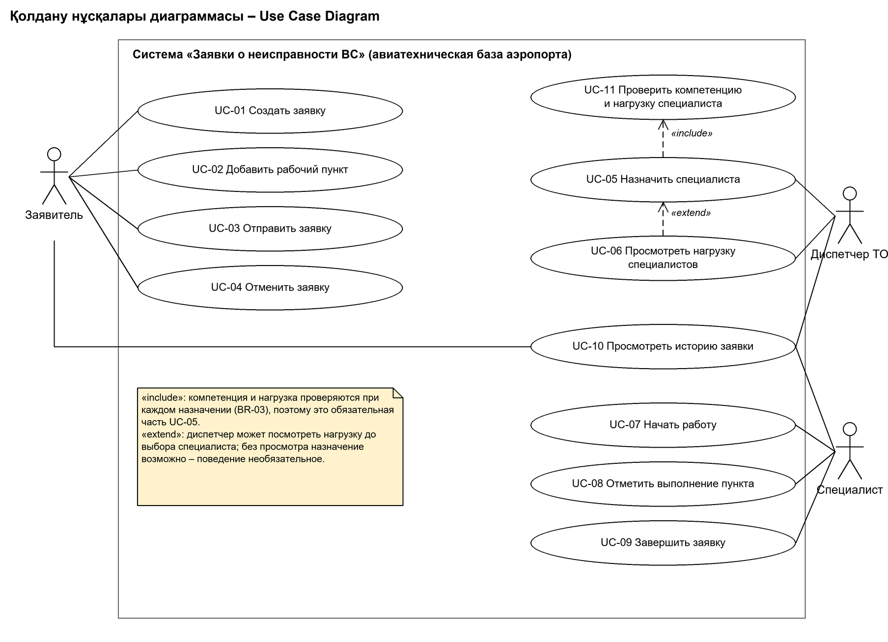
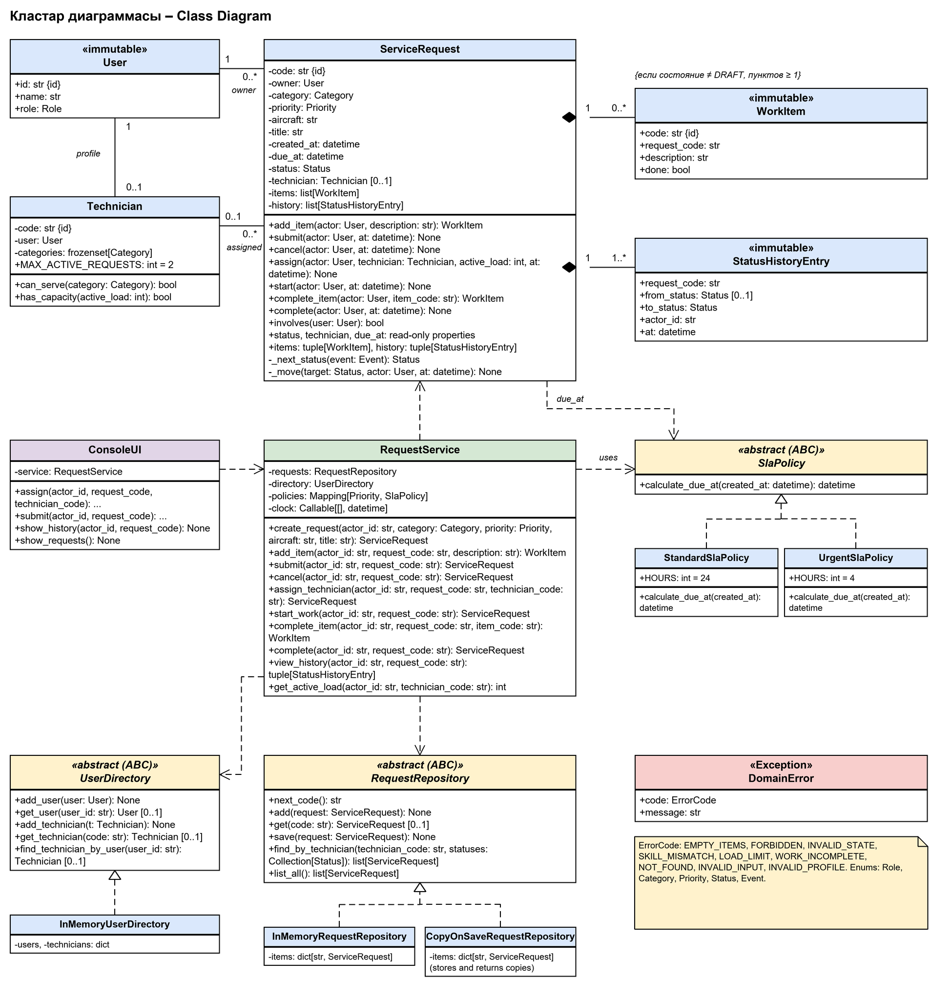
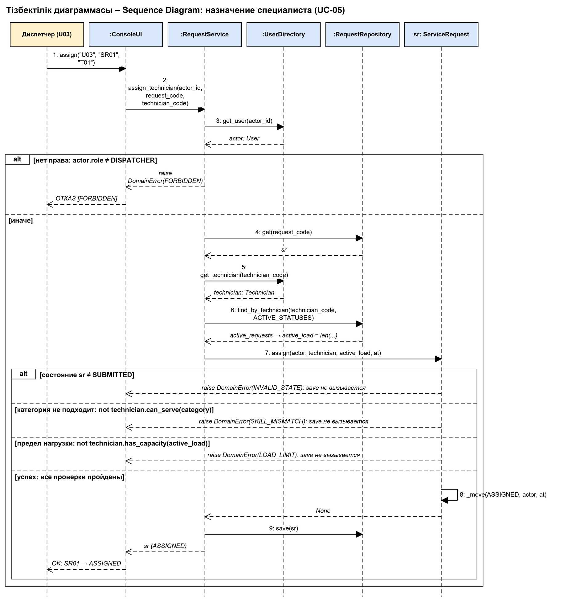
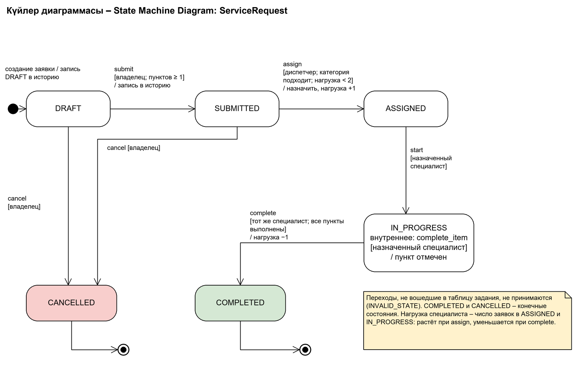

# Практическая работа 9. Проектирование информационной системы объектно-ориентированным подходом

**Дисциплина:** Анализ, моделирование и проектирование информационных систем

**Выполнил:** Маханов Тимур

**Тема (предметная область по теме исследования):** автоматизация технического обслуживания и ремонта воздушных судов. Рассматривается подсистема заявок о неисправности воздушного судна (ВС) авиатехнической базы аэропорта. Вместо «системы управления сервисными заявками» из задания выбрана эта область; роли, коды, числовые данные, состояния, бизнес-правила и проверки TC01-TC12 сохранены без изменений. Соответствие понятий: «Оборудование» – оборудование ВС (планер, двигатели, шасси), «Программное обеспечение» – ПО бортовых систем, «Заявитель» – представитель экипажа или авиакомпании, «Специалист» – авиатехник. Работа учебная, данные искусственные. Исходные файлы: диаграммы – `assets/uml_model.drawio`, генератор – `tools/build_diagrams.py`, программа и проверки – `prototype/`, результаты запусков – `results/`.

## 1. Анализ и определение требований

### 1.1. Организация и границы системы

Условная авиатехническая база аэропорта выполняет техническое обслуживание и ремонт самолётов нескольких авиакомпаний. Когда экипаж или представитель авиакомпании обнаруживает неисправность, например течь гидросистемы, вибрацию двигателя или сбой программного обеспечения системы индикации, он оформляет заявку о неисправности. Диспетчер технического обслуживания получает отправленные заявки и назначает каждую специалисту. Специалист выполняет перечень рабочих пунктов, отмечает их и закрывает заявку. Для каждой заявки важны категория неисправности (оборудование или программное обеспечение), приоритет, который определяет срок завершения, исполнитель и полная история изменений состояния. Диспетчер видит загрузку специалистов, а заявитель следит за своей заявкой по истории её состояний. Все действия выполняются от имени конкретного пользователя, и его роль определяет, что ему разрешено. Специалисты различаются компетенцией и не могут вести больше двух активных заявок одновременно. База работает по одной местной шкале времени. Сроки считаются календарными часами без учёта выходных и графика смен. Склад запасных частей, учёт ресурсов ангара и допуск самолёта к полётам относятся к соседним подсистемам (работы 9 и 10 самостоятельной работы) и в границы этой системы не входят. В границы входят создание и подготовка заявки, назначение, выполнение, завершение или отмена, расчёт срока и ведение истории.

### 1.2. Роли и цели

| Роль (актор) | Пользователи | Цели |
|--------------|------------------------|--------------------------------------------------------------|
| Заявитель | U01, U02 | Зафиксировать неисправность, подготовить перечень работ, отправить или отменить заявку, видеть её историю |
| Диспетчер ТО | U03 | Назначить заявке подходящего и не перегруженного специалиста, видеть нагрузку специалистов |
| Специалист | U04 (профиль T01, оборудование), U05 (профиль T02, оборудование и ПО) | Начать работу, отмечать выполненные пункты, завершить заявку |

### 1.3. Требования

| Код | Функциональное требование |
|-----|-----------------------------------------------------------------------------------------------|
| FR-01 | Заявитель создаёт заявку с указанием борта, категории, приоритета и описания. Заявка получает состояние DRAFT, срок завершения и начальную запись истории |
| FR-02 | Владелец добавляет в заявку рабочие пункты, пока она в состоянии DRAFT |
| FR-03 | Владелец отправляет заявку (SUBMITTED), если в ней есть хотя бы один пункт |
| FR-04 | Владелец отменяет заявку в состоянии DRAFT или SUBMITTED |
| FR-05 | Диспетчер назначает специалиста заявке в состоянии SUBMITTED, если категория подходит и активных заявок у специалиста меньше двух |
| FR-06 | Назначенный специалист начинает работу (IN_PROGRESS) |
| FR-07 | Назначенный специалист отмечает выполнение рабочего пункта в состоянии IN_PROGRESS |
| FR-08 | Назначенный специалист завершает заявку (COMPLETED), если все пункты выполнены |
| FR-09 | Участник заявки или диспетчер просматривает историю изменений состояния |
| FR-10 | Срок завершения вычисляется по приоритету от момента создания: STANDARD – 24 часа, URGENT – 4 часа |
| FR-11 | Диспетчер просматривает активную нагрузку специалиста |

| Код | Нефункциональное требование и способ проверки |
|-----|-----------------------------------------------------------------------------------------------|
| NFR-01 | Неизменность данных при отказе: после любого отклонённого действия не меняются состояние, исполнитель, пункты, история, срок и нагрузка. Проверка: снимок всех данных до и после действия сравнивается в каждом отказном сценарии |
| NFR-02 | Расширяемость: новая политика срока подключается без изменения `domain.py` и `service.py`; не более четырёх изменённых файлов кода; все прежние проверки проходят. Проверка: сравнение файлов до и после изменения (раздел 7) |
| NFR-03 | Воспроизводимость: исходные данные создаются только операциями сервиса, повторная загрузка даёт одинаковый результат, время задаётся часами. Проверка: сравнение снимков двух загрузок (`TrainingData`) |

Бизнес-правила BR-01 – BR-08 соответствуют правилам из задания в том же порядке (редактирование только в DRAFT и минимум один пункт; отправка и отмена владельцем; назначение диспетчером с проверкой категории и нагрузки; начало и отметка пунктов назначенным специалистом; завершение после выполнения всех пунктов; конечные состояния; одна запись истории на переход и отсутствие побочных эффектов при отказе; сроки 24 и 4 часа). Ниже показано, где каждое правило реализовано.

| Правило | Где реализовано | Проверка |
|--------|--------------------------------------------------------------|------------------------------|
| BR-01 | `ServiceRequest.add_item` (только DRAFT), `ServiceRequest.submit` (EMPTY_ITEMS), неизменяемый `WorkItem` | TC01, TC02, `test_items_are_frozen_after_submit` |
| BR-02 | `_require_owner` в `submit`, `cancel`; таблица переходов `_TRANSITIONS` | TC10 |
| BR-03 | `RequestService.assign_technician` (роль, расчёт нагрузки), `ServiceRequest.assign` (состояние), `Technician.can_serve`, `Technician.has_capacity` | TC03, TC04, TC05, TC11 |
| BR-04 | `_require_assignee` в `start` и `complete_item` | TC06, TC07 |
| BR-05 | `ServiceRequest.complete` (WORK_INCOMPLETE) | TC08, TC09 |
| BR-06 | В `_TRANSITIONS` нет переходов из COMPLETED и CANCELLED | TC09 (повтор), `test_final_states_stay_final` |
| BR-07 | `_move` – единственное место изменения состояния, добавляет ровно одну запись; все проверки выполняются до изменения | все отказные TC, NFR-01 |
| BR-08 | `SlaPolicy.calculate_due_at`, `StandardSlaPolicy`, `UrgentSlaPolicy` | TC12 |

### 1.4. Словарь объектов предметной области

| Понятие | Тождественность | Состояние | Поведение |
|----------------|--------------------|--------------------------------|--------------------------------|
| Заявка (ServiceRequest) | Код (SR01) | Статус, категория, приоритет, борт, срок, исполнитель, пункты, история | Отправиться, отмениться, получить исполнителя, начаться, завершиться, отметить пункт |
| Рабочий пункт (WorkItem) | Код в пределах заявки (SR01-W1) | Описание, признак выполнения | Быть отмеченным выполненным (только через заявку) |
| Пользователь (User) | Идентификатор (U01) | Имя, роль | Нет собственного поведения, участвует в проверке прав |
| Профиль специалиста (Technician) | Код (T01) | Пользователь, категории, предел активных заявок (2) | Сообщить, обслуживает ли он категорию и есть ли у него место для заявки |
| Запись истории (StatusHistoryEntry) | Заявка и порядковое место в ней | Прежнее и новое состояние, пользователь, время | Не изменяется после создания |
| Срок завершения | По значению (момент времени) | Момент, вычисленный по приоритету | Вычисляется политикой от времени создания |

### 1.5. CRC-описания

| Класс | Обязанности | Взаимодействует с |
|--------------|--------------------------------------------------------|------------------------------|
| ServiceRequest | Хранит состояние, пункты, историю и исполнителя; проверяет допустимость перехода, владельца и исполнителя, наличие пунктов и их выполнение; записывает историю | User, Technician, WorkItem, StatusHistoryEntry, SlaPolicy |
| WorkItem | Хранит описание и признак выполнения; принадлежит одной заявке; не изменяется на месте | ServiceRequest |
| Technician | Знает категории и предел активных заявок; отвечает на вопросы «обслуживает ли категорию», «есть ли место» | User, ServiceRequest |
| RequestService | Определяет пользователя, проверяет роль, собирает данные других объектов (активную нагрузку), вызывает операцию заявки, сохраняет результат | RequestRepository, UserDirectory, SlaPolicy, ServiceRequest |
| SlaPolicy | Вычисляет срок завершения по времени создания (контракт, реализуемый разными политиками) | ServiceRequest, RequestService |

**Понятие анализа и программный сервис на примере назначения.** «Назначение заявки специалисту» в анализе – событие предметной области: диспетчер связывает заявку и специалиста, при этом должны выполняться условия BR-03. У события нет собственной программной структуры, оно описывается как переход заявки из SUBMITTED в ASSIGNED. Программный сервис `RequestService.assign_technician` – отдельный элемент проекта: он не существует в предметной области, а координирует работу (определяет пользователя, проверяет роль, считает нагрузку по хранилищу, вызывает `ServiceRequest.assign`, сохраняет). Аналогично «нагрузка специалиста» в анализе – понятие (число активных заявок), а в программе – не класс и не поле, а результат запроса к репозиторию.

## 2. Моделирование вариантов использования

{width=16cm}

Диаграмма содержит три актора, одиннадцать вариантов использования и границу системы; цели пользователей выражены ассоциациями. Связь «include» от UC-05 к UC-11 выбрана потому, что проверка категории и нагрузки обязательна при каждом назначении (BR-03) и составляет часть сценария. Связь «extend» от UC-06 к UC-05 отражает необязательное поведение: диспетчер может посмотреть нагрузку до выбора специалиста, но назначение возможно и без этого. Остальные проверки (владелец, исполнитель, состояние) отдельными вариантами не оформлены.

**Сценарий «Назначение специалиста» (UC-05)**

| Элемент | Описание |
|----------------|------------------------------------------------------------------------------------|
| Актор | Диспетчер ТО (U03) |
| Предусловие | Диспетчер зарегистрирован с ролью DISPATCHER; заявка существует и находится в состоянии SUBMITTED; профиль специалиста зарегистрирован |
| Инициирующее событие | Диспетчер выбирает заявку и специалиста и подаёт команду «назначить» |
| Основные шаги | 1. Система определяет пользователя и проверяет его роль. 2. Загружает заявку и профиль специалиста. 3. (По желанию, UC-06) диспетчер видит нагрузку. 4. Система вычисляет активную нагрузку специалиста по хранилищу. 5. Заявка проверяет состояние, категорию (UC-11) и нагрузку (меньше двух). 6. Заявка запоминает исполнителя, переходит в ASSIGNED и записывает историю. 7. Система сохраняет заявку и сообщает об успехе |
| Альтернативные ветви | 1а. Роль не DISPATCHER – FORBIDDEN. 2а. Заявка или специалист не найдены – NOT_FOUND. 5а. Заявка не в SUBMITTED – INVALID_STATE. 5б. **Несоответствие компетенции:** категория заявки не входит в категории специалиста – SKILL_MISMATCH, диспетчер выбирает другого специалиста. 5в. **Достигнут предел нагрузки:** у специалиста уже две активные заявки – LOAD_LIMIT, диспетчер выбирает другого специалиста или ждёт завершения его заявки |
| Постусловие | Успех: заявка в ASSIGNED, исполнитель назначен, в истории новая запись SUBMITTED – ASSIGNED, нагрузка специалиста увеличилась на 1. Отказ: данные не изменились |

**Сценарий «Завершение заявки» (UC-09)**

| Элемент | Описание |
|----------------|------------------------------------------------------------------------------------|
| Актор | Специалист, назначенный на заявку (например, U04 для SR01) |
| Предусловие | Заявка находится в состоянии IN_PROGRESS; пользователь является её назначенным специалистом |
| Инициирующее событие | Специалист подаёт команду «завершить заявку» |
| Основные шаги | 1. Система определяет пользователя и загружает заявку. 2. Заявка проверяет, что пользователь – назначенный специалист. 3. Проверяет, что переход «complete» допустим из текущего состояния. 4. Проверяет, что все рабочие пункты выполнены. 5. Заявка переходит в COMPLETED и записывает историю. 6. Система сохраняет заявку, нагрузка специалиста уменьшается |
| Альтернативные ветви | 2а. Пользователь не назначенный специалист – FORBIDDEN. 3а. Заявка не в IN_PROGRESS, в том числе повторное завершение – INVALID_STATE. 4а. **Работа выполнена не полностью:** есть невыполненные пункты – WORK_INCOMPLETE; специалист отмечает оставшиеся пункты (UC-08) и повторяет команду |
| Постусловие | Успех: заявка в COMPLETED (конечное состояние), в истории запись IN_PROGRESS – COMPLETED, нагрузка специалиста уменьшилась на 1, ссылка на исполнителя сохранена. Отказ: данные не изменились |

## 3. Проектирование классов и интерфейсов



**Словарь классов и контрактов**

| Элемент | Вид | Основная ответственность |
|------------------------------|----------------|------------------------------------------------------|
| ServiceRequest | Класс | Хранить состояние заявки и обеспечивать допустимые переходы, пункты и историю |
| WorkItem | Неизменяемый класс | Описание одного рабочего пункта и признак выполнения |
| StatusHistoryEntry | Неизменяемый класс | Одна запись истории: переход, пользователь, время |
| User | Неизменяемый класс | Идентификатор и роль пользователя |
| Technician | Класс | Категории специалиста и предел активных заявок |
| RequestService | Класс-сервис | Координировать сценарий: пользователь, роль, нагрузка, вызов операции, сохранение |
| SlaPolicy | Абстрактный класс (ABC) | Контракт расчёта срока `calculate_due_at(created_at)` |
| StandardSlaPolicy, UrgentSlaPolicy | Реализации контракта | Срок +24 часа и +4 часа |
| RequestRepository | Абстрактный класс (ABC) | Контракт хранения заявок |
| InMemoryRequestRepository, CopyOnSaveRequestRepository | Реализации контракта | Хранение заявок в памяти по ссылке и по значению |
| UserDirectory, InMemoryUserDirectory | Контракт и реализация | Хранение пользователей и профилей специалистов |
| DomainError (ErrorCode) | Исключение | Единообразный отказ с одним из девяти кодов |
| ConsoleUI | Класс интерфейса | Вызывать сервис и выводить результат, без проверки правил |

Атрибуты, типы, параметры, результаты и области видимости показаны на диаграмме. Закрытые атрибуты (`-`) недоступны снаружи: состояние, исполнитель, пункты и история читаются через свойства, `items` и `history` возвращают кортежи, а `WorkItem` и `StatusHistoryEntry` неизменяемы. Состояние меняет только закрытый метод `_move`, он же добавляет запись истории. Контракты оформлены как ABC, поэтому на диаграмме они помечены «abstract (ABC)».

**Связи и кратности**

| Связь | Кратность | Обоснование |
|----------------------|---------|---------------------------------------------------------------------|
| User – ServiceRequest (владелец) | 1 к 0..\* | Заявитель может не иметь заявок или иметь много, у заявки ровно один владелец. Ассоциация: пользователь существует независимо от заявки |
| User – Technician (профиль) | 1 к 0..1 | Профиль связан с одним пользователем, у пользователя не больше одного профиля. Технически уникальность профиля проверяет сервис при регистрации. Наследование не применено: специалист – роль и профиль пользователя, а не его подтип |
| Technician – ServiceRequest (исполнитель) | 0..1 к 0..\* | У заявки исполнитель появляется при назначении и сохраняется как историческая ссылка после COMPLETED. Предел двух активных заявок **не** выражен кратностью: он зависит от состояния заявок и задан правилом `Technician.has_capacity` |
| ServiceRequest ◆ WorkItem | 1 к 0..\* | Композиция: пункт создаётся, живёт и исчезает вместе с заявкой и принадлежит только ей (код пункта содержит код заявки). В DRAFT пунктов может быть 0, ограничение «в отправленной заявке не меньше одного» зависит от состояния и проверяется в `submit` |
| ServiceRequest ◆ StatusHistoryEntry | 1 к 1..\* | Композиция: запись относится к одной заявке (`request_code`). Не меньше одной записи всегда, потому что DRAFT регистрируется при создании |
| Зависимости RequestService и ServiceRequest от SlaPolicy | – | Политика передаётся как зависимость: `RequestService` хранит отображение «приоритет – политика», а заявка при создании получает объект политики |
| Реализация контрактов | – | Обобщение (реализация интерфейса) применено только там, где варианты взаимозаменяемы: политики срока, репозитории. Между доменными классами наследования нет |

**Что проверяет доменный объект, а что сервис.** Доменный объект проверяет правила, которые зависят только от него самого и переданных ему фактов: допустимость перехода (`_TRANSITIONS`), владельца и назначенного исполнителя, наличие пунктов (EMPTY_ITEMS), выполнение пунктов (WORK_INCOMPLETE), соответствие категории (`Technician.can_serve`) и предел нагрузки (`Technician.has_capacity`). Сервис проверяет то, что заявка знать не может: существование пользователя, заявки и специалиста (NOT_FOUND), роль пользователя (права диспетчера, права заявителя), и собирает факты о других объектах – активную нагрузку по репозиторию. Предел нагрузки сформулирован в `Technician`, но число активных заявок знает только сервис, поэтому оно передаётся в `ServiceRequest.assign` параметром `active_load`.

## 4. Моделирование поведения объектов



Операции на диаграмме последовательности совпадают с классами (`RequestService.assign_technician`, `UserDirectory.get_user`, `get_technician`, `RequestRepository.get`, `find_by_technician`, `save`, `ServiceRequest.assign`, `Technician.can_serve`, `has_capacity`) и с методами кода. Ветви alt охватывают отсутствие права, несоответствие категории, предел нагрузки и успешное назначение; добавлена ветвь INVALID_STATE, так как это отдельный отказ с более высоким приоритетом проверки, чем категория.

{width=16cm}

Диаграмма состояний содержит ровно переходы из таблицы задания: submit, cancel (из DRAFT и SUBMITTED), assign, start, complete. Отметка пункта `complete_item` показана как внутреннее действие IN_PROGRESS: состояние заявки она не меняет и запись истории не добавляет, поэтому заявку не завершает. Переходы, не вошедшие в таблицу, отклоняются с INVALID_STATE (в коде таблица `_TRANSITIONS`).

**Нагрузка специалиста.** Активными считаются заявки в ASSIGNED и IN_PROGRESS (`ACTIVE_STATUSES`). Нагрузка растёт при переходе в ASSIGNED и уменьшается при переходе в COMPLETED, так как выйти из активных состояний можно только через COMPLETED: отмена из ASSIGNED запрещена, переназначения нет. Начало работы (ASSIGNED – IN_PROGRESS) нагрузку не меняет. Отдельное число нигде не хранится: `get_active_load` вычисляет её запросом `find_by_technician(code, ACTIVE_STATUSES)`, поэтому расхождение с заявками невозможно по построению (проверка `test_load_equals_value_computed_from_requests` сравнивает её с независимым подсчётом после каждого шага).

**Пред- и постусловия операций**

| Операция | Предусловие | Постусловие |
|----------------------|----------------------------------|--------------------------------------------|
| `ServiceRequest.assign(actor, technician, active_load, at)` | Роль диспетчера проверена сервисом; состояние SUBMITTED; `technician.can_serve(category)`; `active_load` < 2 | Состояние ASSIGNED; `technician` = назначенный; в истории одна новая запись (SUBMITTED – ASSIGNED, actor, at); нагрузка специалиста выросла на 1. При отказе (INVALID_STATE, SKILL_MISMATCH, LOAD_LIMIT) объект не изменён |
| `ServiceRequest.complete(actor, at)` | `actor` – назначенный специалист; состояние IN_PROGRESS; все пункты выполнены | Состояние COMPLETED; в истории одна новая запись (IN_PROGRESS – COMPLETED, actor, at); нагрузка специалиста уменьшилась на 1; ссылка на исполнителя сохранена. При отказе (FORBIDDEN, INVALID_STATE, WORK_INCOMPLETE) объект не изменён |

## 5. Объектно-ориентированный прототип

Прототип написан на Python 3.11 (стандартная библиотека). Слои разделены: интерфейс (`console.py`) только вызывает сервис и печатает; бизнес-логика – `domain.py`, `service.py`, `sla.py`; хранение – контракты и реализации в `repository.py`. Реализованы операции: создание заявки, добавление пункта, отправка, назначение, начало работы, выполнение пункта, завершение, отмена, просмотр истории. Идентификатор пользователя передаётся в операцию, роль берётся из справочника по этому идентификатору, поэтому заявленная роль не может расходиться с зарегистрированной (вход по паролю в этой версии не нужен).

**Порядок проверок при нарушении нескольких условий.** Во всех операциях: NOT_FOUND – FORBIDDEN (сначала роль, затем владелец или исполнитель) – INVALID_STATE – условия операции (EMPTY_ITEMS; SKILL_MISMATCH, затем LOAD_LIMIT; WORK_INCOMPLETE). Так, в TC04 специалист T01 одновременно не подходит по категории и уже имеет две заявки, и возвращается SKILL_MISMATCH. Все условия проверяются до изменения объекта, поэтому после неудачного действия состояние сохраняется полностью (NFR-01). Для TC08 введена доменная ошибка WORK_INCOMPLETE, она же показана в моделях.

**Сроки.** `ServiceRequest` не содержит ветвления по виду политики (проверка `test_request_does_not_branch_on_policy_kind`): объект политики передаётся в конструктор, а выбор по приоритету выполнен в `config.default_policies()`. SR01 (STANDARD) создана 16.11.2026 09:00 и должна быть завершена к 17.11.2026 09:00; SR02 (URGENT) создана в 09:30 и должна быть завершена к 16.11.2026 13:30. Срочная заявка, созданная на 30 минут позже, получила срок на 19 часов 30 минут раньше: политика прибавляет 4 часа вместо 24, а остальной код тот же.

**Хранение.** Реализованы `InMemoryRequestRepository` (объекты хранятся по ссылке) и `CopyOnSaveRequestRepository` (объекты сохраняются и выдаются копиями, как строки базы данных). Все сценарии TC01-TC12 выполняются на обоих, а файлы `domain.py` и `service.py` для этого не менялись.

**Начальные данные** создаёт `seed.py` только операциями сервиса (создание, добавление пунктов, отправка, назначение, начало работы), поэтому правила не обходятся. SR01-SR04 получают двух пользователей-заявителей, диспетчера и двух специалистов; в SR01, SR02, SR04 по два невыполненных пункта (`SR01-W1`, `SR01-W2` и т. д.), в SR03 пунктов нет. История SR04: DRAFT (U02, 10:00), SUBMITTED (U02, 10:06), ASSIGNED (U03, 10:15), IN_PROGRESS (U04, 10:30).

**Запуск** (из папки `prototype`; Python 3.11.9, только стандартная библиотека; диаграммам нужен Pillow 13.0.0, отчёту – pypandoc_binary 1.12 и python-docx 1.2.0):

```
python demo.py                          # демонстрация на исходных данных
python run_tests.py --save ../results   # автоматические проверки и таблица результатов
python -m unittest discover -s tests -t .
```

Полный вывод `demo.py` приведён в приложении Б. Основные операции в нём: корректное назначение SR01 специалисту T01 (нагрузка T01 становится 2), отклонённое назначение SR02 специалисту T01 (SKILL_MISMATCH, данные и нагрузка не изменились), цепочка «начало – завершение» с отказами FORBIDDEN, WORK_INCOMPLETE и повторным INVALID_STATE, смена политики срока и смена хранилища.

## 6. Проверка программы и согласованности моделей

Автоматические проверки (`unittest`) разделены на цепочки: TC01-TC02 – одна цепочка (общие данные, метод `setUpClass`), TC03-TC09 – вторая, TC10-TC12 создают независимые исходные данные в `setUp` каждой проверки. Предпосылки: исходные данные раздела 5 (для TC10 и TC11 заявка SR03 предварительно получает пункт и отправляется; в TC11 специалисту T02 сначала назначаются SR02 и SR01). Каждый отказ проверяется равенством снимка всех данных (состояние, исполнитель, пункты, история, срок и нагрузка обоих специалистов) до и после действия. Все сценарии повторены на втором хранилище. Всего выполнено 44 проверки (12 сценариев TC, их повтор на втором хранилище, 17 проверок проекта и правил, 3 проверки политик срока), все пройдены; полный журнал – в приложении В.

<!-- BEGIN-MD results/test_results.md -->

| Код | Действие проверки | Ожидаемый результат | Фактический результат | Пройден |
|----|--------|--------|----------|----|
| TC01 | U01 отправляет пустую заявку SR03 | EMPTY_ITEMS, сохраняются состояние DRAFT и история | EMPTY_ITEMS; состояние DRAFT; записей истории 1 | пройден |
| TC02 | U01 добавляет пункт в SR03 и отправляет | SUBMITTED, в истории один новый переход | SUBMITTED; записей истории 1 -> 2 (новая: DRAFT -> SUBMITTED, U01) | пройден |
| TC03 | U03 назначает SR01 специалисту T01 | ASSIGNED, активная нагрузка T01 равна 2 | ASSIGNED; нагрузка T01 = 2 | пройден |
| TC04 | U03 назначает SR02 специалисту T01 | SKILL_MISMATCH, изменений нет | SKILL_MISMATCH; SR02 остаётся SUBMITTED, изменений нет | пройден |
| TC05 | U03 назначает SR02 специалисту T02 | ASSIGNED, активная нагрузка T02 равна 1 | ASSIGNED; нагрузка T02 = 1 | пройден |
| TC06 | U05 начинает работу над SR01 | FORBIDDEN, изменений нет | FORBIDDEN; SR01 остаётся ASSIGNED, изменений нет | пройден |
| TC07 | U04 начинает работу над SR01 | IN_PROGRESS, нагрузка прежняя: 2 | IN_PROGRESS; нагрузка T01 = 2 | пройден |
| TC08 | U04 завершает SR01, не выполнив пункты | Отказ (WORK_INCOMPLETE), состояние и история сохраняются | WORK_INCOMPLETE; SR01 остаётся IN_PROGRESS, записей в истории 4, без изменений | пройден |
| TC09 | U04 выполняет все пункты и завершает SR01; затем завершает повторно | Первое – COMPLETED, нагрузка 1; второе – INVALID_STATE, история не растёт | 1-е: COMPLETED, нагрузка T01 = 1; 2-е: INVALID_STATE, записей в истории 5, без роста | пройден |
| TC10 | Сначала U02, затем U01 отменяет отправленную SR03 | Первое – FORBIDDEN; действие владельца – CANCELLED | U02: FORBIDDEN; U01: CANCELLED, в истории +1 запись | пройден |
| TC11 | Специалисту T02 с двумя активными заявками назначается третья | LOAD_LIMIT, нагрузка остаётся 2 | LOAD_LIMIT; нагрузка T02 = 2 | пройден |
| TC12 | Через один контракт вызываются две политики срока | Для STANDARD прибавляется 24 часа, для URGENT – 4 часа | STANDARD +24 ч; URGENT +4 ч; SR01 срок 17.11 09:00, SR02 срок 16.11 13:30 | пройден |

<!-- END -->

**Прослеживаемость требований**

| Требование | Вариант использования | Операция класса | Шаг динамической диаграммы | Проверка |
|--------|-----------------|-------------------------|---------------------------------|-----------------|
| FR-03 | UC-03 Отправить заявку | `ServiceRequest.submit` | Диаграмма состояний: переход submit DRAFT – SUBMITTED | TC01, TC02 |
| FR-05 | UC-05 Назначить специалиста | `RequestService.assign_technician`, `ServiceRequest.assign` | Диаграмма последовательности: шаги 3, 6, 7 и ветви alt | TC03, TC04, TC05, TC11 |
| FR-06 | UC-07 Начать работу | `ServiceRequest.start` | Диаграмма состояний: переход start ASSIGNED – IN_PROGRESS | TC06, TC07 |
| FR-08 | UC-09 Завершить заявку | `ServiceRequest.complete` | Диаграмма состояний: переход complete IN_PROGRESS – COMPLETED | TC08, TC09 |
| FR-04 | UC-04 Отменить заявку | `ServiceRequest.cancel` | Диаграмма состояний: переходы cancel | TC10 |
| FR-10 | UC-01 Создать заявку | `SlaPolicy.calculate_due_at` | Диаграмма состояний: начальный переход (создание) | TC12 |

## 7. Внесение изменения и защита проектного решения

Добавлена политика `AcceleratedSlaPolicy` (8 календарных часов), подключённая через тот же контракт `SlaPolicy`. Подробный список различий – в `results/change_diff.txt`.

| Файл | Изменение |
|----------------------------|------------------------------------------------------------------------|
| `mro_requests/sla.py` | Новый класс `AcceleratedSlaPolicy` с методом `calculate_due_at` (7 строк) |
| `mro_requests/enums.py` | Новое значение приоритета `ACCELERATED` (1 строка) |
| `mro_requests/config.py` | Импорт новой политики и строка `Priority.ACCELERATED: AcceleratedSlaPolicy()` в `default_policies` (2 строки) |
| `tests/test_sla.py` | Новый файл с тремя проверками: три политики через один контракт, срок 8 часов в реальной заявке, наличие политики для каждого приоритета |

Файлы `domain.py`, `service.py`, `repository.py`, `errors.py` и `clock.py` не изменились (побайтовое сравнение с версией до изменения). Логику смены состояний менять не потребовалось: `ServiceRequest` получает объект политики и вызывает `calculate_due_at`, не зная его вида. После изменения выполнены 44 проверки: 41 прежняя без правок и 3 новые, все пройдены (`results/test_results.txt`).

**Анализ проектного решения.** Инкапсуляция останавливает самую опасную ошибку этой области – обход правил: код вне класса не может присвоить `request.status = COMPLETED`, дописать пункт в отправленную заявку или удалить запись истории. Состояние и коллекции закрыты (`_status`, `_items`, `_history`), свойства только читают, а `items` и `history` отдают кортежи неизменяемых объектов. Единственный путь изменения состояния – метод `_move`, поэтому каждый переход оставляет ровно одну запись (BR-07); проверки `Encapsulation` подтверждают, что присваивание вызывает `AttributeError`. Кроме того, все условия проверяются до первой записи в поля, поэтому неудачное действие не оставляет «наполовину изменённой» заявки; при контрольном отключении записи истории или проверки пунктов в копии кода автоматические проверки падали, то есть защита действительно проверяется тестами. Полиморфизм проявляется в `ServiceRequest.__init__`: вызов `sla_policy.calculate_due_at(created_at)` выполняет разный расчёт для `StandardSlaPolicy`, `UrgentSlaPolicy` и `AcceleratedSlaPolicy` без цепочки if, а выбор политики сосредоточен в `config.default_policies`; тот же приём применён к `RequestRepository`. Композицию `ServiceRequest` – `WorkItem` нельзя заменить наследованием: заявка не является пунктом и не является списком пунктов, она владеет ими. Пункт без заявки не имеет смысла, его жизненный цикл и код определяет заявка, а ограничение «после отправки не меньше одного пункта» зависит от состояния заявки; при наследовании эти связи пришлось бы выражать иначе и потерять контроль заявки над составом пунктов. Отличия модели анализа от программной: (1) в анализе «нагрузка специалиста» и «назначение» – понятия предметной области, а в программе нагрузка не хранится ни в одном классе и вычисляется сервисом по репозиторию, а назначение реализовано сервисом `RequestService`, которого нет в предметной области; (2) в программной модели появились элементы, не существующие в анализе: контракты `RequestRepository`, `UserDirectory`, `SlaPolicy`, часы, коды ошибок и интерфейс; (3) связь «заявка состоит из пунктов» в анализе – один факт, а в коде – закрытый список, неизменяемые объекты, кортежи для чтения и код пункта с кодом заявки.

## Заключение

Подсистема заявок спроектирована и реализована как согласованный набор правил, четырёх UML-диаграмм, программных классов и автоматических проверок. Правила состояния и допустимости переходов размещены в доменном объекте, сценарная координация, роль и расчёт нагрузки – в сервисе, хранение и расчёт срока спрятаны за контрактами. Это подтвердили 44 пройденные проверки и изменение с новой политикой срока, не затронувшее `domain.py` и `service.py`. Ограничения учебной версии: данные хранятся в памяти, входа по паролю нет, переназначение и повторное открытие заявок не поддерживаются, срок считается календарными часами, а русские и казахские названия диаграмм следует сверить с терминологией кафедры.

## Ответы на вопросы для защиты

**1. Как заданы тождественность, состояние и поведение объекта заявки?** Тождественность – код заявки (`SR01`): он задаётся при создании, закрыт от изменения, и две заявки с одинаковыми данными остаются разными объектами. Состояние – закрытые поля `_status`, `_technician`, `_items`, `_history`, `_due_at` и неизменные данные создания. Поведение – операции `add_item`, `submit`, `cancel`, `assign`, `start`, `complete_item`, `complete`, каждая из которых проверяет условия и меняет состояние только через `_move`.

**2. Какое правило проверяет ServiceRequest, какое – RequestService и почему?** `ServiceRequest` проверяет то, что зависит от неё самой: допустимость перехода по таблице `_TRANSITIONS`, владельца и назначенного исполнителя, наличие пунктов (EMPTY_ITEMS), выполнение пунктов (WORK_INCOMPLETE), а через `Technician` – категорию и предел нагрузки. `RequestService` проверяет роль (права диспетчера и заявителя), существование пользователя, заявки и специалиста (NOT_FOUND) и считает активную нагрузку по репозиторию, потому что отдельная заявка не видит чужих заявок и не знает о хранилище.

**3. Почему нельзя изменять состояние заявки напрямую извне?** Присваивание `request.status = COMPLETED` обошло бы проверку прав, таблицу переходов, проверку пунктов и запись истории, и заявка оказалась бы в состоянии, в которое по правилам прийти нельзя. Поэтому поля закрыты, свойства только читают, а единственная точка изменения – `_move`, добавляющий ровно одну запись истории (проверки `Encapsulation` подтверждают, что присваивание вызывает `AttributeError`).

**4. Как композиция на диаграмме реализована в коде?** Список пунктов `_items` и список истории `_history` создаются в конструкторе `ServiceRequest`, закрыты и отдаются наружу только кортежами неизменяемых объектов. Пункт не существует без заявки: его код содержит код заявки (`SR01-W1`), в нём хранится `request_code`, создаёт и заменяет пункты только сама заявка, а при копировании заявки (`CopyOnSaveRequestRepository`) пункты и история копируются вместе с ней.

**5. Какой контракт использовался без изменений при добавлении третьей политики?** Контракт `SlaPolicy` с операцией `calculate_due_at(created_at)`. `AcceleratedSlaPolicy` его реализовала, а файлы `domain.py` и `service.py` остались прежними; добавились только класс, значение приоритета и строка в `config.default_policies`.

**6. Как вы докажете, что неудачное действие не повлияло на данные?** В каждом отказном сценарии (TC01, TC04, TC06, TC08, TC09, TC10, TC11 и дополнительных проверках) снимок состояния, исполнителя, пунктов, истории, срока и нагрузки обоих специалистов сравнивается до и после действия и должен совпасть. Это возможно потому, что все условия проверяются до первого изменения полей; в контрольной копии кода, где состояние менялось до проверки, проверки падали.

## Приложение А. Исходный код программы

<!-- BEGIN-FILE prototype/mro_requests/enums.py -->

**prototype/mro_requests/enums.py**

~~~
"""Enumerations of the domain: roles, categories, priorities, states and events."""

from enum import Enum


class Role(str, Enum):
    APPLICANT = "APPLICANT"      # creates and views own requests
    DISPATCHER = "DISPATCHER"    # assigns technicians, views load
    TECHNICIAN = "TECHNICIAN"    # performs the work


class Category(str, Enum):
    EQUIPMENT = "EQUIPMENT"      # aircraft equipment: airframe, engines, landing gear
    SOFTWARE = "SOFTWARE"        # software of on-board systems


class Priority(str, Enum):
    STANDARD = "STANDARD"
    URGENT = "URGENT"
    ACCELERATED = "ACCELERATED"


class Status(str, Enum):
    DRAFT = "DRAFT"
    SUBMITTED = "SUBMITTED"
    ASSIGNED = "ASSIGNED"
    IN_PROGRESS = "IN_PROGRESS"
    COMPLETED = "COMPLETED"
    CANCELLED = "CANCELLED"


class Event(str, Enum):
    SUBMIT = "submit"
    CANCEL = "cancel"
    ASSIGN = "assign"
    START = "start"
    COMPLETE = "complete"


# A request counts towards the technician's load only in these states (BR-03).
ACTIVE_STATUSES = frozenset({Status.ASSIGNED, Status.IN_PROGRESS})
~~~

<!-- END -->

<!-- BEGIN-FILE prototype/mro_requests/errors.py -->

**prototype/mro_requests/errors.py**

~~~
"""Uniform domain errors: every rejected action raises DomainError with one ErrorCode."""

from enum import Enum


class ErrorCode(str, Enum):
    EMPTY_ITEMS = "EMPTY_ITEMS"          # submit without work items
    FORBIDDEN = "FORBIDDEN"              # the user may not perform the action
    INVALID_STATE = "INVALID_STATE"      # the transition is not in the state table
    SKILL_MISMATCH = "SKILL_MISMATCH"    # technician does not serve the category
    LOAD_LIMIT = "LOAD_LIMIT"            # technician already has the maximum of active requests
    WORK_INCOMPLETE = "WORK_INCOMPLETE"  # complete while some work items are not done
    NOT_FOUND = "NOT_FOUND"              # unknown user, technician, request or work item
    INVALID_INPUT = "INVALID_INPUT"      # empty text, unknown priority, duplicate id
    INVALID_PROFILE = "INVALID_PROFILE"  # wrong technician profile (role, categories, duplicate)


class DomainError(Exception):
    """Business-rule violation. The object that raised it has not been changed."""

    def __init__(self, code: ErrorCode, message: str) -> None:
        super().__init__(f"{code.value}: {message}")
        self.code = code
        self.message = message
~~~

<!-- END -->

<!-- BEGIN-FILE prototype/mro_requests/sla.py -->

**prototype/mro_requests/sla.py**

~~~
"""SLA policies: how the due date of a request is calculated.

All policies implement one contract (SlaPolicy). ServiceRequest and RequestService
only know the contract; the choice of a concrete policy is made in config.py.
"""

from abc import ABC, abstractmethod
from datetime import datetime, timedelta


class SlaPolicy(ABC):
    """Contract: due date by creation time (calendar hours, no weekends or schedule)."""

    @abstractmethod
    def calculate_due_at(self, created_at: datetime) -> datetime:
        """Return the moment by which the request must be completed."""


class StandardSlaPolicy(SlaPolicy):
    HOURS = 24

    def calculate_due_at(self, created_at: datetime) -> datetime:
        return created_at + timedelta(hours=self.HOURS)


class UrgentSlaPolicy(SlaPolicy):
    HOURS = 4

    def calculate_due_at(self, created_at: datetime) -> datetime:
        return created_at + timedelta(hours=self.HOURS)


class AcceleratedSlaPolicy(SlaPolicy):
    HOURS = 8

    def calculate_due_at(self, created_at: datetime) -> datetime:
        return created_at + timedelta(hours=self.HOURS)
~~~

<!-- END -->

<!-- BEGIN-FILE prototype/mro_requests/domain.py -->

**prototype/mro_requests/domain.py**

~~~
"""Domain objects: User, Technician, WorkItem, StatusHistoryEntry, ServiceRequest.

ServiceRequest owns its state, work items and history. Every public operation first
checks all conditions (in the documented order) and only then changes the object, so a
rejected action leaves the request untouched (BR-07).
"""

from __future__ import annotations

from dataclasses import dataclass, replace
from datetime import datetime
from typing import Iterable, Optional

from .enums import ACTIVE_STATUSES, Category, Event, Priority, Role, Status
from .errors import DomainError, ErrorCode
from .sla import SlaPolicy


@dataclass(frozen=True)
class User:
    id: str
    name: str
    role: Role


@dataclass(frozen=True)
class WorkItem:
    """A work point of a request. Immutable: the request replaces it when it is marked done."""
    code: str
    request_code: str
    description: str
    done: bool = False


@dataclass(frozen=True)
class StatusHistoryEntry:
    """One record of the history. from_status is None for the initial DRAFT record."""
    request_code: str
    from_status: Optional[Status]
    to_status: Status
    actor_id: str
    at: datetime


class Technician:
    """Technician profile: one user, served categories and the active-request limit (BR-03)."""

    MAX_ACTIVE_REQUESTS = 2

    def __init__(self, code: str, user: User, categories: Iterable[Category]) -> None:
        cats = frozenset(categories)
        if user.role is not Role.TECHNICIAN:
            raise DomainError(ErrorCode.INVALID_PROFILE, f"user {user.id} is not a technician")
        if not cats:
            raise DomainError(ErrorCode.INVALID_PROFILE, f"technician {code} serves no category")
        self._code = code
        self._user = user
        self._categories = cats

    @property
    def code(self) -> str:
        return self._code

    @property
    def user(self) -> User:
        return self._user

    @property
    def categories(self) -> frozenset[Category]:
        return self._categories

    def can_serve(self, category: Category) -> bool:
        return category in self._categories

    def has_capacity(self, active_load: int) -> bool:
        return active_load < self.MAX_ACTIVE_REQUESTS


# State table of the request (BR-02..BR-06). Anything not listed is rejected with INVALID_STATE.
_TRANSITIONS: dict[tuple[Status, Event], Status] = {
    (Status.DRAFT, Event.SUBMIT): Status.SUBMITTED,
    (Status.DRAFT, Event.CANCEL): Status.CANCELLED,
    (Status.SUBMITTED, Event.CANCEL): Status.CANCELLED,
    (Status.SUBMITTED, Event.ASSIGN): Status.ASSIGNED,
    (Status.ASSIGNED, Event.START): Status.IN_PROGRESS,
    (Status.IN_PROGRESS, Event.COMPLETE): Status.COMPLETED,
}


class ServiceRequest:
    """A request about an aircraft fault. Identity: code. State: status, items, technician, history."""

    def __init__(self, code: str, owner: User, category: Category, priority: Priority,
                 aircraft: str, title: str, created_at: datetime, sla_policy: SlaPolicy) -> None:
        if owner.role is not Role.APPLICANT:
            raise DomainError(ErrorCode.FORBIDDEN, f"user {owner.id} is not an applicant")
        for name, value in (("aircraft", aircraft), ("title", title)):
            if not value.strip():
                raise DomainError(ErrorCode.INVALID_INPUT, f"{name} must not be empty")
        self._code = code
        self._owner = owner
        self._category = category
        self._priority = priority
        self._aircraft = aircraft
        self._title = title
        self._created_at = created_at
        self._due_at = sla_policy.calculate_due_at(created_at)   # the policy is a dependency
        self._status = Status.DRAFT
        self._technician: Optional[Technician] = None
        self._items: list[WorkItem] = []
        self._history: list[StatusHistoryEntry] = []
        self._history.append(StatusHistoryEntry(code, None, Status.DRAFT, owner.id, created_at))

    # ------------------------------------------------------------------ read access
    @property
    def code(self) -> str:
        return self._code

    @property
    def owner(self) -> User:
        return self._owner

    @property
    def category(self) -> Category:
        return self._category

    @property
    def priority(self) -> Priority:
        return self._priority

    @property
    def aircraft(self) -> str:
        return self._aircraft

    @property
    def title(self) -> str:
        return self._title

    @property
    def created_at(self) -> datetime:
        return self._created_at

    @property
    def due_at(self) -> datetime:
        return self._due_at

    @property
    def status(self) -> Status:
        return self._status

    @property
    def technician(self) -> Optional[Technician]:
        """Executor; kept after COMPLETED as a historical reference."""
        return self._technician

    @property
    def items(self) -> tuple[WorkItem, ...]:
        return tuple(self._items)

    @property
    def history(self) -> tuple[StatusHistoryEntry, ...]:
        return tuple(self._history)

    @property
    def is_active(self) -> bool:
        return self._status in ACTIVE_STATUSES

    def involves(self, user: User) -> bool:
        """True for the owner and for the assigned technician."""
        return user.id == self._owner.id or self._is_assignee(user)

    # ------------------------------------------------------------------ operations
    # Order of checks everywhere: FORBIDDEN -> INVALID_STATE -> operation-specific conditions.

    def add_item(self, actor: User, description: str) -> WorkItem:
        self._require_owner(actor)
        if self._status is not Status.DRAFT:
            raise DomainError(ErrorCode.INVALID_STATE, "items can be added only in DRAFT")
        if not description.strip():
            raise DomainError(ErrorCode.INVALID_INPUT, "item description must not be empty")
        item = WorkItem(f"{self._code}-W{len(self._items) + 1}", self._code, description.strip())
        self._items.append(item)
        return item

    def submit(self, actor: User, at: datetime) -> None:
        self._require_owner(actor)
        target = self._next_status(Event.SUBMIT)
        if not self._items:
            raise DomainError(ErrorCode.EMPTY_ITEMS, "a request without work items cannot be submitted")
        self._move(target, actor, at)

    def cancel(self, actor: User, at: datetime) -> None:
        self._require_owner(actor)
        self._move(self._next_status(Event.CANCEL), actor, at)

    def assign(self, actor: User, technician: Technician, active_load: int, at: datetime) -> None:
        """actor is the dispatcher (the role was checked by the service); active_load is given by it."""
        target = self._next_status(Event.ASSIGN)
        if not technician.can_serve(self._category):
            raise DomainError(ErrorCode.SKILL_MISMATCH,
                              f"technician {technician.code} does not serve {self._category.value}")
        if not technician.has_capacity(active_load):
            raise DomainError(ErrorCode.LOAD_LIMIT,
                              f"technician {technician.code} already has {active_load} active requests")
        self._technician = technician
        self._move(target, actor, at)

    def start(self, actor: User, at: datetime) -> None:
        self._require_assignee(actor)
        self._move(self._next_status(Event.START), actor, at)

    def complete_item(self, actor: User, item_code: str) -> WorkItem:
        """Mark a work item done. This is not a state transition: no history record, no state change."""
        self._require_assignee(actor)
        if self._status is not Status.IN_PROGRESS:
            raise DomainError(ErrorCode.INVALID_STATE, "items can be marked only in IN_PROGRESS")
        for index, item in enumerate(self._items):
            if item.code == item_code:
                if item.done:
                    raise DomainError(ErrorCode.INVALID_STATE, f"item {item_code} is already done")
                done = replace(item, done=True)
                self._items[index] = done
                return done
        raise DomainError(ErrorCode.NOT_FOUND, f"item {item_code} not found in {self._code}")

    def complete(self, actor: User, at: datetime) -> None:
        self._require_assignee(actor)
        target = self._next_status(Event.COMPLETE)
        if not all(item.done for item in self._items):
            raise DomainError(ErrorCode.WORK_INCOMPLETE, "not all work items are done")
        self._move(target, actor, at)

    # ------------------------------------------------------------------ internals
    def _is_assignee(self, user: User) -> bool:
        return self._technician is not None and self._technician.user.id == user.id

    def _require_owner(self, actor: User) -> None:
        if actor.id != self._owner.id:
            raise DomainError(ErrorCode.FORBIDDEN, f"{actor.id} is not the owner of {self._code}")

    def _require_assignee(self, actor: User) -> None:
        if not self._is_assignee(actor):
            raise DomainError(ErrorCode.FORBIDDEN, f"{actor.id} is not the assigned technician of {self._code}")

    def _next_status(self, event: Event) -> Status:
        target = _TRANSITIONS.get((self._status, event))
        if target is None:
            raise DomainError(ErrorCode.INVALID_STATE,
                              f"event '{event.value}' is not allowed in state {self._status.value}")
        return target

    def _move(self, target: Status, actor: User, at: datetime) -> None:
        """The only place where the state changes; always adds exactly one history record (BR-07)."""
        self._history.append(StatusHistoryEntry(self._code, self._status, target, actor.id, at))
        self._status = target

    def __repr__(self) -> str:
        return f"ServiceRequest({self._code}, {self._status.value})"
~~~

<!-- END -->

<!-- BEGIN-FILE prototype/mro_requests/repository.py -->

**prototype/mro_requests/repository.py**

~~~
"""Storage contracts and their in-memory implementations.

The domain and the service know only RequestRepository and UserDirectory. Two implementations
of RequestRepository show that the way of storing can be changed without touching domain rules.
"""

from __future__ import annotations

import copy
from abc import ABC, abstractmethod
from typing import Collection, Optional

from .domain import ServiceRequest, Technician, User
from .enums import Status


class RequestRepository(ABC):
    """Contract for storing requests."""

    @abstractmethod
    def next_code(self) -> str:
        """Code for the next request (no side effects until add is called)."""

    @abstractmethod
    def add(self, request: ServiceRequest) -> None: ...

    @abstractmethod
    def get(self, code: str) -> Optional[ServiceRequest]: ...

    @abstractmethod
    def save(self, request: ServiceRequest) -> None: ...

    @abstractmethod
    def find_by_technician(self, technician_code: str, statuses: Collection[Status]) -> list[ServiceRequest]: ...

    @abstractmethod
    def list_all(self) -> list[ServiceRequest]: ...


class UserDirectory(ABC):
    """Contract for storing users and technician profiles."""

    @abstractmethod
    def add_user(self, user: User) -> None: ...

    @abstractmethod
    def get_user(self, user_id: str) -> Optional[User]: ...

    @abstractmethod
    def add_technician(self, technician: Technician) -> None: ...

    @abstractmethod
    def get_technician(self, code: str) -> Optional[Technician]: ...

    @abstractmethod
    def find_technician_by_user(self, user_id: str) -> Optional[Technician]: ...


class InMemoryRequestRepository(RequestRepository):
    """Keeps the request objects themselves in a dict."""

    def __init__(self) -> None:
        self._items: dict[str, ServiceRequest] = {}

    def next_code(self) -> str:
        return f"SR{len(self._items) + 1:02d}"

    def add(self, request: ServiceRequest) -> None:
        self._items[request.code] = request

    def get(self, code: str) -> Optional[ServiceRequest]:
        return self._items.get(code)

    def save(self, request: ServiceRequest) -> None:
        self._items[request.code] = request

    def find_by_technician(self, technician_code: str, statuses: Collection[Status]) -> list[ServiceRequest]:
        return [r for r in self._items.values()
                if r.technician is not None and r.technician.code == technician_code and r.status in statuses]

    def list_all(self) -> list[ServiceRequest]:
        return list(self._items.values())


class CopyOnSaveRequestRepository(RequestRepository):
    """Stores and returns copies, like a database that hands out rows by value.

    A request changed by the caller but not saved does not reach the storage.
    """

    def __init__(self) -> None:
        self._items: dict[str, ServiceRequest] = {}

    def next_code(self) -> str:
        return f"SR{len(self._items) + 1:02d}"

    def add(self, request: ServiceRequest) -> None:
        self._items[request.code] = copy.deepcopy(request)

    def get(self, code: str) -> Optional[ServiceRequest]:
        stored = self._items.get(code)
        return copy.deepcopy(stored) if stored is not None else None

    def save(self, request: ServiceRequest) -> None:
        self._items[request.code] = copy.deepcopy(request)

    def find_by_technician(self, technician_code: str, statuses: Collection[Status]) -> list[ServiceRequest]:
        return [copy.deepcopy(r) for r in self._items.values()
                if r.technician is not None and r.technician.code == technician_code and r.status in statuses]

    def list_all(self) -> list[ServiceRequest]:
        return [copy.deepcopy(r) for r in self._items.values()]


class InMemoryUserDirectory(UserDirectory):
    def __init__(self) -> None:
        self._users: dict[str, User] = {}
        self._technicians: dict[str, Technician] = {}

    def add_user(self, user: User) -> None:
        self._users[user.id] = user

    def get_user(self, user_id: str) -> Optional[User]:
        return self._users.get(user_id)

    def add_technician(self, technician: Technician) -> None:
        self._technicians[technician.code] = technician

    def get_technician(self, code: str) -> Optional[Technician]:
        return self._technicians.get(code)

    def find_technician_by_user(self, user_id: str) -> Optional[Technician]:
        for technician in self._technicians.values():
            if technician.user.id == user_id:
                return technician
        return None
~~~

<!-- END -->

<!-- BEGIN-FILE prototype/mro_requests/clock.py -->

**prototype/mro_requests/clock.py**

~~~
"""Manually driven clock: all times use one local scale (naive datetimes), tests stay deterministic."""

from datetime import datetime, timedelta


class ManualClock:
    def __init__(self, start: datetime) -> None:
        self._now = start

    def __call__(self) -> datetime:
        return self._now

    def set(self, moment: datetime) -> None:
        self._now = moment

    def advance(self, delta: timedelta) -> None:
        self._now += delta
~~~

<!-- END -->

<!-- BEGIN-FILE prototype/mro_requests/service.py -->

**prototype/mro_requests/service.py**

~~~
"""RequestService: coordinates a scenario; the rules of a single request live in ServiceRequest.

The service
  * resolves the user (role comes from the directory, so it cannot be forged by the caller);
  * checks role-based access (who may call an operation at all);
  * collects facts from other objects (the technician's active load) and passes them to the domain;
  * loads and saves requests through the repository contract.

Order of checks in every operation:
  NOT_FOUND -> FORBIDDEN (role, then owner/assignee) -> INVALID_STATE
  -> operation conditions (EMPTY_ITEMS | SKILL_MISMATCH, LOAD_LIMIT | WORK_INCOMPLETE).
"""

from __future__ import annotations

from datetime import datetime
from typing import Callable, Iterable, Mapping

from .domain import ServiceRequest, StatusHistoryEntry, Technician, User, WorkItem
from .enums import ACTIVE_STATUSES, Category, Priority, Role
from .errors import DomainError, ErrorCode
from .repository import RequestRepository, UserDirectory
from .sla import SlaPolicy


class RequestService:
    def __init__(self, requests: RequestRepository, directory: UserDirectory,
                 policies: Mapping[Priority, SlaPolicy], clock: Callable[[], datetime]) -> None:
        self._requests = requests
        self._directory = directory
        self._policies = policies
        self._clock = clock

    # ------------------------------------------------------------------ directory
    def register_user(self, user_id: str, name: str, role: Role) -> User:
        if self._directory.get_user(user_id) is not None:
            raise DomainError(ErrorCode.INVALID_INPUT, f"user {user_id} already exists")
        user = User(user_id, name, role)
        self._directory.add_user(user)
        return user

    def register_technician(self, code: str, user_id: str, categories: Iterable[Category]) -> Technician:
        user = self._user(user_id)
        if self._directory.get_technician(code) is not None:
            raise DomainError(ErrorCode.INVALID_PROFILE, f"technician {code} already exists")
        if self._directory.find_technician_by_user(user_id) is not None:
            raise DomainError(ErrorCode.INVALID_PROFILE, f"user {user_id} already has a technician profile")
        technician = Technician(code, user, categories)
        self._directory.add_technician(technician)
        return technician

    # ------------------------------------------------------------------ request operations
    def create_request(self, actor_id: str, category: Category, priority: Priority,
                       aircraft: str, title: str) -> ServiceRequest:
        actor = self._user(actor_id)
        self._require_role(actor, Role.APPLICANT)
        policy = self._policies.get(priority)
        if policy is None:
            raise DomainError(ErrorCode.INVALID_INPUT, f"no SLA policy configured for {priority}")
        request = ServiceRequest(self._requests.next_code(), actor, category, priority,
                                 aircraft, title, self._clock(), policy)
        self._requests.add(request)
        return request

    def add_item(self, actor_id: str, request_code: str, description: str) -> WorkItem:
        actor, request = self._user(actor_id), self._request(request_code)
        item = request.add_item(actor, description)
        self._requests.save(request)
        return item

    def submit(self, actor_id: str, request_code: str) -> ServiceRequest:
        actor, request = self._user(actor_id), self._request(request_code)
        request.submit(actor, self._clock())
        self._requests.save(request)
        return request

    def cancel(self, actor_id: str, request_code: str) -> ServiceRequest:
        actor, request = self._user(actor_id), self._request(request_code)
        request.cancel(actor, self._clock())
        self._requests.save(request)
        return request

    def assign_technician(self, actor_id: str, request_code: str, technician_code: str) -> ServiceRequest:
        actor = self._user(actor_id)
        self._require_role(actor, Role.DISPATCHER)
        request = self._request(request_code)
        technician = self._technician(technician_code)
        active_load = len(self._requests.find_by_technician(technician_code, ACTIVE_STATUSES))
        request.assign(actor, technician, active_load, self._clock())
        self._requests.save(request)
        return request

    def start_work(self, actor_id: str, request_code: str) -> ServiceRequest:
        actor, request = self._user(actor_id), self._request(request_code)
        request.start(actor, self._clock())
        self._requests.save(request)
        return request

    def complete_item(self, actor_id: str, request_code: str, item_code: str) -> WorkItem:
        actor, request = self._user(actor_id), self._request(request_code)
        item = request.complete_item(actor, item_code)
        self._requests.save(request)
        return item

    def complete(self, actor_id: str, request_code: str) -> ServiceRequest:
        actor, request = self._user(actor_id), self._request(request_code)
        request.complete(actor, self._clock())
        self._requests.save(request)
        return request

    # ------------------------------------------------------------------ queries
    def view_history(self, actor_id: str, request_code: str) -> tuple[StatusHistoryEntry, ...]:
        actor, request = self._user(actor_id), self._request(request_code)
        if actor.role is not Role.DISPATCHER and not request.involves(actor):
            raise DomainError(ErrorCode.FORBIDDEN, f"{actor.id} may not view the history of {request_code}")
        return request.history

    def get_active_load(self, actor_id: str, technician_code: str) -> int:
        self._require_role(self._user(actor_id), Role.DISPATCHER)
        self._technician(technician_code)
        return len(self._requests.find_by_technician(technician_code, ACTIVE_STATUSES))

    def list_requests(self) -> list[ServiceRequest]:
        return self._requests.list_all()

    # ------------------------------------------------------------------ helpers
    def _user(self, user_id: str) -> User:
        user = self._directory.get_user(user_id)
        if user is None:
            raise DomainError(ErrorCode.NOT_FOUND, f"user {user_id} not found")
        return user

    def _technician(self, code: str) -> Technician:
        technician = self._directory.get_technician(code)
        if technician is None:
            raise DomainError(ErrorCode.NOT_FOUND, f"technician {code} not found")
        return technician

    def _request(self, code: str) -> ServiceRequest:
        request = self._requests.get(code)
        if request is None:
            raise DomainError(ErrorCode.NOT_FOUND, f"request {code} not found")
        return request

    @staticmethod
    def _require_role(actor: User, role: Role) -> None:
        if actor.role is not role:
            raise DomainError(ErrorCode.FORBIDDEN, f"{actor.id} has role {actor.role.value}, {role.value} required")
~~~

<!-- END -->

<!-- BEGIN-FILE prototype/mro_requests/config.py -->

**prototype/mro_requests/config.py**

~~~
"""Configuration: which SLA policy serves which priority, and how the system is wired together.

This is the only place that maps a priority code to a policy object.
"""

from __future__ import annotations

from datetime import datetime
from typing import Mapping, Optional

from .clock import ManualClock
from .enums import Priority
from .repository import InMemoryRequestRepository, InMemoryUserDirectory, RequestRepository
from .service import RequestService
from .sla import AcceleratedSlaPolicy, SlaPolicy, StandardSlaPolicy, UrgentSlaPolicy

START_TIME = datetime(2026, 11, 16, 9, 0)


def default_policies() -> dict[Priority, SlaPolicy]:
    return {
        Priority.STANDARD: StandardSlaPolicy(),
        Priority.URGENT: UrgentSlaPolicy(),
        Priority.ACCELERATED: AcceleratedSlaPolicy(),
    }


def build_service(requests: Optional[RequestRepository] = None,
                  policies: Optional[Mapping[Priority, SlaPolicy]] = None) -> tuple[RequestService, ManualClock]:
    """Wire the service with in-memory storage. Returns the service and its manual clock."""
    clock = ManualClock(START_TIME)
    service = RequestService(
        requests if requests is not None else InMemoryRequestRepository(),
        InMemoryUserDirectory(),
        policies if policies is not None else default_policies(),
        clock,
    )
    return service, clock
~~~

<!-- END -->

<!-- BEGIN-FILE prototype/mro_requests/seed.py -->

**prototype/mro_requests/seed.py**

~~~
"""Training data. Loaded only through RequestService operations, so no business rule is bypassed.

Result: SR01 SUBMITTED, SR02 SUBMITTED, SR03 DRAFT without items, SR04 IN_PROGRESS with T01.
"""

from __future__ import annotations

from datetime import datetime

from .clock import ManualClock
from .enums import Category, Priority, Role
from .service import RequestService

DISPATCHER_ID = "U03"


def load_seed(service: RequestService, clock: ManualClock) -> None:
    for user_id, name, role in (
        ("U01", "Заявитель 1 (экипаж, авиакомпания А)", Role.APPLICANT),
        ("U02", "Заявитель 2 (экипаж, авиакомпания Б)", Role.APPLICANT),
        ("U03", "Диспетчер ТО", Role.DISPATCHER),
        ("U04", "Специалист по оборудованию", Role.TECHNICIAN),
        ("U05", "Специалист по оборудованию и ПО", Role.TECHNICIAN),
    ):
        service.register_user(user_id, name, role)
    service.register_technician("T01", "U04", [Category.EQUIPMENT])
    service.register_technician("T02", "U05", [Category.EQUIPMENT, Category.SOFTWARE])

    def at(hour: int, minute: int) -> None:
        clock.set(datetime(2026, 11, 16, hour, minute))

    # SR01: created 16.11.2026 09:00, submitted, two items.
    at(9, 0)
    service.create_request("U01", Category.EQUIPMENT, Priority.STANDARD, "UP-A101",
                           "Течь гидравлической жидкости в основной стойке шасси")
    at(9, 2)
    service.add_item("U01", "SR01", "Осмотреть узлы и магистрали гидросистемы основной стойки шасси, найти место течи")
    at(9, 4)
    service.add_item("U01", "SR01", "Заменить уплотнение гидроцилиндра и проверить гидросистему на герметичность")
    at(9, 6)
    service.submit("U01", "SR01")

    # SR02: created 16.11.2026 09:30, submitted, two items, urgent software fault.
    at(9, 30)
    service.create_request("U02", Category.SOFTWARE, Priority.URGENT, "UP-B202",
                           "Сбой программного обеспечения системы индикации в кабине экипажа")
    at(9, 32)
    service.add_item("U02", "SR02", "Считать журнал отказов системы индикации и зафиксировать коды ошибок")
    at(9, 34)
    service.add_item("U02", "SR02", "Обновить ПО блока индикации до утверждённой версии и выполнить функциональную проверку")
    at(9, 36)
    service.submit("U02", "SR02")

    # SR03: draft without items.
    at(9, 45)
    service.create_request("U01", Category.EQUIPMENT, Priority.STANDARD, "UP-A103",
                           "Износ тормозных дисков колёс основной стойки")

    # SR04: created, submitted, assigned to T01 and started.
    at(10, 0)
    service.create_request("U02", Category.EQUIPMENT, Priority.STANDARD, "UP-B204",
                           "Повышенная вибрация двигателя № 2")
    at(10, 2)
    service.add_item("U02", "SR04", "Выполнить бороскопический осмотр лопаток компрессора двигателя № 2")
    at(10, 4)
    service.add_item("U02", "SR04", "Проверить балансировку вентилятора и крепление датчиков вибрации")
    at(10, 6)
    service.submit("U02", "SR04")
    at(10, 15)
    service.assign_technician(DISPATCHER_ID, "SR04", "T01")
    at(10, 30)
    service.start_work("U04", "SR04")

    at(11, 0)   # "now" for the scenarios that follow
~~~

<!-- END -->

<!-- BEGIN-FILE prototype/mro_requests/console.py -->

**prototype/mro_requests/console.py**

~~~
"""Console interface. Presentation only: it calls the service and prints; it checks no business rule."""

from __future__ import annotations

from typing import Callable, TextIO

from .domain import ServiceRequest, StatusHistoryEntry
from .enums import Category, Priority
from .errors import DomainError
from .service import RequestService


def fmt_time(moment) -> str:
    return moment.strftime("%d.%m.%Y %H:%M") if moment is not None else "-"


class ConsoleUI:
    def __init__(self, service: RequestService, out: TextIO) -> None:
        self._service = service
        self._out = out

    def say(self, text: str = "") -> None:
        print(text, file=self._out)

    # ------------------------------------------------------------------ commands
    def create(self, actor_id: str, category: Category, priority: Priority, aircraft: str, title: str):
        return self._run(f"{actor_id}: создать заявку ({category.value}, {priority.value}, {aircraft})",
                         self._service.create_request, actor_id, category, priority, aircraft, title)

    def add_item(self, actor_id: str, request_code: str, description: str):
        return self._run(f"{actor_id}: добавить пункт в {request_code}",
                         self._service.add_item, actor_id, request_code, description)

    def submit(self, actor_id: str, request_code: str):
        return self._run(f"{actor_id}: отправить {request_code}", self._service.submit, actor_id, request_code)

    def cancel(self, actor_id: str, request_code: str):
        return self._run(f"{actor_id}: отменить {request_code}", self._service.cancel, actor_id, request_code)

    def assign(self, actor_id: str, request_code: str, technician_code: str):
        return self._run(f"{actor_id}: назначить {request_code} специалисту {technician_code}",
                         self._service.assign_technician, actor_id, request_code, technician_code)

    def start(self, actor_id: str, request_code: str):
        return self._run(f"{actor_id}: начать работу над {request_code}",
                         self._service.start_work, actor_id, request_code)

    def complete_item(self, actor_id: str, request_code: str, item_code: str):
        return self._run(f"{actor_id}: выполнить пункт {item_code}",
                         self._service.complete_item, actor_id, request_code, item_code)

    def complete(self, actor_id: str, request_code: str):
        return self._run(f"{actor_id}: завершить {request_code}",
                         self._service.complete, actor_id, request_code)

    def show_history(self, actor_id: str, request_code: str) -> None:
        self.say(f"> {actor_id}: история {request_code}")
        try:
            entries = self._service.view_history(actor_id, request_code)
        except DomainError as error:
            self.say(f"  ОТКАЗ [{error.code.value}] {error.message}")
            return
        for entry in entries:
            self.say("  " + self._entry_line(entry))

    def show_requests(self) -> None:
        self.say(f"  {'Заявка':<6} {'Влад.':<5} {'Категория':<10} {'Приор.':<9} {'Состояние':<12} "
                 f"{'Спец.':<5} {'Пункты':<7} {'Срок'}")
        for r in self._service.list_requests():
            self.say("  " + self._request_line(r))

    def show_load(self, actor_id: str, technician_codes) -> None:
        parts = [f"{code} = {self._service.get_active_load(actor_id, code)}" for code in technician_codes]
        self.say("  Активная нагрузка: " + ", ".join(parts))

    # ------------------------------------------------------------------ formatting
    def _run(self, label: str, action: Callable, *args):
        self.say(f"> {label}")
        try:
            result = action(*args)
        except DomainError as error:
            self.say(f"  ОТКАЗ [{error.code.value}] {error.message}")
            return None
        if isinstance(result, ServiceRequest):
            self.say(f"  OK: {result.code} -> {result.status.value}")
        else:
            self.say(f"  OK: {getattr(result, 'code', result)}")
        return result

    @staticmethod
    def _request_line(r: ServiceRequest) -> str:
        done = sum(1 for i in r.items if i.done)
        tech = r.technician.code if r.technician else "-"
        return (f"{r.code:<6} {r.owner.id:<5} {r.category.value:<10} {r.priority.value:<9} {r.status.value:<12} "
                f"{tech:<5} {done}/{len(r.items):<5} {fmt_time(r.due_at)}")

    @staticmethod
    def _entry_line(e: StatusHistoryEntry) -> str:
        before = e.from_status.value if e.from_status else "(создание)"
        return f"{fmt_time(e.at)}  {before} -> {e.to_status.value}  [{e.actor_id}]"
~~~

<!-- END -->

<!-- BEGIN-FILE prototype/demo.py -->

**prototype/demo.py**

~~~
"""Console demonstration on the training data.

    python demo.py
"""

import sys
from datetime import datetime

sys.stdout.reconfigure(encoding="utf-8")

from mro_requests.config import build_service, default_policies  # noqa: E402
from mro_requests.console import ConsoleUI, fmt_time  # noqa: E402
from mro_requests.enums import Priority  # noqa: E402
from mro_requests.repository import CopyOnSaveRequestRepository, InMemoryRequestRepository  # noqa: E402
from mro_requests.seed import load_seed  # noqa: E402
from mro_requests.sla import AcceleratedSlaPolicy, SlaPolicy, StandardSlaPolicy, UrgentSlaPolicy  # noqa: E402
from tests.support import snapshot, World  # noqa: E402


def section(ui: ConsoleUI, title: str) -> None:
    ui.say()
    ui.say(f"=== {title} ===")


def main() -> None:
    service, clock = build_service()
    load_seed(service, clock)
    ui = ConsoleUI(service, sys.stdout)

    section(ui, "1. Исходное состояние (загружено операциями сервиса)")
    ui.show_requests()
    ui.show_load("U03", ("T01", "T02"))
    ui.show_history("U02", "SR04")

    section(ui, "2. Сроки завершения: одна операция calculate_due_at, две политики")
    for code in ("SR01", "SR02"):
        r = next(x for x in service.list_requests() if x.code == code)
        hours = (r.due_at - r.created_at).total_seconds() / 3600
        ui.say(f"  {code} ({r.priority.value}): создана {fmt_time(r.created_at)} + {hours:g} ч = {fmt_time(r.due_at)}")
    ui.say("  Разница: политика выбирается по приоритету в конфигурации; ServiceRequest получает объект политики.")

    section(ui, "3. Корректная операция: диспетчер назначает SR01 специалисту T01")
    clock.set(datetime(2026, 11, 16, 11, 5))
    ui.assign("U03", "SR01", "T01")
    ui.show_load("U03", ("T01", "T02"))

    section(ui, "4. Отклоняемая операция: SR02 (ПО) назначается специалисту T01 (только оборудование)")
    ui.assign("U03", "SR02", "T01")
    ui.show_requests()
    ui.show_load("U03", ("T01", "T02"))

    section(ui, "5. Основной сценарий SR01: от начала работы до завершения")
    clock.set(datetime(2026, 11, 16, 11, 20))
    ui.start("U05", "SR01")                 # not the assigned technician
    ui.start("U04", "SR01")
    clock.set(datetime(2026, 11, 16, 12, 40))
    ui.complete("U04", "SR01")              # items are not done
    ui.complete_item("U04", "SR01", "SR01-W1")
    ui.complete_item("U04", "SR01", "SR01-W2")
    clock.set(datetime(2026, 11, 16, 13, 0))
    ui.complete("U04", "SR01")
    ui.complete("U04", "SR01")              # repeated completion
    ui.show_load("U03", ("T01", "T02"))
    ui.show_history("U01", "SR01")

    section(ui, "6. Отправка пустой заявки SR03 и отмена")
    ui.submit("U01", "SR03")
    ui.add_item("U01", "SR03", "Заменить изношенные тормозные диски и проверить зазоры колодок")
    ui.submit("U01", "SR03")
    ui.cancel("U02", "SR03")                # not the owner
    ui.cancel("U01", "SR03")
    ui.show_history("U01", "SR03")

    section(ui, "7. Смена политики срока: тот же контракт, другой объект")
    created = datetime(2026, 11, 16, 9, 0)
    for policy in (StandardSlaPolicy(), UrgentSlaPolicy(), AcceleratedSlaPolicy()):
        p: SlaPolicy = policy
        ui.say(f"  {type(p).__name__:<20} {fmt_time(created)} -> {fmt_time(p.calculate_due_at(created))}")
    swapped = default_policies()
    swapped[Priority.STANDARD] = UrgentSlaPolicy()
    service2, clock2 = build_service(policies=swapped)
    load_seed(service2, clock2)
    sr01 = next(r for r in service2.list_requests() if r.code == "SR01")
    ui.say(f"  Конфигурация STANDARD -> UrgentSlaPolicy: срок SR01 стал {fmt_time(sr01.due_at)} "
           f"(было 17.11.2026 09:00); код ServiceRequest не менялся.")

    section(ui, "8. Смена способа хранения: те же операции над другим репозиторием")
    snaps = []
    for factory in (InMemoryRequestRepository, CopyOnSaveRequestRepository):
        repo = factory()
        svc, clk = build_service(repo)
        load_seed(svc, clk)
        svc.assign_technician("U03", "SR01", "T01")
        snaps.append(snapshot(World(svc, clk, repo)))
    ui.say(f"  Результат одинаков в InMemoryRequestRepository и CopyOnSaveRequestRepository: {snaps[0] == snaps[1]}")


if __name__ == "__main__":
    main()
~~~

<!-- END -->

<!-- BEGIN-FILE prototype/run_tests.py -->

**prototype/run_tests.py**

~~~
"""Runs all tests, prints the unittest log and builds the table "expected / actual / passed".

    python run_tests.py                  # console
    python run_tests.py --save DIR       # also writes DIR/test_results.txt and DIR/test_results.md
"""

import argparse
import io
import sys
import unittest
from pathlib import Path

sys.stdout.reconfigure(encoding="utf-8")
sys.stderr.reconfigure(encoding="utf-8")

from tests import support  # noqa: E402


def main() -> int:
    parser = argparse.ArgumentParser()
    parser.add_argument("--save", type=Path, default=None)
    args = parser.parse_args()

    suite = unittest.defaultTestLoader.discover("tests", top_level_dir=".")
    all_tests = [str(t) for t in _iter(suite)]   # the suite is emptied while it runs
    stream = io.StringIO()
    result = unittest.TextTestRunner(stream=stream, verbosity=2).run(suite)
    log = stream.getvalue()
    print(log)

    failed_ids = [t.id() for t, _ in result.failures + result.errors]

    def tc_passed(code: str) -> bool:
        key = f"test_{code.lower()}_"
        ran = any(key in name for name in all_tests)
        return ran and not any(key in fid and "Copy" not in fid for fid in failed_ids)

    rows = ["| Код | Действие проверки | Ожидаемый результат | Фактический результат | Пройден |",
            "|----|--------|--------|----------|----|"]
    for code, (action, expected) in support.TC_TABLE.items():
        actual = support.ACTUAL.get(code, "не выполнено")
        rows.append(f"| {code} | {action} | {expected} | {actual} | {'пройден' if tc_passed(code) else 'не пройден'} |")
    table = "\n".join(rows)
    print(table)

    if args.save:
        args.save.mkdir(parents=True, exist_ok=True)
        (args.save / "test_results.txt").write_text(log, encoding="utf-8")
        (args.save / "test_results.md").write_text(table + "\n", encoding="utf-8")
    return 0 if result.wasSuccessful() else 1


def _iter(suite):
    for item in suite:
        if isinstance(item, unittest.TestSuite):
            yield from _iter(item)
        else:
            yield item


if __name__ == "__main__":
    sys.exit(main())
~~~

<!-- END -->

<!-- BEGIN-FILE prototype/tests/support.py -->

**prototype/tests/support.py**

~~~
"""Shared helpers of the tests: world builder, snapshot of all data, log of actual results."""

from __future__ import annotations

from dataclasses import dataclass
from typing import Callable

from mro_requests.clock import ManualClock
from mro_requests.config import build_service
from mro_requests.enums import ACTIVE_STATUSES
from mro_requests.repository import InMemoryRequestRepository, RequestRepository
from mro_requests.seed import load_seed
from mro_requests.service import RequestService

DISPATCHER = "U03"

# Actual results of the TC checks, filled by the tests and printed by run_tests.py.
ACTUAL: dict[str, str] = {}

# Table of the task (expected results are quoted from the task statement).
TC_TABLE = {
    "TC01": ("U01 отправляет пустую заявку SR03", "EMPTY_ITEMS, сохраняются состояние DRAFT и история"),
    "TC02": ("U01 добавляет пункт в SR03 и отправляет", "SUBMITTED, в истории один новый переход"),
    "TC03": ("U03 назначает SR01 специалисту T01", "ASSIGNED, активная нагрузка T01 равна 2"),
    "TC04": ("U03 назначает SR02 специалисту T01", "SKILL_MISMATCH, изменений нет"),
    "TC05": ("U03 назначает SR02 специалисту T02", "ASSIGNED, активная нагрузка T02 равна 1"),
    "TC06": ("U05 начинает работу над SR01", "FORBIDDEN, изменений нет"),
    "TC07": ("U04 начинает работу над SR01", "IN_PROGRESS, нагрузка прежняя: 2"),
    "TC08": ("U04 завершает SR01, не выполнив пункты", "Отказ (WORK_INCOMPLETE), состояние и история сохраняются"),
    "TC09": ("U04 выполняет все пункты и завершает SR01; затем завершает повторно",
             "Первое – COMPLETED, нагрузка 1; второе – INVALID_STATE, история не растёт"),
    "TC10": ("Сначала U02, затем U01 отменяет отправленную SR03",
             "Первое – FORBIDDEN; действие владельца – CANCELLED"),
    "TC11": ("Специалисту T02 с двумя активными заявками назначается третья", "LOAD_LIMIT, нагрузка остаётся 2"),
    "TC12": ("Через один контракт вызываются две политики срока",
             "Для STANDARD прибавляется 24 часа, для URGENT – 4 часа"),
}


@dataclass
class World:
    service: RequestService
    clock: ManualClock
    requests: RequestRepository


def build_world(repo_factory: Callable[[], RequestRepository] = InMemoryRequestRepository,
                policies=None) -> World:
    """Fresh system with the training data loaded through the service operations."""
    repo = repo_factory()
    service, clock = build_service(repo, policies)
    load_seed(service, clock)
    return World(service, clock, repo)


def snapshot(world: World) -> dict:
    """Everything a failed action must not change: state, executor, history, items, due date, load."""
    data = {}
    for r in world.requests.list_all():
        data[r.code] = (r.status, r.technician.code if r.technician else None, r.history, r.items, r.due_at)
    for code in ("T01", "T02"):
        data["load:" + code] = len(world.requests.find_by_technician(code, ACTIVE_STATUSES))
    return data


def load(world: World, technician_code: str) -> int:
    """Load computed independently of the service: by scanning all requests."""
    return sum(1 for r in world.requests.list_all()
               if r.technician is not None and r.technician.code == technician_code and r.status in ACTIVE_STATUSES)


def record(tc: str, text: str) -> None:
    ACTUAL[tc] = text
~~~

<!-- END -->

<!-- BEGIN-FILE prototype/tests/test_scenarios.py -->

**prototype/tests/test_scenarios.py**

~~~
"""TC01-TC12 of the task.

Chain A (TC01-TC02) and chain B (TC03-TC09) share one world each, created in setUpClass;
test methods run in the order of their names. TC10-TC12 create independent data in setUp.
Every scenario class is run twice: with InMemoryRequestRepository and with CopyOnSaveRequestRepository.
"""

import unittest
from datetime import datetime, timedelta

from mro_requests.config import default_policies
from mro_requests.domain import DomainError
from mro_requests.enums import Category, Priority, Status
from mro_requests.errors import ErrorCode
from mro_requests.repository import CopyOnSaveRequestRepository, InMemoryRequestRepository
from mro_requests.sla import SlaPolicy

from .support import DISPATCHER, build_world, load, record, snapshot


class Base:
    repo_factory = InMemoryRequestRepository
    log = True   # only the primary run feeds the results table

    def note(self, tc: str, text: str) -> None:
        if self.log:
            record(tc, text)

    def rejected(self, world, code: ErrorCode, action, *args):
        """Run an action that must fail with `code` and leave all data unchanged."""
        before = snapshot(world)
        with self.assertRaises(DomainError) as ctx:
            action(*args)
        self.assertIs(ctx.exception.code, code)
        self.assertEqual(snapshot(world), before, "a rejected action changed the data")
        return ctx.exception


class ChainA(Base, unittest.TestCase):
    """TC01 -> TC02 on SR03."""

    @classmethod
    def setUpClass(cls):
        cls.w = build_world(cls.repo_factory)

    def test_tc01_empty_submit(self):
        w = self.w
        err = self.rejected(w, ErrorCode.EMPTY_ITEMS, w.service.submit, "U01", "SR03")
        sr03 = w.requests.get("SR03")
        self.assertIs(sr03.status, Status.DRAFT)
        self.assertEqual(len(sr03.history), 1)
        self.note("TC01", f"{err.code.value}; состояние {sr03.status.value}; записей истории {len(sr03.history)}")

    def test_tc02_add_item_and_submit(self):
        w = self.w
        history_before = len(w.requests.get("SR03").history)
        w.service.add_item("U01", "SR03", "Заменить изношенные тормозные диски и проверить зазоры колодок")
        sr03 = w.service.submit("U01", "SR03")
        self.assertIs(sr03.status, Status.SUBMITTED)
        self.assertEqual(len(w.requests.get("SR03").history), history_before + 1)
        last = w.requests.get("SR03").history[-1]
        self.assertEqual((last.from_status, last.to_status, last.actor_id), (Status.DRAFT, Status.SUBMITTED, "U01"))
        self.note("TC02", f"{sr03.status.value}; записей истории {history_before} -> "
                          f"{len(w.requests.get('SR03').history)} (новая: DRAFT -> SUBMITTED, U01)")


class ChainB(Base, unittest.TestCase):
    """TC03 -> TC09 on SR01, SR02 and the technicians T01, T02."""

    @classmethod
    def setUpClass(cls):
        cls.w = build_world(cls.repo_factory)

    def test_tc03_assign_sr01_to_t01(self):
        w = self.w
        self.assertEqual(load(w, "T01"), 1)   # SR04 is already IN_PROGRESS
        sr01 = w.service.assign_technician(DISPATCHER, "SR01", "T01")
        self.assertIs(sr01.status, Status.ASSIGNED)
        self.assertEqual(w.service.get_active_load(DISPATCHER, "T01"), 2)
        self.assertEqual(load(w, "T01"), 2)
        self.note("TC03", f"{sr01.status.value}; нагрузка T01 = {w.service.get_active_load(DISPATCHER, 'T01')}")

    def test_tc04_skill_mismatch(self):
        w = self.w
        # T01 is both unsuitable (EQUIPMENT only) and full (2 requests): SKILL_MISMATCH is checked first.
        err = self.rejected(w, ErrorCode.SKILL_MISMATCH, w.service.assign_technician, DISPATCHER, "SR02", "T01")
        self.assertIs(w.requests.get("SR02").status, Status.SUBMITTED)
        self.note("TC04", f"{err.code.value}; SR02 остаётся {w.requests.get('SR02').status.value}, изменений нет")

    def test_tc05_assign_sr02_to_t02(self):
        w = self.w
        sr02 = w.service.assign_technician(DISPATCHER, "SR02", "T02")
        self.assertIs(sr02.status, Status.ASSIGNED)
        self.assertEqual(w.service.get_active_load(DISPATCHER, "T02"), 1)
        self.note("TC05", f"{sr02.status.value}; нагрузка T02 = {w.service.get_active_load(DISPATCHER, 'T02')}")

    def test_tc06_start_by_wrong_technician(self):
        w = self.w
        err = self.rejected(w, ErrorCode.FORBIDDEN, w.service.start_work, "U05", "SR01")
        self.assertIs(w.requests.get("SR01").status, Status.ASSIGNED)
        self.note("TC06", f"{err.code.value}; SR01 остаётся {w.requests.get('SR01').status.value}, изменений нет")

    def test_tc07_start_by_assigned_technician(self):
        w = self.w
        sr01 = w.service.start_work("U04", "SR01")
        self.assertIs(sr01.status, Status.IN_PROGRESS)
        self.assertEqual(w.service.get_active_load(DISPATCHER, "T01"), 2)
        self.note("TC07", f"{sr01.status.value}; нагрузка T01 = {w.service.get_active_load(DISPATCHER, 'T01')}")

    def test_tc08_complete_with_open_items(self):
        w = self.w
        err = self.rejected(w, ErrorCode.WORK_INCOMPLETE, w.service.complete, "U04", "SR01")
        self.assertIs(w.requests.get("SR01").status, Status.IN_PROGRESS)
        self.note("TC08", f"{err.code.value}; SR01 остаётся {w.requests.get('SR01').status.value}, "
                          f"записей в истории {len(w.requests.get('SR01').history)}, без изменений")

    def test_tc09_complete_and_repeat(self):
        w = self.w
        for item in w.requests.get("SR01").items:
            w.service.complete_item("U04", "SR01", item.code)
        # Marking items does not complete the request and does not touch the history.
        sr01 = w.requests.get("SR01")
        self.assertIs(sr01.status, Status.IN_PROGRESS)
        self.assertTrue(all(i.done for i in sr01.items))
        history_before = len(sr01.history)

        done = w.service.complete("U04", "SR01")
        self.assertIs(done.status, Status.COMPLETED)
        self.assertEqual(len(w.requests.get("SR01").history), history_before + 1)
        self.assertEqual(w.service.get_active_load(DISPATCHER, "T01"), 1)
        self.assertEqual(load(w, "T01"), 1)

        err = self.rejected(w, ErrorCode.INVALID_STATE, w.service.complete, "U04", "SR01")
        self.assertEqual(len(w.requests.get("SR01").history), history_before + 1)
        self.assertEqual(w.service.get_active_load(DISPATCHER, "T01"), 1)
        self.note("TC09", f"1-е: {done.status.value}, нагрузка T01 = 1; 2-е: {err.code.value}, "
                          f"записей в истории {history_before + 1}, без роста")


class Independent(Base, unittest.TestCase):
    """TC10-TC12: each test starts from fresh training data."""

    def setUp(self):
        self.w = build_world(self.repo_factory)

    def test_tc10_cancel_by_stranger_then_owner(self):
        w = self.w
        w.service.add_item("U01", "SR03", "Заменить изношенные тормозные диски")
        w.service.submit("U01", "SR03")                         # precondition: SR03 is SUBMITTED
        err = self.rejected(w, ErrorCode.FORBIDDEN, w.service.cancel, "U02", "SR03")
        history_before = len(w.requests.get("SR03").history)
        sr03 = w.service.cancel("U01", "SR03")
        self.assertIs(sr03.status, Status.CANCELLED)
        self.assertEqual(len(w.requests.get("SR03").history), history_before + 1)
        self.note("TC10", f"U02: {err.code.value}; U01: {sr03.status.value}, в истории +1 запись")

    def test_tc11_load_limit(self):
        w = self.w
        w.service.assign_technician(DISPATCHER, "SR02", "T02")   # SOFTWARE -> T02
        w.service.assign_technician(DISPATCHER, "SR01", "T02")   # EQUIPMENT -> T02
        self.assertEqual(load(w, "T02"), 2)
        w.service.add_item("U01", "SR03", "Заменить изношенные тормозные диски")
        w.service.submit("U01", "SR03")
        err = self.rejected(w, ErrorCode.LOAD_LIMIT, w.service.assign_technician, DISPATCHER, "SR03", "T02")
        self.assertEqual(w.service.get_active_load(DISPATCHER, "T02"), 2)
        self.assertIs(w.requests.get("SR03").status, Status.SUBMITTED)
        self.note("TC11", f"{err.code.value}; нагрузка T02 = {w.service.get_active_load(DISPATCHER, 'T02')}")

    def test_tc12_two_policies_one_contract(self):
        created_at = datetime(2026, 11, 16, 9, 0)
        policies = default_policies()
        parts = []
        for priority, hours in ((Priority.STANDARD, 24), (Priority.URGENT, 4)):
            policy: SlaPolicy = policies[priority]              # both used only as the contract SlaPolicy
            self.assertEqual(policy.calculate_due_at(created_at) - created_at, timedelta(hours=hours))
            parts.append(f"{priority.value} +{hours} ч")
        # The same result in real requests of the training data.
        sr01, sr02 = self.w.requests.get("SR01"), self.w.requests.get("SR02")
        self.assertEqual(sr01.due_at, datetime(2026, 11, 17, 9, 0))
        self.assertEqual(sr02.due_at, datetime(2026, 11, 16, 13, 30))
        self.note("TC12", "; ".join(parts) + f"; SR01 срок {sr01.due_at:%d.%m %H:%M}, SR02 срок {sr02.due_at:%d.%m %H:%M}")


# The same scenarios against the second storage: domain rules are not rewritten.
class ChainACopy(ChainA):
    repo_factory = CopyOnSaveRequestRepository
    log = False


class ChainBCopy(ChainB):
    repo_factory = CopyOnSaveRequestRepository
    log = False


class IndependentCopy(Independent):
    repo_factory = CopyOnSaveRequestRepository
    log = False


if __name__ == "__main__":
    unittest.main()
~~~

<!-- END -->

<!-- BEGIN-FILE prototype/tests/test_design.py -->

**prototype/tests/test_design.py**

~~~
"""Checks of the design itself: training data, rules outside TC01-TC12, encapsulation, polymorphism, storage swap."""

import dataclasses
import inspect
import unittest
from datetime import datetime

from mro_requests.domain import DomainError, ServiceRequest
from mro_requests.enums import Category, Priority, Role, Status
from mro_requests.errors import ErrorCode
from mro_requests.repository import CopyOnSaveRequestRepository, InMemoryRequestRepository

from .support import DISPATCHER, build_world, load, snapshot


class TrainingData(unittest.TestCase):
    def test_initial_states_match_the_task(self):
        w = build_world()
        got = {r.code: (r.owner.id, r.category, r.priority, r.status, r.technician.code if r.technician else None)
               for r in w.requests.list_all()}
        self.assertEqual(got, {
            "SR01": ("U01", Category.EQUIPMENT, Priority.STANDARD, Status.SUBMITTED, None),
            "SR02": ("U02", Category.SOFTWARE, Priority.URGENT, Status.SUBMITTED, None),
            "SR03": ("U01", Category.EQUIPMENT, Priority.STANDARD, Status.DRAFT, None),
            "SR04": ("U02", Category.EQUIPMENT, Priority.STANDARD, Status.IN_PROGRESS, "T01"),
        })
        self.assertEqual([len(w.requests.get(c).items) for c in ("SR01", "SR02", "SR03", "SR04")], [2, 2, 0, 2])
        for code in ("SR01", "SR02", "SR04"):
            self.assertFalse(any(i.done for i in w.requests.get(code).items))
        self.assertEqual(w.requests.get("SR01").created_at, datetime(2026, 11, 16, 9, 0))
        self.assertEqual(w.requests.get("SR02").created_at, datetime(2026, 11, 16, 9, 30))

    def test_sr04_history_explains_its_state(self):
        history = build_world().requests.get("SR04").history
        self.assertEqual([(e.from_status, e.to_status, e.actor_id) for e in history], [
            (None, Status.DRAFT, "U02"),
            (Status.DRAFT, Status.SUBMITTED, "U02"),
            (Status.SUBMITTED, Status.ASSIGNED, "U03"),
            (Status.ASSIGNED, Status.IN_PROGRESS, "U04"),
        ])

    def test_item_codes_are_unique(self):
        codes = [i.code for r in build_world().requests.list_all() for i in r.items]
        self.assertEqual(len(codes), len(set(codes)))

    def test_loading_twice_gives_the_same_data(self):
        self.assertEqual(snapshot(build_world()), snapshot(build_world()))


class RulesAndOrder(unittest.TestCase):
    def setUp(self):
        self.w = build_world()

    def fails(self, code, action, *args):
        before = snapshot(self.w)
        with self.assertRaises(DomainError) as ctx:
            action(*args)
        self.assertIs(ctx.exception.code, code)
        self.assertEqual(snapshot(self.w), before)

    def test_assign_order_of_checks(self):
        s = self.w.service
        self.fails(ErrorCode.FORBIDDEN, s.assign_technician, "U01", "SR03", "T01")          # role before state
        self.fails(ErrorCode.INVALID_STATE, s.assign_technician, DISPATCHER, "SR03", "T02")  # state before skill/load
        self.fails(ErrorCode.NOT_FOUND, s.assign_technician, DISPATCHER, "SR99", "T01")
        self.fails(ErrorCode.NOT_FOUND, s.assign_technician, DISPATCHER, "SR01", "T99")

    def test_items_are_frozen_after_submit(self):
        self.fails(ErrorCode.INVALID_STATE, self.w.service.add_item, "U01", "SR01", "Ещё один пункт")
        self.fails(ErrorCode.FORBIDDEN, self.w.service.add_item, "U02", "SR03", "Чужая заявка")
        self.fails(ErrorCode.INVALID_INPUT, self.w.service.add_item, "U01", "SR03", "   ")

    def test_transitions_outside_the_table_are_rejected(self):
        s = self.w.service
        self.fails(ErrorCode.INVALID_STATE, s.submit, "U01", "SR01")              # SUBMITTED -> submit
        self.fails(ErrorCode.INVALID_STATE, s.start_work, "U04", "SR04")          # IN_PROGRESS -> start
        self.fails(ErrorCode.INVALID_STATE, s.cancel, "U02", "SR04")              # IN_PROGRESS -> cancel
        s.assign_technician(DISPATCHER, "SR01", "T02")
        self.fails(ErrorCode.INVALID_STATE, s.cancel, "U01", "SR01")              # ASSIGNED -> cancel
        self.fails(ErrorCode.INVALID_STATE, s.assign_technician, DISPATCHER, "SR01", "T01")  # no reassignment

    def test_final_states_stay_final(self):
        s = self.w.service
        s.cancel("U01", "SR01")
        self.fails(ErrorCode.INVALID_STATE, s.submit, "U01", "SR01")
        self.fails(ErrorCode.INVALID_STATE, s.cancel, "U01", "SR01")
        self.fails(ErrorCode.INVALID_STATE, s.assign_technician, DISPATCHER, "SR01", "T01")

    def test_work_items_follow_the_state_rules(self):
        s = self.w.service
        s.assign_technician(DISPATCHER, "SR01", "T01")
        self.fails(ErrorCode.INVALID_STATE, s.complete_item, "U04", "SR01", "SR01-W1")   # still ASSIGNED
        s.start_work("U04", "SR01")
        self.fails(ErrorCode.FORBIDDEN, s.complete_item, "U05", "SR01", "SR01-W1")
        self.fails(ErrorCode.NOT_FOUND, s.complete_item, "U04", "SR01", "SR01-W9")
        s.complete_item("U04", "SR01", "SR01-W1")
        self.fails(ErrorCode.INVALID_STATE, s.complete_item, "U04", "SR01", "SR01-W1")   # already done

    def test_history_visibility(self):
        s = self.w.service
        self.assertEqual(len(s.view_history("U01", "SR01")), 2)      # owner
        self.assertEqual(len(s.view_history(DISPATCHER, "SR04")), 4)  # dispatcher
        self.assertEqual(len(s.view_history("U04", "SR04")), 4)       # assigned technician
        self.fails(ErrorCode.FORBIDDEN, s.view_history, "U02", "SR01")
        self.fails(ErrorCode.FORBIDDEN, s.view_history, "U05", "SR04")
        self.fails(ErrorCode.FORBIDDEN, s.get_active_load, "U01", "T01")

    def test_technician_profile_constraints(self):
        s = self.w.service
        self.fails(ErrorCode.INVALID_PROFILE, s.register_technician, "T03", "U04", [Category.EQUIPMENT])  # 2nd profile
        self.fails(ErrorCode.INVALID_PROFILE, s.register_technician, "T03", "U01", [Category.EQUIPMENT])  # not a technician
        self.fails(ErrorCode.FORBIDDEN, s.create_request, "U03", Category.EQUIPMENT, Priority.STANDARD, "UP-X", "t")

    def test_load_equals_value_computed_from_requests(self):
        s = self.w.service
        steps = [lambda: s.assign_technician(DISPATCHER, "SR01", "T02"),
                 lambda: s.assign_technician(DISPATCHER, "SR02", "T02"),
                 lambda: s.start_work("U05", "SR02"),
                 lambda: s.complete_item("U05", "SR02", "SR02-W1"),
                 lambda: s.complete_item("U05", "SR02", "SR02-W2"),
                 lambda: s.complete("U05", "SR02")]
        for step in steps:
            step()
            for code in ("T01", "T02"):
                self.assertEqual(s.get_active_load(DISPATCHER, code), load(self.w, code))
        self.assertEqual(load(self.w, "T02"), 1)

    def test_every_error_uses_a_declared_code(self):
        self.assertEqual({c.value for c in ErrorCode}, {
            "EMPTY_ITEMS", "FORBIDDEN", "INVALID_STATE", "SKILL_MISMATCH", "LOAD_LIMIT",
            "WORK_INCOMPLETE", "NOT_FOUND", "INVALID_INPUT", "INVALID_PROFILE"})


class Encapsulation(unittest.TestCase):
    def setUp(self):
        self.request = build_world().requests.get("SR01")

    def test_state_cannot_be_assigned_from_outside(self):
        for name in ("status", "technician", "items", "history", "due_at", "owner"):
            with self.assertRaises(AttributeError):
                setattr(self.request, name, None)

    def test_items_and_history_are_immutable_views(self):
        self.assertIsInstance(self.request.items, tuple)
        self.assertIsInstance(self.request.history, tuple)
        with self.assertRaises(dataclasses.FrozenInstanceError):
            self.request.items[0].done = True
        with self.assertRaises(dataclasses.FrozenInstanceError):
            self.request.history[0].to_status = Status.COMPLETED
        self.assertFalse(self.request.items[0].done)

    def test_request_does_not_branch_on_policy_kind(self):
        source = inspect.getsource(ServiceRequest)
        for forbidden in ("isinstance", "Priority.", "StandardSlaPolicy", "UrgentSlaPolicy"):
            self.assertNotIn(forbidden, source)


class StorageSwap(unittest.TestCase):
    def test_same_scenario_gives_same_data_in_both_repositories(self):
        results = []
        for factory in (InMemoryRequestRepository, CopyOnSaveRequestRepository):
            w = build_world(factory)
            w.service.assign_technician(DISPATCHER, "SR01", "T01")
            w.service.start_work("U04", "SR01")
            with self.assertRaises(DomainError):
                w.service.complete("U04", "SR01")
            results.append(snapshot(w))
        self.assertEqual(results[0], results[1])


if __name__ == "__main__":
    unittest.main()
~~~

<!-- END -->

<!-- BEGIN-FILE prototype/tests/test_sla.py -->

**prototype/tests/test_sla.py**

~~~
"""Checks of SLA policies, including AcceleratedSlaPolicy added by the change of task 7."""

import unittest
from datetime import datetime, timedelta

from mro_requests.config import default_policies
from mro_requests.enums import Category, Priority
from mro_requests.sla import AcceleratedSlaPolicy, SlaPolicy, StandardSlaPolicy, UrgentSlaPolicy

from .support import build_world


class SlaPolicies(unittest.TestCase):
    created = datetime(2026, 11, 16, 9, 0)

    def test_all_policies_work_through_one_contract(self):
        for policy, hours in ((StandardSlaPolicy(), 24), (UrgentSlaPolicy(), 4), (AcceleratedSlaPolicy(), 8)):
            contract: SlaPolicy = policy
            self.assertEqual(contract.calculate_due_at(self.created) - self.created, timedelta(hours=hours))

    def test_accelerated_priority_gives_eight_hours_in_a_real_request(self):
        w = build_world()
        request = w.service.create_request("U01", Category.EQUIPMENT, Priority.ACCELERATED, "UP-A105",
                                           "Неисправность датчика температуры двигателя")
        self.assertEqual(request.due_at - request.created_at, timedelta(hours=8))
        self.assertEqual(request.created_at, datetime(2026, 11, 16, 11, 0))

    def test_every_priority_has_a_policy(self):
        self.assertEqual(set(default_policies()), set(Priority))


if __name__ == "__main__":
    unittest.main()
~~~

<!-- END -->

## Приложение Б. Вывод демонстрации (`demo.py`)

<!-- BEGIN-FILE results/demo_output.txt -->

**results/demo_output.txt**

~~~

=== 1. Исходное состояние (загружено операциями сервиса) ===
  Заявка Влад. Категория  Приор.    Состояние    Спец. Пункты  Срок
  SR01   U01   EQUIPMENT  STANDARD  SUBMITTED    -     0/2     17.11.2026 09:00
  SR02   U02   SOFTWARE   URGENT    SUBMITTED    -     0/2     16.11.2026 13:30
  SR03   U01   EQUIPMENT  STANDARD  DRAFT        -     0/0     17.11.2026 09:45
  SR04   U02   EQUIPMENT  STANDARD  IN_PROGRESS  T01   0/2     17.11.2026 10:00
  Активная нагрузка: T01 = 1, T02 = 0
> U02: история SR04
  16.11.2026 10:00  (создание) -> DRAFT  [U02]
  16.11.2026 10:06  DRAFT -> SUBMITTED  [U02]
  16.11.2026 10:15  SUBMITTED -> ASSIGNED  [U03]
  16.11.2026 10:30  ASSIGNED -> IN_PROGRESS  [U04]

=== 2. Сроки завершения: одна операция calculate_due_at, две политики ===
  SR01 (STANDARD): создана 16.11.2026 09:00 + 24 ч = 17.11.2026 09:00
  SR02 (URGENT): создана 16.11.2026 09:30 + 4 ч = 16.11.2026 13:30
  Разница: политика выбирается по приоритету в конфигурации; ServiceRequest получает объект политики.

=== 3. Корректная операция: диспетчер назначает SR01 специалисту T01 ===
> U03: назначить SR01 специалисту T01
  OK: SR01 -> ASSIGNED
  Активная нагрузка: T01 = 2, T02 = 0

=== 4. Отклоняемая операция: SR02 (ПО) назначается специалисту T01 (только оборудование) ===
> U03: назначить SR02 специалисту T01
  ОТКАЗ [SKILL_MISMATCH] technician T01 does not serve SOFTWARE
  Заявка Влад. Категория  Приор.    Состояние    Спец. Пункты  Срок
  SR01   U01   EQUIPMENT  STANDARD  ASSIGNED     T01   0/2     17.11.2026 09:00
  SR02   U02   SOFTWARE   URGENT    SUBMITTED    -     0/2     16.11.2026 13:30
  SR03   U01   EQUIPMENT  STANDARD  DRAFT        -     0/0     17.11.2026 09:45
  SR04   U02   EQUIPMENT  STANDARD  IN_PROGRESS  T01   0/2     17.11.2026 10:00
  Активная нагрузка: T01 = 2, T02 = 0

=== 5. Основной сценарий SR01: от начала работы до завершения ===
> U05: начать работу над SR01
  ОТКАЗ [FORBIDDEN] U05 is not the assigned technician of SR01
> U04: начать работу над SR01
  OK: SR01 -> IN_PROGRESS
> U04: завершить SR01
  ОТКАЗ [WORK_INCOMPLETE] not all work items are done
> U04: выполнить пункт SR01-W1
  OK: SR01-W1
> U04: выполнить пункт SR01-W2
  OK: SR01-W2
> U04: завершить SR01
  OK: SR01 -> COMPLETED
> U04: завершить SR01
  ОТКАЗ [INVALID_STATE] event 'complete' is not allowed in state COMPLETED
  Активная нагрузка: T01 = 1, T02 = 0
> U01: история SR01
  16.11.2026 09:00  (создание) -> DRAFT  [U01]
  16.11.2026 09:06  DRAFT -> SUBMITTED  [U01]
  16.11.2026 11:05  SUBMITTED -> ASSIGNED  [U03]
  16.11.2026 11:20  ASSIGNED -> IN_PROGRESS  [U04]
  16.11.2026 13:00  IN_PROGRESS -> COMPLETED  [U04]

=== 6. Отправка пустой заявки SR03 и отмена ===
> U01: отправить SR03
  ОТКАЗ [EMPTY_ITEMS] a request without work items cannot be submitted
> U01: добавить пункт в SR03
  OK: SR03-W1
> U01: отправить SR03
  OK: SR03 -> SUBMITTED
> U02: отменить SR03
  ОТКАЗ [FORBIDDEN] U02 is not the owner of SR03
> U01: отменить SR03
  OK: SR03 -> CANCELLED
> U01: история SR03
  16.11.2026 09:45  (создание) -> DRAFT  [U01]
  16.11.2026 13:00  DRAFT -> SUBMITTED  [U01]
  16.11.2026 13:00  SUBMITTED -> CANCELLED  [U01]

=== 7. Смена политики срока: тот же контракт, другой объект ===
  StandardSlaPolicy    16.11.2026 09:00 -> 17.11.2026 09:00
  UrgentSlaPolicy      16.11.2026 09:00 -> 16.11.2026 13:00
  AcceleratedSlaPolicy 16.11.2026 09:00 -> 16.11.2026 17:00
  Конфигурация STANDARD -> UrgentSlaPolicy: срок SR01 стал 16.11.2026 13:00 (было 17.11.2026 09:00); код ServiceRequest не менялся.

=== 8. Смена способа хранения: те же операции над другим репозиторием ===
  Результат одинаков в InMemoryRequestRepository и CopyOnSaveRequestRepository: True
~~~

<!-- END -->

## Приложение В. Журнал автоматических проверок

<!-- BEGIN-FILE results/test_results.txt -->

**results/test_results.txt**

~~~
test_items_and_history_are_immutable_views (tests.test_design.Encapsulation.test_items_and_history_are_immutable_views) ... ok
test_request_does_not_branch_on_policy_kind (tests.test_design.Encapsulation.test_request_does_not_branch_on_policy_kind) ... ok
test_state_cannot_be_assigned_from_outside (tests.test_design.Encapsulation.test_state_cannot_be_assigned_from_outside) ... ok
test_assign_order_of_checks (tests.test_design.RulesAndOrder.test_assign_order_of_checks) ... ok
test_every_error_uses_a_declared_code (tests.test_design.RulesAndOrder.test_every_error_uses_a_declared_code) ... ok
test_final_states_stay_final (tests.test_design.RulesAndOrder.test_final_states_stay_final) ... ok
test_history_visibility (tests.test_design.RulesAndOrder.test_history_visibility) ... ok
test_items_are_frozen_after_submit (tests.test_design.RulesAndOrder.test_items_are_frozen_after_submit) ... ok
test_load_equals_value_computed_from_requests (tests.test_design.RulesAndOrder.test_load_equals_value_computed_from_requests) ... ok
test_technician_profile_constraints (tests.test_design.RulesAndOrder.test_technician_profile_constraints) ... ok
test_transitions_outside_the_table_are_rejected (tests.test_design.RulesAndOrder.test_transitions_outside_the_table_are_rejected) ... ok
test_work_items_follow_the_state_rules (tests.test_design.RulesAndOrder.test_work_items_follow_the_state_rules) ... ok
test_same_scenario_gives_same_data_in_both_repositories (tests.test_design.StorageSwap.test_same_scenario_gives_same_data_in_both_repositories) ... ok
test_initial_states_match_the_task (tests.test_design.TrainingData.test_initial_states_match_the_task) ... ok
test_item_codes_are_unique (tests.test_design.TrainingData.test_item_codes_are_unique) ... ok
test_loading_twice_gives_the_same_data (tests.test_design.TrainingData.test_loading_twice_gives_the_same_data) ... ok
test_sr04_history_explains_its_state (tests.test_design.TrainingData.test_sr04_history_explains_its_state) ... ok
test_tc01_empty_submit (tests.test_scenarios.ChainA.test_tc01_empty_submit) ... ok
test_tc02_add_item_and_submit (tests.test_scenarios.ChainA.test_tc02_add_item_and_submit) ... ok
test_tc01_empty_submit (tests.test_scenarios.ChainACopy.test_tc01_empty_submit) ... ok
test_tc02_add_item_and_submit (tests.test_scenarios.ChainACopy.test_tc02_add_item_and_submit) ... ok
test_tc03_assign_sr01_to_t01 (tests.test_scenarios.ChainB.test_tc03_assign_sr01_to_t01) ... ok
test_tc04_skill_mismatch (tests.test_scenarios.ChainB.test_tc04_skill_mismatch) ... ok
test_tc05_assign_sr02_to_t02 (tests.test_scenarios.ChainB.test_tc05_assign_sr02_to_t02) ... ok
test_tc06_start_by_wrong_technician (tests.test_scenarios.ChainB.test_tc06_start_by_wrong_technician) ... ok
test_tc07_start_by_assigned_technician (tests.test_scenarios.ChainB.test_tc07_start_by_assigned_technician) ... ok
test_tc08_complete_with_open_items (tests.test_scenarios.ChainB.test_tc08_complete_with_open_items) ... ok
test_tc09_complete_and_repeat (tests.test_scenarios.ChainB.test_tc09_complete_and_repeat) ... ok
test_tc03_assign_sr01_to_t01 (tests.test_scenarios.ChainBCopy.test_tc03_assign_sr01_to_t01) ... ok
test_tc04_skill_mismatch (tests.test_scenarios.ChainBCopy.test_tc04_skill_mismatch) ... ok
test_tc05_assign_sr02_to_t02 (tests.test_scenarios.ChainBCopy.test_tc05_assign_sr02_to_t02) ... ok
test_tc06_start_by_wrong_technician (tests.test_scenarios.ChainBCopy.test_tc06_start_by_wrong_technician) ... ok
test_tc07_start_by_assigned_technician (tests.test_scenarios.ChainBCopy.test_tc07_start_by_assigned_technician) ... ok
test_tc08_complete_with_open_items (tests.test_scenarios.ChainBCopy.test_tc08_complete_with_open_items) ... ok
test_tc09_complete_and_repeat (tests.test_scenarios.ChainBCopy.test_tc09_complete_and_repeat) ... ok
test_tc10_cancel_by_stranger_then_owner (tests.test_scenarios.Independent.test_tc10_cancel_by_stranger_then_owner) ... ok
test_tc11_load_limit (tests.test_scenarios.Independent.test_tc11_load_limit) ... ok
test_tc12_two_policies_one_contract (tests.test_scenarios.Independent.test_tc12_two_policies_one_contract) ... ok
test_tc10_cancel_by_stranger_then_owner (tests.test_scenarios.IndependentCopy.test_tc10_cancel_by_stranger_then_owner) ... ok
test_tc11_load_limit (tests.test_scenarios.IndependentCopy.test_tc11_load_limit) ... ok
test_tc12_two_policies_one_contract (tests.test_scenarios.IndependentCopy.test_tc12_two_policies_one_contract) ... ok
test_accelerated_priority_gives_eight_hours_in_a_real_request (tests.test_sla.SlaPolicies.test_accelerated_priority_gives_eight_hours_in_a_real_request) ... ok
test_all_policies_work_through_one_contract (tests.test_sla.SlaPolicies.test_all_policies_work_through_one_contract) ... ok
test_every_priority_has_a_policy (tests.test_sla.SlaPolicies.test_every_priority_has_a_policy) ... ok

----------------------------------------------------------------------
Ran 44 tests in 0.047s

OK
~~~

<!-- END -->
