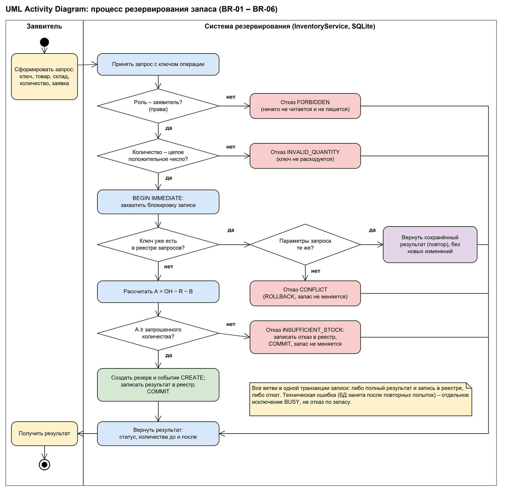
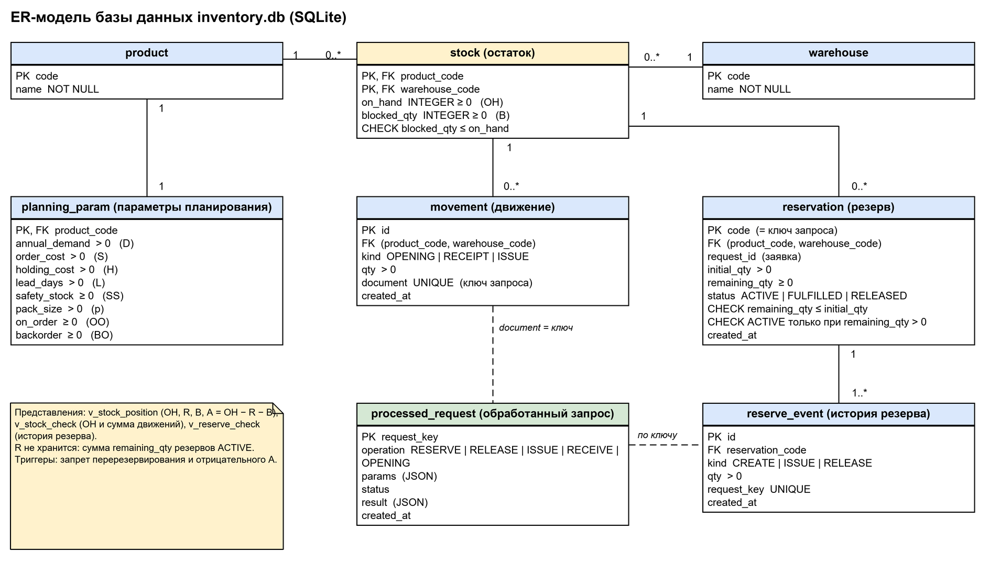

# Практическая работа 10. Разработка модели и прототипа информационной системы управления запасами

**Дисциплина:** Анализ, моделирование и проектирование информационных систем

**Выполнил:** Маханов Тимур

**Организация (по теме исследования):** склад запасных частей авиатехнической базы аэропорта (склад W01), продолжение темы автоматизации технического обслуживания и ремонта воздушных судов. Коды позиций P01-P06, числовые данные, формулы, цепочка операций над P01 и сценарий TEST01 взяты из задания без изменений, названия номенклатуры подобраны под авиатехническую базу. Работа учебная, данные искусственные. Все количества – в штуках. Среда: Python 3.11.9, SQLite 3.45.1 (модуль `sqlite3`), `unittest`, `threading`. Исходные файлы: диаграммы – `assets/inventory_model.drawio`, схема – `prototype/schema.sql`, база с начальным состоянием – `prototype/data/inventory.db`, расчёты – `prototype/inventory/planning.py` и `prototype/calc_report.py`, проверки – `prototype/tests/`, результаты запусков – `results/`.

## 1. Предметная область и требования

### 1.1. Организация

Склад запасных частей авиатехнической базы аэропорта хранит фильтры, ремни, подшипники, датчики, комплекты уплотнителей и крепежа для обслуживания и ремонта самолётов. Склад один – W01. Заявитель, то есть подразделение технического обслуживания, оформляет запрос на резерв под конкретную заявку на работы. Работник склада принимает поставки и выдаёт запасные части по резервам. Менеджер по закупкам планирует пополнение. Часть запаса уже зарезервирована под прежние заявки, часть заблокирована на проверку качества, поэтому на новые запросы можно выделить только доступное количество. Резервирование сверх запаса и частичное резервирование не допускаются: запрос выполняется полностью или отклоняется. Запросы могут повторяться из-за сбоев связи, а в рабочее время поступают одновременно от нескольких подразделений, поэтому повтор не должен создавать второй резерв, а параллельные запросы не должны выделять больше, чем есть на складе. Для планирования пополнения используется другой показатель, чем для резервирования, и его расчёт не меняет остатки. Поставщики отгружают запасные части упаковками фиксированного размера, поэтому размер заказа должен быть кратен упаковке; срок поставки, затраты на заказ и на хранение в учебной модели считаются постоянными. Данные хранятся в одном файле SQLite.

### 1.2. Роли

| Роль | Код роли | Цели |
|---|---|---|
| Работник склада | STOREKEEPER | Принять товар, выдать товар по резерву, освободить резерв, получить отчёт об остатках |
| Заявитель | REQUESTER | Зарезервировать нужное количество под заявку, освободить резерв, получить отчёт об остатках |
| Менеджер по закупкам | PURCHASER | Получить предложение о пополнении: показатели, размер партии, кратный упаковке |

### 1.3. Требования и правила

| Код | Функциональное требование |
|---|---|
| FR-01 | Приём товара: остаток OH растёт на принятое количество, создаётся движение RECEIPT |
| FR-02 | Резервирование: резерв создаётся, если доступное количество A не меньше запрошенного; резерв не меняет OH |
| FR-03 | Освобождение остатка резерва: физический запас не меняется, доступный запас растёт |
| FR-04 | Выдача по резерву: OH и оставшееся количество резерва уменьшаются на выданное, создаётся движение ISSUE |
| FR-05 | Отчёт об остатках: OH, R, B и A по каждой позиции |
| FR-06 | Расчёт A, IP, d, ROP, EOQ и предложение о пополнении с размером партии, кратным упаковке |
| FR-07 | Повторный запрос с тем же ключом возвращает сохранённый результат без новых изменений |
| FR-08 | Ведение истории движений и истории резервов |

| Код | Нефункциональное требование и способ проверки |
|---|---|
| NFR-01 | Целостность при параллельной работе: ΣRᵢ ≤ OH − B и A ≥ 0 при трёх параллельных запросах. Проверка: T08 и 100 повторов эксперимента, нарушений 0 |
| NFR-02 | Неизменность при отказе и повторе: после CONFLICT, INSUFFICIENT_STOCK и ROLLBACK остатки, резервы, движения и история не меняются. Проверка: сравнение содержимого таблиц до и после (T03, T04, T05, T19) |
| NFR-03 | Согласованность журнала и остатка: OH равен сумме движений, R – сумме остатков активных резервов, начальное количество резерва равно остатку, выданному и освобождённому. Проверка: представления `v_stock_check`, `v_reserve_check`, расхождений 0 (T13, T18) |

| Код | Бизнес-правило |
|---|---|
| BR-01 | Приём, начальное сальдо и выдачу выполняет работник склада; резерв создаёт заявитель; освободить резерв могут заявитель и работник склада; предложение о пополнении формирует менеджер по закупкам |
| BR-02 | Количество в операции – положительное целое число; иначе INVALID_QUANTITY, ключ не расходуется |
| BR-03 | A = OH − R − B; резерв создаётся только при A ≥ количества; иначе INSUFFICIENT_STOCK без изменений |
| BR-04 | Ключ операции уникален. Тот же ключ с теми же параметрами возвращает сохранённый результат; с другими параметрами – CONFLICT без изменений |
| BR-05 | Физическими движениями считаются OPENING, RECEIPT и ISSUE; резервирование и освобождение движениями не являются; выдача возможна только по активному резерву в пределах его остатка |
| BR-06 | Предложение о пополнении строится по IP = OH + OO − BO (R повторно не вычитается), размер заказа кратен упаковке p и не меняет остатки |

На диаграмме показаны приём запроса, проверка прав и параметров, распознавание повторного запроса (ключ уже в реестре), проверка доступного количества, сохранение резерва и возврат результата. Случаи недостаточного запаса (INSUFFICIENT_STOCK) и повторяющегося ключа (повтор с теми же параметрами и CONFLICT) показаны отдельными ветвями.

## 2. Расчёт показателей запаса

Расчёты выполняет код `prototype/inventory/planning.py` (формулы) и `prototype/calc_report.py` (таблицы); база только читается. Исходные данные берутся из таблиц `v_stock_position` и `planning_param`. Принято 300 рабочих дней в году, SS – заданный параметр.

<!-- BEGIN-MD results/calc_indicators.md -->

| Код | A | IP | d | ROP | EOQ | Выбор Q | Нужно ли пополнение |
|----|---|---|---|----|----|----|--------|
| P01 | 350 | 580 | 40 | 260 | 346.41 | 350 (заказ не нужен) | нет |
| P02 | 70 | 80 | 20 | 120 | 244.95 | 240 | да |
| P03 | 160 | 330 | 60 | 450 | 424.26 | 400 | да |
| P04 | 160 | 180 | 30 | 120 | 282.84 | 300 (заказ не нужен) | нет |
| P05 | 75 | 140 | 10 | 105 | 173.21 | 175 (заказ не нужен) | нет |
| P06 | 160 | 170 | 50 | 325 | 387.30 | 400 | да |

<!-- END -->

Позиция запаса IP учитывает заказанное и невыполненный отложенный спрос и не равна физическому остатку. Условие пополнения: IP ≤ ROP. Показатели A и IP применяются для разных решений. A = OH − R − B отвечает на вопрос «можно ли выполнить новый запрос на выдачу прямо сейчас»: из учётного остатка вычтены уже обещанные и заблокированные штуки. IP отвечает на вопрос «когда и сколько заказывать»: он смотрит вперёд и добавляет уже заказанное, но ещё не принятое, и вычитает отложенный спрос. Например, у P01 A = 350 при IP = 580: резерв на 500 штук невозможен, хотя пополнение не нужно; у P02 A = 70 при IP = 80 ≤ ROP = 120: резерв на 70 штук возможен, но пополнение уже требуется.

**Выбор партии.** Сравниваются две ближайшие положительные партии, кратные упаковке, ниже и выше EOQ. Затраты TC(Q) = (D/Q)·S + (Q/2)·H, постоянные затраты на SS не входят в сравнение.

<!-- BEGIN-MD results/calc_lots.md -->

| Код | p | Q ниже EOQ | TC | Q выше EOQ | TC | Выбранное Q | Разница TC |
|----|---|----|-----|----|-----|----|-----|
| P01 | 50 | 300 | 210 000 | 350 | 207 857.1 | 350 | 2 142.9 |
| P02 | 20 | 240 | 122 500 | 260 | 122 692.3 | 240 | 192.3 |
| P03 | 100 | 400 | 340 000 | 500 | 344 000 | 400 | 4 000 |
| P04 | 50 | 250 | 128 250 | 300 | 127 500 | 300 | 750 |
| P05 | 25 | 150 | 52 500 | 175 | 51 964.3 | 175 | 535.7 |
| P06 | 50 | 350 | 272 500 | 400 | 271 250 | 400 | 1 250 |

<!-- END -->

Округление EOQ вверх не всегда выгодно: для P02 и P03 меньшая партия дешевле (на 192,3 и 4 000 тенге в год), для P01, P04, P05 и P06 выгоднее верхняя. Для P01 (EOQ = 346,41, упаковка 50) выгодна партия 350, но заказ сейчас не нужен.

**Рекомендации по пополнению.** Нужно заказать P02 – 240 штук (IP после поступления 320 > ROP 120), P03 – 400 штук (IP 730 > ROP 450), P06 – 400 штук (IP 570 > ROP 325). Для P01, P04 и P05 IP больше ROP, заказ не нужен. Все партии кратны упаковке. Формирование рекомендации не меняет складской остаток: полный дамп базы до и после расчёта одинаков (проверка T11).

## 3. Модель данных

Модель содержит восемь сущностей. Первичные ключи, внешние ключи и кратности показаны на диаграмме, полный текст – в `schema.sql` (приложение Б).

| Таблица | Назначение | Ключи и ограничения в SQL |
|---|---|---|
| product, warehouse | Номенклатура и склад | PK code |
| stock | Остаток: OH (`on_hand`) и B (`blocked_qty`) | PK (product_code, warehouse_code) – уникальность пары; CHECK on_hand ≥ 0, blocked_qty ≥ 0, blocked_qty ≤ on_hand; FK на product и warehouse |
| movement | Физические движения: ресурс, место, количество, вид, документ-основание | CHECK qty > 0, kind IN (OPENING, RECEIPT, ISSUE); document UNIQUE; составной FK на stock |
| reservation | Резерв: начальное и оставшееся количество, статус, заявка | CHECK initial_qty > 0, 0 ≤ remaining_qty ≤ initial_qty; статус ACTIVE только при remaining_qty > 0; составной FK на stock |
| reserve_event | История резерва: CREATE, ISSUE, RELEASE | CHECK qty > 0; request_key UNIQUE; FK на reservation |
| processed_request | Обработанный запрос: ключ, вид операции, параметры, результат | PK request_key; CHECK operation IN (...) |
| planning_param | D, S, H, L, SS, p, а также входные данные OO и BO | CHECK значений; PK и FK product_code |

Внешние ключи включаются в каждом подключении (`PRAGMA foreign_keys = ON` в `inventory/db.py`, значение проверяется). Дополнительно два триггера защищают инвариант прямо в SQL: запрет резерва больше доступного количества и запрет изменения OH или B, при котором A стал бы отрицательным.

**R не хранится отдельно.** Он вычисляется как сумма `remaining_qty` активных резервов (представление `v_stock_position`), поэтому расхождение R с записями резервов невозможно. **OH** хранится в `stock.on_hand` и обновляется в одной транзакции с записью движения; соответствие журналу проверяет представление `v_stock_check` (OH против суммы движений: OPENING и RECEIPT со знаком плюс, ISSUE со знаком минус). Резервирование и освобождение в `movement` не записываются. История резервов восстанавливается из `reserve_event`: начальное количество равно остатку плюс выданному плюс освобождённому (`v_reserve_check`). Начальные резервы созданы теми же операциями (ключи INIT-P01-1 и т. д.), OH подтверждён движениями OPENING (ключи OPEN-P01 и т. д.); B и параметры планирования заносятся как входные данные. Файл `inventory.db` содержит начальное состояние: P01 – OH 500, R 120, B 30; остальные позиции по таблице задания.

## 4. Прототип операций

Реализованы операции: приём товара (`receive`), резервирование (`reserve`), освобождение резерва (`release`), выдача по резерву (`issue`) и отчёт об остатках (`stock_report`); расчёт пополнения – отдельный модуль только для чтения. Слои разделены: сервис операций (`service.py`), расчёты (`planning.py`), схема и подключение (`schema.sql`, `db.py`), консольные сценарии (`demo.py`, `calc_report.py`, `concurrency.py`) без бизнес-логики.

**Транзакция операции.** (1) Проверка роли и количества без обращения к базе. (2) `BEGIN IMMEDIATE`: блокировка записи берётся до первого чтения, так как построчный `SELECT FOR UPDATE` в SQLite не применяется; при занятой базе выполняется ограниченное число повторных попыток, затем исключение BUSY. (3) Поиск ключа в `processed_request`: те же параметры – сохранённый результат, другие – CONFLICT. (4) Проверка доступного количества и запись изменений. (5) Запись результата в реестр и `COMMIT`; при любом исключении – `ROLLBACK`, частичные изменения не сохраняются.

**Ошибки.** Бизнес-отказы возвращаются результатом: CONFLICT, INSUFFICIENT_STOCK, INSUFFICIENT_RESERVE, INVALID_QUANTITY, INVALID_STATE, NOT_FOUND, FORBIDDEN. Техническая ошибка (`TechnicalError`: BUSY или DB_ERROR) – исключение, и её нельзя принять за нехватку запаса. Отказ INSUFFICIENT_STOCK регистрируется в реестре запросов (повтор того же ключа вернёт тот же отказ, для новой попытки нужен новый ключ); запас при этом не меняется. Ключ резерва совпадает с кодом резерва (RES01), поэтому выдача и освобождение ссылаются на него.

**Цепочка операций над P01** из исходного состояния (OH 500, R 120, B 30, A 350):

<!-- BEGIN-MD results/p01_chain.md -->

| Шаг | Действие | Результат | OH | R | B | A | RES01 |
|----|--------|------|---|---|---|---|----|
| 0 | Исходное состояние | – | 500 | 120 | 30 | 350 | – |
| 1 | Приём 40 шт., ключ IN01 | OK | 540 | 120 | 30 | 390 | – |
| 2 | Резерв 60 шт., ключ RES01 | OK | 540 | 180 | 30 | 330 | 60 |
| 3 | Повтор RES01 (те же параметры) | OK (повтор, сохранённый результат) | 540 | 180 | 30 | 330 | 60 |
| 4 | Резерв 500 шт., ключ RES02 | INSUFFICIENT_STOCK | 540 | 180 | 30 | 330 | 60 |
| 5 | Выдача 20 шт. из RES01, ключ OUT01 | OK | 520 | 160 | 30 | 330 | 40 |
| 6 | Освобождение остатка RES01, ключ CANCEL01 | OK | 520 | 120 | 30 | 370 | 0 |

<!-- END -->

Шаг 1 приём увеличил OH, но не R; шаг 2 резерв увеличил R, но не OH; приход и резерв – разные события. Шаг 3: повтор RES01 вернул сохранённый результат, второго резерва нет (R остался 180). Шаг 4: A = 330 меньше 500, отказ INSUFFICIENT_STOCK без изменений. **После шага 5 величина A не изменилась (330)**: выдача уменьшила OH на 20 и одновременно R на 20, так как выданное количество уже было вычтено из A при резервировании; A = 520 − 160 − 30 = 330. На шаге 6 освобождён только остаток RES01 (40 штук): R вернулся к начальным 120 по прежним резервам, OH остался 520, A вырос до 370.

## 5. Параллельное резервирование и проверка

Для позиции TEST01 (OH 12, R 0, B 0, отдельная база) три потока, каждый со своим подключением к одному файлу, после общего барьера `threading.Barrier(3)` отправляют запросы на 5 штук с разными ключами. Внутри транзакции блокировка удерживается 50 мс, чтобы ожидание остальных запросов было видно в журнале.

<!-- BEGIN-FILE results/concurrency_log.txt -->

**results/concurrency_log.txt**

~~~
=== TEST01: три параллельных запроса по 5 штук, OH = 12, R = 0, B = 0 ===
Старт всех трёх запросов – после общего барьера threading.Barrier(3); время от момента прохода барьера.

t=   0.01 мс  СТАРТ  T-RES-3
t=   0.09 мс  СТАРТ  T-RES-1
t=   0.16 мс  СТАРТ  T-RES-2

t=  59.59 мс  КОНЕЦ  T-RES-3: OK  A до=12 после=7
t= 125.83 мс  КОНЕЦ  T-RES-1: OK  A до=7 после=2
t= 186.24 мс  КОНЕЦ  T-RES-2: INSUFFICIENT_STOCK  A до=2, без изменений

Резервы: T-RES-1 5 шт. ACTIVE; T-RES-3 5 шт. ACTIVE
Итог: OH=12 B=0 ΣR=10 A=2
Инвариант: ΣR (10) <= OH − B (12): True;  A >= 0: True

=== Повтор эксперимента без искусственной задержки: 100 запусков на новых базах ===
  100 раз(а): INSUFFICIENT_STOCK, OK, OK
  Нарушений инварианта: 0
~~~

<!-- END -->

Запросы стартовали с разницей в доли миллисекунды, обработка прошла последовательно: сначала два запроса получили полные резервы, третий дождался освобождения блокировки, увидел A = 2 и получил INSUFFICIENT_STOCK. Какой запрос отклонён, значения не имеет. Итог: ΣR = 10 ≤ OH − B = 12, A = 2 ≥ 0, частичных резервов нет. Статус всех трёх запросов определён: два OK, один INSUFFICIENT_STOCK, технических ошибок нет. Повтор на 100 новых базах без искусственной задержки дал тот же набор результатов во всех запусках и ни одного нарушения инварианта. В контрольной копии кода, где `BEGIN IMMEDIATE` заменён на обычный `BEGIN`, проверка T08 не проходит: чтение доступного количества и запись перестают быть неделимыми.

Выполнено 19 автоматических проверок (`unittest`): T01-T08 по заданию и T09-T19 дополнительные (расчёты, партии, SQL-ограничения, согласованность, неверные данные, техническая ошибка, откат, сценарий изменения, исходное состояние). Каждая проверка начинается с независимой копии исходного состояния. Журнал запросов (ключ, результат, прежние и последующие количества) – в приложении В.

<!-- BEGIN-MD results/test_results.md -->

| Код | Действие проверки | Ожидаемый результат | Фактический результат | Пройден |
|----|--------|--------|-----------|----|
| T01 | Приём 40 шт. P01 (ключ IN01) | OH растёт на 40 один раз, R не меняется | OK; OH 500 -> 540; R 120 -> 120; 1 движение RECEIPT | пройден |
| T02 | Резерв 60 шт. P01 (ключ RES01) при A = 350 | OK, R растёт на 60, OH не меняется | OK; OH=500 R=120 B=30 A=350 -> OH=500 R=180 B=30 A=290; RES01 = 60 | пройден |
| T03 | Повтор такого же запроса RES01 | Сохранённый результат, нового резерва и события нет | OK, повтор=да; число резервов, событий, движений и запросов не изменилось; R = 180 | пройден |
| T04 | Ключ RES01 с другим количеством (70) | CONFLICT, данные не меняются | CONFLICT; остатки, резервы, движения и реестр запросов без изменений | пройден |
| T05 | Резерв 500 шт. P01 (ключ RES02) при A = 350 | INSUFFICIENT_STOCK, запас не меняется | INSUFFICIENT_STOCK; OH=500 R=120 B=30 A=350 без изменений; резерва RES02 нет | пройден |
| T06 | Выдача 20 шт. из резерва RES01 (ключ OUT01) | OH и R уменьшаются на 20, A не меняется | OK; OH 500 -> 480, R 180 -> 160, A 290 -> 290; RES01 = 40 | пройден |
| T07 | Освобождение остатка RES01 (ключ CANCEL01) | OH не меняется, R уменьшается, A растёт | OK; OH 480 -> 480; R 160 -> 120; A 290 -> 330; движения не создано | пройден |
| T08 | TEST01 (OH = 12): три параллельных запроса по 5 шт. из трёх подключений | Два резерва и один INSUFFICIENT_STOCK; ΣR ≤ OH − B, A ≥ 0 | INSUFFICIENT_STOCK, OK, OK; ΣR = 10, OH − B = 12, A = 2; разброс стартов 0.32 мс | пройден |
| T09 | Расчёт A, IP, d, ROP, EOQ для P01-P06 | Значения совпадают с ручным расчётом; пополнение нужно P02, P03, P06 | A, IP, d, ROP, EOQ всех шести позиций совпали; пополнение: P02, P03, P06 | пройден |
| T10 | Выбор партии, кратной упаковке, по меньшему TC | Q: P01 350, P02 240, P03 400, P04 300, P05 175, P06 400 | Q кратны упаковке и дают меньший TC из двух соседних: P01 350, P02 240, P03 400, P04 300, P05 175, P06 400; точное кратное EOQ = 200 выбрано само | пройден |
| T11 | Формирование рекомендации по пополнению | Содержимое базы не меняется | рекомендации сформированы (3 позиции к пополнению); полный дамп базы (76 строк) до и после совпал | пройден |
| T12 | Прямые SQL-нарушения: отрицательный остаток, количество 0, неизвестный товар, дубль остатка, перерезерв | Все отклонены ограничениями SQL | 7 из 7 нарушений отклонены SQL (CHECK, FOREIGN KEY, PRIMARY KEY, триггеры); P01 не изменён | пройден |
| T13 | Согласованность после цепочки P01: журнал движений, резервы, история резервов | OH равен сумме движений, R равен сумме резервов, история резервов сходится | P01: OH = 520 = 500 (OPENING) + 40 − 20; расхождений журнала 0; R всех позиций = сумме остатков резервов; история резервов сходится | пройден |
| T14 | Неверные количества и чужие роли | INVALID_QUANTITY, FORBIDDEN; ключ не расходуется | INVALID_QUANTITY для 0, −5, 2.5, '3', True, None; FORBIDDEN для трёх чужих ролей; записей в базе не добавилось, ключ BADQ после исправления принят | пройден |
| T15 | База занята другим писателем | Техническая ошибка BUSY, не INSUFFICIENT_STOCK; данные не меняются | TechnicalError BUSY (исключение, а не INSUFFICIENT_STOCK); данные не менялись; после освобождения базы тот же ключ выполнен: OK | пройден |
| T16 | Выдача из резерва: изменение A на шаге 5 цепочки | A не меняется (OH и R уменьшаются одинаково) | после шага 4: OH 540, R 180, A 330; после шага 5: OH 520, R 160, A 330 | пройден |
| T17 | Срок поставки P02 и P03 + 2 дня, SS без изменений | ROP 160 и 570, пополнение нужно по-прежнему | P02: ROP 120 -> 160, P03: ROP 450 -> 570; IP 80 и 330, пополнение нужно; остальные позиции не изменились | пройден |
| T18 | Исходное состояние склада | OH, R, B, A совпадают с таблицей задания; OH и R подтверждены записями | OH, R, B, A шести позиций совпали с таблицей; OH = сумма OPENING, R = сумма начальных резервов | пройден |
| T19 | Сбой внутри транзакции до фиксации | Частичные изменения откатываются | RuntimeError после вставки резерва и события: ROLLBACK, резерва, события и записи в реестре нет | пройден |

<!-- END -->

## 6. Сценарий изменения и анализ проектного решения

Срок поставки P02 и P03 увеличен на 2 рабочих дня, остальные параметры, в том числе SS, не менялись:

<!-- BEGIN-MD results/calc_scenario.md -->

| Код | L | ROP | IP | ROP − IP | Пополнение | L + 2 | ROP | ROP − IP | Пополнение |
|----|--|----|---|-----|----|----|----|-----|----|
| P02 | 4 | 120 | 80 | 40 | да | 6 | 160 | 80 | да |
| P03 | 6 | 450 | 330 | 120 | да | 8 | 570 | 240 | да |

<!-- END -->

Пополнение по-прежнему нужно обеим позициям, но запас прочности стал меньше: разрыв между ROP и IP вырос с 40 до 80 штук у P02 и с 120 до 240 у P03. SS принят постоянным: в расчёте меняется только слагаемое d·L, а SS = 40 и 90 остаются заданными. В реальной ситуации для пересмотра SS нужны фактические сроки поставки по прошлым заказам (среднее и разброс), изменчивость суточного спроса, требуемый уровень обслуживания, а также сведения о том, носит ли увеличение срока постоянный или временный характер. Проверка – T17.

**Прослеживаемость (FR-02 «Резервирование»).**

| Звено | Элемент |
|---|---|
| Требование | FR-02 (и BR-03, BR-04) |
| Шаг диаграммы процесса | «A ≥ запрошенного количества?» и «Создать резерв и событие CREATE; записать результат в реестр; COMMIT» (рис. 1) |
| Сущность ER-модели | `reservation` (с `reserve_event`, `stock`, `processed_request`) |
| Операция в коде | `InventoryService.reserve` (`inventory/service.py`) |
| Проверки | T02, T03, T04, T05, T08 |

**Анализ.** Отчёт о пополнении и операция резервирования опираются на разные показатели. Резервирование решается по A = OH − R − B, то есть по тому, что можно выдать немедленно, и обязано быть точным и неделимым: иначе возникнет перерезервирование. Это обеспечивают `BEGIN IMMEDIATE`, проверка A внутри транзакции и триггер как последний барьер. Отчёт о пополнении решается по IP = OH + OO − BO в сравнении с ROP и по партии с минимальным TC; он ничего не записывает. Пример из данных: у P01 запрос на 500 штук отклонён, так как A = 350, но заказывать P01 не нужно, поскольку IP = 580 выше ROP = 260. У P02, наоборот, резерв на 70 штук допустим, а заказ требуется, так как IP = 80 ниже ROP = 120. Идемпотентность защищает от двойного резерва при повторе запроса после сбоя связи: ключ уникален в реестре и дополнительно в `movement.document` и `reserve_event.request_key`, поэтому даже ошибка прикладного кода не создаст второго движения или второго события. Запланированный заказ не увеличивает OH: поступление отражается только движением RECEIPT после приёма. Ограничение записи SQLite – одна транзакция записи – определило архитектуру: короткие транзакции, блокировка до чтения, ограниченные повторы, отдельное исключение BUSY и отдельное подключение на каждого исполнителя. При адаптации модели к другой организации изменилось бы правило BR-03: например, склад с партиями и сроками годности потребовал бы резервировать по партиям и допускал бы частичное резервирование.

## Заключение

Построены модель процесса и ER-модель, выполнен расчёт показателей и партий, кратных упаковке, реализован прототип операций на SQLite с идемпотентными запросами и транзакциями, доказано безопасное параллельное резервирование. Все 19 проверок пройдены, значения совпали с заданием, расхождений журнала и остатков нет. Ограничения: одна база и один склад, роли передаются параметром без входа по паролю, повторные запросы с отказом по запасу регистрируются под тем же ключом, а процесс поставки (поступление заказанного) моделируется только операцией приёма.

## Ответы на вопросы для защиты

**1. Почему A и IP не используются как один показатель?** Они отвечают на разные вопросы. A = OH − R − B показывает, что можно выдать прямо сейчас, и решает судьбу нового запроса. IP = OH + OO − BO учитывает заказанное и отложенный спрос и решает, пора ли заказывать (IP ≤ ROP). Например, у P01 A = 350 при IP = 580, у P02 A = 70 при IP = 80.

**2. Почему запланированный заказ не увеличивает OH?** OH – физический учётный остаток, он меняется только движениями OPENING, RECEIPT и ISSUE. Заказанное, но не принятое количество учитывается в OO и входит в IP; в OH оно попадёт только после приёма (RECEIPT).

**3. Всегда ли выгодно просто округлять EOQ вверх до упаковки?** Нет. Нужно сравнить TC двух ближайших партий, кратных упаковке. Для P02 (EOQ 244,95) партия 240 дешевле, чем 260, на 192,3 тенге в год, для P03 (EOQ 424,26) партия 400 дешевле, чем 500, на 4 000 тенге в год; для P01, P04, P05 и P06 верхняя партия выгоднее.

**4. Как восстанавливается история начальных резервов и движений?** OH каждой позиции подтверждён движением OPENING (ключи `OPEN-P01` и т. д.), начальные резервы созданы операцией резервирования (ключи `INIT-P01-1` и т. д.) и записаны событиями CREATE в `reserve_event`. Соответствие проверяют представления `v_stock_check` и `v_reserve_check` и тест T18.

**5. Как определяется правильный результат при повторе запроса RES01?** Ключ уже есть в `processed_request`, параметры совпадают, поэтому возвращается сохранённый результат (признак повтора), а нового резерва, события и движения нет, R остаётся 180. Если бы тот же ключ пришёл с другим количеством, результатом был бы CONFLICT без изменений.

**6. Почему A может не измениться, когда по резерву со склада выдано 20 штук?** Резерв уже вычтен из A. Выдача из резерва уменьшает OH на 20 и одновременно R на 20, поэтому A = OH − R − B остаётся 330.

**7. Какой эксперимент доказывает безопасность параллельных запросов?** Позиция TEST01 (OH 12), три подключения, общий барьер старта, запросы по 5 штук с разными ключами: результат – два резерва и один INSUFFICIENT_STOCK, ΣR = 10 ≤ OH − B, A = 2. Тот же эксперимент повторён 100 раз без нарушений, а в контрольной копии с обычным `BEGIN` вместо `BEGIN IMMEDIATE` проверка T08 не проходит.

**8. Как ограничение записи в SQLite влияет на архитектуру прототипа?** Одновременно выполняется одна транзакция записи, а построчного `SELECT FOR UPDATE` нет. Поэтому операция открывает транзакцию через `BEGIN IMMEDIATE` до чтения доступного количества, транзакции короткие, при занятой базе выполняется ограниченное число повторов, затем исключение BUSY (не отказ по запасу), и у каждого исполнителя своё подключение.

**9. Как проверить соответствие журнала запасов и агрегированного остатка?** Сравнить `stock.on_hand` с суммой движений (OPENING и RECEIPT со знаком плюс, ISSUE со знаком минус) – представление `v_stock_check`; R – с суммой остатков активных резервов; для резерва проверить равенство «начальное = остаток + выдано + освобождено» (`v_reserve_check`). Расхождений нет (T13, T18).

**10. Какие параметры пересматриваются при изменении срока поставки?** Меняется L, а с ним ROP = d·L + SS и разрыв между ROP и IP. SS в расчёте принят постоянным, но в реальной ситуации его нужно пересмотреть по фактическим срокам поставки, изменчивости спроса и требуемому уровню обслуживания. EOQ от срока поставки не зависит.

## Приложение А. Исходный код

<!-- BEGIN-FILE prototype/inventory/db.py -->

**prototype/inventory/db.py**

~~~
"""Database connection: foreign keys are switched on in every connection."""

from __future__ import annotations

import sqlite3
from pathlib import Path

SCHEMA_PATH = Path(__file__).resolve().parent.parent / "schema.sql"

def connect(path: str | Path, busy_timeout: float = 5.0) -> sqlite3.Connection:
    """Open a connection. Transactions are controlled manually (BEGIN IMMEDIATE ... COMMIT)."""
    conn = sqlite3.connect(str(path), timeout=busy_timeout, isolation_level=None)
    conn.row_factory = sqlite3.Row
    conn.execute("PRAGMA foreign_keys = ON")
    if conn.execute("PRAGMA foreign_keys").fetchone()[0] != 1:
        raise RuntimeError("foreign key enforcement could not be enabled")
    return conn

def create_schema(conn: sqlite3.Connection) -> None:
    conn.executescript(SCHEMA_PATH.read_text(encoding="utf-8"))
~~~

<!-- END -->

<!-- BEGIN-FILE prototype/inventory/results.py -->

**prototype/inventory/results.py**

~~~
"""Results of operations and errors.

Business refusals (INSUFFICIENT_STOCK, CONFLICT, ...) are returned as a Result.
Technical failures (database busy, SQL error) raise TechnicalError and are never reported as a lack of stock.
"""

from __future__ import annotations

from dataclasses import dataclass, field
from typing import Any

OK = "OK"
INSUFFICIENT_STOCK = "INSUFFICIENT_STOCK"
INSUFFICIENT_RESERVE = "INSUFFICIENT_RESERVE"
CONFLICT = "CONFLICT"
INVALID_QUANTITY = "INVALID_QUANTITY"
INVALID_STATE = "INVALID_STATE"
NOT_FOUND = "NOT_FOUND"
FORBIDDEN = "FORBIDDEN"

@dataclass(frozen=True)
class Result:
    key: str
    operation: str
    status: str
    message: str = ""
    data: dict[str, Any] = field(default_factory=dict)
    replayed: bool = False          # True when the stored result of an earlier identical request is returned

    @property
    def ok(self) -> bool:
        return self.status == OK

class TechnicalError(Exception):
    """BUSY (the database stayed locked after all attempts) or DB_ERROR (unexpected SQL error)."""

    def __init__(self, code: str, message: str = "") -> None:
        super().__init__(f"{code}: {message}")
        self.code = code
        self.message = message
~~~

<!-- END -->

<!-- BEGIN-FILE prototype/inventory/service.py -->

**prototype/inventory/service.py**

~~~
"""InventoryService: operations that change stock. Every operation is one SQLite write transaction.

Protocol of a changing operation (see _execute):
  1. static checks without the database: role and quantity (positive integer);
  2. BEGIN IMMEDIATE: the write lock is taken before anything is read, so concurrent requests are serialised
     (SQLite has no row-level SELECT FOR UPDATE); a busy database is retried a limited number of times;
  3. look the key up in processed_request: same parameters -> return the stored result;
     other parameters -> CONFLICT, nothing is written;
  4. check business conditions and compute the result, then write the changes;
  5. record the result in processed_request and COMMIT. Any exception -> ROLLBACK, nothing is kept.
"""

from __future__ import annotations

import json
import sqlite3
import time
from datetime import datetime
from pathlib import Path
from typing import Any, Callable, Optional

from . import results as R
from .db import connect
from .results import Result, TechnicalError

STOREKEEPER = "STOREKEEPER"   # warehouse worker
REQUESTER = "REQUESTER"       # applicant (maintenance unit)
PURCHASER = "PURCHASER"       # purchasing manager

# Who may perform which operation (BR-01).
PERMISSIONS = {
    "OPENING": {STOREKEEPER},
    "RECEIVE": {STOREKEEPER},
    "ISSUE": {STOREKEEPER},
    "RESERVE": {REQUESTER},
    "RELEASE": {REQUESTER, STOREKEEPER},
    "REPORT": {STOREKEEPER, REQUESTER, PURCHASER},
    "REPLENISHMENT": {PURCHASER},
}

def _now() -> str:
    return datetime.now().replace(microsecond=0).isoformat(sep=" ")

_NO_QTY = object()     # operations without a quantity parameter (release)

def _is_positive_int(value: Any) -> bool:
    return type(value) is int and value > 0

class InventoryService:
    def __init__(self, db_path: str | Path, *, busy_timeout: float = 5.0, retries: int = 3,
                 clock: Optional[Callable[[], str]] = None, hold_seconds: float = 0.0) -> None:
        """hold_seconds keeps the write lock for a while inside the transaction (used to show waiting)."""
        self._conn = connect(db_path, busy_timeout)
        self._retries = retries
        self._clock = clock or _now
        self._hold = hold_seconds

    def close(self) -> None:
        self._conn.close()

    @property
    def connection(self) -> sqlite3.Connection:
        return self._conn

    # ------------------------------------------------------------------ operations
    def opening(self, key: str, role: str, product: str, warehouse: str, qty: int) -> Result:
        return self._receive(key, role, "OPENING", "OPENING", product, warehouse, qty)

    def receive(self, key: str, role: str, product: str, warehouse: str, qty: int) -> Result:
        return self._receive(key, role, "RECEIVE", "RECEIPT", product, warehouse, qty)

    def reserve(self, key: str, role: str, product: str, warehouse: str, qty: int, request_id: str) -> Result:
        params = {"product": product, "warehouse": warehouse, "qty": qty, "request_id": request_id}

        def apply(conn):
            before = self._position(conn, product, warehouse)
            if before is None:
                return R.NOT_FOUND, f"no stock row for {product} in {warehouse}", {}
            if before["a"] < qty:
                return R.INSUFFICIENT_STOCK, f"available {before['a']} < requested {qty}", {"before": before}
            now = self._clock()
            conn.execute("INSERT INTO reservation (code, product_code, warehouse_code, request_id, initial_qty, "
                         "remaining_qty, status, created_at) VALUES (?, ?, ?, ?, ?, ?, 'ACTIVE', ?)",
                         (key, product, warehouse, request_id, qty, qty, now))
            conn.execute("INSERT INTO reserve_event (reservation_code, kind, qty, request_key, created_at) "
                         "VALUES (?, 'CREATE', ?, ?, ?)", (key, qty, key, now))
            return R.OK, f"reserved {qty}", {"reservation": key, "before": before,
                                              "after": self._position(conn, product, warehouse)}

        return self._execute(key, "RESERVE", role, params, apply, qty)

    def release(self, key: str, role: str, reservation: str) -> Result:
        """Release the whole remaining part of a reservation. Physical stock does not change."""
        params = {"reservation": reservation}

        def apply(conn):
            res = self._reservation(conn, reservation)
            if res is None:
                return R.NOT_FOUND, f"reservation {reservation} not found", {}
            if res["status"] != "ACTIVE":
                return R.INVALID_STATE, f"reservation {reservation} is {res['status']}", {}
            before = self._position(conn, res["product_code"], res["warehouse_code"])
            released = res["remaining_qty"]
            conn.execute("UPDATE reservation SET remaining_qty = 0, status = 'RELEASED' WHERE code = ?", (reservation,))
            conn.execute("INSERT INTO reserve_event (reservation_code, kind, qty, request_key, created_at) "
                         "VALUES (?, 'RELEASE', ?, ?, ?)", (reservation, released, key, self._clock()))
            return R.OK, f"released {released}", {"released": released, "before": before,
                                                  "after": self._position(conn, res["product_code"], res["warehouse_code"])}

        return self._execute(key, "RELEASE", role, params, apply, _NO_QTY)

    def issue(self, key: str, role: str, reservation: str, qty: int) -> Result:
        """Issue goods from a reservation: remaining quantity of the reservation and OH decrease together."""
        params = {"reservation": reservation, "qty": qty}

        def apply(conn):
            res = self._reservation(conn, reservation)
            if res is None:
                return R.NOT_FOUND, f"reservation {reservation} not found", {}
            if res["status"] != "ACTIVE":
                return R.INVALID_STATE, f"reservation {reservation} is {res['status']}", {}
            product, wh = res["product_code"], res["warehouse_code"]
            before = self._position(conn, product, wh)
            if qty > res["remaining_qty"]:
                return R.INSUFFICIENT_RESERVE, f"remaining {res['remaining_qty']} < requested {qty}", {"before": before}
            now = self._clock()
            left = res["remaining_qty"] - qty
            # the reservation is reduced first, then OH: A never becomes negative in between
            conn.execute("UPDATE reservation SET remaining_qty = ?, status = ? WHERE code = ?",
                         (left, "ACTIVE" if left > 0 else "FULFILLED", reservation))
            conn.execute("UPDATE stock SET on_hand = on_hand - ? WHERE product_code = ? AND warehouse_code = ?",
                         (qty, product, wh))
            conn.execute("INSERT INTO movement (product_code, warehouse_code, kind, qty, document, created_at) "
                         "VALUES (?, ?, 'ISSUE', ?, ?, ?)", (product, wh, qty, key, now))
            conn.execute("INSERT INTO reserve_event (reservation_code, kind, qty, request_key, created_at) "
                         "VALUES (?, 'ISSUE', ?, ?, ?)", (reservation, qty, key, now))
            return R.OK, f"issued {qty}", {"remaining": left, "before": before,
                                            "after": self._position(conn, product, wh)}

        return self._execute(key, "ISSUE", role, params, apply, qty)

    # ------------------------------------------------------------------ queries (no changes)
    def stock_report(self, role: str) -> list[dict]:
        """Report of balances: OH, R, B, A of every stock row. Read-only."""
        self._require(role, "REPORT")
        rows = self._conn.execute("SELECT p.code AS product, p.name, v.warehouse_code AS warehouse, v.oh, v.r, v.b, v.a "
                                  "FROM v_stock_position v JOIN product p ON p.code = v.product_code "
                                  "ORDER BY p.code, v.warehouse_code").fetchall()
        return [dict(r) for r in rows]

    def position(self, product: str, warehouse: str) -> Optional[dict]:
        return self._position(self._conn, product, warehouse)

    def reservation_remaining(self, code: str) -> Optional[int]:
        res = self._reservation(self._conn, code)
        return None if res is None else res["remaining_qty"]

    @staticmethod
    def _require(role: str, operation: str) -> None:
        if role not in PERMISSIONS[operation]:
            raise PermissionError(f"role {role} may not perform {operation}")

    # ------------------------------------------------------------------ internals
    def _receive(self, key, role, operation, kind, product, warehouse, qty) -> Result:
        params = {"product": product, "warehouse": warehouse, "qty": qty}

        def apply(conn):
            before = self._position(conn, product, warehouse)
            if before is None:
                return R.NOT_FOUND, f"no stock row for {product} in {warehouse}", {}
            conn.execute("UPDATE stock SET on_hand = on_hand + ? WHERE product_code = ? AND warehouse_code = ?",
                         (qty, product, warehouse))
            conn.execute("INSERT INTO movement (product_code, warehouse_code, kind, qty, document, created_at) "
                         "VALUES (?, ?, ?, ?, ?, ?)", (product, warehouse, kind, qty, key, self._clock()))
            return R.OK, f"received {qty}", {"before": before, "after": self._position(conn, product, warehouse)}

        return self._execute(key, operation, role, params, apply, qty)

    @staticmethod
    def _position(conn, product: str, warehouse: str) -> Optional[dict]:
        row = conn.execute("SELECT oh, r, b, a FROM v_stock_position WHERE product_code = ? AND warehouse_code = ?",
                           (product, warehouse)).fetchone()
        return dict(row) if row else None

    @staticmethod
    def _reservation(conn, code: str):
        return conn.execute("SELECT * FROM reservation WHERE code = ?", (code,)).fetchone()

    def _begin(self) -> None:
        for attempt in range(self._retries + 1):
            try:
                self._conn.execute("BEGIN IMMEDIATE")
                return
            except sqlite3.OperationalError as error:
                if "locked" not in str(error).lower() and "busy" not in str(error).lower():
                    raise TechnicalError("DB_ERROR", str(error)) from error
                if attempt == self._retries:
                    raise TechnicalError("BUSY", f"database is locked after {attempt + 1} attempts") from error
                time.sleep(0.01 * (attempt + 1))

    def _rollback(self) -> None:
        try:
            if self._conn.in_transaction:
                self._conn.execute("ROLLBACK")
        except sqlite3.Error:
            pass

    def _execute(self, key: str, operation: str, role: str, params: dict, apply, qty: Any) -> Result:
        # 1. static checks: nothing is read or written, the key is not consumed
        if role not in PERMISSIONS[operation]:
            return Result(key, operation, R.FORBIDDEN, f"role {role} may not perform {operation}")
        if qty is not _NO_QTY and not _is_positive_int(qty):
            return Result(key, operation, R.INVALID_QUANTITY, f"quantity must be a positive integer, got {qty!r}")
        fingerprint = json.dumps(params, sort_keys=True, ensure_ascii=False)
        # 2. write transaction
        self._begin()
        try:
            row = self._conn.execute("SELECT operation, params, status, result FROM processed_request "
                                     "WHERE request_key = ?", (key,)).fetchone()
            if row is not None:                                        # 3. repeated key
                self._rollback()
                if row["operation"] == operation and row["params"] == fingerprint:
                    stored = json.loads(row["result"])
                    return Result(key, operation, row["status"], stored["message"], stored["data"], replayed=True)
                return Result(key, operation, R.CONFLICT,
                              f"key {key} was used for {row['operation']} {row['params']}")
            status, message, data = apply(self._conn)                  # 4. business logic and changes
            if self._hold:
                time.sleep(self._hold)
            self._conn.execute("INSERT INTO processed_request (request_key, operation, params, status, result, created_at) "
                               "VALUES (?, ?, ?, ?, ?, ?)",
                               (key, operation, fingerprint, status,
                                json.dumps({"message": message, "data": data}, ensure_ascii=False), self._clock()))
            self._conn.execute("COMMIT")                               # 5. commit
            return Result(key, operation, status, message, data)
        except TechnicalError:
            self._rollback()
            raise
        except sqlite3.OperationalError as error:
            self._rollback()
            code = "BUSY" if ("locked" in str(error).lower() or "busy" in str(error).lower()) else "DB_ERROR"
            raise TechnicalError(code, str(error)) from error
        except sqlite3.Error as error:
            self._rollback()
            raise TechnicalError("DB_ERROR", str(error)) from error
        except BaseException:
            self._rollback()
            raise
~~~

<!-- END -->

<!-- BEGIN-FILE prototype/inventory/planning.py -->

**prototype/inventory/planning.py**

~~~
"""Stock indicators and replenishment proposal. Pure calculations plus read-only database access.

A  = OH - R - B            available quantity: decides whether a NEW request can be served
IP = OH + OO - BO          inventory position: decides whether to REPLENISH
d  = D / 300               daily demand (300 working days)
ROP = d * L + SS           reorder point
EOQ = sqrt(2 * D * S / H)  economic order quantity
TC(Q) = D / Q * S + Q / 2 * H   cycle cost of a real lot (SS holding cost is common to all lots and omitted)
"""

from __future__ import annotations

import math
import sqlite3
from dataclasses import dataclass, replace
from typing import Optional

WORKING_DAYS = 300

@dataclass(frozen=True)
class Params:
    code: str
    D: int      # annual demand, pieces
    S: int      # cost of one order, tenge
    H: int      # holding cost per piece per year, tenge
    L: int      # lead time, working days
    SS: int     # safety stock, pieces
    p: int      # supplier pack size
    OO: int     # ordered, not received
    BO: int     # backorders

@dataclass(frozen=True)
class Lot:
    eoq: float
    lower: Optional[int]
    upper: int
    tc_lower: Optional[float]
    tc_upper: float
    q: int

@dataclass(frozen=True)
class Row:
    code: str
    oh: int
    r: int
    b: int
    a: int
    ip: int
    d: float
    rop: float
    lot: Lot
    need: bool          # IP <= ROP
    order_qty: int      # Q if replenishment is needed, otherwise 0
    ip_after: int       # IP after the proposed order

def available(oh: int, r: int, b: int) -> int:
    return oh - r - b

def inventory_position(oh: int, oo: int, bo: int) -> int:
    return oh + oo - bo

def daily_demand(D: int) -> float:
    return D / WORKING_DAYS

def reorder_point(d: float, L: int, SS: int) -> float:
    return d * L + SS

def eoq(D: int, S: int, H: int) -> float:
    return math.sqrt(2 * D * S / H)

def total_cost(D: int, S: int, H: int, Q: int) -> float:
    return D / Q * S + Q / 2 * H

def choose_lot(pr: Params) -> Lot:
    """Compare the two nearest positive lots that are multiples of the pack size: below and above EOQ.

    If EOQ is exactly a multiple of the pack size, it is itself the lower candidate and is compared
    with the next multiple above it.
    """
    e = eoq(pr.D, pr.S, pr.H)
    k = int(e // pr.p)
    exact = k > 0 and (k * pr.p) ** 2 * pr.H == 2 * pr.D * pr.S      # exact integer test, no float noise
    lower = k * pr.p if k > 0 else None
    upper = lower + pr.p if exact else (k + 1) * pr.p
    tc_lo = total_cost(pr.D, pr.S, pr.H, lower) if lower else None
    tc_up = total_cost(pr.D, pr.S, pr.H, upper)
    q = lower if (lower is not None and tc_lo <= tc_up) else upper
    return Lot(e, lower, upper, tc_lo, tc_up, q)

def indicators(pr: Params, oh: int, r: int, b: int) -> Row:
    d = daily_demand(pr.D)
    ip = inventory_position(oh, pr.OO, pr.BO)
    rop = reorder_point(d, pr.L, pr.SS)
    lot = choose_lot(pr)
    need = ip <= rop
    return Row(pr.code, oh, r, b, available(oh, r, b), ip, d, rop, lot, need,
               lot.q if need else 0, ip + (lot.q if need else 0))

def load_params(conn: sqlite3.Connection) -> dict[str, Params]:
    rows = conn.execute("SELECT product_code, annual_demand, order_cost, holding_cost, lead_days, safety_stock, "
                        "pack_size, on_order, backorder FROM planning_param ORDER BY product_code").fetchall()
    return {r[0]: Params(*tuple(r)) for r in rows}

def replenishment_report(conn: sqlite3.Connection, warehouse: str = "W01",
                         lead_time_shift: Optional[dict[str, int]] = None) -> list[Row]:
    """Proposal for replenishment. Only SELECT statements: the stock is never changed (see test T11).

    lead_time_shift adds working days to L of the given products (scenario of task 6); SS stays constant.
    """
    shift = lead_time_shift or {}
    params = load_params(conn)
    rows = []
    for code, pr in params.items():
        if code in shift:
            pr = replace(pr, L=pr.L + shift[code])
        pos = conn.execute("SELECT oh, r, b FROM v_stock_position WHERE product_code = ? AND warehouse_code = ?",
                           (code, warehouse)).fetchone()
        if pos is not None:
            rows.append(indicators(pr, pos["oh"], pos["r"], pos["b"]))
    return rows
~~~

<!-- END -->

<!-- BEGIN-FILE prototype/inventory/seed.py -->

**prototype/inventory/seed.py**

~~~
"""Initial state of the warehouse W01 and of the separate test position TEST01.

Everything is loaded through InventoryService operations: OH is confirmed by OPENING movements,
R by the initial reservations (history: reserve_event). Only the blocked quantity B and the planning
parameters are inserted directly (they are inputs, not results of operations).
"""

from __future__ import annotations

from pathlib import Path

from .db import connect, create_schema
from .service import InventoryService, REQUESTER, STOREKEEPER

# code, name, OH, B, planning: D, S, H, L, SS, p, OO, BO
ITEMS = [
    ("P01", "Фильтр топливный", 500, 30, 12000, 3000, 600, 5, 60, 50, 100, 20),
    ("P02", "Ремень привода генератора", 100, 10, 6000, 2500, 500, 4, 40, 20, 0, 20),
    ("P03", "Подшипник", 240, 20, 18000, 4000, 800, 6, 90, 100, 100, 10),
    ("P04", "Датчик температуры", 180, 0, 9000, 2000, 450, 3, 30, 50, 0, 0),
    ("P05", "Комплект уплотнителей", 90, 5, 3000, 1500, 300, 7, 35, 25, 50, 0),
    ("P06", "Комплект крепежа", 200, 0, 15000, 3500, 700, 5, 75, 50, 0, 30),
]

# Initial active reservations of earlier work requests: product -> quantities (their sum is R).
INITIAL_RESERVES = {
    "P01": [70, 50], "P02": [20], "P03": [40, 20], "P04": [20], "P05": [10], "P06": [25, 15],
}

WAREHOUSE = "W01"

class FixedClock:
    """Deterministic time stamps for the initial data: one second per call."""

    def __init__(self) -> None:
        self._n = 0

    def __call__(self) -> str:
        self._n += 1
        return f"2026-11-02 08:{self._n // 60:02d}:{self._n % 60:02d}"

def build_initial_db(path: str | Path) -> None:
    path = Path(path)
    if path.exists():
        path.unlink()
    conn = connect(path)
    create_schema(conn)
    conn.execute("INSERT INTO warehouse (code, name) VALUES (?, ?)",
                 (WAREHOUSE, "Склад запасных частей авиатехнической базы"))
    for code, name, oh, blocked, D, S, H, L, SS, p, OO, BO in ITEMS:
        conn.execute("INSERT INTO product (code, name) VALUES (?, ?)", (code, name))
        conn.execute("INSERT INTO stock (product_code, warehouse_code) VALUES (?, ?)", (code, WAREHOUSE))
        conn.execute("INSERT INTO planning_param VALUES (?, ?, ?, ?, ?, ?, ?, ?, ?)",
                     (code, D, S, H, L, SS, p, OO, BO))
    conn.close()

    service = InventoryService(path, clock=FixedClock())
    for code, name, oh, blocked, *_ in ITEMS:
        result = service.opening(f"OPEN-{code}", STOREKEEPER, code, WAREHOUSE, oh)
        assert result.ok, result
        if blocked:   # quantity blocked for quality control (input data)
            service.connection.execute("UPDATE stock SET blocked_qty = ? WHERE product_code = ?", (blocked, code))
    for code, quantities in INITIAL_RESERVES.items():
        for i, qty in enumerate(quantities, 1):
            result = service.reserve(f"INIT-{code}-{i}", REQUESTER, code, WAREHOUSE, qty, f"WO-{code}-{i}")
            assert result.ok, result
    service.close()

def build_test01_db(path: str | Path) -> None:
    """Separate database with one position: TEST01, OH = 12, R = 0, B = 0 (parallel reservation test)."""
    path = Path(path)
    if path.exists():
        path.unlink()
    conn = connect(path)
    create_schema(conn)
    conn.execute("INSERT INTO warehouse (code, name) VALUES (?, ?)", (WAREHOUSE, "Склад"))
    conn.execute("INSERT INTO product (code, name) VALUES ('TEST01', 'Тестовая позиция')")
    conn.execute("INSERT INTO stock (product_code, warehouse_code) VALUES ('TEST01', ?)", (WAREHOUSE,))
    conn.close()
    service = InventoryService(path, clock=FixedClock())
    assert service.opening("OPEN-TEST01", STOREKEEPER, "TEST01", WAREHOUSE, 12).ok
    service.close()
~~~

<!-- END -->

<!-- BEGIN-FILE prototype/inventory/scenarios.py -->

**prototype/inventory/scenarios.py**

~~~
"""Reusable scenarios: the P01 chain of task 4 and the parallel reservation of TEST01 (task 5)."""

from __future__ import annotations

import tempfile
import threading
import time
from pathlib import Path
from typing import Callable

from .results import Result, TechnicalError
from .seed import WAREHOUSE, build_test01_db
from .service import InventoryService, REQUESTER, STOREKEEPER

def state(service: InventoryService, product: str = "P01", reservation: str = "RES01") -> dict:
    """OH, R, B, A of the product and the remaining quantity of the reservation (None if it does not exist)."""
    pos = service.position(product, WAREHOUSE)
    return {"oh": pos["oh"], "r": pos["r"], "b": pos["b"], "a": pos["a"],
            "res": service.reservation_remaining(reservation)}

def p01_chain(service: InventoryService) -> list[tuple[str, str, Result, dict]]:
    """Six operations of task 4 on P01 from the initial state. Returns (step, action, result, state after)."""
    w = WAREHOUSE
    steps: list[tuple[str, str, Callable[[], Result]]] = [
        ("1", "Приём 40 шт., ключ IN01", lambda: service.receive("IN01", STOREKEEPER, "P01", w, 40)),
        ("2", "Резерв 60 шт., ключ RES01", lambda: service.reserve("RES01", REQUESTER, "P01", w, 60, "WO-2001")),
        ("3", "Повтор RES01 (те же параметры)", lambda: service.reserve("RES01", REQUESTER, "P01", w, 60, "WO-2001")),
        ("4", "Резерв 500 шт., ключ RES02", lambda: service.reserve("RES02", REQUESTER, "P01", w, 500, "WO-2002")),
        ("5", "Выдача 20 шт. из RES01, ключ OUT01", lambda: service.issue("OUT01", STOREKEEPER, "RES01", 20)),
        ("6", "Освобождение остатка RES01, ключ CANCEL01", lambda: service.release("CANCEL01", REQUESTER, "RES01")),
    ]
    rows = []
    for step, action, call in steps:
        result = call()
        rows.append((step, action, result, state(service)))
    return rows

def parallel_reservation(workdir: str | Path, workers: int = 3, qty: int = 5, hold: float = 0.05,
                         busy_timeout: float = 10.0) -> dict:
    """Three independent connections reserve `qty` of TEST01 (OH = 12) after a common start barrier.

    hold keeps the write lock inside each transaction so that the other requests visibly wait.
    Returns the journal (key, start and end offsets, result, before, after) and the final state.
    """
    db = Path(workdir) / "test01.db"
    build_test01_db(db)
    ref: list[float] = []
    barrier = threading.Barrier(workers, action=lambda: ref.append(time.perf_counter()))
    journal: list[dict] = []
    lock = threading.Lock()

    def worker(i: int) -> None:
        service = InventoryService(db, busy_timeout=busy_timeout, hold_seconds=hold)   # own connection
        key = f"T-RES-{i}"
        try:
            barrier.wait()
            t0 = time.perf_counter() - ref[0]
            try:
                result = service.reserve(key, REQUESTER, "TEST01", WAREHOUSE, qty, f"WO-T{i}")
                entry = {"key": key, "status": result.status, "before": result.data.get("before"),
                         "after": result.data.get("after")}
            except TechnicalError as error:
                entry = {"key": key, "status": "TECHNICAL:" + error.code, "before": None, "after": None}
            entry.update(start=t0, end=time.perf_counter() - ref[0])
            with lock:
                journal.append(entry)
        finally:
            service.close()

    threads = [threading.Thread(target=worker, args=(i,), name=f"worker-{i}") for i in range(1, workers + 1)]
    for t in threads:
        t.start()
    for t in threads:
        t.join()

    checker = InventoryService(db)
    pos = checker.position("TEST01", WAREHOUSE)
    reserved = [dict(r) for r in checker.connection.execute(
        "SELECT code, initial_qty, remaining_qty, status FROM reservation ORDER BY code")]
    checker.close()
    journal.sort(key=lambda e: e["end"])
    return {"journal": journal, "position": pos, "reservations": reserved}

def parallel_batch(runs: int = 100) -> dict:
    """Repeat the experiment on fresh databases (no artificial delay) and count the outcomes."""
    outcomes: dict[str, int] = {}
    violations = 0
    for _ in range(runs):
        with tempfile.TemporaryDirectory() as tmp:
            result = parallel_reservation(tmp, hold=0.0)
        statuses = sorted(e["status"] for e in result["journal"])
        key = ", ".join(statuses)
        outcomes[key] = outcomes.get(key, 0) + 1
        p = result["position"]
        if not (p["r"] <= p["oh"] - p["b"] and p["a"] >= 0):
            violations += 1
    return {"runs": runs, "outcomes": outcomes, "violations": violations}
~~~

<!-- END -->

<!-- BEGIN-FILE prototype/init_db.py -->

**prototype/init_db.py**

~~~
"""Creates data/inventory.db (schema + initial state). Run from the prototype folder:  python init_db.py"""

import sys
from pathlib import Path

sys.stdout.reconfigure(encoding="utf-8")

from inventory.seed import build_initial_db  # noqa: E402

target = Path(__file__).resolve().parent / "data" / "inventory.db"
target.parent.mkdir(exist_ok=True)
build_initial_db(target)
print("created", target)
~~~

<!-- END -->

<!-- BEGIN-FILE prototype/demo.py -->

**prototype/demo.py**

~~~
"""Demonstration from the initial state: P01 chain of six operations and the stock report.

    python demo.py [--save DIR]

The initial file data/inventory.db is copied to a temporary working file and stays untouched.
"""

import argparse
import shutil
import sys
import tempfile
from pathlib import Path

sys.stdout.reconfigure(encoding="utf-8")

from inventory.scenarios import p01_chain, state  # noqa: E402
from inventory.seed import WAREHOUSE  # noqa: E402
from inventory.service import InventoryService, STOREKEEPER  # noqa: E402

INITIAL_DB = Path(__file__).resolve().parent / "data" / "inventory.db"

def main() -> None:
    parser = argparse.ArgumentParser()
    parser.add_argument("--save", type=Path, default=None)
    args = parser.parse_args()
    lines: list[str] = []

    with tempfile.TemporaryDirectory() as tmp:
        work = Path(tmp) / "inventory_work.db"
        shutil.copy(INITIAL_DB, work)
        service = InventoryService(work)

        lines.append("=== Исходное состояние склада W01 (отчёт об остатках) ===")
        lines.append(f"{'Код':<5}{'Номенклатура':<28}{'OH':>5}{'R':>5}{'B':>5}{'A':>5}")
        for r in service.stock_report(STOREKEEPER):
            lines.append(f"{r['product']:<5}{r['name']:<28}{r['oh']:>5}{r['r']:>5}{r['b']:>5}{r['a']:>5}")

        lines.append("")
        lines.append("=== Цепочка операций над P01 ===")
        init = state(service)
        table = ["| Шаг | Действие | Результат | OH | R | B | A | RES01 |", "|----|--------|------|---|---|---|---|----|",
                 f"| 0 | Исходное состояние | – | {init['oh']} | {init['r']} | {init['b']} | {init['a']} | – |"]
        lines.append(f"Шаг 0: OH={init['oh']} R={init['r']} B={init['b']} A={init['a']}")
        for step, action, result, st in p01_chain(service):
            shown = result.status + (" (повтор, сохранённый результат)" if result.replayed else "")
            res = "–" if st["res"] is None else st["res"]
            lines.append(f"Шаг {step}: {action} -> {shown}; OH={st['oh']} R={st['r']} B={st['b']} A={st['a']} RES01={res}")
            table.append(f"| {step} | {action} | {shown} | {st['oh']} | {st['r']} | {st['b']} | {st['a']} | {res} |")

        counts = service.connection.execute(
            "SELECT (SELECT COUNT(*) FROM reservation), (SELECT COUNT(*) FROM movement), "
            "(SELECT COUNT(*) FROM processed_request)").fetchone()
        lines.append("")
        lines.append(f"Записей: резервов {counts[0]}, движений {counts[1]}, обработанных запросов {counts[2]}")
        bad = service.connection.execute(
            "SELECT COUNT(*) FROM v_stock_check WHERE on_hand <> from_movements").fetchone()[0]
        lines.append(f"Расхождений журнала движений и OH: {bad}")
        service.close()

    print("\n".join(lines))
    if args.save:
        args.save.mkdir(parents=True, exist_ok=True)
        (args.save / "demo_output.txt").write_text("\n".join(lines) + "\n", encoding="utf-8")
        (args.save / "p01_chain.md").write_text("\n".join(table) + "\n", encoding="utf-8")

if __name__ == "__main__":
    main()
~~~

<!-- END -->

<!-- BEGIN-FILE prototype/calc_report.py -->

**prototype/calc_report.py**

~~~
"""Replenishment calculations (task 2 and the change scenario of task 6). The database is only read.

    python calc_report.py [--save DIR]

Formulas: see inventory/planning.py.
"""

import argparse
import sys
from pathlib import Path

sys.stdout.reconfigure(encoding="utf-8")

from inventory.db import connect  # noqa: E402
from inventory.planning import replenishment_report  # noqa: E402

INITIAL_DB = Path(__file__).resolve().parent / "data" / "inventory.db"

def fmt(x: float) -> str:
    return f"{x:,.1f}".replace(",", " ") if x != int(x) else f"{int(x):,}".replace(",", " ")

def tables(rows) -> tuple[str, str]:
    main = ["| Код | A | IP | d | ROP | EOQ | Выбор Q | Нужно ли пополнение |", "|----|---|---|---|----|----|----|--------|"]
    cmp_ = ["| Код | p | Q ниже EOQ | TC | Q выше EOQ | TC | Выбранное Q | Разница TC |", "|----|---|----|-----|----|-----|----|-----|"]
    for r in rows:
        need = "да" if r.need else "нет"
        q = f"{r.lot.q}" if r.need else f"{r.lot.q} (заказ не нужен)"
        main.append(f"| {r.code} | {r.a} | {r.ip} | {fmt(r.d)} | {fmt(r.rop)} | {r.lot.eoq:.2f} | {q} | {need} |")
        lo = r.lot.lower
        cmp_.append(f"| {r.code} | {r.lot.upper - r.lot.lower}"
                    f" | {lo} | {fmt(r.lot.tc_lower)} | {r.lot.upper} | {fmt(r.lot.tc_upper)} | {r.lot.q} | "
                    f"{fmt(abs(r.lot.tc_upper - r.lot.tc_lower))} |")
    return "\n".join(main), "\n".join(cmp_)

def scenario_table(base, shifted) -> str:
    out = ["| Код | L | ROP | IP | ROP − IP | Пополнение | L + 2 | ROP | ROP − IP | Пополнение |",
           "|----|--|----|---|-----|----|----|----|-----|----|"]
    for b, s in zip(base, shifted):
        if b.code in ("P02", "P03"):
            dl = {"P02": 4, "P03": 6}[b.code]
            out.append(f"| {b.code} | {dl} | {fmt(b.rop)} | {b.ip} | {fmt(b.rop - b.ip)} | {'да' if b.need else 'нет'} "
                       f"| {dl + 2} | {fmt(s.rop)} | {fmt(s.rop - s.ip)} | {'да' if s.need else 'нет'} |")
    return "\n".join(out)

def main() -> None:
    parser = argparse.ArgumentParser()
    parser.add_argument("--save", type=Path, default=None)
    args = parser.parse_args()
    conn = connect(INITIAL_DB)
    base = replenishment_report(conn)
    shifted = replenishment_report(conn, lead_time_shift={"P02": 2, "P03": 2})
    conn.close()
    main_t, cmp_t = tables(base)
    scen = scenario_table(base, shifted)
    text = ("Таблица показателей (A = OH − R − B; IP = OH + OO − BO; d = D/300; ROP = d·L + SS):\n\n" + main_t +
            "\n\nСравнение двух ближайших партий, кратных упаковке:\n\n" + cmp_t +
            "\n\nСценарий: срок поставки P02 и P03 увеличен на 2 рабочих дня, SS без изменений:\n\n" + scen + "\n")
    print(text)
    if args.save:
        args.save.mkdir(parents=True, exist_ok=True)
        (args.save / "calc_indicators.md").write_text(main_t + "\n", encoding="utf-8")
        (args.save / "calc_lots.md").write_text(cmp_t + "\n", encoding="utf-8")
        (args.save / "calc_scenario.md").write_text(scen + "\n", encoding="utf-8")
        (args.save / "calc_report.txt").write_text(text, encoding="utf-8")

if __name__ == "__main__":
    main()
~~~

<!-- END -->

<!-- BEGIN-FILE prototype/concurrency.py -->

**prototype/concurrency.py**

~~~
"""Parallel reservation of TEST01 (OH = 12) by three independent connections.

    python concurrency.py [--save DIR] [--runs N]

Detailed run (the write lock is held 50 ms inside every transaction so that waiting is visible),
then N repetitions without delay on fresh databases.
"""

import argparse
import sys
import tempfile
from pathlib import Path

sys.stdout.reconfigure(encoding="utf-8")

from inventory.scenarios import parallel_batch, parallel_reservation  # noqa: E402

def main() -> None:
    parser = argparse.ArgumentParser()
    parser.add_argument("--save", type=Path, default=None)
    parser.add_argument("--runs", type=int, default=100)
    args = parser.parse_args()

    with tempfile.TemporaryDirectory() as tmp:
        result = parallel_reservation(tmp, hold=0.05)
    lines = ["=== TEST01: три параллельных запроса по 5 штук, OH = 12, R = 0, B = 0 ===",
             "Старт всех трёх запросов – после общего барьера threading.Barrier(3); время от момента прохода барьера.", ""]
    first_end = None
    for e in sorted(result["journal"], key=lambda x: x["start"]):
        lines.append(f"t={e['start'] * 1000:7.2f} мс  СТАРТ  {e['key']}")
    lines.append("")
    for e in result["journal"]:
        b, a = e["before"], e["after"]
        ba = f"A до={b['a']} после={a['a']}" if b and a else (f"A до={b['a']}, без изменений" if b else "")
        lines.append(f"t={e['end'] * 1000:7.2f} мс  КОНЕЦ  {e['key']}: {e['status']}  {ba}")
    p = result["position"]
    reserved = sum(r["remaining_qty"] for r in result["reservations"] if r["status"] == "ACTIVE")
    lines += ["", "Резервы: " + "; ".join(f"{r['code']} {r['initial_qty']} шт. {r['status']}" for r in result["reservations"]),
              f"Итог: OH={p['oh']} B={p['b']} ΣR={reserved} A={p['a']}",
              f"Инвариант: ΣR ({reserved}) <= OH − B ({p['oh'] - p['b']}): {reserved <= p['oh'] - p['b']};  A >= 0: {p['a'] >= 0}"]

    batch = parallel_batch(args.runs)
    lines += ["", f"=== Повтор эксперимента без искусственной задержки: {batch['runs']} запусков на новых базах ==="]
    for outcome, n in batch["outcomes"].items():
        lines.append(f"  {n} раз(а): {outcome}")
    lines.append(f"  Нарушений инварианта: {batch['violations']}")
    print("\n".join(lines))
    if args.save:
        args.save.mkdir(parents=True, exist_ok=True)
        (args.save / "concurrency_log.txt").write_text("\n".join(lines) + "\n", encoding="utf-8")

if __name__ == "__main__":
    main()
~~~

<!-- END -->

<!-- BEGIN-FILE prototype/run_tests.py -->

**prototype/run_tests.py**

~~~
"""Runs all checks, prints the unittest log, the table "expected / actual / passed" and the request journal.

    python run_tests.py [--save DIR]    # writes test_results.txt, test_results.md, test_journal.txt into DIR
"""

import argparse
import io
import sys
import unittest
from pathlib import Path

sys.stdout.reconfigure(encoding="utf-8")
sys.stderr.reconfigure(encoding="utf-8")

from tests import support  # noqa: E402

def _iter(suite):
    for item in suite:
        if isinstance(item, unittest.TestSuite):
            yield from _iter(item)
        else:
            yield item

def main() -> int:
    parser = argparse.ArgumentParser()
    parser.add_argument("--save", type=Path, default=None)
    args = parser.parse_args()

    suite = unittest.defaultTestLoader.discover("tests", top_level_dir=".")
    names = [str(t) for t in _iter(suite)]            # the suite is emptied while it runs
    stream = io.StringIO()
    result = unittest.TextTestRunner(stream=stream, verbosity=2).run(suite)
    log = stream.getvalue()
    print(log)
    failed = [t.id() for t, _ in result.failures + result.errors]

    rows = ["| Код | Действие проверки | Ожидаемый результат | Фактический результат | Пройден |",
            "|----|--------|--------|-----------|----|"]
    for code, (action, expected) in support.TABLE.items():
        key = f"test_{code.lower()}_"
        ok = any(key in n for n in names) and not any(key in f for f in failed)
        rows.append(f"| {code} | {action} | {expected} | {support.ACTUAL.get(code, 'не выполнено')} | "
                    f"{'пройден' if ok else 'не пройден'} |")
    table = "\n".join(rows)
    print(table)
    journal = "\n".join(support.JOURNAL)
    print("\n" + journal)

    if args.save:
        args.save.mkdir(parents=True, exist_ok=True)
        (args.save / "test_results.txt").write_text(log, encoding="utf-8")
        (args.save / "test_results.md").write_text(table + "\n", encoding="utf-8")
        (args.save / "test_journal.txt").write_text(journal + "\n", encoding="utf-8")
    return 0 if result.wasSuccessful() else 1

if __name__ == "__main__":
    sys.exit(main())
~~~

<!-- END -->

<!-- BEGIN-FILE prototype/tests/support.py -->

**prototype/tests/support.py**

~~~
"""Shared helpers of the tests: independent initial database, snapshot, logs of actual results and journal."""

from __future__ import annotations

import sqlite3
import tempfile
import unittest
from pathlib import Path

from inventory.results import Result
from inventory.seed import build_initial_db
from inventory.service import InventoryService

ACTUAL: dict[str, str] = {}      # actual result of every check, filled by the tests
JOURNAL: list[str] = []          # journal of requests: key, result, previous and following quantities

# Check code -> (action, expected result)
TABLE = {
    "T01": ("Приём 40 шт. P01 (ключ IN01)", "OH растёт на 40 один раз, R не меняется"),
    "T02": ("Резерв 60 шт. P01 (ключ RES01) при A = 350", "OK, R растёт на 60, OH не меняется"),
    "T03": ("Повтор такого же запроса RES01", "Сохранённый результат, нового резерва и события нет"),
    "T04": ("Ключ RES01 с другим количеством (70)", "CONFLICT, данные не меняются"),
    "T05": ("Резерв 500 шт. P01 (ключ RES02) при A = 350", "INSUFFICIENT_STOCK, запас не меняется"),
    "T06": ("Выдача 20 шт. из резерва RES01 (ключ OUT01)", "OH и R уменьшаются на 20, A не меняется"),
    "T07": ("Освобождение остатка RES01 (ключ CANCEL01)", "OH не меняется, R уменьшается, A растёт"),
    "T08": ("TEST01 (OH = 12): три параллельных запроса по 5 шт. из трёх подключений",
            "Два резерва и один INSUFFICIENT_STOCK; ΣR ≤ OH − B, A ≥ 0"),
    "T09": ("Расчёт A, IP, d, ROP, EOQ для P01-P06", "Значения совпадают с ручным расчётом; пополнение нужно P02, P03, P06"),
    "T10": ("Выбор партии, кратной упаковке, по меньшему TC", "Q: P01 350, P02 240, P03 400, P04 300, P05 175, P06 400"),
    "T11": ("Формирование рекомендации по пополнению", "Содержимое базы не меняется"),
    "T12": ("Прямые SQL-нарушения: отрицательный остаток, количество 0, неизвестный товар, дубль остатка, перерезерв",
            "Все отклонены ограничениями SQL"),
    "T13": ("Согласованность после цепочки P01: журнал движений, резервы, история резервов",
            "OH равен сумме движений, R равен сумме резервов, история резервов сходится"),
    "T14": ("Неверные количества и чужие роли", "INVALID_QUANTITY, FORBIDDEN; ключ не расходуется"),
    "T15": ("База занята другим писателем", "Техническая ошибка BUSY, не INSUFFICIENT_STOCK; данные не меняются"),
    "T16": ("Выдача из резерва: изменение A на шаге 5 цепочки", "A не меняется (OH и R уменьшаются одинаково)"),
    "T17": ("Срок поставки P02 и P03 + 2 дня, SS без изменений", "ROP 160 и 570, пополнение нужно по-прежнему"),
    "T18": ("Исходное состояние склада", "OH, R, B, A совпадают с таблицей задания; OH и R подтверждены записями"),
    "T19": ("Сбой внутри транзакции до фиксации", "Частичные изменения откатываются"),
}

def record(tid: str, text: str) -> None:
    ACTUAL[tid] = text

def journal(tid: str, result: Result) -> None:
    b, a = result.data.get("before"), result.data.get("after")
    fmt = lambda p: "-" if p is None else f"OH={p['oh']} R={p['r']} A={p['a']}"
    if a is None and b is not None:
        after = "без изменений"
    else:
        after = fmt(a)
    status = result.status + (" (повтор)" if result.replayed else "")
    JOURNAL.append(f"{tid}  ключ={result.key:<9} {result.operation:<8} {status:<26} до: {fmt(b):<22} после: {after}")

def pos_text(p: dict) -> str:
    return f"OH={p['oh']} R={p['r']} B={p['b']} A={p['a']}"

class DbTestCase(unittest.TestCase):
    """Every test starts from its own copy of the initial state."""

    def setUp(self) -> None:
        self._tmp = tempfile.TemporaryDirectory()
        self.addCleanup(self._tmp.cleanup)
        self.path = Path(self._tmp.name) / "inventory.db"
        build_initial_db(self.path)
        self.service = InventoryService(self.path)
        self.addCleanup(self.service.close)

    @property
    def conn(self) -> sqlite3.Connection:
        return self.service.connection

    def counts(self) -> dict:
        return {t: self.conn.execute(f"SELECT COUNT(*) FROM {t}").fetchone()[0]
                for t in ("reservation", "movement", "reserve_event", "processed_request")}

    def inventory_snapshot(self) -> list:
        """All data of stock, reservations, movements and reservation history (without the request register)."""
        out = []
        for table in ("stock", "reservation", "movement", "reserve_event"):
            out.append([tuple(r) for r in self.conn.execute(f"SELECT * FROM {table} ORDER BY 1, 2")])
        return out

    def dump(self) -> list[str]:
        return list(self.conn.iterdump())
~~~

<!-- END -->

<!-- BEGIN-FILE prototype/tests/test_inventory.py -->

**prototype/tests/test_inventory.py**

~~~
"""Automated checks T01-T19. Every test starts from an independent copy of the initial state (setUp);
T08 builds its own database with the position TEST01."""

import sqlite3
import tempfile
import unittest

from inventory import results as R
from inventory.db import connect
from inventory.planning import Params, choose_lot, replenishment_report
from inventory.results import TechnicalError
from inventory.scenarios import p01_chain, parallel_reservation
from inventory.seed import WAREHOUSE
from inventory.service import InventoryService, PURCHASER, REQUESTER, STOREKEEPER

from .support import DbTestCase, journal, pos_text, record

W = WAREHOUSE

class Operations(DbTestCase):
    def test_t01_receive_increases_stock_once(self):
        before = self.service.position("P01", W)
        res = self.service.receive("IN01", STOREKEEPER, "P01", W, 40)
        journal("T01", res)
        after = self.service.position("P01", W)
        self.assertTrue(res.ok)
        self.assertEqual((after["oh"], after["r"]), (before["oh"] + 40, before["r"]))
        self.assertEqual(self.conn.execute("SELECT COUNT(*) FROM movement WHERE document = 'IN01'").fetchone()[0], 1)
        record("T01", f"OK; OH {before['oh']} -> {after['oh']}; R {before['r']} -> {after['r']}; 1 движение RECEIPT")

    def test_t02_reserve_available_quantity(self):
        before = self.service.position("P01", W)
        res = self.service.reserve("RES01", REQUESTER, "P01", W, 60, "WO-2001")
        journal("T02", res)
        after = self.service.position("P01", W)
        self.assertTrue(res.ok)
        self.assertEqual((after["oh"], after["r"], after["a"]), (before["oh"], before["r"] + 60, before["a"] - 60))
        self.assertEqual(self.service.reservation_remaining("RES01"), 60)
        record("T02", f"OK; {pos_text(before)} -> {pos_text(after)}; RES01 = 60")

    def test_t03_repeat_creates_no_duplicate(self):
        first = self.service.reserve("RES01", REQUESTER, "P01", W, 60, "WO-2001")
        counts = self.counts()
        second = self.service.reserve("RES01", REQUESTER, "P01", W, 60, "WO-2001")
        journal("T03", second)
        self.assertTrue(second.replayed and not first.replayed)
        self.assertEqual((second.status, second.data), (first.status, first.data))
        self.assertEqual(self.counts(), counts)
        self.assertEqual(self.service.position("P01", W)["r"], 180)
        record("T03", f"{second.status}, повтор=да; число резервов, событий, движений и запросов не изменилось; R = 180")

    def test_t04_same_key_other_quantity_conflict(self):
        self.service.reserve("RES01", REQUESTER, "P01", W, 60, "WO-2001")
        before_inv, before_cnt = self.inventory_snapshot(), self.counts()
        res = self.service.reserve("RES01", REQUESTER, "P01", W, 70, "WO-2001")
        journal("T04", res)
        self.assertEqual(res.status, R.CONFLICT)
        self.assertEqual(self.inventory_snapshot(), before_inv)
        self.assertEqual(self.counts(), before_cnt)
        record("T04", f"{res.status}; остатки, резервы, движения и реестр запросов без изменений")

    def test_t05_insufficient_stock_changes_nothing(self):
        before_pos, before_inv = self.service.position("P01", W), self.inventory_snapshot()
        res = self.service.reserve("RES02", REQUESTER, "P01", W, 500, "WO-2002")
        journal("T05", res)
        self.assertEqual(res.status, R.INSUFFICIENT_STOCK)
        self.assertEqual(self.service.position("P01", W), before_pos)
        self.assertEqual(self.inventory_snapshot(), before_inv)
        self.assertIsNone(self.service.reservation_remaining("RES02"))
        row = self.conn.execute("SELECT status FROM processed_request WHERE request_key = 'RES02'").fetchone()
        self.assertEqual(row[0], R.INSUFFICIENT_STOCK)     # the refusal itself is registered, stock is not touched
        record("T05", f"{res.status}; {pos_text(before_pos)} без изменений; резерва RES02 нет")

    def test_t06_issue_reduces_oh_and_r_equally(self):
        self.service.reserve("RES01", REQUESTER, "P01", W, 60, "WO-2001")
        before = self.service.position("P01", W)
        res = self.service.issue("OUT01", STOREKEEPER, "RES01", 20)
        journal("T06", res)
        after = self.service.position("P01", W)
        self.assertTrue(res.ok)
        self.assertEqual((before["oh"] - after["oh"], before["r"] - after["r"], after["a"]), (20, 20, before["a"]))
        self.assertEqual(self.service.reservation_remaining("RES01"), 40)
        record("T06", f"OK; OH {before['oh']} -> {after['oh']}, R {before['r']} -> {after['r']}, "
                      f"A {before['a']} -> {after['a']}; RES01 = 40")

    def test_t07_release_keeps_oh(self):
        self.service.reserve("RES01", REQUESTER, "P01", W, 60, "WO-2001")
        self.service.issue("OUT01", STOREKEEPER, "RES01", 20)
        before = self.service.position("P01", W)
        res = self.service.release("CANCEL01", REQUESTER, "RES01")
        journal("T07", res)
        after = self.service.position("P01", W)
        self.assertTrue(res.ok)
        self.assertEqual(after["oh"], before["oh"])
        self.assertEqual((before["r"] - after["r"], after["a"] - before["a"]), (40, 40))
        self.assertEqual(self.service.reservation_remaining("RES01"), 0)
        self.assertEqual(self.conn.execute("SELECT COUNT(*) FROM movement WHERE document = 'CANCEL01'").fetchone()[0], 0)
        record("T07", f"OK; OH {before['oh']} -> {after['oh']}; R {before['r']} -> {after['r']}; "
                      f"A {before['a']} -> {after['a']}; движения не создано")

class Parallel(unittest.TestCase):
    def test_t08_three_parallel_reservations(self):
        with tempfile.TemporaryDirectory() as tmp:
            out = parallel_reservation(tmp, hold=0.02)
        statuses = sorted(e["status"] for e in out["journal"])
        self.assertEqual(statuses, ["INSUFFICIENT_STOCK", "OK", "OK"])
        p = out["position"]
        reservations = out["reservations"]
        self.assertEqual(len(reservations), 2)
        self.assertTrue(all(r["initial_qty"] == 5 and r["remaining_qty"] == 5 and r["status"] == "ACTIVE"
                            for r in reservations))                       # two full reservations, none partial
        total = sum(r["remaining_qty"] for r in reservations)
        self.assertLessEqual(total, p["oh"] - p["b"])
        self.assertEqual(p["a"], p["oh"] - p["b"] - total)
        self.assertGreaterEqual(p["a"], 0)
        starts = [e["start"] for e in out["journal"]]
        self.assertLess(max(starts) - min(starts), 0.02)                  # started together (barrier)
        for e in sorted(out["journal"], key=lambda x: x["end"]):
            from .support import JOURNAL
            b, a = e["before"], e["after"]
            JOURNAL.append(f"T08  ключ={e['key']:<10} RESERVE  {e['status']:<19} до: A={b['a']:<3} после: A={a['a'] if a else b['a']}"
                           f"   старт +{e['start'] * 1000:.2f} мс, конец +{e['end'] * 1000:.1f} мс")
        record("T08", f"{', '.join(statuses)}; ΣR = {total}, OH − B = {p['oh'] - p['b']}, A = {p['a']}; "
                      f"разброс стартов {1000 * (max(starts) - min(starts)):.2f} мс")

class Planning(DbTestCase):
    def test_t09_indicators(self):
        rows = {r.code: r for r in replenishment_report(self.conn)}
        expected = {  # A, IP, d, ROP, EOQ, need
            "P01": (350, 580, 40, 260, 346.41, False), "P02": (70, 80, 20, 120, 244.95, True),
            "P03": (160, 330, 60, 450, 424.26, True), "P04": (160, 180, 30, 120, 282.84, False),
            "P05": (75, 140, 10, 105, 173.21, False), "P06": (160, 170, 50, 325, 387.30, True),
        }
        for code, (a, ip, d, rop, eoq_, need) in expected.items():
            r = rows[code]
            self.assertEqual((r.a, r.ip, r.d, r.rop, round(r.lot.eoq, 2), r.need), (a, ip, d, rop, eoq_, need), code)
        record("T09", "A, IP, d, ROP, EOQ всех шести позиций совпали; пополнение: " +
               ", ".join(c for c, r in rows.items() if r.need))

    def test_t10_lot_is_multiple_of_pack_and_cheaper(self):
        params = {r.code: r for r in replenishment_report(self.conn)}
        packs = {"P01": 50, "P02": 20, "P03": 100, "P04": 50, "P05": 25, "P06": 50}
        chosen = {}
        for code, r in params.items():
            lot = r.lot
            self.assertEqual(lot.q % packs[code], 0)
            self.assertLess(lot.lower, lot.eoq)
            self.assertGreater(lot.upper, lot.eoq)
            self.assertEqual(lot.q, lot.lower if lot.tc_lower <= lot.tc_upper else lot.upper)
            chosen[code] = lot.q
        self.assertEqual(chosen, {"P01": 350, "P02": 240, "P03": 400, "P04": 300, "P05": 175, "P06": 400})
        # EOQ exactly a multiple of the pack size: it is chosen itself and compared with the next multiple
        exact = choose_lot(Params("X", D=20000, S=100, H=100, L=1, SS=0, p=50, OO=0, BO=0))
        self.assertEqual((exact.eoq, exact.lower, exact.upper, exact.q), (200.0, 200, 250, 200))
        record("T10", "Q кратны упаковке и дают меньший TC из двух соседних: " +
               ", ".join(f"{c} {q}" for c, q in chosen.items()) + "; точное кратное EOQ = 200 выбрано само")

    def test_t11_report_does_not_change_the_database(self):
        before = self.dump()
        rows = replenishment_report(self.conn)
        self.service.stock_report(PURCHASER)
        self.assertTrue(any(r.need for r in rows))
        self.assertEqual(self.dump(), before)
        record("T11", f"рекомендации сформированы ({sum(r.need for r in rows)} позиции к пополнению); "
                      f"полный дамп базы ({len(before)} строк) до и после совпал")

    def test_t17_lead_time_scenario(self):
        base = {r.code: r for r in replenishment_report(self.conn)}
        new = {r.code: r for r in replenishment_report(self.conn, lead_time_shift={"P02": 2, "P03": 2})}
        self.assertEqual((new["P02"].rop, new["P03"].rop), (160, 570))
        self.assertTrue(new["P02"].need and new["P03"].need)
        for code in ("P01", "P04", "P05", "P06"):
            self.assertEqual(new[code].rop, base[code].rop)
        params = {r.code: r for r in replenishment_report(self.conn)}
        self.assertEqual(params["P02"].rop, 120)       # the base calculation is unchanged by the scenario
        record("T17", "P02: ROP 120 -> 160, P03: ROP 450 -> 570; IP 80 и 330, пополнение нужно; остальные позиции не изменились")

class Integrity(DbTestCase):
    def test_t12_sql_constraints(self):
        c = self.conn
        bad = [
            "UPDATE stock SET on_hand = -1 WHERE product_code = 'P01'",
            "INSERT INTO movement (product_code, warehouse_code, kind, qty, document, created_at) "
            "VALUES ('P01', 'W01', 'RECEIPT', 0, 'X1', 'now')",
            "INSERT INTO movement (product_code, warehouse_code, kind, qty, document, created_at) "
            "VALUES ('NOPE', 'W01', 'RECEIPT', 5, 'X2', 'now')",
            "INSERT INTO stock (product_code, warehouse_code) VALUES ('P01', 'W01')",
            "INSERT INTO reservation (code, product_code, warehouse_code, request_id, initial_qty, remaining_qty, status, "
            "created_at) VALUES ('BIG', 'P01', 'W01', 'WO', 351, 351, 'ACTIVE', 'now')",
            "UPDATE stock SET blocked_qty = 600 WHERE product_code = 'P01'",
            "UPDATE stock SET on_hand = 140 WHERE product_code = 'P01'",
        ]
        errors = []
        for sql in bad:
            with self.assertRaises(sqlite3.IntegrityError, msg=sql) as ctx:
                c.execute(sql)
            errors.append(str(ctx.exception).split(":")[0][:30])
        self.assertEqual(self.service.position("P01", W), {"oh": 500, "r": 120, "b": 30, "a": 350})
        record("T12", f"{len(bad)} из {len(bad)} нарушений отклонены SQL (CHECK, FOREIGN KEY, PRIMARY KEY, триггеры); P01 не изменён")

    def test_t13_consistency_of_journal_and_balance(self):
        p01_chain(self.service)
        c = self.conn
        self.assertEqual(c.execute("SELECT COUNT(*) FROM v_stock_check WHERE on_hand <> from_movements").fetchone()[0], 0)
        self.assertEqual(c.execute("SELECT COUNT(*) FROM v_reserve_check "
                                   "WHERE initial_qty <> remaining_qty + issued + released").fetchone()[0], 0)
        for product in ("P01", "P02", "P03", "P04", "P05", "P06"):
            r = c.execute("SELECT COALESCE(SUM(remaining_qty), 0) FROM reservation WHERE product_code = ? AND status = 'ACTIVE'",
                          (product,)).fetchone()[0]
            self.assertEqual(r, self.service.position(product, W)["r"])
        oh = c.execute("SELECT on_hand FROM stock WHERE product_code = 'P01'").fetchone()[0]
        moves = c.execute("SELECT SUM(CASE WHEN kind = 'ISSUE' THEN -qty ELSE qty END) FROM movement "
                          "WHERE product_code = 'P01'").fetchone()[0]
        self.assertEqual((oh, moves), (520, 520))
        record("T13", "P01: OH = 520 = 500 (OPENING) + 40 − 20; расхождений журнала 0; R всех позиций = сумме остатков резервов; "
                      "история резервов сходится")

    def test_t14_invalid_quantities_and_roles(self):
        before = self.counts()
        for qty in (0, -5, 2.5, "3", True, None):
            res = self.service.receive("BADQ", STOREKEEPER, "P01", W, qty)
            self.assertEqual(res.status, R.INVALID_QUANTITY, repr(qty))
        self.assertEqual(self.service.receive("ROLE1", REQUESTER, "P01", W, 5).status, R.FORBIDDEN)
        self.assertEqual(self.service.reserve("ROLE2", PURCHASER, "P01", W, 5, "WO").status, R.FORBIDDEN)
        self.assertEqual(self.service.issue("ROLE3", REQUESTER, "INIT-P01-1", 5).status, R.FORBIDDEN)
        self.assertEqual(self.counts(), before)                            # the keys are not consumed
        self.assertTrue(self.service.receive("BADQ", STOREKEEPER, "P01", W, 5).ok)   # the same key, now correct
        record("T14", "INVALID_QUANTITY для 0, −5, 2.5, '3', True, None; FORBIDDEN для трёх чужих ролей; "
                      "записей в базе не добавилось, ключ BADQ после исправления принят")

    def test_t15_busy_database_is_technical_error(self):
        blocker = connect(self.path)
        blocker.execute("BEGIN IMMEDIATE")                                 # another writer holds the lock
        impatient = InventoryService(self.path, busy_timeout=0.05, retries=1)
        try:
            with self.assertRaises(TechnicalError) as ctx:
                impatient.reserve("RES-BUSY", REQUESTER, "P01", W, 10, "WO-B")
        finally:
            blocker.execute("ROLLBACK")
            blocker.close()
        self.assertEqual(ctx.exception.code, "BUSY")
        self.assertEqual(self.service.position("P01", W)["r"], 120)
        self.assertIsNone(self.service.reservation_remaining("RES-BUSY"))
        res = impatient.reserve("RES-BUSY", REQUESTER, "P01", W, 10, "WO-B")  # the key was not consumed
        impatient.close()
        self.assertTrue(res.ok)
        record("T15", "TechnicalError BUSY (исключение, а не INSUFFICIENT_STOCK); данные не менялись; "
                      "после освобождения базы тот же ключ выполнен: OK")

    def test_t16_available_unchanged_after_issue(self):
        rows = p01_chain(self.service)
        a = {step: st["a"] for step, _, _, st in rows}
        oh = {step: st["oh"] for step, _, _, st in rows}
        r_ = {step: st["r"] for step, _, _, st in rows}
        self.assertEqual((a["4"], a["5"]), (330, 330))
        self.assertEqual((oh["4"] - oh["5"], r_["4"] - r_["5"]), (20, 20))
        self.assertEqual([rows[i][2].status for i in range(6)],
                         ["OK", "OK", "OK", "INSUFFICIENT_STOCK", "OK", "OK"])
        record("T16", f"после шага 4: OH {oh['4']}, R {r_['4']}, A {a['4']}; после шага 5: OH {oh['5']}, R {r_['5']}, A {a['5']}")

    def test_t18_initial_state(self):
        expected = {"P01": (500, 120, 30, 350), "P02": (100, 20, 10, 70), "P03": (240, 60, 20, 160),
                    "P04": (180, 20, 0, 160), "P05": (90, 10, 5, 75), "P06": (200, 40, 0, 160)}
        for code, vals in expected.items():
            p = self.service.position(code, W)
            self.assertEqual((p["oh"], p["r"], p["b"], p["a"]), vals, code)
            opening = self.conn.execute("SELECT SUM(qty) FROM movement WHERE product_code = ? AND kind = 'OPENING'",
                                        (code,)).fetchone()[0]
            self.assertEqual(opening, vals[0])
            created = self.conn.execute("SELECT SUM(e.qty) FROM reserve_event e JOIN reservation r ON r.code = e.reservation_code "
                                        "WHERE r.product_code = ? AND e.kind = 'CREATE'", (code,)).fetchone()[0]
            self.assertEqual(created, vals[1])
        record("T18", "OH, R, B, A шести позиций совпали с таблицей; OH = сумма OPENING, R = сумма начальных резервов")

    def test_t19_failure_before_commit_rolls_back(self):
        calls = {"n": 0}

        def clock():
            calls["n"] += 1
            if calls["n"] >= 2:      # the 1st call stamps the reservation, the 2nd one stamps the register entry
                raise RuntimeError("simulated failure before COMMIT")
            return "2026-11-16 10:00:00"

        failing = InventoryService(self.path, clock=clock)
        before = self.inventory_snapshot()
        with self.assertRaises(RuntimeError):
            failing.reserve("RES-FAIL", REQUESTER, "P01", W, 10, "WO-F")
        failing.close()
        self.assertEqual(self.inventory_snapshot(), before)
        self.assertEqual(self.conn.execute("SELECT COUNT(*) FROM processed_request WHERE request_key = 'RES-FAIL'").fetchone()[0], 0)
        record("T19", "RuntimeError после вставки резерва и события: ROLLBACK, резерва, события и записи в реестре нет")

if __name__ == "__main__":
    unittest.main()
~~~

<!-- END -->

## Приложение Б. Схема базы данных (schema.sql)

<!-- BEGIN-FILE prototype/schema.sql -->

**prototype/schema.sql**

~~~
-- Inventory control of the spare-parts warehouse W01 (educational). SQLite 3.
-- Foreign keys are enabled in every connection by inventory/db.py (PRAGMA foreign_keys = ON).
-- All quantities are integers, in pieces.

CREATE TABLE product (
    code TEXT PRIMARY KEY,
    name TEXT NOT NULL
);

CREATE TABLE warehouse (
    code TEXT PRIMARY KEY,
    name TEXT NOT NULL
);

-- Balance of a product in a warehouse: OH (on_hand) and B (blocked_qty).
-- R is NOT stored: it is the sum of remaining quantities of active reservations (view v_stock_position).
CREATE TABLE stock (
    product_code   TEXT    NOT NULL REFERENCES product (code),
    warehouse_code TEXT    NOT NULL REFERENCES warehouse (code),
    on_hand        INTEGER NOT NULL DEFAULT 0 CHECK (on_hand >= 0),
    blocked_qty    INTEGER NOT NULL DEFAULT 0 CHECK (blocked_qty >= 0),
    PRIMARY KEY (product_code, warehouse_code),
    CHECK (blocked_qty <= on_hand)
);

-- Physical movements only: opening balance, receipt, issue. Reserving and releasing are not movements.
-- document is the basis of the movement; here it is the idempotency key of the request (unique).
CREATE TABLE movement (
    id             INTEGER PRIMARY KEY AUTOINCREMENT,
    product_code   TEXT    NOT NULL,
    warehouse_code TEXT    NOT NULL,
    kind           TEXT    NOT NULL CHECK (kind IN ('OPENING', 'RECEIPT', 'ISSUE')),
    qty            INTEGER NOT NULL CHECK (qty > 0),
    document       TEXT    NOT NULL UNIQUE,
    created_at     TEXT    NOT NULL,
    FOREIGN KEY (product_code, warehouse_code) REFERENCES stock (product_code, warehouse_code)
);

-- Reservation. code equals the key of the request that created it (RES01).
CREATE TABLE reservation (
    code           TEXT    PRIMARY KEY,
    product_code   TEXT    NOT NULL,
    warehouse_code TEXT    NOT NULL,
    request_id     TEXT    NOT NULL,                       -- linked work request
    initial_qty    INTEGER NOT NULL CHECK (initial_qty > 0),
    remaining_qty  INTEGER NOT NULL CHECK (remaining_qty >= 0),
    status         TEXT    NOT NULL CHECK (status IN ('ACTIVE', 'FULFILLED', 'RELEASED')),
    created_at     TEXT    NOT NULL,
    CHECK (remaining_qty <= initial_qty),
    CHECK ((status = 'ACTIVE' AND remaining_qty > 0) OR (status <> 'ACTIVE' AND remaining_qty = 0)),
    FOREIGN KEY (product_code, warehouse_code) REFERENCES stock (product_code, warehouse_code)
);

-- History of a reservation: creation, issues, release. One event per request key.
CREATE TABLE reserve_event (
    id               INTEGER PRIMARY KEY AUTOINCREMENT,
    reservation_code TEXT    NOT NULL REFERENCES reservation (code),
    kind             TEXT    NOT NULL CHECK (kind IN ('CREATE', 'ISSUE', 'RELEASE')),
    qty              INTEGER NOT NULL CHECK (qty > 0),
    request_key      TEXT    NOT NULL UNIQUE,
    created_at       TEXT    NOT NULL
);

-- Processed requests: the idempotency register. The key is unique; params identify the request.
CREATE TABLE processed_request (
    request_key TEXT PRIMARY KEY,
    operation   TEXT NOT NULL CHECK (operation IN ('OPENING', 'RECEIVE', 'RESERVE', 'RELEASE', 'ISSUE')),
    params      TEXT NOT NULL,
    status      TEXT NOT NULL,
    result      TEXT NOT NULL,
    created_at  TEXT NOT NULL
);

-- Planning parameters and planning inputs (OO, BO are given, not calculated).
CREATE TABLE planning_param (
    product_code  TEXT PRIMARY KEY REFERENCES product (code),
    annual_demand INTEGER NOT NULL CHECK (annual_demand > 0),   -- D
    order_cost    INTEGER NOT NULL CHECK (order_cost > 0),      -- S, tenge
    holding_cost  INTEGER NOT NULL CHECK (holding_cost > 0),    -- H, tenge per piece per year
    lead_days     INTEGER NOT NULL CHECK (lead_days > 0),       -- L, working days
    safety_stock  INTEGER NOT NULL CHECK (safety_stock >= 0),   -- SS
    pack_size     INTEGER NOT NULL CHECK (pack_size > 0),       -- p
    on_order      INTEGER NOT NULL CHECK (on_order >= 0),       -- OO
    backorder     INTEGER NOT NULL CHECK (backorder >= 0)       -- BO
);

-- OH, B, R and A of every stock row. A = OH - R - B.
CREATE VIEW v_stock_position AS
SELECT product_code, warehouse_code, oh, reserved AS r, blocked AS b, oh - blocked - reserved AS a
FROM (
    SELECT s.product_code, s.warehouse_code, s.on_hand AS oh, s.blocked_qty AS blocked,
           COALESCE((SELECT SUM(r.remaining_qty) FROM reservation r
                     WHERE r.product_code = s.product_code AND r.warehouse_code = s.warehouse_code
                       AND r.status = 'ACTIVE'), 0) AS reserved
    FROM stock s
);

-- Consistency of the journal and the aggregated balance: on_hand must equal the sum of movements.
CREATE VIEW v_stock_check AS
SELECT s.product_code, s.warehouse_code, s.on_hand,
       COALESCE((SELECT SUM(CASE WHEN m.kind = 'ISSUE' THEN -m.qty ELSE m.qty END) FROM movement m
                 WHERE m.product_code = s.product_code AND m.warehouse_code = s.warehouse_code), 0) AS from_movements
FROM stock s;

-- Consistency of reservation history: initial = remaining + issued + released.
CREATE VIEW v_reserve_check AS
SELECT r.code, r.initial_qty, r.remaining_qty,
       COALESCE((SELECT SUM(e.qty) FROM reserve_event e WHERE e.reservation_code = r.code AND e.kind = 'ISSUE'), 0) AS issued,
       COALESCE((SELECT SUM(e.qty) FROM reserve_event e WHERE e.reservation_code = r.code AND e.kind = 'RELEASE'), 0) AS released
FROM reservation r;

-- Last line of defence in SQL: no overselling even if the application is wrong.
CREATE TRIGGER trg_reservation_no_oversell
BEFORE INSERT ON reservation
WHEN NEW.status = 'ACTIVE'
 AND NEW.initial_qty > (SELECT a FROM v_stock_position
                        WHERE product_code = NEW.product_code AND warehouse_code = NEW.warehouse_code)
BEGIN
    SELECT RAISE(ABORT, 'INSUFFICIENT_STOCK');
END;

CREATE TRIGGER trg_stock_no_negative_available
BEFORE UPDATE OF on_hand, blocked_qty ON stock
WHEN NEW.on_hand - NEW.blocked_qty < (SELECT COALESCE(SUM(remaining_qty), 0) FROM reservation
                                      WHERE product_code = NEW.product_code
                                        AND warehouse_code = NEW.warehouse_code AND status = 'ACTIVE')
BEGIN
    SELECT RAISE(ABORT, 'NEGATIVE_AVAILABLE');
END;
~~~

<!-- END -->

## Приложение В. Журналы запусков

Вывод `demo.py`:

<!-- BEGIN-FILE results/demo_output.txt -->

**results/demo_output.txt**

~~~
=== Исходное состояние склада W01 (отчёт об остатках) ===
Код  Номенклатура                   OH    R    B    A
P01  Фильтр топливный              500  120   30  350
P02  Ремень привода генератора     100   20   10   70
P03  Подшипник                     240   60   20  160
P04  Датчик температуры            180   20    0  160
P05  Комплект уплотнителей          90   10    5   75
P06  Комплект крепежа              200   40    0  160

=== Цепочка операций над P01 ===
Шаг 0: OH=500 R=120 B=30 A=350
Шаг 1: Приём 40 шт., ключ IN01 -> OK; OH=540 R=120 B=30 A=390 RES01=–
Шаг 2: Резерв 60 шт., ключ RES01 -> OK; OH=540 R=180 B=30 A=330 RES01=60
Шаг 3: Повтор RES01 (те же параметры) -> OK (повтор, сохранённый результат); OH=540 R=180 B=30 A=330 RES01=60
Шаг 4: Резерв 500 шт., ключ RES02 -> INSUFFICIENT_STOCK; OH=540 R=180 B=30 A=330 RES01=60
Шаг 5: Выдача 20 шт. из RES01, ключ OUT01 -> OK; OH=520 R=160 B=30 A=330 RES01=40
Шаг 6: Освобождение остатка RES01, ключ CANCEL01 -> OK; OH=520 R=120 B=30 A=370 RES01=0

Записей: резервов 10, движений 8, обработанных запросов 20
Расхождений журнала движений и OH: 0
~~~

<!-- END -->

Журнал запросов автоматических проверок:

<!-- BEGIN-FILE results/test_journal.txt -->

**results/test_journal.txt**

~~~
T01  ключ=IN01      RECEIVE  OK                         до: OH=500 R=120 A=350     после: OH=540 R=120 A=390
T02  ключ=RES01     RESERVE  OK                         до: OH=500 R=120 A=350     после: OH=500 R=180 A=290
T03  ключ=RES01     RESERVE  OK (повтор)                до: OH=500 R=120 A=350     после: OH=500 R=180 A=290
T04  ключ=RES01     RESERVE  CONFLICT                   до: -                      после: -
T05  ключ=RES02     RESERVE  INSUFFICIENT_STOCK         до: OH=500 R=120 A=350     после: без изменений
T06  ключ=OUT01     ISSUE    OK                         до: OH=500 R=180 A=290     после: OH=480 R=160 A=290
T07  ключ=CANCEL01  RELEASE  OK                         до: OH=480 R=160 A=290     после: OH=480 R=120 A=330
T08  ключ=T-RES-3    RESERVE  OK                  до: A=12  после: A=7   старт +0.03 мс, конец +30.8 мс
T08  ключ=T-RES-1    RESERVE  OK                  до: A=7   после: A=2   старт +0.14 мс, конец +73.2 мс
T08  ключ=T-RES-2    RESERVE  INSUFFICIENT_STOCK  до: A=2   после: A=2   старт +0.36 мс, конец +101.7 мс
~~~

<!-- END -->

Журнал выполнения `unittest`:

<!-- BEGIN-FILE results/test_results.txt -->

**results/test_results.txt**

~~~
test_t12_sql_constraints (tests.test_inventory.Integrity.test_t12_sql_constraints) ... ok
test_t13_consistency_of_journal_and_balance (tests.test_inventory.Integrity.test_t13_consistency_of_journal_and_balance) ... ok
test_t14_invalid_quantities_and_roles (tests.test_inventory.Integrity.test_t14_invalid_quantities_and_roles) ... ok
test_t15_busy_database_is_technical_error (tests.test_inventory.Integrity.test_t15_busy_database_is_technical_error) ... ok
test_t16_available_unchanged_after_issue (tests.test_inventory.Integrity.test_t16_available_unchanged_after_issue) ... ok
test_t18_initial_state (tests.test_inventory.Integrity.test_t18_initial_state) ... ok
test_t19_failure_before_commit_rolls_back (tests.test_inventory.Integrity.test_t19_failure_before_commit_rolls_back) ... ok
test_t01_receive_increases_stock_once (tests.test_inventory.Operations.test_t01_receive_increases_stock_once) ... ok
test_t02_reserve_available_quantity (tests.test_inventory.Operations.test_t02_reserve_available_quantity) ... ok
test_t03_repeat_creates_no_duplicate (tests.test_inventory.Operations.test_t03_repeat_creates_no_duplicate) ... ok
test_t04_same_key_other_quantity_conflict (tests.test_inventory.Operations.test_t04_same_key_other_quantity_conflict) ... ok
test_t05_insufficient_stock_changes_nothing (tests.test_inventory.Operations.test_t05_insufficient_stock_changes_nothing) ... ok
test_t06_issue_reduces_oh_and_r_equally (tests.test_inventory.Operations.test_t06_issue_reduces_oh_and_r_equally) ... ok
test_t07_release_keeps_oh (tests.test_inventory.Operations.test_t07_release_keeps_oh) ... ok
test_t08_three_parallel_reservations (tests.test_inventory.Parallel.test_t08_three_parallel_reservations) ... ok
test_t09_indicators (tests.test_inventory.Planning.test_t09_indicators) ... ok
test_t10_lot_is_multiple_of_pack_and_cheaper (tests.test_inventory.Planning.test_t10_lot_is_multiple_of_pack_and_cheaper) ... ok
test_t11_report_does_not_change_the_database (tests.test_inventory.Planning.test_t11_report_does_not_change_the_database) ... ok
test_t17_lead_time_scenario (tests.test_inventory.Planning.test_t17_lead_time_scenario) ... ok

----------------------------------------------------------------------
Ran 19 tests in 4.644s

OK
~~~

<!-- END -->
