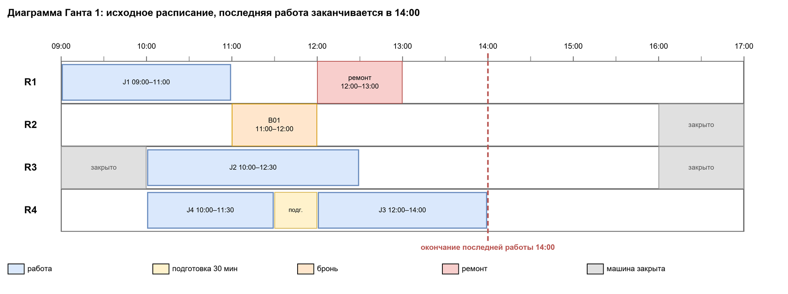
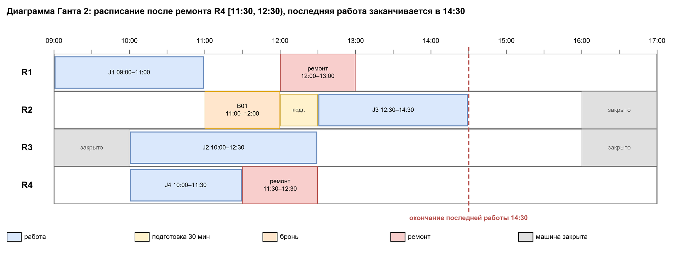
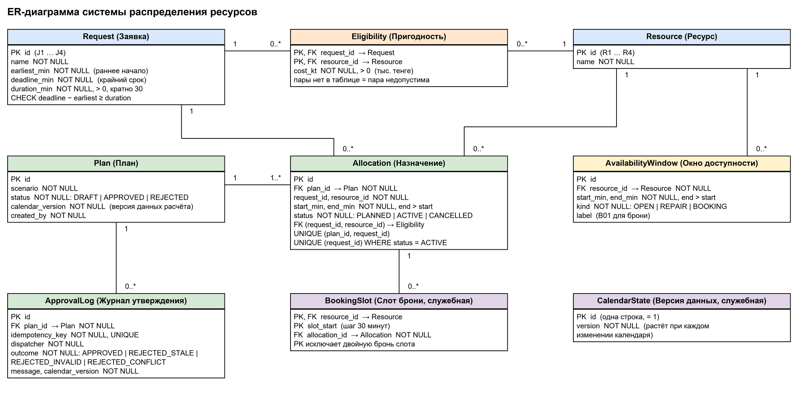
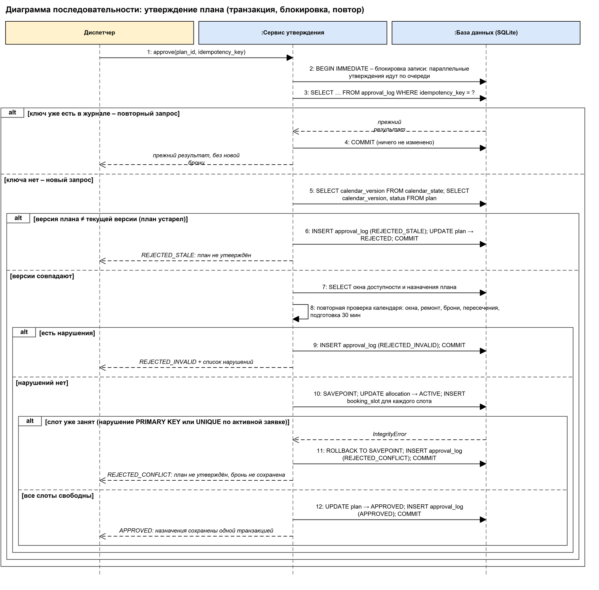

# Практическая работа 11. Информационная система распределения ресурсов

**Дисциплина:** Анализ, моделирование и проектирование информационных систем

**Выполнил:** Маханов Тимур

**Предметная область:** распределение сельскохозяйственной техники в хозяйстве. Ресурсы – четыре единицы техники R1–R4, заявки – четыре работы J1–J4 (поверхностная обработка почвы, глубокое рыхление, боронование, перевозка груза). Числовые данные таблиц 1, 2, 4 и 5 взяты из задания без изменений. Затраты и штрафы – в тысячах тенге, время – в минутах, шаг – 30 минут. Среда: Python 3.11.9, SQLite (модуль `sqlite3`), `unittest`, `threading`; диаграммы – `assets/allocation_model.drawio` (diagrams.net) и PNG. Исходные файлы: расчёты – `prototype/planning.py`, база и утверждение – `prototype/schema.sql`, `prototype/approval.py`, проверки TC01–TC08 – `prototype/checks.py`, автотесты – `prototype/tests/`, воспроизведение всех чисел – `prototype/run_all.py` (результаты – Excel-книга `results/results.xlsx`, формируется `prototype/export_xlsx.py`; журнал запуска – в приложении Б).

## 1. Анализ предметной области (задание 1)

### 1.1. Границы системы и роли

Система принимает заявки на работы, хранит календарь доступности техники, строит план распределения (какая машина и когда выполняет работу), проверяет его по правилам и после утверждения фиксирует брони. Вне границ системы: фактический учёт моточасов, закупка и ремонт техники, расчёт заработной платы механизаторов.

| Роль | Обязанности |
|---|---|
| Заявитель (агроном, бригадир участка) | Оформляет заявку: вид работы, раннее начало, крайний срок, длительность. Получает от системы машину и время либо отказ с причиной. Отвечает за достоверность окна времени |
| Диспетчер | Запускает расчёт плана, просматривает диаграмму Ганта, утверждает план. При изменении календаря или заявок пересчитывает план. Отвечает за то, что утверждается только допустимый и актуальный план |
| Ответственный за технику (механик) | Поддерживает данные о технике: пригодность машин к видам работ (таблица стоимости), интервалы доступности, ремонты и брони. Отвечает за актуальность календаря: любое его изменение повышает версию данных |

### 1.2. Требования

| Код | Функциональное требование |
|---|---|
| FR-01 | Система хранит заявки и таблицу пригодности «работа – машина – стоимость»; пара, которой нет в таблице, считается недопустимой |
| FR-02 | Система строит план одной смены: каждой работе не более одной подходящей машины, каждой машине не более одной работы, с минимальной суммарной стоимостью |
| FR-03 | При недоступности машины система пересчитывает план: либо сообщает, что допустимого плана нет и какое ограничение нарушено, либо переносит работу с учётом штрафа и признака обязательности |
| FR-04 | Система строит расписание внутри дня: машина, начало и окончание каждой работы с учётом окон времени, календаря машин и подготовки |
| FR-05 | Система утверждает план одной транзакцией: проверяет версию данных и календарь, сохраняет назначения и брони, пишет журнал утверждения |

| Код | Измеримое нефункциональное требование |
|---|---|
| NFR-01 | Расчёт и проверка плана из четырёх работ и четырёх машин – не более 5 секунд на обычном ПК (фактически перебор 432 расписаний занимает около 0,05 с, замер в разделе 6) |
| NFR-02 | При 30 параллельных попытках утвердить пересекающиеся планы в каждой попытке сохраняется ровно одна бронь интервала; доля двойных броней – 0 % |
| NFR-03 | Повторный запрос утверждения с тем же ключом не создаёт ни одной новой записи брони (число броней до и после повтора совпадает); ответ совпадает с прежним на 100 % |

### 1.3. Бизнес-правила и разграничение ограничений

| Код | Правило | Тип |
|---|---|---|
| BR-01 | Пригодность: работа назначается только машине, для которой в таблице стоимости указано значение (не прочерк) | жёсткое |
| BR-02 | Доступность: интервал работы лежит целиком в открытом интервале машины, не пересекается с ремонтом и бронью; конец интервала [начало, конец) в него не входит | жёсткое |
| BR-03 | Одна машина не выполняет две работы одновременно: в задаче на смену – не более одной работы, в расписании – работы не пересекаются | жёсткое |
| BR-04 | Окно времени: начало не раньше раннего начала, окончание не позже крайнего срока; между соседними работами на машине (включая бронь B01) 30 минут подготовки непосредственно перед следующей работой в открытом интервале | жёсткое |
| BR-05 | Обязательная работа не переносится; переносимая работа откладывается со штрафом, не более одной за смену; утверждается только план, рассчитанный на актуальной версии данных | жёсткое (обязательность, версия) |

Жёсткие ограничения определяют допустимость плана: нарушение любого делает план недопустимым (BR-01 – BR-05, FR-05). Критерии улучшения сравнивают допустимые планы между собой: минимум затрат C (FR-02), минимум Z = C + P при переносе (FR-03), как можно более раннее окончание последней работы (FR-04). Связь требований и проверок – в разделе 7.

## 2. Назначение техники на одну смену (задание 2)

Таблица 1 (затраты, тыс. тенге; «–» – пара недопустима):

| Работа | R1 | R2 | R3 | R4 |
|---|---|---|---|---|
| J1 Поверхностная обработка почвы | 5 | 8 | – | – |
| J2 Глубокое рыхление | 6 | 24 | 11 | – |
| J3 Боронование | – | 9 | 7 | 10 |
| J4 Перевозка груза | – | – | 8 | 4 |

### 2.1. Последовательный выбор

Работы рассматриваются в порядке J1, J2, J3, J4, каждой назначается самая дешёвая из оставшихся пригодных машин (при равной стоимости – меньший код).

| Шаг | Работа | Свободные пригодные машины | Выбор | Затраты |
|---|---|---|---|---|
| 1 | J1 | R1 (5), R2 (8) | R1 | 5 |
| 2 | J2 | R2 (24), R3 (11); R1 занята | R3 | 11 |
| 3 | J3 | R2 (9), R4 (10); R3 занята | R2 | 9 |
| 4 | J4 | R4 (4); R3 занята | R4 | 4 |

План последовательного выбора: J1–R1, J2–R3, J3–R2, J4–R4; общая стоимость **29**.

### 2.2. Математическая модель

Бинарная переменная x<sub>ij</sub> = 1, если работа i выполняется машиной j; переменные вводятся только для допустимых пар: x<sub>11</sub>, x<sub>12</sub>, x<sub>21</sub>, x<sub>22</sub>, x<sub>23</sub>, x<sub>32</sub>, x<sub>33</sub>, x<sub>34</sub>, x<sub>43</sub>, x<sub>44</sub> (первый индекс – работа, второй – машина). c<sub>ij</sub> – стоимость из таблицы 1.

Целевая функция: C = Σ c<sub>ij</sub>·x<sub>ij</sub> → min, то есть

C = 5x<sub>11</sub> + 8x<sub>12</sub> + 6x<sub>21</sub> + 24x<sub>22</sub> + 11x<sub>23</sub> + 9x<sub>32</sub> + 7x<sub>33</sub> + 10x<sub>34</sub> + 8x<sub>43</sub> + 4x<sub>44</sub> → min.

Ограничения для работ (каждая обязательна и выполняется ровно одной машиной):

- J1: x<sub>11</sub> + x<sub>12</sub> = 1;
- J2: x<sub>21</sub> + x<sub>22</sub> + x<sub>23</sub> = 1;
- J3: x<sub>32</sub> + x<sub>33</sub> + x<sub>34</sub> = 1;
- J4: x<sub>43</sub> + x<sub>44</sub> = 1.

Ограничения для техники (не более одной работы на машину за смену):

- R1: x<sub>11</sub> + x<sub>21</sub> ≤ 1;
- R2: x<sub>12</sub> + x<sub>22</sub> + x<sub>32</sub> ≤ 1;
- R3: x<sub>23</sub> + x<sub>33</sub> + x<sub>43</sub> ≤ 1;
- R4: x<sub>34</sub> + x<sub>44</sub> ≤ 1;

x<sub>ij</sub> ∈ {0, 1}.

### 2.3. Оптимальный план

Полный перебор допустимых вариантов (`prototype/planning.py`, функция `enumerate_plans`) даёт пять допустимых планов (другие сочетания нарушают ограничения для работ или техники):

| № | План | Стоимость |
|---|---|---|
| 1 | J1–R2, J2–R1, J3–R3, J4–R4 | **25** |
| 2 | J1–R1, J2–R3, J3–R2, J4–R4 | 29 (последовательный выбор) |
| 3 | J1–R2, J2–R1, J3–R4, J4–R3 | 32 |
| 4 | J1–R1, J2–R2, J3–R3, J4–R4 | 40 |
| 5 | J1–R1, J2–R2, J3–R4, J4–R3 | 47 |

Оптимальный план единственный: J1–R2 (8), J2–R1 (6), J3–R3 (7), J4–R4 (4), стоимость **25**. Последовательный выбор даёт 29; разница – 4 тыс. тенге.

**Обоснование.** Последовательный выбор отдал R1 работе J1 (5 вместо 8 на R2), хотя R1 – самая дешёвая машина для J2 (6). В результате J2 ушла на R3 (11), а J3 – на R2 (9 вместо 7 на R3). Выигрыш на J1 (3) меньше потерь на J2 (5) и J3 (2): 3 – 5 – 2 = –4.

## 3. Дефицит ресурсов и приоритет (задание 3)

R1 недоступна всю смену: остаются R2, R3, R4. Расчёт – `run_all.py`, раздел «Задание 3».

### 3.1. S1. Все работы обязательны

Допустимых планов нет. Невозможно выполнить ограничение «каждая обязательная работа получает собственную машину»: четырём работам нужны четыре разные машины, а доступны три (R2, R3, R4). Более того, J1 пригодна только для R1 и R2, то есть после отказа R1 ей остаётся R2; тогда J2 уходит на R3, J3 – на R4, а J4 (пригодна только для R3 и R4) остаётся без машины. Перебор подтверждает: ни одного допустимого плана.

### 3.2. S2. Перенос не более одной работы

Z = C + P, P = Σ p<sub>i</sub>·y<sub>i</sub>, Σ y<sub>i</sub> ≤ 1; работа с y<sub>i</sub> = 1 не назначается. Для каждой отложенной работы остальные назначаются с минимальными затратами:

| Отложена | Назначения остальных | C | P | Z |
|---|---|---|---|---|
| J1 | J2–R3, J3–R2, J4–R4 | 24 | 25 | 49 |
| **J2** | **J1–R2, J3–R3, J4–R4** | **19** | **12** | **31** |
| J3 | J1–R2, J2–R3, J4–R4 | 23 | 14 | 37 |
| J4 | J1–R2, J2–R3, J3–R4 | 29 | 30 | 59 |

Оптимум S2: отложить J2, C = 19, P = 12, **Z = 31**.

### 3.3. S3. Срочная заявка: J2 обязательна

Вариант «отложить J2» исключён. Из оставшихся минимум даёт перенос J3: J1–R2 (8), J2–R3 (11), J4–R4 (4), C = 23, P = 14, **Z = 37**.

**Влияние приоритета.** Требование выполнить J2 вынудило поставить её на R3 вместо переноса: фактические затраты выросли с 19 до 23 (+4), а штраф – с 12 до 14 (+2), итог Z – с 31 до 37 (+6). Обязательность сузила область допустимых решений, поэтому оптимум не мог улучшиться; цену приоритета в данных условиях составляют эти 6 тыс. тенге.

### 3.4. Сравнение результатов

| Сценарий | Назначения и отложенная работа | Доля охвата | C, тыс. тг | P, тыс. тг | Z, тыс. тг |
|---|---|---|---|---|---|
| S0 Исходный | J1–R2, J2–R1, J3–R3, J4–R4; отложенных нет | 4/4 = 100 % | 25 | 0 | 25 |
| S1 Все обязательны | Решения нет | – | – | – | – |
| S2 Перенос со штрафом | J1–R2, J3–R3, J4–R4; отложена J2 | 3/4 = 75 % | 19 | 12 | 31 |
| S3 J2 обязательна | J1–R2, J2–R3, J4–R4; отложена J3 | 3/4 = 75 % | 23 | 14 | 37 |

### 3.5. Анализ чувствительности

Штраф J2 обозначим p<sub>2</sub>. Перенос J2 даёт Z<sub>J2</sub> = 19 + p<sub>2</sub> (C = 19 не зависит от штрафа), перенос J3 даёт Z<sub>J3</sub> = 23 + 14 = 37. Равенство 19 + p<sub>2</sub> = 37 выполняется при **p<sub>2</sub> = 18**. Ниже порога (p<sub>2</sub> < 18) выгоднее отложить J2 (например, при p<sub>2</sub> = 12 – Z = 31), выше порога (p<sub>2</sub> > 18) – J3 (Z = 37). Остальные варианты не конкурируют: переносы J1 и J4 дают 49 и 59. Подтверждено перебором при p<sub>2</sub> = 0…30: смена оптимума происходит ровно на p<sub>2</sub> = 18 (в точке 18 оба варианта дают Z = 37).

## 4. Построение расписания (задание 4)

Модель: работа выполняется без перерыва на одной допустимой машине, шаг 30 минут, цель – как можно раньше закончить последнюю работу. Допустимые расписания перебираются полностью: для каждой работы формируются допустимые пары «машина – начало», затем проверяются все сочетания полной проверкой (окна, календарь, пересечения, подготовка). Расписаний, соответствующих правилам, **432**.

**Принятые толкования правил.** Подготовка 30 минут нужна непосредственно перед каждой работой, у которой на этой машине есть предыдущая работа (в том числе перед бронью B01 и после неё); перед первой работой на машине подготовка не нужна; ремонт предыдущей работой не считается. Подготовка не пересекается с предыдущей работой, ремонтом, бронью и лежит в открытом интервале.

### 4.1. Исходное расписание

Допустимые варианты по работам (одиночные ограничения):

- J1 (окно 09:00–12:30, 120 мин): R1 с 09:00, 09:30 или 10:00; R2 в 09:00 формально проходит, но тогда нет подготовки перед B01 (R2: подготовка [10:30,11:00) пересекается с J1);
- J2 (10:00–14:00, 150 мин): только R3 с 10:00 по 11:30; на R1 любой интервал пересекает ремонт [12:00,13:00), на R2 до B01 не помещается, а после B01 с подготовкой начало 12:30 даёт окончание 15:00 > 14:00;
- J4 (10:00–13:00, 90 мин): R3 или R4, начало 10:00–11:30;
- J3 (11:30–16:00, 120 мин): R2 – не раньше 12:30 (подготовка после B01), R3 – после J2, R4.

| Работа | Машина | Начало | Окончание |
|---|---|---|---|
| J1 | R1 | 09:00 | 11:00 |
| J2 | R3 | 10:00 | 12:30 |
| J4 | R4 | 10:00 | 11:30 |
| J3 | R4 | 12:00 | 14:00 |

Последняя работа J3 заканчивается в **14:00**.



**Почему раньше нельзя.** J2 возможна только на R3 и занимает её минимум до 12:30. Поэтому J4 не может стоять на R3 (до J2 не хватает времени: J2 начнётся в 12:00, закончится в 14:30 > 14:00; после J2 J4 начнётся не раньше 13:00 > 11:30), и J4 стоит на R4. Для окончания J3 в 13:30 ей нужно начало в 11:30. Но на R3 она пересекается с J2, на R2 раньше 12:30 не поставить из-за B01 и подготовки, а на R4 с J4 до неё нужна подготовка: J4 заканчивается в 11:30, начало J3 – 12:00. Полный перебор подтверждает: расписаний с окончанием раньше 14:00 нет, а с окончанием 14:00 – 12 (отличаются временем начала J1 и J2); выбрано расписание с минимальной суммой окончаний работ.

### 4.2. Расписание после ремонта R4 [11:30, 12:30)

Старое расписание недопустимо: J3 на R4 [12:00,14:00) пересекается с ремонтом [11:30,12:30). Новых допустимых расписаний – 102.

| Работа | Машина | Начало | Окончание |
|---|---|---|---|
| J1 | R1 | 09:00 | 11:00 |
| J2 | R3 | 10:00 | 12:30 |
| J4 | R4 | 10:00 | 11:30 |
| J3 | R2 | 12:30 | 14:30 |



Изменилась одна работа – **J3**: машина R4 → R2, начало 12:00 → 12:30. J1, J2, J4 остались прежними. Окончание последней работы сдвинулось с 14:00 до **14:30** (+30 минут). Из нескольких расписаний с окончанием 14:30 выбрано то, где меняется минимум работ.

### 4.3. Проверка временных ограничений

Оба расписания прошли полную проверку `check_schedule` без нарушений (книга `results/results.xlsx`, лист «Расписание»): пара допустима; начало не раньше раннего, окончание не позже крайнего срока; интервал в открытом интервале машины; пересечений с ремонтом и бронью B01 нет; работы на машине не пересекаются; подготовка 30 минут есть перед J3 на R4 (в первом расписании: [11:30,12:00)) и перед J3 на R2 (во втором: [12:00,12:30), после B01). Работа J4 заканчивается в 11:30 – ровно в начале ремонта R4: конец интервала не входит в него, пересечения нет.

## 5. Проектирование данных и утверждения плана (задание 5)

### 5.1. ER-диаграмма



Схема – `prototype/schema.sql`. Ключи и кратности показаны на рисунке; основные решения:

| Требование | Реализация |
|---|---|
| Пара (plan_id, request_id) уникальна внутри плана | `UNIQUE (plan_id, request_id)` в Allocation |
| У заявки не более одного активного назначения | частичный уникальный индекс `uq_active_request` по `request_id` при `status = 'ACTIVE'` |
| У машины не более одной активной брони на момент времени | таблица BookingSlot: по строке на каждый 30-минутный слот активного назначения, `PRIMARY KEY (resource_id, slot_start)`; два назначения не могут занять один слот |
| Назначение только на пригодную машину | внешний ключ `(request_id, resource_id)` → Eligibility |
| Устаревший план | `Plan.calendar_version` сравнивается с `CalendarState.version` |
| Повторный запрос | `ApprovalLog.idempotency_key UNIQUE` |

Обязательные поля отмечены NOT NULL; кратности: Request 1 – 0..\* Eligibility, Resource 1 – 0..\* Eligibility, Plan 1 – 1..\* Allocation, Request 1 – 0..\* Allocation, Resource 1 – 0..\* Allocation, Resource 1 – 0..\* AvailabilityWindow, Plan 1 – 0..\* ApprovalLog, Allocation 1 – 0..\* BookingSlot. Таблицы BookingSlot и CalendarState – служебные: они не входят в перечень сущностей задания и нужны для защиты от двойной брони и для версии данных.

### 5.2. Диаграмма последовательности утверждения



Утверждение выполняется в одной транзакции (`approve_plan`): `BEGIN IMMEDIATE`, поиск ключа в журнале, сравнение версии плана с текущей версией данных, повторная проверка календаря, запись назначений и слотов под `SAVEPOINT`, затем запись в журнал и `COMMIT`.

**Защита от двойной брони при параллельных запросах.** Два уровня. Первый – блокировка: `BEGIN IMMEDIATE` берёт блокировку записи, поэтому параллельные утверждения выполняются по очереди, и второй видит результат первого. Второй – ограничение базы: даже если проверка пропустила конфликт, вставка занятого слота нарушает первичный ключ BookingSlot (или уникальный индекс активной заявки), транзакция откатывается до `SAVEPOINT`, план получает статус REJECTED с исходом REJECTED_CONFLICT, брони не сохраняются. В СУБД с диапазонными ограничениями (например, PostgreSQL) то же делает `EXCLUDE USING gist` по интервалу.

**Повторный запрос.** Каждый запрос утверждения несёт ключ идемпотентности. Если ключ уже есть в ApprovalLog, сервис без изменений возвращает прежний результат (исход и сообщение) и ничего не записывает. Уникальность ключа в базе не позволяет двум параллельным повторам оба записать результат.

## 6. Проверка расчётной модели (задание 6)

Модель – Python (`prototype/`): `planning.py` рассчитывает распределение и проверяет ограничения, `approval.py` и `schema.sql` реализуют утверждение на SQLite. Проверки TC01–TC05 выполнены на исходных данных расчётными функциями, TC06–TC08 – на базе SQLite (в каждой проверке новая база с данными таблиц 1 и 5), TC07 – в двух потоках с барьером, повторено 30 раз. Автотесты: `python -m unittest discover -s tests` – 9 тестов, все пройдены (лист «Автотесты» книги `results/results.xlsx`); все числа воспроизводит `python run_all.py`, а таблицы с формулами – `python export_xlsx.py` (листы «Задание 2», «Задание 3», «Расписание», «Проверки TC», «Автотесты»). Замер на ПК автора: перебор и проверка 432 расписаний исходного календаря – около 0,05 с, 102 расписаний после ремонта – около 0,02 с; выполнение всех проверок TC01–TC08 – около 6 с, в основном из-за 30 повторов TC07. NFR-01 выполнено.

| Код | Действие | Ожидаемый результат | Фактический результат | Вывод |
|---|---|---|---|---|
| TC01 | Назначить J1 машине R4 | Недопустимая пара отклоняется | «J1: пара J1-R4 недопустима» | Пройдена: BR-01 соблюдается |
| TC02 | Назначить J1 и J2 машине R2 в одной смене | Два назначения одной машине запрещены | «машина R2 назначена нескольким работам за смену: J1, J2» | Пройдена: BR-03 соблюдается |
| TC03 | R1 недоступна, все четыре работы обязательны | Допустимый план отсутствует | допустимых планов 0; обязательных работ 4, доступных подходящих машин 3 (R2, R3, R4) | Пройдена: сценарий S1 из задания 3 подтверждён |
| TC04 | Запланировать J2 на R1 в [10:00, 12:30) | Есть пересечение с ремонтом | «J2 на R1 [10:00,12:30): пересечение с ремонтом [12:00,13:00)» | Пройдена: BR-02 соблюдается |
| TC05 | Запланировать J3 на R2 в [12:00, 14:00) | Пересечения с B01 нет, но нет времени на подготовку | «R2: перед J3 нет времени на подготовку: подготовка [11:30,12:00) пересекается с B01 [11:00,12:00)»; сообщения о пересечении самой работы с B01 нет | Пройдена: BR-04 соблюдается |
| TC06 | Утвердить старый проект после изменения календаря | Устаревший проект не утверждается | REJECTED_STALE: план рассчитан на версии 1, текущая версия 2; активных броней 0 | Пройдена: версия проверяется |
| TC07 | Два диспетчера одновременно утверждают один интервал R4 | Сохраняется одна бронь, второй запрос получает конфликт | 30 запусков: в 30 из 30 один APPROVED и один REJECTED_CONFLICT; активная бронь J4 одна, слотов R4 10:00–11:30 три без дублей | Пройдена: NFR-02 выполнено |
| TC08 | Повторить тот же запрос утверждения с тем же ключом | Возвращается прежний результат, новая бронь не создаётся | APPROVED повторно из журнала (replayed = True); броней, слотов и записей журнала до повтора (4, 16, 1) и после (4, 16, 1) | Пройдена: NFR-03 выполнено |

Дополнительная проверка: два разных проекта с пересекающимися, но не совпадающими интервалами (J4 на R4 [11:00,12:30) и J3 на R4 [11:30,13:30)) – результат APPROVED и REJECTED_CONFLICT: ограничение по слотам работает и тогда, когда конфликтуют разные заявки. Итого пройдено 8 из 8 проверок.

Ограничение проверки: параллельность моделируется потоками с отдельными соединениями к одной базе SQLite; на другой СУБД поведение блокировок отличается, поэтому ограничение уникальности в схеме обязательно сохранять.

## 7. Сравнение и обоснование решений (задание 7)

### 7.1. Затраты (задание 2)

| Показатель | Последовательный выбор | Оптимальный план |
|---|---|---|
| Назначения | J1–R1, J2–R3, J3–R2, J4–R4 | J1–R2, J2–R1, J3–R3, J4–R4 |
| Стоимость, тыс. тенге | 29 | 25 |
| Абсолютная разница | – | 4 тыс. тенге |
| Экономия от последовательного выбора | – | 4 / 29 = 13,8 % |

### 7.2. Расписания (задание 4)

| Показатель | Исходное расписание | После ремонта R4 |
|---|---|---|
| Окончание последней работы | 14:00 | 14:30 |
| Число работ с изменившейся машиной или началом | – | 1 (J3: R4 12:00 → R2 12:30) |

### 7.3. Связь требований, ограничений модели и проверок

| Требование | Ограничение модели | Проверка |
|---|---|---|
| BR-01 / FR-01 пригодность | xᵢⱼ вводятся только для допустимых пар | TC01 |
| BR-03 одна работа на машину | R1: x<sub>11</sub> + x<sub>21</sub> ≤ 1 и аналогично для R2–R4 | TC02 |
| FR-03 дефицит ресурсов | Σ x<sub>ij</sub> по обязательным работам = 1 при трёх доступных машинах | TC03 |
| BR-02 доступность и календарь | интервал в открытом интервале, без ремонта и брони | TC04 |
| BR-04 подготовка 30 минут | перед следующей работой свободный открытый слот | TC05 |
| FR-05 / BR-05 актуальность плана | версия плана равна текущей версии данных | TC06 |
| NFR-02 нет двойных броней | PRIMARY KEY (resource_id, slot_start) и блокировка записи | TC07 |
| NFR-03 повторный запрос | UNIQUE (idempotency_key) | TC08 |

### 7.4. Вывод и рекомендация

Рекомендую оптимальный план: J1–R2, J2–R1, J3–R3, J4–R4 со стоимостью 25 тыс. тенге вместо 29 при последовательном выборе. Экономия – 4 тыс. тенге, или 13,8 % от стоимости последовательного выбора: самую дешёвую для J1 машину R1 выгоднее отдать работе J2, для которой она ценнее. Для расписания рекомендую вариант с окончанием последней работы в 14:00; если R4 уходит в ремонт на [11:30, 12:30), достаточно перенести одну работу J3 на R2 с началом 12:30, и последняя работа заканчивается в 14:30. Рекомендация зависит от предпосылок. Затраты не зависят от времени работы и считаются точными. Штрафы заданы верно: если штраф за перенос J2 превысит 18 тыс. тенге, выгоднее откладывать J3. Календарь, бронь B01 и подготовка в 30 минут актуальны. Деньги и время оптимизировались раздельно, поэтому при совместном критерии планы нужно сравнить заново. Перед утверждением обязательна повторная проверка версии данных и календаря. Последовательный выбор остаётся допустимым запасным вариантом, когда нужен мгновенный ответ, но он дороже. Расчёт охватывает четыре работы и одну смену; при росте числа заявок полный перебор заменяют решателем.

### 7.5. Вопрос для защиты

*Почему последовательный выбор самой дешёвой машины для каждой заявки не всегда снижает общую стоимость?*

Потому что выбор для одной заявки уменьшает набор машин для следующих. В расчёте J1 взяла R1 за 5 (самая дешёвая из её машин), хотя на R2 стоила бы 8. Но R1 – самая дешёвая машина для J2 (6): J2 вынуждена идти на R3 за 11, и J3 теряет R3 (7) и берёт R2 за 9. Выигрыш на J1 – 3, потери – 5 на J2 и 2 на J3, итог +4 тыс. тенге (29 вместо 25). Локально лучший выбор не учитывает ценность машины для последующих работ, а оптимизация сравнивает планы целиком.

## Приложение А. Исходный код

### А.1. planning.py – модель распределения, расписание, проверки

```python
"""Resource allocation model of practice 11: one-shift assignment (tasks 2-3) and timetable (task 4).

Pure functions, no I/O. Times are minutes from 00:00 of the planned day, the time step is 30 minutes.
Costs and penalties are in thousand tenge.
"""

from __future__ import annotations

import itertools
from dataclasses import dataclass, field
from typing import Optional

STEP = 30            # time step and preparation length, minutes
PREP = 30            # preparation before the next work on the same machine, minutes

JOBS = ["J1", "J2", "J3", "J4"]
MACHINES = ["R1", "R2", "R3", "R4"]
JOB_NAMES = {"J1": "Поверхностная обработка почвы", "J2": "Глубокоерыхление", "J3": "Боронование",
             "J4": "Перевозка груза"}

# Table 1: cost of the job on the machine; a missing pair is not allowed
COST = {
    "J1": {"R1": 5, "R2": 8},
    "J2": {"R1": 6, "R2": 24, "R3": 11},
    "J3": {"R2": 9, "R3": 7, "R4": 10},
    "J4": {"R3": 8, "R4": 4},
}
# Table 2: penalty for postponing a job
PENALTY = {"J1": 25, "J2": 12, "J3": 14, "J4": 30}

# Table 4: earliest start, deadline, duration (minutes)


def hm(text: str) -> int:
    h, m = text.split(":")
    return int(h) * 60 + int(m)


def hhmm(minutes: int) -> str:
    return f"{minutes // 60:02d}:{minutes % 60:02d}"


TIME = {
    "J1": (hm("09:00"), hm("12:30"), 120),
    "J2": (hm("10:00"), hm("14:00"), 150),
    "J3": (hm("11:30"), hm("16:00"), 120),
    "J4": (hm("10:00"), hm("13:00"), 90),
}


# ----------------------------------------------------------------------------- tasks 2 and 3: one shift
@dataclass
class ShiftPlan:
    assign: dict            # job -> machine (only for executed jobs)
    postponed: tuple        # jobs postponed (y = 1)
    cost: int               # C
    penalty: int            # P

    @property
    def total(self) -> int:     # Z = C + P
        return self.cost + self.penalty

    @property
    def coverage(self) -> float:
        return len(self.assign) / len(JOBS)


def greedy(cost=COST, order=JOBS, available=MACHINES) -> ShiftPlan:
    """Sequential choice: jobs in the given order, each takes the cheapest free eligible machine
    (ties - the smaller machine code). All jobs are mandatory; a job without a machine stays unassigned."""
    used, assign = set(), {}
    for j in order:
        options = sorted((c, r) for r, c in cost[j].items() if r in available and r not in used)
        if options:
            c, r = options[0]
            assign[j] = r
            used.add(r)
    return ShiftPlan(assign, tuple(j for j in order if j not in assign),
                     sum(cost[j][r] for j, r in assign.items()), 0)


def enumerate_plans(available=MACHINES, mandatory=frozenset(JOBS), max_postponed=0,
                    penalty=PENALTY, cost=COST) -> list[ShiftPlan]:
    """All feasible plans: every job gets an eligible available machine or is postponed
    (not mandatory, at most max_postponed postponed); a machine takes at most one job."""
    plans = []
    options = [[None] + [r for r in cost[j] if r in available] for j in JOBS]
    for combo in itertools.product(*options):
        chosen = [r for r in combo if r is not None]
        if len(set(chosen)) != len(chosen):
            continue
        postponed = tuple(j for j, r in zip(JOBS, combo) if r is None)
        if len(postponed) > max_postponed or any(j in mandatory for j in postponed):
            continue
        assign = {j: r for j, r in zip(JOBS, combo) if r is not None}
        plans.append(ShiftPlan(assign, postponed, sum(cost[j][r] for j, r in assign.items()),
                               sum(penalty[j] for j in postponed)))
    return plans


def best_plan(plans: list[ShiftPlan]) -> Optional[ShiftPlan]:
    """Minimum of Z = C + P; ties - the plan with the lexicographically smallest assignment."""
    if not plans:
        return None
    return min(plans, key=lambda p: (p.total, sorted(p.assign.items())))


def explain_infeasible(available, mandatory=frozenset(JOBS), cost=COST) -> list[str]:
    """Why no plan exists: a job without a machine, or fewer machines than mandatory jobs."""
    reasons = []
    for j in sorted(mandatory):
        eligible = [r for r in cost[j] if r in available]
        if not eligible:
            reasons.append(f"{j}: нет доступной подходящей машины")
    usable = sorted({r for j in mandatory for r in cost[j] if r in available})
    if len(mandatory) > len(usable):
        reasons.append(f"обязательных работ {len(mandatory)}, а доступных подходящих машин {len(usable)} "
                       f"({', '.join(usable)}), при этом машине назначается не более одной работы")
    return reasons


def check_shift(assign: dict, available=MACHINES, cost=COST) -> list[str]:
    """Validate a one-shift plan (job -> machine): eligibility, availability, one job per machine."""
    errors = []
    for j, r in assign.items():
        if r not in cost[j]:
            errors.append(f"{j}: пара {j}-{r} недопустима")
        if r not in available:
            errors.append(f"{j}: машина {r} недоступна")
    for r in sorted(set(assign.values())):
        jobs = sorted(j for j, rr in assign.items() if rr == r)
        if len(jobs) > 1:
            errors.append(f"машина {r} назначена нескольким работам за смену: {', '.join(jobs)}")
    return errors


# ----------------------------------------------------------------------------- task 4: timetable
@dataclass
class Calendar:
    """Availability of the machines. open - open intervals [start, end); repairs and bookings block time."""
    open: dict = field(default_factory=dict)
    repairs: dict = field(default_factory=dict)       # machine -> [(start, end)]
    bookings: dict = field(default_factory=dict)      # machine -> [(start, end, label)]

    def copy(self) -> "Calendar":
        return Calendar({r: list(v) for r, v in self.open.items()},
                        {r: list(v) for r, v in self.repairs.items()},
                        {r: list(v) for r, v in self.bookings.items()})

    def with_repair(self, machine: str, start: int, end: int) -> "Calendar":
        cal = self.copy()
        cal.repairs.setdefault(machine, []).append((start, end))
        return cal

    def in_open(self, machine, start, end) -> bool:
        return any(s <= start and end <= e for s, e in self.open.get(machine, []))

    def blockers(self, machine, start, end) -> list[str]:
        """Repairs and bookings that intersect [start, end)."""
        found = [f"ремонтом [{hhmm(s)},{hhmm(e)})" for s, e in self.repairs.get(machine, []) if start < e and s < end]
        found += [f"бронью {lb} [{hhmm(s)},{hhmm(e)})" for s, e, lb in self.bookings.get(machine, [])
                  if start < e and s < end]
        return found


def base_calendar() -> Calendar:
    """Table 5."""
    return Calendar(
        open={"R1": [(hm("09:00"), hm("12:00")), (hm("13:00"), hm("17:00"))],
              "R2": [(hm("09:00"), hm("16:00"))],
              "R3": [(hm("10:00"), hm("16:00"))],
              "R4": [(hm("09:00"), hm("17:00"))]},
        repairs={"R1": [(hm("12:00"), hm("13:00"))]},
        bookings={"R2": [(hm("11:00"), hm("12:00"), "B01")]})


def calendar_with_r4_repair() -> Calendar:
    return base_calendar().with_repair("R4", hm("11:30"), hm("12:30"))


def duration_of(job: str) -> int:
    return TIME[job][2]


def check_schedule(cal: Calendar, plan: dict) -> list[str]:
    """Validate a timetable plan: job -> (machine, start). Returns the list of violations (empty = valid).

    Rules: eligible pair; step 30 min; start >= earliest, end <= deadline; the interval [start, end) lies in one
    open interval and does not meet repairs or bookings; works on a machine do not overlap; 30 minutes of
    preparation directly before every work (job or booking) that has a previous work on the machine; the
    preparation lies in an open interval, does not meet the previous work, repairs and bookings."""
    errors = []
    for j, (r, s) in sorted(plan.items()):
        earliest, deadline, dur = TIME[j]
        e = s + dur
        if r not in COST[j]:
            errors.append(f"{j}: пара {j}-{r} недопустима")
        if (s - earliest) % STEP:
            errors.append(f"{j}: начало {hhmm(s)} не кратно шагу 30 минут")
        if s < earliest:
            errors.append(f"{j}: начало {hhmm(s)} раньше раннего начала {hhmm(earliest)}")
        if e > deadline:
            errors.append(f"{j}: окончание {hhmm(e)} позже крайнего срока {hhmm(deadline)}")
        blockers = cal.blockers(r, s, e)
        if blockers:
            errors.append(f"{j} на {r} [{hhmm(s)},{hhmm(e)}): пересечение с " + ", ".join(blockers))
        elif not cal.in_open(r, s, e):
            errors.append(f"{j} на {r} [{hhmm(s)},{hhmm(e)}): интервал не лежит целиком в открытом интервале машины")
    for r in MACHINES:
        works = [(s, s + duration_of(j), j) for j, (rr, s) in plan.items() if rr == r]
        works += [(s, e, lb) for s, e, lb in cal.bookings.get(r, [])]
        works.sort()
        for (s1, e1, n1), (s2, e2, n2) in zip(works, works[1:]):
            if s2 < e1:
                if not (n1.startswith("B") and n2.startswith("B")):
                    errors.append(f"{r}: пересечение {n1} [{hhmm(s1)},{hhmm(e1)}) и {n2} [{hhmm(s2)},{hhmm(e2)})")
                continue
            ps, pe = s2 - PREP, s2
            why = []
            if e1 > ps:
                why.append(f"пересекается с {n1} [{hhmm(s1)},{hhmm(e1)})")
            blockers = [b for b in cal.blockers(r, ps, pe) if not b.startswith(f"бронью {n1} ")]
            why += ["пересекается с " + b for b in blockers]
            if not cal.in_open(r, ps, pe) and not blockers:
                why.append("не лежит в открытом интервале машины")
            if why:
                errors.append(f"{r}: перед {n2} нет времени на подготовку: подготовка [{hhmm(ps)},{hhmm(pe)}) "
                              + "; ".join(why))
    return errors


def preparations(cal: Calendar, plan: dict) -> list[tuple]:
    """Preparation intervals (machine, start, end, before) of a valid plan, for the Gantt chart."""
    result = []
    for r in MACHINES:
        works = [(s, s + duration_of(j), j) for j, (rr, s) in plan.items() if rr == r]
        works += [(s, e, lb) for s, e, lb in cal.bookings.get(r, [])]
        works.sort()
        for (_, _, _), (s2, _, n2) in zip(works, works[1:]):
            result.append((r, s2 - PREP, s2, n2))
    return result


def candidates(cal: Calendar, job: str) -> list[tuple]:
    """Single-job feasible placements (machine, start) ignoring the other jobs and preparation."""
    earliest, deadline, dur = TIME[job]
    found = []
    for r in COST[job]:
        for s in range(earliest, deadline - dur + 1, STEP):
            if not cal.blockers(r, s, s + dur) and cal.in_open(r, s, s + dur):
                found.append((r, s))
    return found


def schedules(cal: Calendar) -> list[dict]:
    """All valid timetables of the four jobs (complete enumeration over the candidates)."""
    lists = [candidates(cal, j) for j in JOBS]
    result = []
    for combo in itertools.product(*lists):
        plan = dict(zip(JOBS, combo))
        if not check_schedule(cal, plan):
            result.append(plan)
    return result


def makespan(plan: dict) -> int:
    return max(s + duration_of(j) for j, (_, s) in plan.items())


def changed_jobs(old: dict, new: dict) -> list[str]:
    return [j for j in JOBS if old[j] != new[j]]


def best_schedule(cal: Calendar, reference: Optional[dict] = None, plans: Optional[list] = None):
    """Earliest finish of the last job. Ties: fewest changes against the reference plan, then the smaller sum of
    finish times, then the lexicographically smallest plan. Returns (plan, number of plans with the same makespan)."""
    plans = schedules(cal) if plans is None else plans
    if not plans:
        return None, 0
    best = min(makespan(p) for p in plans)
    top = [p for p in plans if makespan(p) == best]

    def key(p):
        changes = len(changed_jobs(reference, p)) if reference else 0
        return (changes, sum(s + duration_of(j) for j, (_, s) in p.items()), sorted(p.items()))

    return min(top, key=key), len(top)
```

### А.2. schema.sql – схема базы данных

```sql
-- Data model of the resource allocation system (SQLite). Times are minutes from 00:00 of the planned day.
PRAGMA foreign_keys = ON;

CREATE TABLE request (
    id            TEXT PRIMARY KEY,                       -- J1..J4
    name          TEXT NOT NULL,
    earliest_min  INTEGER NOT NULL,                       -- earliest start
    deadline_min  INTEGER NOT NULL,                       -- latest finish
    duration_min  INTEGER NOT NULL CHECK (duration_min > 0 AND duration_min % 30 = 0),
    CHECK (deadline_min - earliest_min >= duration_min)
);

CREATE TABLE resource (
    id    TEXT PRIMARY KEY,                               -- R1..R4
    name  TEXT NOT NULL
);

CREATE TABLE eligibility (                                -- which machine may do which job, and at what cost
    request_id   TEXT NOT NULL REFERENCES request(id),
    resource_id  TEXT NOT NULL REFERENCES resource(id),
    cost_kt      INTEGER NOT NULL CHECK (cost_kt > 0),    -- thousand tenge
    PRIMARY KEY (request_id, resource_id)
);

CREATE TABLE availability_window (
    id           INTEGER PRIMARY KEY AUTOINCREMENT,
    resource_id  TEXT NOT NULL REFERENCES resource(id),
    start_min    INTEGER NOT NULL,
    end_min      INTEGER NOT NULL,
    kind         TEXT NOT NULL CHECK (kind IN ('OPEN', 'REPAIR', 'BOOKING')),
    label        TEXT,                                    -- B01 for a booking
    CHECK (end_min > start_min)
);

CREATE TABLE calendar_state (                             -- data version: grows with every calendar change
    id       INTEGER PRIMARY KEY CHECK (id = 1),
    version  INTEGER NOT NULL
);

CREATE TABLE plan (
    id                INTEGER PRIMARY KEY AUTOINCREMENT,
    scenario          TEXT NOT NULL,
    status            TEXT NOT NULL CHECK (status IN ('DRAFT', 'APPROVED', 'REJECTED')),
    calendar_version  INTEGER NOT NULL,                   -- version the plan was calculated on
    created_by        TEXT NOT NULL
);

CREATE TABLE allocation (
    id           INTEGER PRIMARY KEY AUTOINCREMENT,
    plan_id      INTEGER NOT NULL REFERENCES plan(id),
    request_id   TEXT NOT NULL,
    resource_id  TEXT NOT NULL,
    start_min    INTEGER NOT NULL,
    end_min      INTEGER NOT NULL,
    status       TEXT NOT NULL CHECK (status IN ('PLANNED', 'ACTIVE', 'CANCELLED')),
    CHECK (end_min > start_min),
    UNIQUE (plan_id, request_id),                         -- a job occurs once inside a plan
    FOREIGN KEY (request_id, resource_id) REFERENCES eligibility(request_id, resource_id)
);

-- a request has at most one active allocation
CREATE UNIQUE INDEX uq_active_request ON allocation(request_id) WHERE status = 'ACTIVE';

CREATE TABLE booking_slot (                               -- one row per 30-minute slot of an active allocation
    resource_id    TEXT NOT NULL REFERENCES resource(id),
    slot_start     INTEGER NOT NULL,
    allocation_id  INTEGER NOT NULL REFERENCES allocation(id),
    PRIMARY KEY (resource_id, slot_start)                 -- two active bookings of one slot are impossible
);

CREATE TABLE approval_log (
    id               INTEGER PRIMARY KEY AUTOINCREMENT,
    idempotency_key  TEXT NOT NULL UNIQUE,                -- repeated request is recognised by the key
    plan_id          INTEGER NOT NULL REFERENCES plan(id),
    dispatcher       TEXT NOT NULL,
    outcome          TEXT NOT NULL CHECK (outcome IN ('APPROVED', 'REJECTED_STALE', 'REJECTED_INVALID',
                                                      'REJECTED_CONFLICT')),
    message          TEXT NOT NULL,
    calendar_version INTEGER NOT NULL                     -- version seen at the moment of the decision
);
```

### А.3. approval.py – сервис утверждения плана

```python
"""Plan approval service on SQLite: stale-plan check, calendar re-check, double-booking protection, idempotency.

approve_plan() runs in one transaction. BEGIN IMMEDIATE takes the write lock, so parallel approvals are
serialised; the unique constraints (booking_slot primary key, partial unique index on active requests) stay
the last line of defence even if the lock is missed.
"""

from __future__ import annotations

import pathlib
import sqlite3
from dataclasses import dataclass

from planning import COST, JOB_NAMES, JOBS, MACHINES, STEP, TIME, Calendar, check_schedule, duration_of

SCHEMA = pathlib.Path(__file__).resolve().parent / "schema.sql"


def connect(path: str) -> sqlite3.Connection:
    conn = sqlite3.connect(path, timeout=10, isolation_level=None)      # manual transactions
    conn.execute("PRAGMA foreign_keys = ON")
    return conn


def init_db(path: str, cal: Calendar) -> None:
    """Create the schema and load Table 1 and the calendar of Table 5."""
    conn = connect(path)
    conn.executescript(SCHEMA.read_text(encoding="utf-8"))
    for r in MACHINES:
        conn.execute("INSERT INTO resource VALUES (?, ?)", (r, f"Машина {r}"))
    for j in JOBS:
        earliest, deadline, dur = TIME[j]
        conn.execute("INSERT INTO request VALUES (?, ?, ?, ?, ?)", (j, JOB_NAMES[j], earliest, deadline, dur))
        for r, c in COST[j].items():
            conn.execute("INSERT INTO eligibility VALUES (?, ?, ?)", (j, r, c))
    conn.execute("INSERT INTO calendar_state VALUES (1, 1)")
    for r, spans in cal.open.items():
        for s, e in spans:
            conn.execute("INSERT INTO availability_window (resource_id, start_min, end_min, kind) "
                         "VALUES (?, ?, ?, 'OPEN')", (r, s, e))
    for r, spans in cal.repairs.items():
        for s, e in spans:
            conn.execute("INSERT INTO availability_window (resource_id, start_min, end_min, kind, label) "
                         "VALUES (?, ?, ?, 'REPAIR', 'repair')", (r, s, e))
    for r, spans in cal.bookings.items():
        for s, e, label in spans:
            conn.execute("INSERT INTO availability_window (resource_id, start_min, end_min, kind, label) "
                         "VALUES (?, ?, ?, 'BOOKING', ?)", (r, s, e, label))
    conn.close()


def load_calendar(conn: sqlite3.Connection) -> Calendar:
    cal = Calendar()
    for r, s, e, kind, label in conn.execute(
            "SELECT resource_id, start_min, end_min, kind, label FROM availability_window ORDER BY id"):
        if kind == "OPEN":
            cal.open.setdefault(r, []).append((s, e))
        elif kind == "REPAIR":
            cal.repairs.setdefault(r, []).append((s, e))
        else:
            cal.bookings.setdefault(r, []).append((s, e, label))
    return cal


def calendar_version(conn: sqlite3.Connection) -> int:
    return conn.execute("SELECT version FROM calendar_state WHERE id = 1").fetchone()[0]


def add_repair(path: str, machine: str, start: int, end: int) -> int:
    """Dispatcher changes the calendar: the data version grows by one."""
    conn = connect(path)
    conn.execute("BEGIN IMMEDIATE")
    conn.execute("INSERT INTO availability_window (resource_id, start_min, end_min, kind, label) "
                 "VALUES (?, ?, ?, 'REPAIR', 'repair')", (machine, start, end))
    conn.execute("UPDATE calendar_state SET version = version + 1 WHERE id = 1")
    version = calendar_version(conn)
    conn.execute("COMMIT")
    conn.close()
    return version


def create_draft(path: str, plan: dict, scenario: str, dispatcher: str) -> int:
    """Save a draft plan (job -> (machine, start)) calculated on the current calendar version."""
    conn = connect(path)
    conn.execute("BEGIN IMMEDIATE")
    cur = conn.execute("INSERT INTO plan (scenario, status, calendar_version, created_by) VALUES (?, 'DRAFT', ?, ?)",
                       (scenario, calendar_version(conn), dispatcher))
    plan_id = cur.lastrowid
    for j, (r, s) in plan.items():
        conn.execute("INSERT INTO allocation (plan_id, request_id, resource_id, start_min, end_min, status) "
                     "VALUES (?, ?, ?, ?, ?, 'PLANNED')", (plan_id, j, r, s, s + duration_of(j)))
    conn.execute("COMMIT")
    conn.close()
    return plan_id


@dataclass
class Decision:
    outcome: str            # APPROVED | REJECTED_STALE | REJECTED_INVALID | REJECTED_CONFLICT
    message: str
    replayed: bool = False  # True if returned from the log for a repeated key

    @property
    def approved(self) -> bool:
        return self.outcome == "APPROVED"


def approve_plan(path: str, plan_id: int, key: str, dispatcher: str) -> Decision:
    """Approve a draft plan in one transaction (version check, calendar re-check, write of the bookings)."""
    conn = connect(path)
    try:
        conn.execute("BEGIN IMMEDIATE")                                  # write lock: approvals are serialised
        row = conn.execute("SELECT outcome, message FROM approval_log WHERE idempotency_key = ?", (key,)).fetchone()
        if row:                                                          # repeated request: previous answer
            conn.execute("COMMIT")
            return Decision(row[0], row[1], replayed=True)
        version = calendar_version(conn)
        status, plan_version = conn.execute("SELECT status, calendar_version FROM plan WHERE id = ?",
                                            (plan_id,)).fetchone()

        def finish(outcome, message):
            conn.execute("INSERT INTO approval_log (idempotency_key, plan_id, dispatcher, outcome, message, "
                         "calendar_version) VALUES (?, ?, ?, ?, ?, ?)", (key, plan_id, dispatcher, outcome, message,
                                                                         version))
            if outcome != "APPROVED":
                conn.execute("UPDATE plan SET status = 'REJECTED' WHERE id = ? AND status = 'DRAFT'", (plan_id,))
            conn.execute("COMMIT")
            return Decision(outcome, message)

        if status != "DRAFT":
            return finish("REJECTED_INVALID", f"план в статусе {status}, утверждение возможно только для DRAFT")
        if plan_version != version:                                      # stale draft
            return finish("REJECTED_STALE", f"план рассчитан на версии календаря {plan_version}, "
                                            f"текущая версия {version}")
        rows = conn.execute("SELECT id, request_id, resource_id, start_min FROM allocation WHERE plan_id = ?",
                            (plan_id,)).fetchall()
        plan = {j: (r, s) for _, j, r, s in rows}
        errors = check_schedule(load_calendar(conn), plan)               # calendar re-check
        if errors:
            return finish("REJECTED_INVALID", "; ".join(errors))
        conn.execute("SAVEPOINT booking")
        try:
            for alloc_id, j, r, s in rows:
                conn.execute("UPDATE allocation SET status = 'ACTIVE' WHERE id = ?", (alloc_id,))
                for slot in range(s, s + duration_of(j), STEP):
                    conn.execute("INSERT INTO booking_slot VALUES (?, ?, ?)", (r, slot, alloc_id))
        except sqlite3.IntegrityError as exc:                            # double booking: nothing is saved
            conn.execute("ROLLBACK TO booking")
            conn.execute("RELEASE booking")
            return finish("REJECTED_CONFLICT", f"конфликт брони: {exc}")
        conn.execute("RELEASE booking")
        conn.execute("UPDATE plan SET status = 'APPROVED' WHERE id = ?", (plan_id,))
        return finish("APPROVED", f"план {plan_id} утверждён, назначений: {len(rows)}")
    except BaseException:
        if conn.in_transaction:
            conn.execute("ROLLBACK")
        raise
    finally:
        conn.close()


def active_allocations(path: str) -> list[tuple]:
    conn = connect(path)
    rows = conn.execute("SELECT request_id, resource_id, start_min, end_min FROM allocation "
                        "WHERE status = 'ACTIVE' ORDER BY request_id").fetchall()
    conn.close()
    return rows
```

### А.4. checks.py – проверки TC01–TC08

```python
"""Checks TC01-TC08 of Table 6: each returns (actual result, passed)."""

from __future__ import annotations

import os
import tempfile
import threading

from approval import (active_allocations, add_repair, approve_plan, connect, create_draft, init_db)
from planning import (JOBS, base_calendar, best_plan, best_schedule, check_schedule, check_shift,
                      enumerate_plans, explain_infeasible, hm, MACHINES, schedules)

KEY = "approve-{}-{}"


def fresh_db() -> str:
    folder = tempfile.mkdtemp(prefix="sched_")
    path = os.path.join(folder, "scheduling.db")
    init_db(path, base_calendar())
    return path


def tc01():
    errors = check_shift({"J1": "R4"})
    return "; ".join(errors), bool(errors) and "недопустима" in errors[0]


def tc02():
    errors = check_shift({"J1": "R2", "J2": "R2"})
    return "; ".join(errors), len(errors) == 1 and "нескольким работам" in errors[0]


def tc03():
    available = [r for r in MACHINES if r != "R1"]
    plans = enumerate_plans(available)
    reasons = explain_infeasible(available)
    return (f"допустимых планов: {len(plans)}; " + "; ".join(reasons)), not plans and bool(reasons)


def tc04():
    errors = check_schedule(base_calendar(), {"J2": ("R1", hm("10:00"))})
    return "; ".join(errors), len(errors) == 1 and "ремонтом [12:00,13:00)" in errors[0]


def tc05():
    errors = check_schedule(base_calendar(), {"J3": ("R2", hm("12:00"))})
    no_overlap_with_work = not any("пересечение" in e for e in errors)
    return "; ".join(errors), no_overlap_with_work and len(errors) == 1 and "нет времени на подготовку" in errors[0]


def best_plan_for(cal):
    plan, _ = best_schedule(cal)
    return plan


def tc06():
    path = fresh_db()
    plan = best_plan_for(base_calendar())
    plan_id = create_draft(path, plan, "S0", "dispatcher-1")
    version = add_repair(path, "R4", hm("11:30"), hm("12:30"))          # calendar changed after the draft
    decision = approve_plan(path, plan_id, KEY.format(plan_id, 1), "dispatcher-1")
    rows = active_allocations(path)
    actual = f"{decision.outcome}: {decision.message}; версия календаря {version}; активных броней {len(rows)}"
    return actual, decision.outcome == "REJECTED_STALE" and not rows


def two_drafts(path):
    """Two dispatchers have drafts that book the same interval of R4: J4 on R4 at 10:00-11:30."""
    plan = best_plan_for(base_calendar())
    return (create_draft(path, plan, "S0-A", "dispatcher-1"), create_draft(path, plan, "S0-B", "dispatcher-2"))


def run_parallel(path, jobs):
    """Run approve_plan calls in threads released by one barrier; returns decisions in the order of jobs."""
    barrier = threading.Barrier(len(jobs))
    results = [None] * len(jobs)

    def worker(i, plan_id, key, dispatcher):
        barrier.wait()
        results[i] = approve_plan(path, plan_id, key, dispatcher)

    threads = [threading.Thread(target=worker, args=(i, *args)) for i, args in enumerate(jobs)]
    for t in threads:
        t.start()
    for t in threads:
        t.join()
    return results


def tc07(rounds: int = 30):
    """Two dispatchers approve plans with the same R4 interval in parallel; repeated `rounds` times."""
    outcomes, good = [], True
    for n in range(rounds):
        path = fresh_db()
        a, b = two_drafts(path)
        results = run_parallel(path, [(a, KEY.format(a, 1), "dispatcher-1"), (b, KEY.format(b, 1), "dispatcher-2")])
        kinds = sorted(r.outcome for r in results)
        conn = connect(path)
        slots_r4 = conn.execute("SELECT count(*), count(DISTINCT slot_start) FROM booking_slot "
                                "WHERE resource_id = 'R4' AND slot_start BETWEEN ? AND ?",
                                (hm("10:00"), hm("11:00"))).fetchone()
        active = conn.execute("SELECT count(*) FROM allocation WHERE status = 'ACTIVE' AND request_id = 'J4'").fetchone()[0]
        conn.close()
        good &= kinds == ["APPROVED", "REJECTED_CONFLICT"] and active == 1 and slots_r4 == (3, 3)
        outcomes.append(kinds)
    ok_rounds = sum(k == ["APPROVED", "REJECTED_CONFLICT"] for k in outcomes)
    actual = (f"{rounds} запусков по 2 параллельных утверждения: в {ok_rounds} из {rounds} один APPROVED и один "
              f"REJECTED_CONFLICT; активных броней J4 – по одной, слотов R4 10:00–11:30 – по три без дублей")
    return actual, good and ok_rounds == rounds


def tc08():
    path = fresh_db()
    plan = best_plan_for(base_calendar())
    plan_id = create_draft(path, plan, "S0", "dispatcher-1")
    first = approve_plan(path, plan_id, "approve-key-77", "dispatcher-1")
    before = (len(active_allocations(path)), _count(path, "booking_slot"), _count(path, "approval_log"))
    second = approve_plan(path, plan_id, "approve-key-77", "dispatcher-1")
    after = (len(active_allocations(path)), _count(path, "booking_slot"), _count(path, "approval_log"))
    actual = (f"1-й запрос: {first.outcome}; повтор: {second.outcome}, из журнала = {second.replayed}; "
              f"броней/слотов/записей журнала до повтора {before}, после {after}")
    ok = first.approved and second.outcome == first.outcome and second.message == first.message \
        and second.replayed and before == after == (4, 4 + 5 + 4 + 3, 1)
    return actual, ok


def _count(path, table):
    conn = connect(path)
    n = conn.execute(f"SELECT count(*) FROM {table}").fetchone()[0]
    conn.close()
    return n


def overlap_by_slot_constraint():
    """Extra check: even without the service logic the database refuses two bookings of one slot (J4 and J3 on R4)."""
    path = fresh_db()
    a = create_draft(path, {"J4": ("R4", hm("11:00"))}, "X-A", "dispatcher-1")
    b = create_draft(path, {"J3": ("R4", hm("11:30"))}, "X-B", "dispatcher-2")
    results = run_parallel(path, [(a, KEY.format(a, 1), "dispatcher-1"), (b, KEY.format(b, 1), "dispatcher-2")])
    kinds = sorted(r.outcome for r in results)
    return kinds


CASES = [
    ("TC01", "Назначить J1 машине R4", "Недопустимая пара отклоняется", tc01),
    ("TC02", "Назначить J1 и J2 машине R2 в одной смене", "Два назначения одной машине запрещены", tc02),
    ("TC03", "R1 недоступна, все четыре работы обязательны", "Допустимый план отсутствует", tc03),
    ("TC04", "Запланировать J2 на R1 в [10:00, 12:30)", "Есть пересечение с ремонтом", tc04),
    ("TC05", "Запланировать J3 на R2 в [12:00, 14:00)", "Пересечения с B01 нет, но нет времени на подготовку", tc05),
    ("TC06", "Утвердить старый проект после изменения календаря", "Устаревший проект не утверждается", tc06),
    ("TC07", "Два диспетчера одновременно утверждают один интервал R4",
     "Сохраняется одна бронь, второй запрос получает конфликт", tc07),
    ("TC08", "Повторить тот же запрос утверждения с тем же ключом",
     "Возвращается прежний результат, новая бронь не создаётся", tc08),
]


def run_cases():
    return [(code, action, expected, *fn()) for code, action, expected, fn in CASES]
```

### А.5. run_all.py – воспроизведение расчётов

```python
"""Reproduces every number of the report: tasks 2-4, checks TC01-TC08 and the comparison of task 7.

    python run_all.py        # prints to the console; Excel results: python export_xlsx.py
"""

import pathlib
import sys

sys.stdout.reconfigure(encoding="utf-8")
sys.path.insert(0, str(pathlib.Path(__file__).resolve().parent))

from checks import overlap_by_slot_constraint, run_cases  # noqa: E402
from planning import (JOBS, MACHINES, PENALTY, base_calendar, best_plan, best_schedule, calendar_with_r4_repair,  # noqa: E402
                      candidates, changed_jobs, check_schedule, duration_of, enumerate_plans, explain_infeasible, greedy, hhmm,
                      makespan, schedules)

R4_ONLY = [m for m in MACHINES if m != "R1"]


def fmt_assign(plan):
    return ", ".join(f"{j}-{r}" for j, r in sorted(plan.assign.items()))


def fmt_schedule(plan):
    return "; ".join(f"{j}: {r} {hhmm(s)}-{hhmm(s + duration_of(j))}"
                     for j, (r, s) in sorted(plan.items()))


def main():
    print("=== Задание 2. Одна смена, не более одной работы на машину ===")
    g = greedy()
    plans = sorted(enumerate_plans(), key=lambda p: (p.total, sorted(p.assign.items())))
    opt = best_plan(plans)
    print(f"Последовательный выбор: {fmt_assign(g)}; затраты {g.cost}")
    print(f"Все допустимые планы ({len(plans)}):")
    for p in plans:
        print(f"  {fmt_assign(p)}; затраты {p.cost}")
    print(f"Оптимум: {fmt_assign(opt)}; затраты {opt.cost}; разница {g.cost - opt.cost}; "
          f"экономия {(g.cost - opt.cost) / g.cost * 100:.2f} % от последовательного выбора")

    print("\n=== Задание 3. R1 недоступна ===")
    print("S1:", enumerate_plans(R4_ONLY), explain_infeasible(R4_ONLY))
    for title, mandatory in (("S2 (перенос не более одной, обязательных нет)", frozenset()),
                             ("S3 (J2 обязательна)", frozenset({"J2"}))):
        all_plans = sorted(enumerate_plans(R4_ONLY, mandatory, 1), key=lambda p: (p.total, sorted(p.assign.items())))
        print(f"{title}: допустимых планов {len(all_plans)}")
        for j in JOBS:
            best = best_plan([p for p in all_plans if p.postponed == (j,)])
            if best:
                print(f"  отложена {j}: {fmt_assign(best)}; C={best.cost}, P={best.penalty}, Z={best.total}")
    print("Чувствительность S2 (штраф J2 от 0 до 30, остальные штрафы из таблицы 2):")
    previous = None
    for p2 in range(0, 31):
        pen = dict(PENALTY, J2=p2)
        best = best_plan(enumerate_plans(R4_ONLY, frozenset(), 1, pen))
        tie = [x for x in enumerate_plans(R4_ONLY, frozenset(), 1, pen) if x.total == best.total]
        label = ",".join(sorted(x.postponed[0] for x in tie))
        if label != previous:
            print(f"  p2 = {p2}: отложить {label}, Z = {best.total}")
            previous = label
    z_j2 = lambda p2: 19 + p2          # noqa: E731  C = 19 when J2 postponed (J1-R2, J3-R3, J4-R4)
    z_j3 = 23 + PENALTY["J3"]          # C = 23 when J3 postponed (J1-R2, J2-R3, J4-R4)
    print(f"  порог: 19 + p2 = {z_j3} -> p2 = {z_j3 - 19}")

    print("\n=== Задание 4. Расписание ===")
    cal = base_calendar()
    for j in JOBS:
        print(f"Кандидаты {j}:", ", ".join(f"{r} {hhmm(s)}" for r, s in candidates(cal, j)))
    all_s = schedules(cal)
    base, ties = best_schedule(cal, plans=all_s)
    print(f"Допустимых расписаний: {len(all_s)}; окончание последней работы лучшего: {hhmm(makespan(base))}; "
          f"расписаний с тем же временем окончания: {ties}; с окончанием раньше: "
          f"{sum(makespan(p) < makespan(base) for p in all_s)}")
    print("Расписание S0:", fmt_schedule(base), "| проверка:", check_schedule(cal, base) or "нарушений нет")
    print(f"Окончания по работам J3 в допустимых расписаниях: "
          + ", ".join(sorted({hhmm(p['J3'][1] + 120) for p in all_s})))
    cal2 = calendar_with_r4_repair()
    all_s2 = schedules(cal2)
    new, ties2 = best_schedule(cal2, base, all_s2)
    print(f"R4 ремонт 11:30-12:30: допустимых расписаний {len(all_s2)}; лучшее окончание {hhmm(makespan(new))}; "
          f"с тем же окончанием {ties2}")
    print("Расписание S1:", fmt_schedule(new), "| проверка:", check_schedule(cal2, new) or "нарушений нет")
    print("Изменились:", changed_jobs(base, new), "; окончание последней работы:",
          hhmm(makespan(base)), "->", hhmm(makespan(new)))
    print("Старое расписание в новом календаре:", check_schedule(cal2, base))

    print("\n=== Задание 6. Проверки TC01-TC08 ===")
    cases = run_cases()
    for code, action, expected, actual, ok in cases:
        print(f"{code} | {action} | ожидается: {expected} | факт: {actual} | {'PASS' if ok else 'FAIL'}")
    print("Дополнительно, пересечение разных заявок по слотам (J4 11:00-12:30 и J3 11:30-13:30 на R4):",
          overlap_by_slot_constraint())
    print("Итого пройдено:", sum(c[4] for c in cases), "из", len(cases))

    print("\n=== Задание 7. Сравнение ===")
    saving = g.cost - opt.cost
    print(f"Затраты: последовательный выбор {g.cost}, оптимум {opt.cost}, разница {saving}, "
          f"{saving / g.cost * 100:.2f} % от последовательного выбора")


if __name__ == "__main__":
    main()
```

### А.6. export_xlsx.py – вывод результатов в Excel

```python
"""Writes every result of the practice to one Excel workbook (values from the Python model, totals as formulas).

    python export_xlsx.py [--out ../results/results.xlsx]

Sheets: Задание 2, Задание 3, Расписание, Проверки TC, Автотесты. Needs openpyxl.
"""

import argparse
import pathlib
import sys
import time
import unittest

sys.stdout.reconfigure(encoding="utf-8")
HERE = pathlib.Path(__file__).resolve().parent
sys.path.insert(0, str(HERE))

from openpyxl import Workbook  # noqa: E402
from openpyxl.styles import Alignment, Border, Font, PatternFill, Side  # noqa: E402
from openpyxl.utils import get_column_letter  # noqa: E402

from checks import overlap_by_slot_constraint, run_cases  # noqa: E402
from planning import (COST, JOB_NAMES, JOBS, MACHINES, PENALTY, STEP, base_calendar, best_plan,  # noqa: E402
                      best_schedule, calendar_with_r4_repair, changed_jobs, check_schedule, duration_of,
                      enumerate_plans, explain_infeasible, greedy, hhmm, makespan, schedules)

HEAD = PatternFill("solid", fgColor="DAE8FC")
GOOD = PatternFill("solid", fgColor="D5E8D4")
BAD = PatternFill("solid", fgColor="F8CECC")
BOLD = Font(bold=True)
THIN = Side(style="thin", color="999999")
BORDER = Border(left=THIN, right=THIN, top=THIN, bottom=THIN)
WRAP = Alignment(wrap_text=True, vertical="top")
TIME_FMT = "hh:mm"


class Sheet:
    """Small helper: a cursor that writes titled tables and keeps track of the current row."""

    def __init__(self, wb, title, widths):
        self.ws = wb.create_sheet(title)
        self.row = 1
        for i, w in enumerate(widths, 1):
            self.ws.column_dimensions[get_column_letter(i)].width = w

    def title(self, text):
        self.ws.cell(self.row, 1, text).font = Font(bold=True, size=13)
        self.row += 1

    def note(self, text):
        self.ws.cell(self.row, 1, text).alignment = Alignment(wrap_text=False)
        self.row += 1

    def blank(self):
        self.row += 1

    def table(self, header, rows, formats=None):
        """Write header + rows; returns (first data row, last data row). Strings starting with = are formulas."""
        for c, h in enumerate(header, 1):
            cell = self.ws.cell(self.row, c, h)
            cell.font, cell.fill, cell.border, cell.alignment = BOLD, HEAD, BORDER, WRAP
        first = self.row + 1
        for r, values in enumerate(rows, first):
            for c, v in enumerate(values, 1):
                cell = self.ws.cell(r, c, v)
                cell.border, cell.alignment = BORDER, WRAP
                if formats and c in formats:
                    cell.number_format = formats[c]
        self.row = first + len(rows)
        return first, self.row - 1


def col(n):
    return get_column_letter(n)


def sheet_task2(wb):
    s = Sheet(wb, "Задание 2", [30, 12, 12, 12, 12, 40])
    s.title("Задание 2. Назначение техники на одну смену, тыс. тенге")
    s.note("Таблица 1: стоимость выполнения работ (пусто – пара недопустима)")
    s.table(["Работа", "R1", "R2", "R3", "R4"],
            [[f"{j} {JOB_NAMES[j]}"] + [COST[j].get(r) for r in MACHINES] for j in JOBS])
    s.blank()
    g = greedy()
    s.note("Последовательный выбор (порядок J1–J4, самая дешёвая из свободных пригодных машин, ничья – меньший код)")
    steps, used = [], set()
    for j in JOBS:
        free = sorted((c, r) for r, c in COST[j].items() if r not in used)
        used.add(g.assign[j])
        steps.append([j, ", ".join(f"{r} ({c})" for c, r in free), g.assign[j], COST[j][g.assign[j]]])
    f1, l1 = s.table(["Работа", "Свободные пригодные машины", "Выбор", "Затраты"], steps)
    s.ws.cell(s.row, 3, "Итого").font = BOLD
    s.ws.cell(s.row, 4, f"=SUM(D{f1}:D{l1})").font = BOLD
    greedy_cell = f"D{s.row}"
    s.row += 2
    s.note("Все допустимые планы (полный перебор): стоимость работы на выбранной машине и итог")
    plans = sorted(enumerate_plans(), key=lambda p: (p.total, sorted(p.assign.items())))
    rows = []
    for n, p in enumerate(plans, 1):
        rows.append([n] + [f"{p.assign[j]} ({COST[j][p.assign[j]]})" for j in JOBS] + [None])
    # separate numeric cost columns so that totals are formulas
    first = s.row + 1
    s.table(["№", "J1", "J2", "J3", "J4", "Стоимость (формула)"], rows)
    cost_cols = {}
    for r, p in zip(range(first, first + len(plans)), plans):
        s.ws.cell(r, 6, "=" + "+".join(str(COST[j][p.assign[j]]) for j in JOBS))
        cost_cols[r] = p.cost
    last = first + len(plans) - 1
    s.blank()
    s.note("Сравнение")
    base = s.row
    s.table(["Показатель", "Значение"], [
        ["Последовательный выбор, тыс. тг", f"={greedy_cell}"],
        ["Оптимальный план, тыс. тг", f"=MIN(F{first}:F{last})"],
        ["Абсолютная разница, тыс. тг", f"=B{base + 1}-B{base + 2}"],
        ["Экономия от последовательного выбора, %", f"=B{base + 3}/B{base + 1}"],
    ])
    s.ws.cell(base + 4, 2).number_format = "0.00%"
    s.ws.column_dimensions["B"].width = 34


def sheet_task3(wb):
    s = Sheet(wb, "Задание 3", [34, 40, 12, 12, 12, 12, 12, 12, 12, 16])
    avail = [r for r in MACHINES if r != "R1"]
    s.title("Задание 3. R1 недоступна всю смену, тыс. тенге")
    s.note("S1. Все работы обязательны: " + "; ".join(explain_infeasible(avail))
           + f"; допустимых планов: {len(enumerate_plans(avail))}")
    s.blank()
    for name, mandatory in (("S2. Перенос не более одной работы (Z = C + P)", frozenset()),
                            ("S3. J2 обязательна", frozenset({"J2"}))):
        s.note(name)
        plans = enumerate_plans(avail, mandatory, 1)
        rows = []
        for j in JOBS:
            if j in mandatory:
                continue
            best = best_plan([p for p in plans if p.postponed == (j,)])
            rows.append([j, ", ".join(f"{k}–{r}" for k, r in sorted(best.assign.items())), best.cost,
                         PENALTY[j], None])
        first, last = s.table(["Отложена", "Назначения остальных", "C", "P", "Z = C + P"], rows)
        for r in range(first, last + 1):
            s.ws.cell(r, 5, f"=C{r}+D{r}")
        s.ws.cell(s.row, 4, "Оптимум Z").font = BOLD
        s.ws.cell(s.row, 5, f"=MIN(E{first}:E{last})").font = BOLD
        s.row += 2
    s.note("Таблица 3. Сравнение результатов")
    s2 = best_plan(enumerate_plans(avail, frozenset(), 1))
    s3 = best_plan(enumerate_plans(avail, frozenset({"J2"}), 1))
    s0 = best_plan(enumerate_plans())

    def line(code, plan):
        if plan is None:
            return [code, "Решения нет", "–", "–", "–", "–"]
        text = ", ".join(f"{j}–{r}" for j, r in sorted(plan.assign.items()))
        text += f"; отложена {plan.postponed[0]}" if plan.postponed else "; отложенных нет"
        return [code, text, len(plan.assign) / 4, plan.cost, plan.penalty, None]

    rows = [line("S0 Исходный", s0), line("S1 Все обязательны", None), line("S2 Перенос со штрафом", s2),
            line("S3 J2 обязательна", s3)]
    first, last = s.table(["Сценарий", "Назначения и отложенная работа", "Доля охвата", "C", "P", "Z"], rows,
                          {3: "0%"})
    for r in (first, first + 2, first + 3):
        s.ws.cell(r, 6, f"=D{r}+E{r}")
    s.blank()
    s.note("Анализ чувствительности S2: штраф J2 (p2) меняется, остальные штрафы из таблицы 2. "
           "C при переносе: J1 – 24, J2 – 19, J3 – 23, J4 – 29")
    header = ["p2, тыс. тг", "Z при переносе J1", "Z при переносе J2", "Z при переносе J3", "Z при переносе J4",
              "Оптимум Z", "Что откладывать"]
    c_cost = {}
    for j in JOBS:
        c_cost[j] = best_plan([p for p in enumerate_plans(avail, frozenset(), 1) if p.postponed == (j,)]).cost
    rows = [[p2, f"={c_cost['J1']}+{PENALTY['J1']}", f"={c_cost['J2']}+A{{r}}", f"={c_cost['J3']}+{PENALTY['J3']}",
             f"={c_cost['J4']}+{PENALTY['J4']}", None, None] for p2 in range(0, 31)]
    first = s.row + 1
    rows = [[v.replace("{r}", str(first + i)) if isinstance(v, str) else v for v in row] for i, row in enumerate(rows)]
    first, last = s.table(header, rows)
    for r in range(first, last + 1):
        s.ws.cell(r, 6, f"=MIN(B{r}:E{r})")
        s.ws.cell(r, 7, f'=IF(C{r}<D{r},"J2",IF(C{r}>D{r},"J3","J2 или J3 (равны)"))')
    s.blank()
    s.note("Порог: 19 + p2 = 23 + 14, то есть p2 = 18; ниже порога выгоднее отложить J2, выше – J3")


def sheet_schedule(wb):
    s = Sheet(wb, "Расписание", [14, 12, 12, 12, 14, 16, 60])
    s.title("Задание 4. Расписания (шаг 30 минут, подготовка 30 минут перед следующей работой)")
    cal0, cal1 = base_calendar(), calendar_with_r4_repair()
    all0 = schedules(cal0)
    plan0, ties0 = best_schedule(cal0, plans=all0)
    all1 = schedules(cal1)
    plan1, ties1 = best_schedule(cal1, plan0, all1)
    ranges = []
    for name, cal, plan, total, ties in (("Исходное расписание", cal0, plan0, len(all0), ties0),
                                          ("После ремонта R4 [11:30, 12:30)", cal1, plan1, len(all1), ties1)):
        s.note(f"{name}: допустимых расписаний {total}, с минимальным окончанием {ties}")
        rows = [[j, plan[j][0], plan[j][1] / 1440, duration_of(j), None] for j in JOBS]
        first, last = s.table(["Работа", "Машина", "Начало", "Длительность, мин", "Окончание"], rows,
                              {3: TIME_FMT, 5: TIME_FMT})
        for r in range(first, last + 1):
            s.ws.cell(r, 5, f"=C{r}+D{r}/1440").number_format = TIME_FMT
        s.ws.cell(s.row, 4, "Окончание последней").font = BOLD
        end = s.ws.cell(s.row, 5, f"=MAX(E{first}:E{last})")
        end.font, end.number_format = BOLD, TIME_FMT
        ranges.append((first, last, s.row))
        errors = check_schedule(cal, plan)
        s.ws.cell(s.row, 7, "Проверка: " + ("нарушений нет" if not errors else "; ".join(errors)))
        s.row += 2
    (f0, l0, e0), (f1, l1, e1) = ranges
    s.note("Сравнение расписаний")
    first, last = s.table(["Работа", "Машина, было", "Начало, было", "Машина, стало", "Начало, стало", "Изменилась?"],
                          [[j, plan0[j][0], f"=C{f0 + i}", plan1[j][0], f"=C{f1 + i}", None]
                           for i, j in enumerate(JOBS)], {3: TIME_FMT, 5: TIME_FMT})
    for r in range(first, last + 1):
        s.ws.cell(r, 6, f'=IF(OR(B{r}<>D{r},C{r}<>E{r}),"да","нет")')
    s.ws.cell(s.row, 5, "Число изменённых").font = BOLD
    s.ws.cell(s.row, 6, f'=COUNTIF(F{first}:F{last},"да")').font = BOLD
    s.row += 1
    s.ws.cell(s.row, 5, "Сдвиг окончания, мин").font = BOLD
    s.ws.cell(s.row, 6, f"=ROUND((E{e1}-E{e0})*1440,0)").font = BOLD
    s.blank()
    s.note("Старое расписание в новом календаре: " + "; ".join(check_schedule(cal1, plan0)))
    assert changed_jobs(plan0, plan1) == ["J3"] and hhmm(makespan(plan0)) == "14:00"


def sheet_checks(wb):
    s = Sheet(wb, "Проверки TC", [8, 40, 40, 80, 12])
    s.title("Задание 6. Ожидаемые и фактические результаты проверок")
    cases = run_cases()
    first, last = s.table(["Код", "Проверяемое действие", "Ожидаемый результат", "Фактический результат", "Итог"],
                          [[c, a, e, act, "PASS" if ok else "FAIL"] for c, a, e, act, ok in cases])
    for r in range(first, last + 1):
        cell = s.ws.cell(r, 5)
        cell.fill = GOOD if cell.value == "PASS" else BAD
    s.ws.cell(s.row, 4, "Пройдено проверок").font = BOLD
    s.ws.cell(s.row, 5, f'=COUNTIF(E{first}:E{last},"PASS")&" из "&COUNTA(E{first}:E{last})').font = BOLD
    s.row += 2
    s.note("Дополнительно: разные заявки на пересекающихся слотах R4 (J4 11:00–12:30 и J3 11:30–13:30): "
           + ", ".join(overlap_by_slot_constraint()))


def sheet_tests(wb):
    s = Sheet(wb, "Автотесты", [70, 12, 12])
    s.title("Автоматические тесты (unittest)")
    suite = unittest.defaultTestLoader.discover(str(HERE / "tests"), top_level_dir=str(HERE / "tests"))
    rows = []

    def flatten(item):
        for t in item:
            if isinstance(t, unittest.TestSuite):
                yield from flatten(t)
            else:
                yield t

    for test in flatten(suite):
        result = unittest.TestResult()
        started = time.time()
        test.run(result)
        rows.append([test.id(), "OK" if result.wasSuccessful() else "FAIL", round(time.time() - started, 2)])
    first, last = s.table(["Тест", "Результат", "Время, с"], rows)
    for r in range(first, last + 1):
        cell = s.ws.cell(r, 2)
        cell.fill = GOOD if cell.value == "OK" else BAD
    s.ws.cell(s.row, 1, "Пройдено").font = BOLD
    s.ws.cell(s.row, 2, f'=COUNTIF(B{first}:B{last},"OK")&" из "&COUNTA(B{first}:B{last})').font = BOLD


def main():
    parser = argparse.ArgumentParser()
    parser.add_argument("--out", default=str(HERE.parent / "results" / "results.xlsx"))
    args = parser.parse_args()
    wb = Workbook()
    wb.remove(wb.active)
    for fn in (sheet_task2, sheet_task3, sheet_schedule, sheet_checks, sheet_tests):
        fn(wb)
    out = pathlib.Path(args.out)
    out.parent.mkdir(parents=True, exist_ok=True)
    wb.save(out)
    print("saved", out)


if __name__ == "__main__":
    main()
```

### А.7. tests/test_all.py – автоматические тесты

```python
"""Automatic checks: python -m unittest discover -s tests -v (from the prototype folder)."""

import pathlib
import sys
import unittest

sys.path.insert(0, str(pathlib.Path(__file__).resolve().parent.parent))

import checks  # noqa: E402
from planning import (base_calendar, best_plan, best_schedule, calendar_with_r4_repair, changed_jobs,  # noqa: E402
                      check_schedule, enumerate_plans, greedy, hm, makespan, schedules)


class Task2(unittest.TestCase):
    def test_greedy_and_optimum(self):
        self.assertEqual(greedy().assign, {"J1": "R1", "J2": "R3", "J3": "R2", "J4": "R4"})
        self.assertEqual(greedy().cost, 29)
        plans = enumerate_plans()
        self.assertEqual(len(plans), 5)
        opt = best_plan(plans)
        self.assertEqual((opt.cost, opt.assign), (25, {"J1": "R2", "J2": "R1", "J3": "R3", "J4": "R4"}))


class Task3(unittest.TestCase):
    avail = ["R2", "R3", "R4"]

    def test_scenarios(self):
        self.assertEqual(enumerate_plans(self.avail), [])
        s2 = best_plan(enumerate_plans(self.avail, frozenset(), 1))
        self.assertEqual((s2.postponed, s2.cost, s2.penalty, s2.total), (("J2",), 19, 12, 31))
        s3 = best_plan(enumerate_plans(self.avail, frozenset({"J2"}), 1))
        self.assertEqual((s3.postponed, s3.cost, s3.penalty, s3.total), (("J3",), 23, 14, 37))

    def test_threshold(self):
        from planning import PENALTY
        totals = {}
        for p2 in (17, 18, 19):
            plans = enumerate_plans(self.avail, frozenset(), 1, dict(PENALTY, J2=p2))
            totals[p2] = {j: min(pl.total for pl in plans if pl.postponed == (j,)) for j in ("J2", "J3")}
        self.assertEqual(totals[17]["J2"], 36)
        self.assertEqual(totals[18]["J2"], totals[18]["J3"])
        self.assertLess(totals[19]["J3"], totals[19]["J2"])


class Task4(unittest.TestCase):
    def test_base_schedule(self):
        cal = base_calendar()
        plan, ties = best_schedule(cal)
        self.assertEqual(makespan(plan), hm("14:00"))
        self.assertEqual(check_schedule(cal, plan), [])
        self.assertFalse([p for p in schedules(cal) if makespan(p) < hm("14:00")])

    def test_after_repair(self):
        base, _ = best_schedule(base_calendar())
        cal2 = calendar_with_r4_repair()
        new, _ = best_schedule(cal2, base)
        self.assertEqual(makespan(new), hm("14:30"))
        self.assertEqual(changed_jobs(base, new), ["J3"])
        self.assertEqual(new["J3"], ("R2", hm("12:30")))
        self.assertTrue(check_schedule(cal2, base))      # the old plan is no longer valid

    def test_end_of_interval_is_free_and_preparation_is_needed(self):
        cal = base_calendar()
        # J4 ends at 11:30, preparation 11:30-12:00, J3 starts at 12:00: valid
        self.assertEqual(check_schedule(cal, {"J4": ("R4", hm("10:00")), "J3": ("R4", hm("12:00"))}), [])
        # J3 starts right at 11:30: the 30 minutes of preparation are missing
        errors = check_schedule(cal, {"J4": ("R4", hm("10:00")), "J3": ("R4", hm("11:30"))})
        self.assertTrue(any("нет времени на подготовку" in e for e in errors))

    def test_preparation_before_booking(self):
        errors = check_schedule(base_calendar(), {"J1": ("R2", hm("09:00"))})
        self.assertTrue(any("перед B01" in e for e in errors))


class Task6(unittest.TestCase):
    def test_all_cases(self):
        for code, _, _, actual, ok in checks.run_cases():
            with self.subTest(code=code):
                self.assertTrue(ok, actual)

    def test_slot_constraint_for_different_requests(self):
        self.assertEqual(checks.overlap_by_slot_constraint(), ["APPROVED", "REJECTED_CONFLICT"])


if __name__ == "__main__":
    unittest.main()
```

## Приложение Б. Журнал запуска

### Б.1. run_all.py

```
=== Задание 2. Одна смена, не более одной работы на машину ===
Последовательный выбор: J1-R1, J2-R3, J3-R2, J4-R4; затраты 29
Все допустимые планы (5):
  J1-R2, J2-R1, J3-R3, J4-R4; затраты 25
  J1-R1, J2-R3, J3-R2, J4-R4; затраты 29
  J1-R2, J2-R1, J3-R4, J4-R3; затраты 32
  J1-R1, J2-R2, J3-R3, J4-R4; затраты 40
  J1-R1, J2-R2, J3-R4, J4-R3; затраты 47
Оптимум: J1-R2, J2-R1, J3-R3, J4-R4; затраты 25; разница 4; экономия 13.79 % от последовательного выбора

=== Задание 3. R1 недоступна ===
S1: [] ['обязательных работ 4, а доступных подходящих машин 3 (R2, R3, R4), при этом машине назначается не более одной работы']
S2 (перенос не более одной, обязательных нет): допустимых планов 7
  отложена J1: J2-R3, J3-R2, J4-R4; C=24, P=25, Z=49
  отложена J2: J1-R2, J3-R3, J4-R4; C=19, P=12, Z=31
  отложена J3: J1-R2, J2-R3, J4-R4; C=23, P=14, Z=37
  отложена J4: J1-R2, J2-R3, J3-R4; C=29, P=30, Z=59
S3 (J2 обязательна): допустимых планов 5
  отложена J1: J2-R3, J3-R2, J4-R4; C=24, P=25, Z=49
  отложена J3: J1-R2, J2-R3, J4-R4; C=23, P=14, Z=37
  отложена J4: J1-R2, J2-R3, J3-R4; C=29, P=30, Z=59
Чувствительность S2 (штраф J2 от 0 до 30, остальные штрафы из таблицы 2):
  p2 = 0: отложить J2, Z = 19
  p2 = 18: отложить J2,J3, Z = 37
  p2 = 19: отложить J3, Z = 37
  порог: 19 + p2 = 37 -> p2 = 18

=== Задание 4. Расписание ===
Кандидаты J1: R1 09:00, R1 09:30, R1 10:00, R2 09:00
Кандидаты J2: R3 10:00, R3 10:30, R3 11:00, R3 11:30
Кандидаты J3: R2 12:00, R2 12:30, R2 13:00, R2 13:30, R2 14:00, R3 11:30, R3 12:00, R3 12:30, R3 13:00, R3 13:30, R3 14:00, R4 11:30, R4 12:00, R4 12:30, R4 13:00, R4 13:30, R4 14:00
Кандидаты J4: R3 10:00, R3 10:30, R3 11:00, R3 11:30, R4 10:00, R4 10:30, R4 11:00, R4 11:30
Допустимых расписаний: 432; окончание последней работы лучшего: 14:00; расписаний с тем же временем окончания: 12; с окончанием раньше: 0
Расписание S0: J1: R1 09:00-11:00; J2: R3 10:00-12:30; J3: R4 12:00-14:00; J4: R4 10:00-11:30 | проверка: нарушений нет
Окончания по работам J3 в допустимых расписаниях: 14:00, 14:30, 15:00, 15:30, 16:00
R4 ремонт 11:30-12:30: допустимых расписаний 102; лучшее окончание 14:30; с тем же окончанием 12
Расписание S1: J1: R1 09:00-11:00; J2: R3 10:00-12:30; J3: R2 12:30-14:30; J4: R4 10:00-11:30 | проверка: нарушений нет
Изменились: ['J3'] ; окончание последней работы: 14:00 -> 14:30
Старое расписание в новом календаре: ['J3 на R4 [12:00,14:00): пересечение с ремонтом [11:30,12:30)', 'R4: перед J3 нет времени на подготовку: подготовка [11:30,12:00) пересекается с ремонтом [11:30,12:30)']

=== Задание 6. Проверки TC01-TC08 ===
TC01 | Назначить J1 машине R4 | ожидается: Недопустимая пара отклоняется | факт: J1: пара J1-R4 недопустима | PASS
TC02 | Назначить J1 и J2 машине R2 в одной смене | ожидается: Два назначения одной машине запрещены | факт: машина R2 назначена нескольким работам за смену: J1, J2 | PASS
TC03 | R1 недоступна, все четыре работы обязательны | ожидается: Допустимый план отсутствует | факт: допустимых планов: 0; обязательных работ 4, а доступных подходящих машин 3 (R2, R3, R4), при этом машине назначается не более одной работы | PASS
TC04 | Запланировать J2 на R1 в [10:00, 12:30) | ожидается: Есть пересечение с ремонтом | факт: J2 на R1 [10:00,12:30): пересечение с ремонтом [12:00,13:00) | PASS
TC05 | Запланировать J3 на R2 в [12:00, 14:00) | ожидается: Пересечения с B01 нет, но нет времени на подготовку | факт: R2: перед J3 нет времени на подготовку: подготовка [11:30,12:00) пересекается с B01 [11:00,12:00) | PASS
TC06 | Утвердить старый проект после изменения календаря | ожидается: Устаревший проект не утверждается | факт: REJECTED_STALE: план рассчитан на версии календаря 1, текущая версия 2; версия календаря 2; активных броней 0 | PASS
TC07 | Два диспетчера одновременно утверждают один интервал R4 | ожидается: Сохраняется одна бронь, второй запрос получает конфликт | факт: 30 запусков по 2 параллельных утверждения: в 30 из 30 один APPROVED и один REJECTED_CONFLICT; активных броней J4 – по одной, слотов R4 10:00–11:30 – по три без дублей | PASS
TC08 | Повторить тот же запрос утверждения с тем же ключом | ожидается: Возвращается прежний результат, новая бронь не создаётся | факт: 1-й запрос: APPROVED; повтор: APPROVED, из журнала = True; броней/слотов/записей журнала до повтора (4, 16, 1), после (4, 16, 1) | PASS
Дополнительно, пересечение разных заявок по слотам (J4 11:00-12:30 и J3 11:30-13:30 на R4): ['APPROVED', 'REJECTED_CONFLICT']
Итого пройдено: 8 из 8

=== Задание 7. Сравнение ===
Затраты: последовательный выбор 29, оптимум 25, разница 4, 13.79 % от последовательного выбора
```

### Б.2. Автотесты

```
test_greedy_and_optimum (test_all.Task2.test_greedy_and_optimum) ... ok
test_scenarios (test_all.Task3.test_scenarios) ... ok
test_threshold (test_all.Task3.test_threshold) ... ok
test_after_repair (test_all.Task4.test_after_repair) ... ok
test_base_schedule (test_all.Task4.test_base_schedule) ... ok
test_end_of_interval_is_free_and_preparation_is_needed (test_all.Task4.test_end_of_interval_is_free_and_preparation_is_needed) ... ok
test_preparation_before_booking (test_all.Task4.test_preparation_before_booking) ... ok
test_all_cases (test_all.Task6.test_all_cases) ... ok
test_slot_constraint_for_different_requests (test_all.Task6.test_slot_constraint_for_different_requests) ... ok

----------------------------------------------------------------------
Ran 9 tests in 5.681s

OK
```
