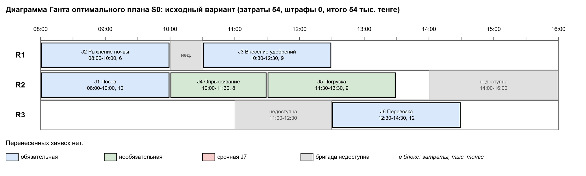
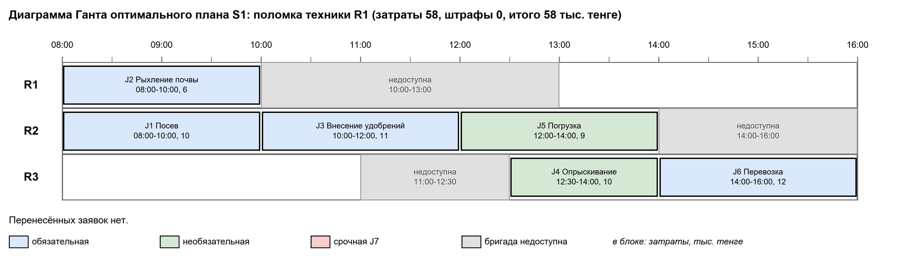
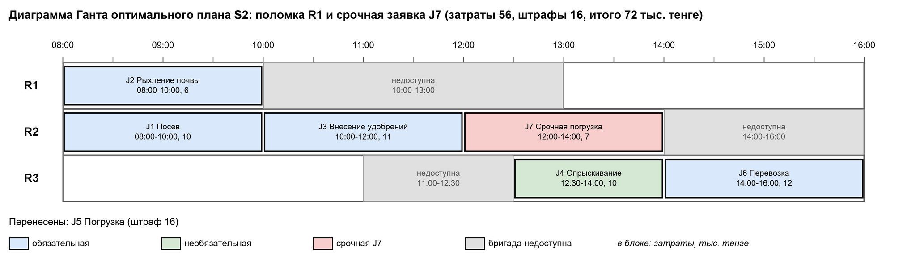
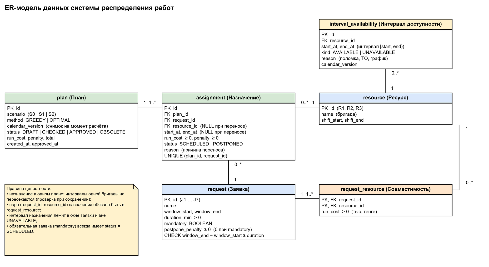

# СРО 11. Распределение сельскохозяйственной техники

**Дисциплина:** Анализ, моделирование и проектирование информационных систем

**Выполнил:** Маханов Тимур

## 1. Анализ требований

### 1.1. Участники и действия

**Заявитель** (агроном или бригадир участка) оформляет заявку: работа, окно времени (самое раннее начало и крайний срок завершения), длительность, признак обязательности, штраф за перенос. Он получает от системы время и бригаду либо сообщение о переносе с причиной.

**Диспетчер** ведёт календарь бригад: вносит интервалы недоступности (поломка, обслуживание, график), запускает расчёт плана, просматривает диаграмму Ганта, утверждает план. При поломке техники или появлении срочной заявки он меняет календарь или добавляет заявку и запускает пересчёт.

### 1.2. Входные данные и результаты

| Вход | Результат |
|---|---|
| Заявки J1-J6 (J7 в сценарии S2): окно, длительность, обязательность, штраф | План: для каждой заявки бригада, начало, окончание, стоимость либо перенос и его причина |
| Бригады R1-R3 и их календари доступности | Суммарные затраты, штрафы, итог, число и доля выполненных заявок |
| Стоимости заявка–бригада (R1-R3), прочерк – бригада не подходит | Диаграмма Ганта |
| Смена 08:00-16:00, шаг 30 минут | Протокол проверки плана (список нарушений, пустой – план допустим) |

### 1.3. Обязательные ограничения плана

| Код | Ограничение |
|---|---|
| C1 | Каждая заявка либо назначается ровно один раз (одна бригада, один непрерывный интервал), либо переносится |
| C2 | Обязательные заявки (J1, J2, J3, J6, а в S2 и J7) переносить нельзя |
| C3 | Назначение только на совместимую бригаду (в таблице стоимости не прочерк) |
| C4 | Интервал [начало, конец) лежит в окне заявки: начало не раньше самого раннего начала, конец не позже крайнего срока |
| C5 | Интервал не пересекается с периодами недоступности бригады; R2 работает только с 08:00 до 14:00 |
| C6 | Бригада выполняет одну работу одновременно; конец одной работы может совпадать с началом следующей |
| C7 | Работа идёт без перерывов, длительность округляется до шага 30 минут (1,5 ч = 3 слота) |
| C8 | Окончание работы не позже 16:00 (конец смены) |

## 2. Математическая модель

**Обозначения.** Заявки j ∈ J, бригады r ∈ R = {R1, R2, R3}, слоты t = 0…15 (слот t – интервал [08:00 + 30t мин, 08:00 + 30(t+1) мин)). Для заявки j: dⱼ – длительность в слотах, eⱼ – слот самого раннего начала, lⱼ – граница крайнего срока (конец допустим не позже lⱼ), cⱼᵣ – стоимость выполнения бригадой r, pⱼ – штраф за перенос, mⱼ = 1 для обязательной заявки.

**Допустимые начала.** Aⱼᵣₜ = 1, если бригада r совместима с j, eⱼ ≤ t, t + dⱼ ≤ lⱼ и все слоты t…t+dⱼ−1 доступны для r. Иначе Aⱼᵣₜ = 0. В Aⱼᵣₜ уже учтены сроки, совместимость и недоступные интервалы.

**Переменные.** xⱼᵣₜ ∈ {0,1} – заявка j начата бригадой r в слоте t; yⱼ ∈ {0,1} – заявка j перенесена.

**Ограничения.**

1. Однократное назначение либо перенос: Σᵣ Σₜ xⱼᵣₜ + yⱼ = 1 для каждой j.
2. Обязательные заявки не переносятся: yⱼ = 0 при mⱼ = 1.
3. Сроки, совместимость, календарь: xⱼᵣₜ ≤ Aⱼᵣₜ для всех j, r, t.
4. Одна работа на бригаде в слоте: для каждых r и τ выполняется Σⱼ Σₜ₌max(0, τ−dⱼ+1)…τ xⱼᵣₜ ≤ 1. Интервал полуоткрытый, поэтому работа, закончившаяся в слоте τ−1, не мешает работе, начатой в τ.

**Целевая функция** (затраты на выполнение плюс штрафы за перенос):

F = Σⱼ Σᵣ Σₜ cⱼᵣ · xⱼᵣₜ + Σⱼ pⱼ · yⱼ → min.

Для обязательных заявок pⱼ = 0 в данных, но перенос запрещён ограничением 2. Если для обязательной заявки нет ни одного допустимого начала, модель не имеет решения.

**Реализация.** Число допустимых вариантов мало (в S0: J1 – 4, J2 – 6, J3 – 7, J4 – 7, J5 – 5, J6 – 4), поэтому задача решается точно методом ветвей и границ (`optimise` в `scheduling.py`): перебор вариантов заявок с отсечением по нижней оценке (для каждой оставшейся заявки берётся минимум из самой дешёвой стоимости и штрафа). Из равных по F планов выбирается план с меньшей суммой номеров слотов начала, затем лексикографически меньший по списку (бригада, начало) в порядке кодов заявок. Результат проверен независимым полным перебором без отсечения по стоимости (`enumerate_min`).

## 3. Сравнение методов планирования

### 3.1. Базовый (жадный) план для S0

Правило: сначала обязательные заявки, затем остальные, в порядке крайнего срока (при равных сроках – меньший код). Для каждой заявки берётся самая дешёвая подходящая бригада со свободным интервалом и её самое раннее свободное время; при равной стоимости – более раннее начало, затем меньший код бригады.

Порядок обработки: J1 (срок 11:00), J2 (12:00), J3 (13:00), J6 (16:00), затем J4 (14:00), J5 (15:00).

| Шаг | Заявка | Бригада | Начало | Конец | Затраты | Пояснение |
|---|---|---|---|---|---|---|
| 1 | J1 | R1 | 08:00 | 10:00 | 8 | R1 дешевле R2; другие старты R1 задевают недоступность 10:00-10:30 |
| 2 | J2 | R2 | 08:00 | 10:00 | 18 | R1 занята в 08:00-10:00 и недоступна в 10:00-10:30, окно J2 закрывается в 12:00 |
| 3 | J3 | R1 | 10:30 | 12:30 | 9 | самое раннее свободное время R1 после недоступности |
| 4 | J6 | R3 | 12:30 | 14:30 | 12 | R3 недоступна до 12:30 |
| 5 | J4 | R2 | 10:00 | 11:30 | 8 | R2 свободна с 10:00 |
| 6 | J5 | R2 | 11:30 | 13:30 | 9 | R2 свободна с 11:30 |

Затраты 64, штрафы 0, итого 64. План допустим (проверка нарушений не нашла).

### 3.2. Сравнение с оптимизацией

Оптимальный план S0 стоит 54 (затраты 54, штрафы 0). Разница с жадным планом – 10 тыс. тенге (15,6 %). Причина: жадный метод назначает J1 на дешёвую R1 (8) в единственный подходящий для неё интервал 08:00-10:00. Это вынуждает направить J2 на дорогую R2 (18). Оптимизация переносит J1 на R2 (10, дороже на 2) и ставит J2 на R1 (6, дешевле на 12): выигрыш 10. Жадное правило смотрит на заявки по одной и не видит, что занятый слот нужен другой заявке. Остальные назначения (J3, J4, J5, J6) совпадают по стоимости.

Оптимум для S0 неоднозначен: полный перебор находит 32 плана с суммой 54 (они различаются временем J4, J5 и т. п.). Выбран план по правилу из раздела 2.

## 4. Пересчёт плана

Условия S1 и S2 известны до начала смены, поэтому модель применяется ко всей смене заново.

### 4.1. Сценарий S0 (исходный)

| Заявка | Бригада | Начало | Конец | Затраты |
|---|---|---|---|---|
| J1 Посев | R2 | 08:00 | 10:00 | 10 |
| J2 Рыхление почвы | R1 | 08:00 | 10:00 | 6 |
| J3 Внесение удобрений | R1 | 10:30 | 12:30 | 9 |
| J4 Опрыскивание | R2 | 10:00 | 11:30 | 8 |
| J5 Погрузка | R2 | 11:30 | 13:30 | 9 |
| J6 Перевозка | R3 | 12:30 | 14:30 | 12 |



### 4.2. Сценарий S1 (поломка R1, 10:00-13:00)

J3 нельзя поставить на R1 (в окне 09:00-13:00 бригада свободна только до 10:00 и после 13:00), поэтому J3 уходит на R2 (11 вместо 9). R2 занята J1 и J3 до 12:00, J4 переходит на R3 (10 вместо 8) на единственное допустимое время 12:30-14:00, J6 сдвигается на 14:00-16:00.

| Заявка | Бригада | Начало | Конец | Затраты |
|---|---|---|---|---|
| J1 Посев | R2 | 08:00 | 10:00 | 10 |
| J2 Рыхление почвы | R1 | 08:00 | 10:00 | 6 |
| J3 Внесение удобрений | R2 | 10:00 | 12:00 | 11 |
| J4 Опрыскивание | R3 | 12:30 | 14:00 | 10 |
| J5 Погрузка | R2 | 12:00 | 14:00 | 9 |
| J6 Перевозка | R3 | 14:00 | 16:00 | 12 |



### 4.3. Сценарий S2 (поломка R1 и срочная заявка J7)

J7 допустима только на R2 в интервале 12:00-14:00 (единственный вариант), поэтому R2 занята до 14:00. Погрузка J5 на R2 невозможна, а на R3 она не помещается рядом с J4 и J6. Переносить J4 (штраф 18) дороже, чем J5 (штраф 16), поэтому переносится J5.

| Заявка | Бригада | Начало | Конец | Затраты | Примечание |
|---|---|---|---|---|---|
| J1 Посев | R2 | 08:00 | 10:00 | 10 | |
| J2 Рыхление почвы | R1 | 08:00 | 10:00 | 6 | |
| J3 Внесение удобрений | R2 | 10:00 | 12:00 | 11 | |
| J4 Опрыскивание | R3 | 12:30 | 14:00 | 10 | |
| J5 Погрузка | – | – | – | 0 | перенос, штраф 16: все допустимые интервалы заняты обязательными и более выгодными заявками |
| J6 Перевозка | R3 | 14:00 | 16:00 | 12 | |
| J7 Срочная погрузка | R2 | 12:00 | 14:00 | 7 | |



## 5. Модель данных



Заданные пять сущностей дополнены таблицей совместимости `request_resource`: она разрешает связь «многие ко многим» между заявками и бригадами и хранит стоимость выполнения.

| Сущность | Первичный ключ | Внешние ключи | Назначение |
|---|---|---|---|
| Заявка (`request`) | `id` | – | Окно, длительность, обязательность, штраф за перенос |
| Ресурс (`resource`) | `id` | – | Бригада и её смена |
| Интервал доступности (`interval_availability`) | `id` | `resource_id` | Периоды доступности и недоступности бригады, версия календаря |
| План (`plan`) | `id` | – | Сценарий, метод, версия календаря на момент расчёта, статус, итоги |
| Назначение (`assignment`) | `id`, уникальна пара (`plan_id`, `request_id`) | `plan_id`, `request_id`, `resource_id` (NULL при переносе) | Бригада, начало и конец, затраты, штраф, причина переноса |
| Совместимость (`request_resource`) | (`request_id`, `resource_id`) | оба | Допустимые бригады и стоимость |

Связи: ресурс 1:N интервалы доступности; план 1:N назначения; заявка 1:N назначения (по одному на план); ресурс 1:N назначения; заявка M:N ресурс через совместимость.

**Повторная проверка перед утверждением.** План в статусе DRAFT хранит `calendar_version` – версию календаря, на которой он рассчитан. При утверждении система сравнивает её с текущей версией календаря и списком заявок. Если версия изменилась, выполняется полная проверка (те же правила C1-C8, функция `check_plan`): совместимость, окна, недоступные интервалы, пересечения, наличие обязательных заявок. При отсутствии нарушений план получает статус CHECKED и обновлённую версию, после чего диспетчер его утверждает (APPROVED). При нарушениях план получает статус OBSOLETE, диспетчеру показывается список нарушений, а пересчёт запускается заново. Пример: план S0 на календаре S1 даёт нарушение J3 (R1 недоступна в 10:30-12:30), J2 остаётся допустимой, так как заканчивается в 10:00.

## 6. Проверка решения и выводы

### 6.1. Проверки

Автоматические проверки (`prototype/tests/test_scheduling.py`, 13 тестов, все пройдены; протокол – `results/tests.txt`):

| Проверяемый случай | Ожидание | Результат |
|---|---|---|
| Несовместимый ресурс: J1 на R3, J6 на R1 | нарушение «бригада не подходит» | выявлено |
| Пересечение: J2 на R2 в 08:00 и J1 на R2 в 08:30 | нарушение «пересечение» | выявлено |
| Конец одной работы совпадает с началом следующей: J1 08:00-10:00 и J2 10:00-12:00 на R2 | план допустим; при сдвиге J2 на 09:30 – пересечение | допустим / пересечение выявлено |
| R3 недоступна всю смену | J6 не имеет вариантов, модель не имеет решения, проверка сообщает о невыполненной J6 | `optimise` вернул None, полный перебор – None |
| Границы календаря: J1 на R1 в 08:00 допустима, в 08:30 – нет; J5 на R2 в 13:00 – нет; J6 на R3 в 12:00 – нет | как указано | выполнено |
| Окна: J3 в 08:30, J4 в 13:00 (конец 14:30 > 14:00) | нарушение окна | выявлено |
| Оптимум равен полному перебору в S0, S1, S2 | 54, 58, 72 | совпало |
| Обязательные заявки в оптимальных планах | не переносятся | выполнено |
| Жадный план S0 допустим и дороже оптимума на 10 | 64 против 54 | выполнено |
| Срочная заявка J7 только на R2 в 12:00-14:00 | единственный вариант | выполнено |
| Повторяемость выбора из равных по стоимости планов | совпадение запусков | выполнено |

При недоступности R3 на всю смену система должна не строить план, а сообщить диспетчеру, что обязательная заявка J6 невыполнима, и предложить изменить календарь или заявку.

### 6.2. Показатели планов

| План | Выполнено заявок | Доля | Затраты на выполнение | Штрафы | Итого |
|---|---|---|---|---|---|
| Жадный S0 | 6 из 6 | 100 % | 64 | 0 | 64 |
| Оптимальный S0 | 6 из 6 | 100 % | 54 | 0 | 54 |
| Оптимальный S1 | 6 из 6 | 100 % | 58 | 0 | 58 |
| Оптимальный S2 | 6 из 7 | 85,7 % | 56 | 16 | 72 |

### 6.3. Выводы

Оптимизация в S0 сокращает итог с 64 до 54 тыс. тенге, потому что учитывает конкуренцию заявок за один и тот же слот самой дешёвой бригады; жадное правило решает заявки по очереди и ошибается на J1 и J2.

Поломка R1 (S1) не нарушает ни одной обязательной заявки и не вызывает штрафов, но поднимает итог на 4 (с 54 до 58): J3 и J4 перешли на более дорогие бригады (+2 каждая), J5 и J6 изменили время без изменения стоимости.

Срочная заявка J7 (S2) обязательна и допустима только на R2 в 12:00-14:00, поэтому занимает всю R2 до конца её смены. Это вытесняет J5: она переносится со штрафом 16, выполнено 6 из 7 заявок. Итог растёт на 14 относительно S1 (+7 за J7, +16 штраф и −9 за не выполняемую J5). Перенос J5 дешевле переноса J4 (18).

Узкое место хозяйства – бригада R2: она работает только до 14:00 и единственная допустима для J7. Для повышения устойчивости имеет смысл продлить смену R2 или допустить R3 к погрузке J7.

Расчёт воспроизводится командами из папки `prototype`: `python run_all.py --save ../results` и `python -m unittest discover -s tests`; диаграммы – `python ../tools/build_diagrams.py`.

## Приложение А. Исходный код

### А.1. scheduling.py – модель, оптимизатор, жадный метод, проверка плана

```python
"""Shift scheduling of six (seven) farm jobs over three crews (SRO 11).

Data model, scenarios S0-S2, exact optimiser (branch and bound), greedy
baseline and an independent plan checker. Standard library only.

Time grid: 30-minute slots, slot t covers [08:00 + 30*t, 08:00 + 30*(t+1)).
A job started in slot s with duration d slots occupies slots s .. s+d-1, i.e.
the half-open interval [start, end); the next job may start at ``end``.
"""

from __future__ import annotations

from dataclasses import dataclass, field
from typing import Optional

SLOT_MIN = 30
SHIFT_START_MIN = 8 * 60
N_SLOTS = 16                      # 08:00 .. 16:00
RESOURCES = ("R1", "R2", "R3")


def hhmm(t: int) -> str:
    """Slot boundary -> 'HH:MM' (t = 0 is 08:00, t = 16 is 16:00)."""
    m = SHIFT_START_MIN + SLOT_MIN * t
    return f"{m // 60:02d}:{m % 60:02d}"


def to_slot(text: str) -> int:
    h, m = text.split(":")
    return (int(h) * 60 + int(m) - SHIFT_START_MIN) // SLOT_MIN


@dataclass(frozen=True)
class Job:
    code: str
    name: str
    win_from: int                 # earliest start (slot boundary)
    win_to: int                   # latest completion (slot boundary)
    dur: int                      # duration in slots
    mandatory: bool
    penalty: int                  # penalty for postponing, thousand tenge (0 for mandatory)
    cost: dict = field(default_factory=dict)   # resource -> cost; missing = incompatible


@dataclass
class Scenario:
    code: str
    title: str
    jobs: list
    unavailable: dict             # resource -> set of unavailable slots
    horizon: dict                 # resource -> (first slot, last slot + 1) of availability

    def free(self, r: str, t: int) -> bool:
        lo, hi = self.horizon[r]
        return lo <= t < hi and t not in self.unavailable.get(r, set())


def _job(code, name, w, dur_h, mandatory, penalty, **cost) -> Job:
    a, b = w.split("-")
    return Job(code, name, to_slot(a), to_slot(b), round(dur_h * 2), mandatory, penalty, cost)


def base_jobs() -> list:
    return [
        _job("J1", "Посев", "08:00-11:00", 2, True, 0, R1=8, R2=10),
        _job("J2", "Рыхление почвы", "08:00-12:00", 2, True, 0, R1=6, R2=18),
        _job("J3", "Внесение удобрений", "09:00-13:00", 2, True, 0, R1=9, R2=11),
        _job("J4", "Опрыскивание", "10:00-14:00", 1.5, False, 18, R2=8, R3=10),
        _job("J5", "Погрузка", "11:00-15:00", 2, False, 16, R2=9, R3=12),
        _job("J6", "Перевозка", "12:00-16:00", 2, True, 0, R3=12),
    ]


def slots(a: str, b: str) -> set:
    return set(range(to_slot(a), to_slot(b)))


def make_scenario(code: str, r3_off_all_shift: bool = False) -> Scenario:
    """S0, S1, S2 of the task. ``r3_off_all_shift`` is a test variant of S0."""
    if code not in ("S0", "S1", "S2"):
        raise ValueError(code)
    jobs = base_jobs()
    horizon = {"R1": (0, N_SLOTS), "R2": (0, to_slot("14:00")), "R3": (0, N_SLOTS)}
    unav = {"R1": slots("10:00", "10:30"), "R3": slots("11:00", "12:30")}
    title = "исходный вариант"
    if code in ("S1", "S2"):
        unav["R1"] = slots("10:00", "13:00")
        title = "поломка техники R1"
    if code == "S2":
        jobs.append(_job("J7", "Срочная погрузка", "12:00-14:00", 2, True, 0, R2=7))
        title = "поломка R1 и срочная заявка J7"
    if r3_off_all_shift:
        unav["R3"] = set(range(N_SLOTS))
        title += ", R3 недоступна всю смену"
    return Scenario(code, title, jobs, unav, horizon)


# ---------------------------------------------------------------- options
def options(sc: Scenario, job: Job) -> list:
    """All feasible (resource, start) pairs of a job: window, compatibility, calendar."""
    out = []
    for r in RESOURCES:
        if r not in job.cost:
            continue
        for s in range(job.win_from, job.win_to - job.dur + 1):
            if all(sc.free(r, t) for t in range(s, s + job.dur)):
                out.append((r, s))
    return out


# ---------------------------------------------------------------- plan
@dataclass
class Plan:
    scenario: Scenario
    assign: dict                  # job code -> (resource, start); postponed jobs are absent
    method: str = ""

    def run_cost(self) -> int:
        J = {j.code: j for j in self.scenario.jobs}
        return sum(J[c].cost[r] for c, (r, _) in self.assign.items())

    def penalty(self) -> int:
        return sum(j.penalty for j in self.scenario.jobs if j.code not in self.assign)

    def total(self) -> int:
        return self.run_cost() + self.penalty()

    def done(self) -> int:
        return len(self.assign)

    def rows(self) -> list:
        """One row per job: code, name, resource, start, end, cost, penalty, note."""
        out = []
        for j in self.scenario.jobs:
            if j.code in self.assign:
                r, s = self.assign[j.code]
                out.append((j.code, j.name, r, hhmm(s), hhmm(s + j.dur), j.cost[r], 0, ""))
            else:
                out.append((j.code, j.name, "–", "–", "–", 0, j.penalty,
                            postponed_reason(self.scenario, j, self.assign)))
        return out


def postponed_reason(sc: Scenario, job: Job, assign: dict) -> str:
    ops = options(sc, job)
    if not ops:
        return "нет допустимых вариантов: окно, совместимость и календари не оставляют места"
    jobs = {j.code: j for j in sc.jobs}
    free_ops = []
    for r, s in ops:
        clash = any(
            rr == r and a < s + job.dur and s < a + jobs[c].dur
            for c, (rr, a) in assign.items()
        )
        if not clash:
            free_ops.append((r, s))
    if not free_ops:
        return "все допустимые интервалы заняты обязательными и более выгодными заявками"
    return "перенос дешевле размещения: штраф меньше затрат или размещение вытесняет другую заявку"


# ---------------------------------------------------------------- checker
def check_plan(sc: Scenario, assign: dict) -> list:
    """Independent verification; returns violation messages (empty list = valid plan)."""
    errors = []
    J = {j.code: j for j in sc.jobs}
    busy: dict = {r: {} for r in RESOURCES}
    for code, (r, s) in assign.items():
        j = J.get(code)
        if j is None:
            errors.append(f"{code}: неизвестная заявка")
            continue
        if r not in j.cost:
            errors.append(f"{code}: бригада {r} не подходит")
            continue
        if s < j.win_from or s + j.dur > j.win_to:
            errors.append(f"{code}: выход за окно {hhmm(j.win_from)}-{hhmm(j.win_to)}")
        for t in range(s, s + j.dur):
            if not sc.free(r, t):
                errors.append(f"{code}: {r} недоступна в {hhmm(t)}")
            if t in busy[r]:
                errors.append(f"{code}: пересечение с {busy[r][t]} у {r} в {hhmm(t)}")
            busy[r][t] = code
    for j in sc.jobs:
        if j.mandatory and j.code not in assign:
            errors.append(f"{j.code}: обязательная заявка не выполнена")
    unique = []
    for e in errors:
        if e not in unique:
            unique.append(e)
    return unique


# ---------------------------------------------------------------- exact optimiser
def optimise(sc: Scenario) -> Optional[Plan]:
    """Minimum of (running cost + postponement penalties) by branch and bound.

    Tie-break among equal totals: smaller sum of start slots, then the
    lexicographically smaller list of (resource, start) in job-code order.
    Returns None when the mandatory jobs cannot be placed (model infeasible).
    """
    jobs = list(sc.jobs)
    opts = [options(sc, j) for j in jobs]
    if any(j.mandatory and not o for j, o in zip(jobs, opts)):
        return None
    floor = []                    # cheapest possible contribution of each job
    for j, o in zip(jobs, opts):
        c = min((j.cost[r] for r, _ in o), default=10 ** 9)
        floor.append(c if j.mandatory else min(c, j.penalty))
    tail = [sum(floor[i:]) for i in range(len(jobs) + 1)]

    best = {"key": None, "assign": None}
    busy = {r: 0 for r in RESOURCES}         # bit mask of occupied slots

    def rec(i, cost, chosen):
        if best["key"] is not None and cost + tail[i] > best["key"][0]:
            return
        if i == len(jobs):
            starts = sum(c[1] for c in chosen if c)
            key = (cost, starts, tuple(c or ("~", 99) for c in chosen))
            if best["key"] is None or key < best["key"]:
                best["key"], best["assign"] = key, list(chosen)
            return
        j = jobs[i]
        for r, s in opts[i]:
            m = ((1 << j.dur) - 1) << s
            if busy[r] & m:
                continue
            busy[r] |= m
            chosen.append((r, s))
            rec(i + 1, cost + j.cost[r], chosen)
            chosen.pop()
            busy[r] &= ~m
        if not j.mandatory:
            chosen.append(None)
            rec(i + 1, cost + j.penalty, chosen)
            chosen.pop()

    rec(0, 0, [])
    if best["assign"] is None:
        return None
    assign = {j.code: c for j, c in zip(jobs, best["assign"]) if c}
    return Plan(sc, assign, "оптимизация")


def count_optimal(sc: Scenario) -> int:
    """Number of distinct plans with the optimal total, by plain enumeration without
    cost bounding (a cross-check of the branch and bound and a measure of ambiguity)."""
    plan = optimise(sc)
    if plan is None:
        return 0
    target = plan.total()
    jobs = list(sc.jobs)
    opts = [options(sc, j) for j in jobs]
    busy = {r: 0 for r in RESOURCES}
    n = 0

    def rec(i, cost):
        nonlocal n
        if i == len(jobs):
            n += cost == target
            return
        j = jobs[i]
        for r, s in opts[i]:
            m = ((1 << j.dur) - 1) << s
            if busy[r] & m:
                continue
            busy[r] |= m
            rec(i + 1, cost + j.cost[r])
            busy[r] &= ~m
        if not j.mandatory:
            rec(i + 1, cost + j.penalty)

    rec(0, 0)
    return n


def enumerate_min(sc: Scenario) -> Optional[int]:
    """Minimum total by exhaustive enumeration (no pruning by cost); None if infeasible."""
    jobs = list(sc.jobs)
    opts = [options(sc, j) for j in jobs]
    busy = {r: 0 for r in RESOURCES}
    best = [None]

    def rec(i, cost):
        if i == len(jobs):
            if best[0] is None or cost < best[0]:
                best[0] = cost
            return
        j = jobs[i]
        for r, s in opts[i]:
            m = ((1 << j.dur) - 1) << s
            if busy[r] & m:
                continue
            busy[r] |= m
            rec(i + 1, cost + j.cost[r])
            busy[r] &= ~m
        if not j.mandatory:
            rec(i + 1, cost + j.penalty)

    rec(0, 0)
    return best[0]


# ---------------------------------------------------------------- greedy baseline
def greedy(sc: Scenario, log: Optional[list] = None) -> Plan:
    """Baseline rule of the task: mandatory jobs first, then by deadline (then code);
    the cheapest compatible crew that has a free interval, at its earliest start;
    ties: earlier start, then smaller crew code. No place -> postponed."""
    order = sorted(sc.jobs, key=lambda j: (not j.mandatory, j.win_to, j.code))
    assign: dict = {}
    busy = {r: set() for r in RESOURCES}
    for j in order:
        cand = []
        for r, s in options(sc, j):
            if not any(t in busy[r] for t in range(s, s + j.dur)):
                cand.append((j.cost[r], s, r))
        if cand:
            c, s, r = min(cand)
            assign[j.code] = (r, s)
            busy[r].update(range(s, s + j.dur))
            if log is not None:
                log.append((j.code, r, hhmm(s), hhmm(s + j.dur), c, ""))
        elif log is not None:
            log.append((j.code, "–", "–", "–", 0,
                        "не размещена (обязательная)" if j.mandatory else f"перенос, штраф {j.penalty}"))
    return Plan(sc, assign, "жадный план")


# ---------------------------------------------------------------- re-validation
def revalidate(plan: Plan, new_scenario: Scenario) -> list:
    """Check an approved/draft plan against a changed calendar or request list.
    Same rules as ``check_plan``: an empty list means the plan is still valid."""
    return check_plan(new_scenario, plan.assign)
```

### А.2. run_all.py – воспроизведение расчётов

```python
"""Reproduce all numbers of the report: baseline, optimum for S0-S2, checks, re-validation.

    python run_all.py [--save ../results]
"""

import argparse
import io
import pathlib
import sys
from contextlib import redirect_stdout

sys.stdout.reconfigure(encoding="utf-8")
sys.path.insert(0, str(pathlib.Path(__file__).resolve().parent))

from scheduling import (check_plan, count_optimal, enumerate_min, greedy, make_scenario,  # noqa: E402
                        optimise, revalidate)


def table(rows, header):
    print("| " + " | ".join(header) + " |")
    print("|" + "|".join("---" for _ in header) + "|")
    for r in rows:
        print("| " + " | ".join(str(x) for x in r) + " |")


def main():
    ap = argparse.ArgumentParser()
    ap.add_argument("--save", type=pathlib.Path)
    args = ap.parse_args()
    buf = io.StringIO()
    with redirect_stdout(buf):
        s0 = make_scenario("S0")
        log = []
        g = greedy(s0, log)
        print("## Жадный план S0")
        table(log, ["Заявка", "Бригада", "Начало", "Конец", "Затраты", "Примечание"])
        print(f"\nЗатраты {g.run_cost()}, штрафы {g.penalty()}, итого {g.total()}; "
              f"нарушений: {len(check_plan(s0, g.assign))}\n")
        results = {}
        for code in ("S0", "S1", "S2"):
            sc = make_scenario(code)
            plan = optimise(sc)
            results[code] = plan
            print(f"## Оптимальный план {code}: {sc.title}")
            table(plan.rows(), ["Заявка", "Работа", "Бригада", "Начало", "Конец", "Затраты", "Штраф", "Причина переноса"])
            n = len(sc.jobs)
            print(f"\nВыполнено {plan.done()} из {n} ({100 * plan.done() / n:.1f} %), затраты {plan.run_cost()}, "
                  f"штрафы {plan.penalty()}, итого {plan.total()}; "
                  f"проверка плана: {check_plan(sc, plan.assign) or 'нарушений нет'}; "
                  f"полный перебор: {enumerate_min(sc)}; число оптимальных планов: {count_optimal(sc)}\n")
        print("## Повторная проверка плана S0 на календаре S1")
        for e in revalidate(results["S0"], make_scenario("S1")):
            print("-", e)
        print("\n## Модель при недоступности R3 на всю смену")
        print("optimise ->", optimise(make_scenario("S0", r3_off_all_shift=True)))
    text = buf.getvalue()
    print(text)
    if args.save:
        args.save.mkdir(exist_ok=True)
        (args.save / "run_all.txt").write_text(text, encoding="utf-8")


if __name__ == "__main__":
    main()
```

### А.3. tests/test_scheduling.py – автоматические проверки

```python
"""Automatic checks of the scheduling model (python -m unittest discover -s tests)."""

import pathlib
import sys
import unittest

sys.path.insert(0, str(pathlib.Path(__file__).resolve().parent.parent))

from scheduling import (check_plan, count_optimal, enumerate_min, greedy, make_scenario,  # noqa: E402
                        optimise, options, revalidate, to_slot)

T = to_slot


def p(code, res, start):
    return code, (res, T(start))


class Checks(unittest.TestCase):
    def setUp(self):
        self.s0 = make_scenario("S0")

    def test_01_incompatible_resource(self):
        errs = check_plan(self.s0, dict([p("J1", "R3", "08:00")]))
        self.assertTrue(any("J1: бригада R3 не подходит" in e for e in errs))
        errs = check_plan(self.s0, dict([p("J6", "R1", "12:30")]))
        self.assertTrue(any("J6: бригада R1 не подходит" in e for e in errs))

    def test_02_overlap(self):
        errs = check_plan(self.s0, dict([p("J2", "R2", "08:00"), p("J1", "R2", "08:30")]))
        self.assertTrue(any("пересечение" in e for e in errs))

    def test_03_end_equals_start_is_allowed(self):
        plan = dict([p("J1", "R2", "08:00"), p("J2", "R2", "10:00"),
                     p("J3", "R1", "10:30"), p("J6", "R3", "12:30")])
        self.assertEqual(check_plan(self.s0, plan), [])
        plan["J2"] = ("R2", T("09:30"))              # one slot earlier: now they overlap
        self.assertTrue(any("пересечение" in e for e in check_plan(self.s0, plan)))

    def test_04_r3_unavailable_all_shift(self):
        sc = make_scenario("S0", r3_off_all_shift=True)
        self.assertEqual(options(sc, sc.jobs[5]), [])            # J6 has no place
        self.assertIsNone(optimise(sc))                          # mandatory job: model infeasible
        self.assertIsNone(enumerate_min(sc))
        errs = check_plan(sc, dict([p("J1", "R1", "08:00"), p("J2", "R2", "08:00"), p("J3", "R1", "10:30")]))
        self.assertIn("J6: обязательная заявка не выполнена", errs)

    def test_05_calendar_edges(self):
        self.assertEqual([e for e in check_plan(self.s0, dict([p("J1", "R1", "08:00")])) if "J1" in e], [])
        errs = check_plan(self.s0, dict([p("J1", "R1", "08:30")]))      # 08:30-10:30 hits 10:00-10:30
        self.assertTrue(any("R1 недоступна в 10:00" in e for e in errs))
        errs = check_plan(self.s0, dict([p("J5", "R2", "13:00")]))      # R2 works only until 14:00
        self.assertTrue(any("R2 недоступна в 14:00" in e for e in errs))
        errs = check_plan(self.s0, dict([p("J6", "R3", "12:00")]))      # R3 off until 12:30
        self.assertTrue(any("R3 недоступна в 12:00" in e for e in errs))

    def test_06_windows(self):
        errs = check_plan(self.s0, dict([p("J3", "R1", "08:30")]))
        self.assertTrue(any("выход за окно" in e for e in errs))
        errs = check_plan(self.s0, dict([p("J4", "R2", "13:00")]))      # ends 14:30 > 14:00
        self.assertTrue(any("выход за окно" in e for e in errs))

    def test_07_mandatory_not_postponed(self):
        for code in ("S0", "S1", "S2"):
            sc = make_scenario(code)
            plan = optimise(sc)
            for j in sc.jobs:
                if j.mandatory:
                    self.assertIn(j.code, plan.assign, f"{code}: {j.code}")

    def test_08_optimum_matches_exhaustive_search(self):
        for code, total in (("S0", 54), ("S1", 58), ("S2", 72)):
            sc = make_scenario(code)
            plan = optimise(sc)
            self.assertEqual(check_plan(sc, plan.assign), [])
            self.assertEqual(plan.total(), total)
            self.assertEqual(enumerate_min(sc), total)

    def test_09_greedy_is_valid_and_worse(self):
        sc = make_scenario("S0")
        g = greedy(sc)
        self.assertEqual(check_plan(sc, g.assign), [])
        self.assertEqual(g.total(), 64)
        self.assertEqual(g.total() - optimise(sc).total(), 10)

    def test_10_deterministic(self):
        for code in ("S0", "S1", "S2"):
            a, b = optimise(make_scenario(code)), optimise(make_scenario(code))
            self.assertEqual(a.assign, b.assign)

    def test_11_urgent_job_only_r2_at_12(self):
        sc = make_scenario("S2")
        j7 = sc.jobs[-1]
        self.assertEqual(options(sc, j7), [("R2", T("12:00"))])
        self.assertEqual(optimise(sc).assign["J7"], ("R2", T("12:00")))

    def test_12_revalidation_after_calendar_change(self):
        plan = optimise(self.s0)
        self.assertEqual(revalidate(plan, make_scenario("S0")), [])
        errs = revalidate(plan, make_scenario("S1"))                    # R1 broke down 10:00-13:00
        self.assertTrue(any(e.startswith("J3: R1 недоступна") for e in errs))
        self.assertFalse(any(e.startswith("J2") for e in errs))         # J2 ends at 10:00: still valid

    def test_13_counts_and_totals(self):
        res = {c: optimise(make_scenario(c)) for c in ("S0", "S1", "S2")}
        self.assertEqual([(r.done(), r.run_cost(), r.penalty()) for r in res.values()],
                         [(6, 54, 0), (6, 58, 0), (6, 56, 16)])
        self.assertEqual(count_optimal(make_scenario("S1")), 1)


if __name__ == "__main__":
    unittest.main(verbosity=2)
```

## Приложение Б. Журнал запуска

```text
## Жадный план S0
| Заявка | Бригада | Начало | Конец | Затраты | Примечание |
|---|---|---|---|---|---|
| J1 | R1 | 08:00 | 10:00 | 8 |  |
| J2 | R2 | 08:00 | 10:00 | 18 |  |
| J3 | R1 | 10:30 | 12:30 | 9 |  |
| J6 | R3 | 12:30 | 14:30 | 12 |  |
| J4 | R2 | 10:00 | 11:30 | 8 |  |
| J5 | R2 | 11:30 | 13:30 | 9 |  |

Затраты 64, штрафы 0, итого 64; нарушений: 0

## Оптимальный план S0: исходный вариант
| Заявка | Работа | Бригада | Начало | Конец | Затраты | Штраф | Причина переноса |
|---|---|---|---|---|---|---|---|
| J1 | Посев | R2 | 08:00 | 10:00 | 10 | 0 |  |
| J2 | Рыхление почвы | R1 | 08:00 | 10:00 | 6 | 0 |  |
| J3 | Внесение удобрений | R1 | 10:30 | 12:30 | 9 | 0 |  |
| J4 | Опрыскивание | R2 | 10:00 | 11:30 | 8 | 0 |  |
| J5 | Погрузка | R2 | 11:30 | 13:30 | 9 | 0 |  |
| J6 | Перевозка | R3 | 12:30 | 14:30 | 12 | 0 |  |

Выполнено 6 из 6 (100.0 %), затраты 54, штрафы 0, итого 54; проверка плана: нарушений нет; полный перебор: 54; число оптимальных планов: 32

## Оптимальный план S1: поломка техники R1
| Заявка | Работа | Бригада | Начало | Конец | Затраты | Штраф | Причина переноса |
|---|---|---|---|---|---|---|---|
| J1 | Посев | R2 | 08:00 | 10:00 | 10 | 0 |  |
| J2 | Рыхление почвы | R1 | 08:00 | 10:00 | 6 | 0 |  |
| J3 | Внесение удобрений | R2 | 10:00 | 12:00 | 11 | 0 |  |
| J4 | Опрыскивание | R3 | 12:30 | 14:00 | 10 | 0 |  |
| J5 | Погрузка | R2 | 12:00 | 14:00 | 9 | 0 |  |
| J6 | Перевозка | R3 | 14:00 | 16:00 | 12 | 0 |  |

Выполнено 6 из 6 (100.0 %), затраты 58, штрафы 0, итого 58; проверка плана: нарушений нет; полный перебор: 58; число оптимальных планов: 1

## Оптимальный план S2: поломка R1 и срочная заявка J7
| Заявка | Работа | Бригада | Начало | Конец | Затраты | Штраф | Причина переноса |
|---|---|---|---|---|---|---|---|
| J1 | Посев | R2 | 08:00 | 10:00 | 10 | 0 |  |
| J2 | Рыхление почвы | R1 | 08:00 | 10:00 | 6 | 0 |  |
| J3 | Внесение удобрений | R2 | 10:00 | 12:00 | 11 | 0 |  |
| J4 | Опрыскивание | R3 | 12:30 | 14:00 | 10 | 0 |  |
| J5 | Погрузка | – | – | – | 0 | 16 | все допустимые интервалы заняты обязательными и более выгодными заявками |
| J6 | Перевозка | R3 | 14:00 | 16:00 | 12 | 0 |  |
| J7 | Срочная погрузка | R2 | 12:00 | 14:00 | 7 | 0 |  |

Выполнено 6 из 7 (85.7 %), затраты 56, штрафы 16, итого 72; проверка плана: нарушений нет; полный перебор: 72; число оптимальных планов: 1

## Повторная проверка плана S0 на календаре S1
- J3: R1 недоступна в 10:30
- J3: R1 недоступна в 11:00
- J3: R1 недоступна в 11:30
- J3: R1 недоступна в 12:00

## Модель при недоступности R3 на всю смену
optimise -> None
```
