**Выполнил:** Маханов Тимур

**Дисциплина:** «Анализ, моделирование и проектирование информационных систем»

**Тема:** «Моделирование и проектирование информационной системы управления запасами» (организация: авиатехническая база аэропорта, склад запасных частей и материалов для ТО и ремонта самолётов)

# СРМ №10. Моделирование и проектирование информационной системы управления запасами

Примечание: работа учебная. Организация условная («Авиатехническая база», АТБ), реальный склад какого-либо аэропорта не описывается. Данные о спросе, ценах и затратах искусственные (допущения – в разделе 5.1), числовые пороги – проектные предположения. Диаграммы – в файле inventory_model.drawio (diagrams.net, одна страница на диаграмму) и в папке assets; расчёты – в папке calc; прототип – в папке prototype.

## Введение. Выбор организации и связь с работой 9

Задание требует исследовать запасы одной организации. В работе 9 рассматривалась информационная система автоматизации технического обслуживания и ремонта (ТО и Р) самолётов в аэропорту. Запчасти там были внешним участником: «закупка запчастей» входила в список того, что находится вне границ системы, а «специалист по запчастям» только передавал данные о наличии деталей. Для работы 10 выбрана та же организация, а граница сдвинута: **склад запасных частей и материалов авиатехнической базы** теперь внутри системы. Это естественное продолжение: в заказ-наряд (работа 9) техник вносит запчасти и расходные материалы, а их наличие определяет, когда самолёт выйдет из ангара.

Из работы 9 сохранены: заказ-наряд как основание для расхода деталей (номер вида WO-NNNN); роли планировщика, техника, руководителя технической службы и администратора, к ним добавлен кладовщик; подход к конкурентным действиям, транзакциям и повторным запросам; неизменяемый журнал операций; запрет действий вне роли; формат требований и матрицы трассируемости. Новые элементы: партии со сроком годности и сертификатом годности, серийные номера агрегатов, остатки по местам хранения, политика пополнения.

**Исследовательский вопрос:** как организовать учёт и пополнение запасов авиатехнической базы, чтобы остаток был достоверным, одна и та же деталь не была обещана двум заказ-нарядам, деталь без подтверждения годности не попадала на самолёт, а пополнение опиралось на расчёт.

## 1. Исследование предметной области (задание 1)

### 1.1. Деятельность и запасы

АТБ выполняет плановое и внеплановое ТО и ремонт самолётов (работа 9). Запасы нужны, чтобы самолёт не простаивал в ожидании детали: простой воздушного судна из-за отсутствия детали обходится существенно дороже самой детали. Одновременно деталь нельзя «просто взять»: каждая единица должна иметь подтверждение годности, а установка должна быть прослеживаема до партии или серийного номера.

| Группа запасов | Состав | Учёт | Особенности хранения |
|---|---|---|---|
| Агрегаты (ремонтируемые узлы) | Стартёр-генератор, гидронасос, топливный насос-регулятор, колесо в сборе, приёмник воздушного давления, бортовой аккумулятор | Серийный: одна единица – один серийный номер (S/N) в пределах номера детали (P/N) | Дорогие, редкий спрос; сертификат годности на каждую единицу; хранятся в отдельных ячейках |
| Расходные материалы и жидкости | Масло, гидрожидкость, противообледенительная жидкость, герметик, уплотнительные кольца | Партионно-количественный, база – штука | Срок годности (герметик, кольца, жидкости); сезонный спрос на противообледенительную жидкость; хранение по условиям производителя |
| Фильтры, лампы, огнетушители, щётки | Фильтрующие элементы гидросистемы, топливные, масляные, воздушные фильтры, лампы, огнетушители | Партионно-количественный | Ровный спрос по регламенту обслуживания |
| Шины и тормоза | Пневматики стоек шасси, тормозные диски | Количественный по партии | Спрос растёт с интенсивностью полётов летом; хранение в вертикальном положении вдали от света |
| Стандартные изделия | Болты, гайки, шплинты, контровочная проволока | Количественный; упаковка 100 | Мелкие, дешёвые, но их отсутствие останавливает работы |

Склад – один: стеллажи и ячейки вида A-01; для партий без подтверждённого сертификата и для подозрительных деталей предусмотрена зона карантина. Модельный набор данных (раздел 5) покрывает 24 позиции с годовым расходом около 998,7 млн тенге.

### 1.2. Участники и ответственность

| Участник | Ответственность |
|---|---|
| Техник | Определяет по заказ-наряду, какие детали нужны; получает деталь у кладовщика и устанавливает её |
| Инженер-планировщик | Запрашивает резерв деталей под заказ-наряд, снимает свой резерв при отмене работ |
| Кладовщик | Принимает детали, хранит, готовит и выдаёт по резерву, считает при инвентаризации |
| Специалист по запчастям | Определяет потребность, утверждает и отправляет заказ поставщику |
| Руководитель технической службы / инспектор качества | Проверяет сертификаты, помещает партии в карантин и снимает его, согласует корректировки, снимает чужие резервы |
| Поставщик | Подтверждает заказ, отгружает деталь с накладной и документом о годности |
| Администратор | Управляет пользователями и ролями |

### 1.3. Порядок движения запасов (действующий, AS-IS)

1. **Пополнение:** раз в месяц кладовщик обходит склад и «на глаз» решает, чего мало; специалист по запчастям получает сообщение в чате, составляет заказ в Excel и отправляет поставщику по почте.
2. **Приёмка:** кладовщик принимает деталь по накладной, пересчитывает вручную, сертификат сверяет на бумаге; приход вносится в журнал на следующий день.
3. **Резервирование:** техник просит оставить деталь для заказ-наряда; планировщик договаривается устно, кладовщик откладывает деталь и пишет в блокнот; срок и владелец резерва не фиксируются.
4. **Отпуск:** выдача по требованию-накладной, списание в журнале в конце смены.
5. **Инвентаризация:** раз в квартал выдача останавливается, детали пересчитываются и сверяются с журналом; расхождения исправляются в таблице без акта.

### 1.4. Проблемы действующего способа учёта

| № | Проблема | Причина | Последствие | Предлагаемое решение средствами ИС |
|---|---|---|---|---|
| П1 | Остаток в журнале отстаёт на смену | Приход и расход вносятся вручную после операции | Планировщику называют остаток, которого нет; заказ-наряд встаёт в ожидание | Проведение прихода и выдачи в одной транзакции, остаток виден сразу (FR-03, FR-08) |
| П2 | Резерв существует только в блокноте | Нет единой записи, срока и владельца | Деталь «висит» отложенной для отменённого заказ-наряда | Резерв как запись ИС: ключ запроса, заказ-наряд, владелец, снятие (FR-06, FR-07) |
| П3 | Одна деталь обещана двум заказ-нарядам | Проверка наличия и откладывание разделены во времени и людьми | Один из самолётов задерживается, срываются сроки допуска | Атомарный резерв, отказ с сообщением «доступно N» (BR-01, NFR-03) |
| П4 | Пополнение «на глаз» | Нет расчёта точки заказа, спрос не анализируется | Дефицит ходовых позиций (простой самолёта) при избытке редких, замороженные средства | ABC/XYZ-анализ, точка заказа и EOQ, предложение специалисту (FR-13) |
| П5 | Выдаются детали без подтверждённой годности или с истёкшим сроком | Сертификат и срок годности контролируются вручную | Риск безопасности полёта, браковка уже установленной детали | Партия без сертификата принимается только в карантин, срок проверяется при резерве и выдаче (BR-02, BR-13) |
| П6 | Ошибки приёмки правятся в таблице без следа; не видно, какая серийная единица ушла на какой заказ-наряд | Нет журнала операций, S/N не фиксируются при выдаче | Невозможно найти причину расхождения и проследить деталь | Неизменяемый журнал движений, исправление встречным движением, S/N в приходе и выдаче (FR-04, FR-09, FR-11) |
| П7 | Расхождения при инвентаризации «подгоняются» | Ручной пересчёт, нет акта и согласования | Потери не выявляются, нет ответственности | Ведомость, согласование и корректировка движением (FR-15) |
| П8 | Любой сотрудник может изменить любую запись или выдать деталь | Роли не разделены | Риск ошибок и злоупотреблений, нет аудита | Права по ролям, проверка в каждой операции (FR-12, BR-06) |

## 2. Требования к системе (задание 2)

Требования получены из проблем П1-П8. Столбец «Прототип» показывает, реализовано ли требование в программе раздела 8.

### 2.1. Функциональные требования

| Код | Требование | Проблема | Прототип |
|---|---|---|---|
| FR-01 | Регистрировать номенклатуру: P/N (уникален), наименование, базовая единица, упаковки с коэффициентом, признак серийного учёта | П1 | Да |
| FR-02 | Вести места хранения; остаток хранится по сочетанию «номенклатура – партия – место» | П1 | Да |
| FR-03 | Принимать детали приходным документом со строками: номенклатура, партия, номер сертификата, срок годности, количество, единица, место | П1, П5, П6 | Да |
| FR-04 | Для серийных позиций принимать каждую единицу с S/N: формат и уникальность в пределах P/N проверяются | П6 | Да |
| FR-05 | Показывать остаток, резерв, доступное количество и количество негодного запаса (в карантине или просроченного) | П1, П5 | Да |
| FR-06 | Резервировать деталь под заказ-наряд в пределах доступного; партии выбираются по сроку годности (FEFO) | П2, П3 | Да |
| FR-07 | Снимать резерв; снятый резерв возвращает количество в доступное | П2 | Да |
| FR-08 | Выдавать деталь по резерву; выдача уменьшает остаток и резерв, для серийных позиций называет S/N | П1, П6 | Да |
| FR-09 | Хранить неизменяемую историю движений: кто, когда, какой документ, партия, место, изменение остатка и резерва | П6 | Да |
| FR-10 | Помещать партию в карантин; снимать карантин с указанием номера сертификата (только руководитель) | П5 | Да |
| FR-11 | Исправлять подтверждённый приход сторно (встречным движением) | П6 | Да |
| FR-12 | Разрешать операции только ролям, которым они назначены; заблокированный пользователь не работает | П8 | Да |
| FR-13 | Рассчитывать ABC/XYZ, EOQ, страховой запас и точку заказа; предлагать специалисту заказ при достижении точки заказа | П4 | Расчёт отдельно (calc), в ИС нет |
| FR-14 | Оформлять заказ поставщику: утверждение специалистом, отправка, статус, связь с приходом | П4 | Нет |
| FR-15 | Проводить инвентаризацию: ведомость из остатков системы, ввод факта, согласование и корректировка движением | П7 | Нет |
| FR-16 | Проверять согласованность хранимого остатка с суммой движений | П1, П6 | Да |

### 2.2. Нефункциональные требования

Пороги – проектные предположения; «нагрузочный тест» в прототипе не выполнялся.

| Код | Требование | Условия | Проверка |
|---|---|---|---|
| NFR-01 | Резерв выполняется не дольше 1 с в 95 % случаев | 30 одновременных пользователей, 50 000 позиций, один сервер | Нагрузочный тест (не выполнялся) |
| NFR-02 | Экран остатка по позиции открывается не дольше 2 с в 95 % случаев | 100 одновременных просмотров | Нагрузочный тест (не выполнялся) |
| NFR-03 | При двух одновременных резервах, сумма которых больше доступного, успешным становится ровно один в 100 % случаев | 1000 повторов; прототип – 20 | TC-08 |
| NFR-04 | При сбое в середине операции в базе нет частичных записей | 100 % случаев со сбоем | TC-17 |
| NFR-05 | Попытка изменить или удалить запись журнала движений не удаётся ни в одном случае | Прямой запрос к базе | TC-19 |
| NFR-06 | Каждое движение содержит пользователя и время; доля движений без них – 0 % | Все операции | TC-02, TC-18 |
| NFR-07 | Доступность в рабочие часы (круглосуточно, так как ТО идёт в три смены) не ниже 99,5 % за месяц | Эксплуатация | Мониторинг (не проверялось) |
| NFR-08 | Потеря данных при аварии не больше 15 минут работы | Резервная копия каждые 15 минут | Проверка восстановления (не выполнялась) |

### 2.3. Бизнес-правила

| Код | Правило | Обязательная ситуация задания | Проверка |
|---|---|---|---|
| BR-01 | Резерв допустим, только если запрошенное количество не больше доступного: остаток минус резерв по годным партиям | Резервирование сверх доступного | TC-06, TC-08 |
| BR-02 | Партия в карантине или просроченная не резервируется и не выдаётся; проверка делается и при выдаче | Отпуск заблокированного или просроченного запаса | TC-12, TC-13 |
| BR-03 | Повторный приходный документ (тот же номер) и повторный запрос резерва (тот же ключ) не создают новых записей; тот же ключ с другими данными – конфликт | Повторная обработка документа | TC-04, TC-07 |
| BR-04 | Подтверждённая операция не редактируется; исправление – встречное движение. Сторно прихода запрещено, если часть деталей зарезервирована или выдана | Корректировка подтверждённой операции | TC-15 |
| BR-05 | Количество хранится в базовых единицах; документ может быть в упаковках: количество × коэффициент. Коэффициент – целое число больше 1 | Преобразование единиц измерения | TC-03 |
| BR-06 | Приход, выдача и сторно – роль «кладовщик»; резерв – «планировщик» или «руководитель»; карантин – «кладовщик» или «руководитель», снятие карантина – только «руководитель»; чужой резерв снимает только руководитель; техник только просматривает | Разграничение прав | TC-09, TC-22 |
| BR-07 | S/N серийной единицы: 4-30 символов (заглавная латиница, цифры, дефис), уникален в пределах P/N; число S/N в строке равно количеству | Прослеживаемость агрегатов | TC-16 |
| BR-08 | Журнал движений только пополняется | Аудит | TC-19 |
| BR-09 | Резерв выполняется из партии с ближайшим сроком годности (FEFO); партия без срока – последней | Порядок выбора | TC-14 |
| BR-10 | Срок годности при приёмке не может быть в прошлом | Входной контроль | TC-13 |
| BR-11 | Серийная единица резервируется один раз: второй запрос на ту же единицу получает отказ «доступно 0» | Перенос правила «один ресурс – одно активное назначение» из работы 9 | TC-16 (частично) |
| BR-12 | Заказ поставщику формируется по предложению системы и отправляется только после утверждения специалистом | Контроль пополнения | Не реализовано |
| BR-13 | Партия без номера сертификата годности принимается только в карантин; снять карантин может руководитель, указав номер | Допуск детали к самолёту | TC-22 |
| BR-14 | Резерв оформляется только под заказ-наряд формата WO-NNNN | Связь с работой 9 | TC-23 |

## 3. Моделирование бизнес-процессов (задание 3)

Процессы показаны BPMN с дорожками участников, условиями и исключительными ситуациями: два рисунка для AS-IS и два для TO-BE. Все пять обязательных процессов присутствуют в обеих моделях.

| Процесс | AS-IS | TO-BE |
|---|---|---|
| 1. Определение потребности | Рис. 1 | Рис. 3 |
| 2. Заказ поставщику | Рис. 1 | Рис. 3 |
| 3. Приёмка товара | Рис. 1 | Рис. 3 |
| 4. Резервирование и отпуск | Рис. 2 | Рис. 4 |
| 5. Инвентаризация | Рис. 2 | Рис. 4 |

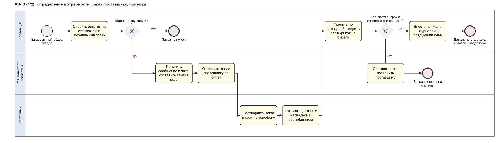

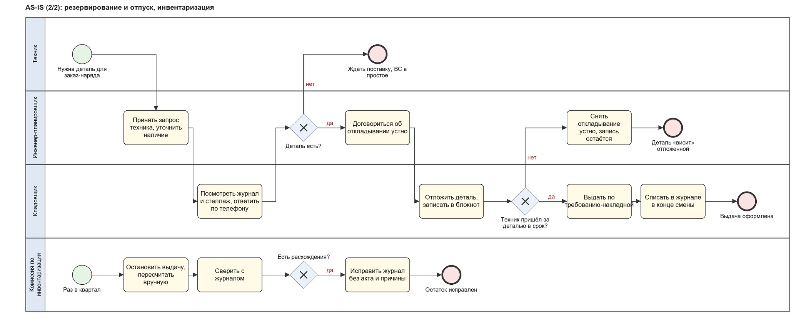

В AS-IS решения принимаются «на глаз» и устно, участники связаны телефоном и чатом, а исключения (расхождение или отсутствие сертификата при приёмке, резерв «висит» в блокноте, расхождение при инвентаризации) решаются вне системы.

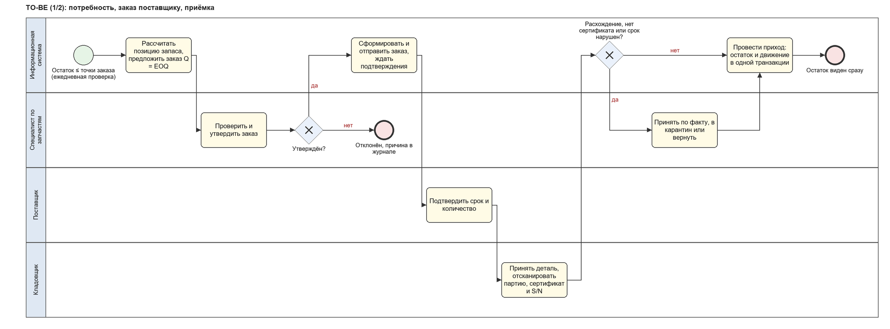

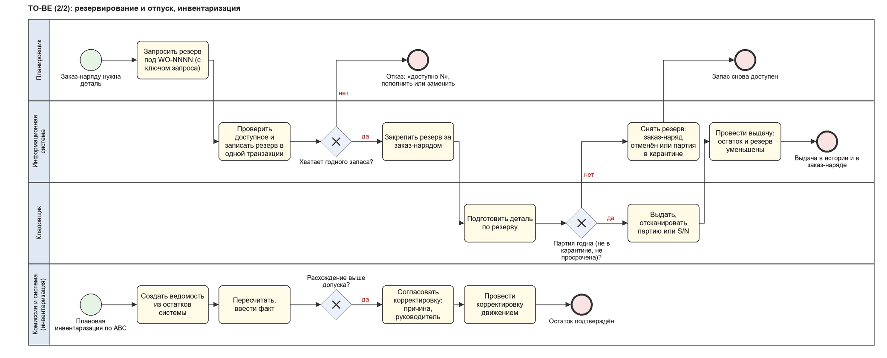

В TO-BE потребность определяет расчёт, резерв и приход проводятся транзакциями, у каждой исключительной ситуации есть ветка: отклонённый заказ, расхождение или отсутствие сертификата при приёмке, нехватка годного запаса, негодная партия, расхождение при инвентаризации. На диаграмме инвентаризации показана ветка «расхождение выше допуска»; при отсутствии расхождения ведомость закрывается без корректировки.

### 3.1. Обоснование изменений

| № | Изменение | Что автоматизируется | Какой контроль вводится | Как оценивается результат |
|---|---|---|---|---|
| 1 | Расчёт потребности вместо обхода «на глаз» (процесс 1) | Ежедневная проверка позиции запаса против точки заказа, расчёт Q = EOQ | Специалист по запчастям утверждает заказ, причина отказа пишется в журнал | Доля заказ-нарядов, у которых детали не оказалось (из раздела 5: доля спроса, выполненного сразу, 99,59 % у рекомендованной политики против 95,38 % у периодического контроля при R = 30); число позиций ниже страхового запаса |
| 2 | Атомарный резерв под заказ-наряд с ключом запроса (процесс 4) | Проверка доступного и запись резерва одной транзакцией | Отказ сверх доступного, один резерв на повторный запрос | Число случаев двойного обещания детали: целевое 0 (TC-06, TC-07, TC-08); число «висящих» резервов старше срока |
| 3 | Входной контроль при приёмке (процесс 3) | Перевод в базовые единицы, проверка срока годности, сертификата и S/N, запись остатка и движения | Деталь без сертификата уходит в карантин; снять его может только руководитель; просроченная партия не принимается | Число деталей, выданных без подтверждения годности: целевое 0 (TC-12, TC-22); задержка между приёмкой и видимым остатком (со смены до секунд) |
| 4 | Корректировка движением и инвентаризация по ведомости (процессы 3 и 5) | Формирование ведомости, расчёт расхождений, запись корректировки | Согласование руководителем при расхождении выше допуска; сторно вместо правки | Доля позиций с расхождением при инвентаризации (цель до 2 %, исходное значение до внедрения неизвестно); число исправлений без причины: 0 |

Базовые значения показателей AS-IS в организации не измерялись (организация условная); сравнение с исходным уровнем после внедрения потребует замеров.

## 4. Модель данных (задание 4)

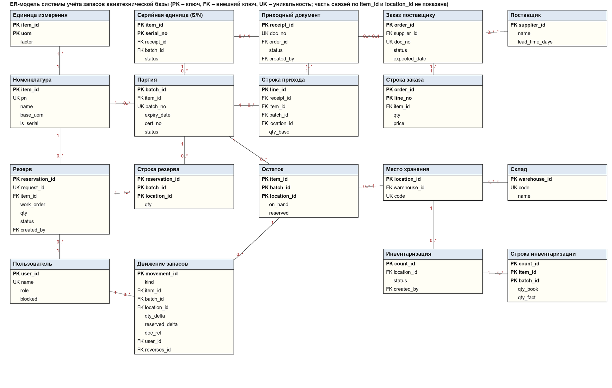

Модель содержит 18 сущностей. Для читаемости на рисунке показаны не все связи по item_id и location_id; все внешние ключи перечислены в словаре данных. Заказ-наряд хранится в резерве как ссылочный номер work_order, потому что сам заказ-наряд ведётся системой ТО и Р из работы 9 и в данную модель не входит.

### 4.1. Словарь данных

| Сущность | Первичный ключ | Основные атрибуты | Внешние ключи | Обязательность и уникальность |
|---|---|---|---|---|
| Номенклатура | item_id | pn, name, base_uom, is_serial | – | pn уникален и обязателен; формат 2-20 символов |
| Единица измерения | item_id + uom | factor | item_id | factor – целое > 0 |
| Склад | warehouse_id | code, name | – | code уникален |
| Место хранения | location_id | code | warehouse_id | code уникален в складе |
| Поставщик | supplier_id | name, lead_time_days | – | name обязателен |
| Заказ поставщику | order_id | doc_no, status, expected_date | supplier_id | doc_no уникален |
| Строка заказа | order_id + line_no | qty, price | order_id, item_id | qty > 0 |
| Приходный документ | receipt_id | doc_no, status, created_at | order_id (необязателен), created_by | doc_no уникален; статус posted или reversed |
| Строка прихода | line_id | qty_doc, uom, qty_base | receipt_id, item_id, batch_id, location_id | qty > 0 |
| Партия | batch_id | batch_no, expiry_date, cert_no, status | item_id | (item_id, batch_no) уникально; статус ok или quarantine; для статуса ok cert_no обязателен |
| Серийная единица | item_id + serial_no | status | receipt_id, batch_id, location_id | S/N уникален в пределах P/N, 4-30 символов |
| Остаток | item_id + batch_id + location_id | on_hand, reserved | item_id, batch_id, location_id | on_hand ≥ 0; reserved ≥ 0; reserved ≤ on_hand |
| Движение запасов | movement_id | ts, kind, qty_delta, reserved_delta, doc_ref | item_id, batch_id, location_id, user_id, reverses_id | Только добавление; kind из пяти значений |
| Резерв | reservation_id | request_id, work_order, qty, status, created_at | item_id, created_by | request_id уникален; qty > 0; work_order вида WO-NNNN |
| Строка резерва | reservation_id + batch_id + location_id | qty | reservation_id, batch_id, location_id | qty > 0 |
| Инвентаризация | count_id | status, created_at | location_id, created_by | Один открытый документ на место |
| Строка инвентаризации | count_id + item_id + batch_id | qty_book, qty_fact | count_id, item_id, batch_id | qty_fact ≥ 0 |
| Пользователь | user_id | name, role, blocked | – | name уникален; роль из пяти значений |

### 4.2. Кратности основных связей

| Связь | Кратность | Обоснование |
|---|---|---|
| Номенклатура – Партия | 1 : 0..* | У позиции может не быть партий, пока не было прихода |
| Партия – Остаток | 1 : 0..* | Партия лежит в нескольких местах |
| Склад – Место хранения | 1 : 1..* | Склад без мест не имеет смысла |
| Поставщик – Заказ | 1 : 0..* | Заказы создаются по мере потребности |
| Заказ – Приходный документ | 0..1 : 0..* | Приход возможен без заказа; один заказ принимают частями |
| Приходный документ – Строка прихода | 1 : 1..* | Документ без строк не создаётся (FR-03) |
| Резерв – Строка резерва | 1 : 1..* | Резерв охватывает одну или несколько партий (FEFO) |
| Партия – Серийная единица | 1 : 0..* | Серийная позиция принимается с S/N |
| Остаток – Движение запасов | 1 : 0..* | Остаток – результат движений |
| Пользователь – Резерв, Движение | 1 : 0..* | Для аудита фиксируется автор |

### 4.3. Нормализация до третьей нормальной формы

- **1НФ:** все атрибуты атомарны; повторяющихся групп нет (строки документов, резервов и инвентаризации вынесены в отдельные сущности).
- **2НФ:** в сущностях с составным ключом неключевые атрибуты зависят от всего ключа: в «Остатке» on_hand и reserved определены тройкой «номенклатура – партия – место»; в «Единице измерения» factor определён парой «номенклатура – единица»; в «Строке заказа» qty и price – парой «заказ – номер строки».
- **3НФ:** транзитивных зависимостей нет: срок годности, номер сертификата и статус относятся к партии, а не к строке прихода; наименование и базовая единица – к номенклатуре, а не к движению; роль – к пользователю; срок поставки – к поставщику. Единственное осознанное нарушение – в «Остатке» хранится item_id вместе с batch_id, хотя партия уже определяет номенклатуру: это сохраняет составной ключ, ускоряет выборку по позиции и защищено внешним ключом на партию (допустимая денормализация).

### 4.4. Как получается текущий остаток

Применяются **оба подхода одновременно**. Источник истины – журнал движений (stock_movement): каждая операция добавляет запись с изменением остатка (qty_delta) и резерва (reserved_delta). Для быстрого ответа хранится текущее значение в «Остатке», которое обновляется в той же транзакции, что и запись движения. Остаток по позиции складывается из строк «Остатка»; доступное – по годным партиям: сумма (on_hand − reserved) без партий в карантине и просроченных.

Расхождение двух представлений – признак ошибки, поэтому операция check_consistency сравнивает хранимые значения с суммой движений и с суммой активных резервов (TC-18). Только вычисление по журналу было бы медленным при каждом просмотре, только хранимое значение не позволило бы найти причину расхождения, а для авиатехники возможность восстановить историю детали обязательна.

### 4.5. Ограничения целостности

| № | Ограничение | Где обеспечивается |
|---|---|---|
| IC-1 | on_hand ≥ 0, reserved ≥ 0, reserved ≤ on_hand | CHECK в базе (TC-20) |
| IC-2 | Уникальность pn, doc_no, request_id, (pn, S/N), (item_id, batch_no) | UNIQUE и первичные ключи в базе |
| IC-3 | Журнал движений нельзя менять и удалять | Триггеры BEFORE UPDATE, BEFORE DELETE (TC-19) |
| IC-4 | Запись остатка и запись движения – одна транзакция | Сервис, BEGIN IMMEDIATE (TC-17) |
| IC-5 | Резерв не больше доступного по годным партиям | Сервис и условное обновление (TC-06, TC-08) |
| IC-6 | Резерв в остатке равен сумме строк активных резервов | Сервис; check_consistency (TC-18) |
| IC-7 | Статус резерва меняется только active → released или active → issued | Сервис (TC-10, TC-11) |
| IC-8 | Партия со статусом ok имеет номер сертификата | CHECK в базе, сервис (TC-22) |

## 5. Исследование политики пополнения запасов (задание 5)

### 5.1. Набор данных и допущения

Реальных данных нет, **данные искусственные**. Набор создаёт скрипт calc/gen_data.py (seed = 10), файлы – data/items.csv и data/demand_monthly.csv. Допущения:

- 24 позиции запасных частей и материалов, спрос за 12 месяцев (январь-декабрь), в штуках;
- цены и затраты на заказ – правдоподобные по порядку величины, но выбраны автором; затраты на оформление и доставку заказа 3 000-60 000 тг (у агрегатов выше);
- годовые затраты на хранение единицы H = 25 % цены (капитал, склад, риск устаревания и порчи);
- месячный спрос = средний уровень × сезонный профиль × (1 + шум), значения округляются и не бывают отрицательными; сезонность задана явно: летний пик рейсов (шины, колёса, тормозные диски, турбинное масло), зимний пик (противообледенительная жидкость, герметик, аккумулятор), у остальных профиль ровный; у редких агрегатов средний спрос меньше двух единиц в месяц, поэтому в отдельные месяцы он равен нулю;
- срок поставки постоянный (7-75 дней, у агрегатов длиннее), начальный остаток – от 0,5 до 1,2 среднего месячного спроса (не менее 1);
- год из 365 суток, уровень обслуживания 95 % (z = 1,645);
- ремонт и возврат агрегатов в запас (цикл ремонтируемых узлов), ограничения по ресурсу детали и скидки поставщиков не моделируются.

Параметры позиций (цена, затраты на заказ S и хранение H, срок поставки L, начальный остаток, годовой спрос) и помесячный спрос приведены в приложении Б.

### 5.2. ABC-анализ

Позиции упорядочены по годовым продажам (спрос × цена). Группа A – позиции, в сумме дающие до 80 % расхода, B – до 95 %, C – остальное. Позиция относится к группе, в которой лежит её начало на накопленной кривой.

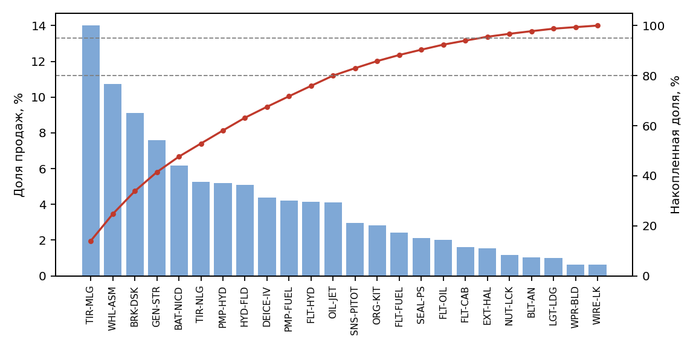

Полная таблица ABC/XYZ (продажи, доля, накопленная доля, среднее, σ, CV) – в приложении В.

Итог: A – 12 поз. и 80.0 %; B – 7 поз. и 15.5 %; C – 5 поз. и 4.5 %. Пять первых позиций (пневматик основной стойки, колесо в сборе, тормозные диски, стартёр-генератор, бортовой аккумулятор) дают 47,6 % расхода, поэтому именно агрегатам, шинам и тормозам нужен наиболее строгий контроль.

### 5.3. XYZ-анализ

Показатель – коэффициент вариации месячного спроса CV = σ / среднее (σ с поправкой n − 1). Границы (допущение): X – CV ≤ 0,25 (стабильный спрос), Y – до 0,50 (колеблющийся), Z – выше 0,50 (нерегулярный).

|  | X | Y | Z | Всего |
|---|---|---|---|---|
| **A** | 2 (HYD-FLD, FLT-HYD), 9,2 % | 4 (TIR-MLG, WHL-ASM, TIR-NLG, OIL-JET), 34,1 % | 6 (BRK-DSK, GEN-STR, BAT-NICD, PMP-HYD, DEICE-IV, PMP-FUEL), 36,7 % | 12 |
| **B** | 4 (ORG-KIT, FLT-FUEL, FLT-OIL, FLT-CAB), 8,9 % | 2 (SEAL-PS, EXT-HAL), 3,7 % | 1 (SNS-PITOT), 3,0 % | 7 |
| **C** | 2 (NUT-LCK, BLT-AN), 2,2 % | 2 (LGT-LDG, WIRE-LK), 1,6 % | 1 (WPR-BLD), 0,6 % | 5 |

Обоснование: X – гидросистемные, топливные, масляные и кабинные фильтры, гидрожидкость, уплотнительные кольца, гайки и болты (CV 0,10-0,24): расход определяется регламентом планового обслуживания. Y – шины, колесо, масло, герметик, огнетушитель, лампа, проволока (CV 0,26-0,49): умеренные колебания и сезонность летнего пика. Z – агрегаты (стартёр-генератор, гидронасос, топливный насос, аккумулятор, датчик) и тормозные диски (CV 0,54-1,17), противообледенительная жидкость (CV 1,06 из-за зимней сезонности) и щётки (CV 0,52). У агрегатов высокий CV отражает редкие внеплановые отказы, а при среднем спросе меньше двух единиц в месяц сам коэффициент малонадёжен; для противообледенительной жидкости причина – сезонность, а не случайность, её нужно учитывать отдельным сезонным пересмотром параметров, поэтому расчёт ниже с постоянными параметрами даёт для неё завышенный страховой запас. Группа AZ – самая важная для управления: дорогие позиции с неустойчивым спросом.

### 5.4. EOQ, страховой запас и точка повторного заказа

Формулы: EOQ = √(2·D·S / H), где D – годовой спрос, S – затраты на заказ, H – затраты на хранение единицы в год; годовые затраты TC(Q) = D/Q · S + Q/2 · H. Страховой запас SS = z · σ_сут · √L, где σ_сут = σ_мес / √(365/12); точка заказа ROP = d · L + SS, d = D / 365. Значения EOQ и страхового запаса округляются вверх до целых.

**Пример (фильтрующий элемент гидросистемы FLT-HYD):** D = 487, S = 8 000, H = 21 250. EOQ = √(2 · 487 · 8 000 / 21 250) = 19,1, берём Q = 20. TC = 487/20 · 8 000 + 20/2 · 21 250 = 194 800 + 212 500 = 407 300 тг. σ_сут = 0,82, L = 14: SS = 1,645 · 0,82 · √14 = 5,05 → 6; d = 1,33 в сутки; ROP = 1,33 · 14 + 6 = 24,7 → 25.

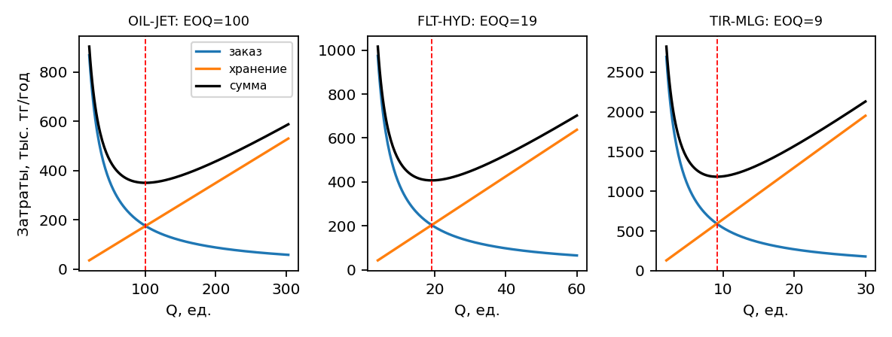

Минимум суммарных затрат находится в точке EOQ: затраты на заказ убывают с ростом Q, затраты на хранение растут. Расчёт выполнен для всех 24 позиций, полная таблица (EOQ, Q, число заказов, затраты, σ в сутки, SS, ROP) – в приложении Г.

Страховой запас взят из общей изменчивости месячного спроса, включая сезонную составляющую, поэтому для противообледенительной жидкости и масла он завышен: это осторожная оценка. Для агрегатов с EOQ около 1 размер заказа Q = 1-3 единицы: заказ одной дорогой единицы экономически оправдан, но на практике зависит от условий поставщика.

### 5.5. Сравнение политик непрерывного и периодического контроля

**Политики.** (s, Q) – непрерывный контроль: после каждых суток проверяется позиция запаса (остаток + заказанное − невыполненный спрос); при позиции ≤ ROP заказывается Q = EOQ (кратное число лотов, если позиция сильно ниже). (R, S) – периодический контроль: раз в R = 30 суток заказывается количество до уровня S = d · (R + L) + z · σ_сут · √(R + L).

**Условия сравнения.** Начальный остаток у обеих политик одинаков (колонка «Начальный остаток» таблицы набора данных), заказов в пути нет. Суточный спрос получен случайным распределением месячных итогов по дням (seed = 100); обе политики видят **один и тот же ряд спроса**. Срок поставки постоянный, поставка приходит в начале суток.

**Обработка дефицита (определена заранее).** Спрос, не выполненный из запаса, **не теряется, а выполняется позже**: невыполненное количество ждёт поставки и закрывается в первую очередь. Показатель «величина дефицита» – сумма единиц, не выданных сразу; дополнительно считается ожидание в единицах-сутках. Штраф за дефицит в стоимость не включён; чтобы это не искажало вывод, ниже рассчитан безубыточный штраф.

**Показатели.** Средний запас (в тенге по цене, для сопоставимости разных позиций), дефицит, число заказов, затраты на заказ (заказы × S) и хранение (средний остаток × H), доля спроса, удовлетворённого сразу из запаса. Третий столбец – смешанная политика, описанная ниже.

| Показатель | (s, Q) непрерывный | (R, S) периодический, R = 30 | Смешанная: D < 60 – (R, S), иначе (s, Q) |
|---|---|---|---|
| Средний запас, млн тг | 124,41 | 124,41 | 104,95 |
| Дефицит, ед. (ожидание, ед.-сут.) | 43 (313) | 604 (5 785) | 53 (817) |
| Число заказов за год | 465 | 270 | 443 |
| Затраты на заказ, тыс. тг | 6 064 | 3 763 | 5 234 |
| Затраты на хранение, тыс. тг | 31 101 | 31 102 | 26 236 |
| Суммарные затраты, тыс. тг | 37 166 | 34 865 | 31 471 |
| Доля спроса, выполненного сразу, % | 99,67 | 95,38 | 99,59 |

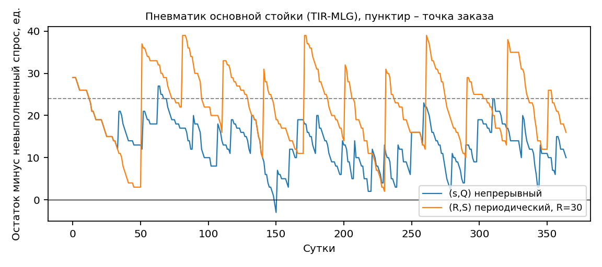

**Результат для двух основных политик.** В отличие от «очевидного» ответа, непрерывный контроль здесь **не дешевле**: при одинаковом среднем запасе (124,41 млн тг) (s, Q) делает на 72 % больше заказов (465 против 270), и суммарные затраты у него выше на 6,6 % (37 166 против 34 865 тыс. тг). Зато (s, Q) выполняет спрос сразу в 99,67 % случаев против 95,38 %, дефицит у него 43 единицы против 604, а ожидание – 313 против 5 785 единиц-суток (в 18 раз меньше). Причина двоякая: (s, Q) страхует спрос на срок поставки L и реагирует на каждый всплеск, а (R, S) при R = 30 держит запас такого же размера, но реагирует раз в месяц; заказов у (s, Q) больше потому, что после каждого достижения ROP заказывается лот Q, причём у редких дорогих агрегатов округление ROP, страхового запаса и Q вверх до целых даёт запас больше, чем нужно.

**Где (s, Q) проигрывает.** По отдельным позициям (приблизительно по округлённому среднему запасу):

| P/N | D, ед. | (s, Q): заказов / затраты, тыс. тг (≈) | (R, S): заказов / затраты, тыс. тг (≈) |
|---|---|---|---|
| WHL-ASM | 51 | 18 / 4 110 | 11 / 3 585 |
| GEN-STR | 20 | 11 / 5 000 | 10 / 3 250 |
| BAT-NICD | 44 | 15 / 3 035 | 10 / 3 015 |
| PMP-HYD | 8 | 9 / 6 065 | 6 / 3 772 |
| PMP-FUEL | 10 | 11 / 4 435 | 6 / 3 555 |
| SNS-PITOT | 33 | 12 / 1 650 | 11 / 1 422 |

У шести позиций с годовым спросом меньше 60 единиц (WHL-ASM, GEN-STR, BAT-NICD, PMP-HYD, PMP-FUEL, SNS-PITOT) периодический контроль дешевле, а дефицит различается на единицы (у остальных 18 позиций (s, Q) почти везде дешевле и стабильно лучше по дефициту). Вероятная причина – округление вверх до целых параметров ROP и Q при спросе в одну-две единицы в месяц и большом разбросе месячных значений. Поэтому сформирована **смешанная политика**: для позиций с годовым спросом меньше 60 единиц – (R, S), для остальных – (s, Q). Порог 60 выбран по результатам этой же выборки, а не заранее, поэтому ниже указано, что подтверждено повторениями, а что нет.

**По группам ABC (та же последовательность спроса):**

| Группа | Позиций | Политика | Средний запас, млн тг | Дефицит, ед. | Заказов | Затраты, тыс. тг | Доля сразу, % |
|---|---|---|---|---|---|---|---|
| A | 12 | (s, Q) | 110,32 | 20 | 244 | 32 261 | 99,67 |
| A | 12 | (R, S) | 107,07 | 271 | 127 | 29 559 | 95,57 |
| B | 7 | (s, Q) | 11,56 | 15 | 137 | 3 942 | 99,61 |
| B | 7 | (R, S) | 13,74 | 249 | 83 | 4 167 | 93,57 |
| C | 5 | (s, Q) | 2,53 | 8 | 84 | 963 | 99,74 |
| C | 5 | (R, S) | 3,60 | 84 | 60 | 1 139 | 97,28 |

**Устойчивость вывода.** Тот же эксперимент повторён на 30 других разбивках месячного спроса по дням (в каждой обе политики видят один ряд): суммарные затраты (s, Q) – 37 371 ± 114 тыс. тг, (R, S) – 35 301 ± 187 тыс. тг, смешанной политики – 32 008 ± 194 тыс. тг; (R, S) дешевле (s, Q) в 30 из 30 повторений, смешанная дешевле (s, Q) в 30 из 30. Дефицит: 43 ± 9, 597 ± 20 и 55 ед.; доля спроса, выполненного сразу, – 99,67 ± 0,07 %, 95,43 ± 0,15 % и 99,58 %. Месячные итоги при повторениях те же, поэтому это проверка влияния случайного разбиения по дням, а не изменения самого спроса, и порог 60 она не проверяет независимо: для этого нужен другой год данных.

**Безубыточный штраф за дефицит.** (s, Q) окупается, если одна единица дефицита обходится дороже 3 738 ± 441 тг (среднее по 30 повторениям): именно столько составляет разница затрат, делённая на разницу дефицита. Это меньше цены самой дешёвой позиции набора (6 500 тг), а простой воздушного судна из-за отсутствия детали стоит намного больше. Поэтому критерием выбора служит доступность, а не только затраты на заказ и хранение.

**Чувствительность к периоду контроля R** (основная последовательность):

| R, сут. | Средний запас, млн тг | Дефицит, ед. | Заказов | Затраты, тыс. тг | Доля сразу, % |
|---|---|---|---|---|---|
| 7 | 86,64 | 108 | 1033 | 33 229 | 99,17 |
| 14 | 104,21 | 133 | 554 | 32 972 | 98,98 |
| 30 | 124,41 | 604 | 270 | 34 865 | 95,38 |
| 60 | 155,88 | 1899 | 141 | 41 103 | 85,48 |

Подбор R частично меняет вывод: при R = 14 суток (R, S) даёт затраты 32 972 тыс. тг (ниже, чем у (s, Q)) и 98,98 % спроса сразу, при R = 7 – 33 229 тыс. тг и 99,17 %. Однако дефицит остаётся выше, чем у (s, Q) (133 и 108 единиц против 43), а число заказов растёт до 554 и 1 033. Эти варианты не лучше смешанной политики (31 471 тыс. тг, 53 единицы, 99,59 %). Смешанная схема «A – (s, Q), B и C – (R, S)» даёт 37 566 тыс. тг, дефицит 353 ед. и 97,30 % – хуже и единой (s, Q), и смешанной по спросу.

**Выбор политики.** Для 18 позиций с годовым спросом от 60 единиц (расходные материалы, фильтры, шины, тормозные диски, стандартные изделия, жидкости) выбрана политика (s, Q) с Q = EOQ и ROP из раздела 5.4: она даёт минимальный дефицит и снижает затраты по сравнению с (R, S) при том же уровне доступности. Для шести редких агрегатов и датчика (WHL-ASM, GEN-STR, BAT-NICD, PMP-HYD, PMP-FUEL, SNS-PITOT) выбрана политика (R, S) с периодом 30 суток: у них дешевле, а различие в дефиците не превышает нескольких единиц; для самых критичных из них руководитель может вручную задать неснижаемый запас. Смешанная политика уменьшает затраты на 15,3 % против (s, Q) и на 9,7 % против (R, S) при доле спроса, выполненного сразу, 99,59 %. Ограничения: срок поставки постоянный, спрос по дням распределён равномерно случайно, ремонтный цикл агрегатов, ступенчатые скидки, общие поставки по расписанию и ограничения склада не учтены, для сезонных позиций нужен пересмотр ROP, порог 60 подобран по тем же данным.

## 6. UML-модели (задание 6)

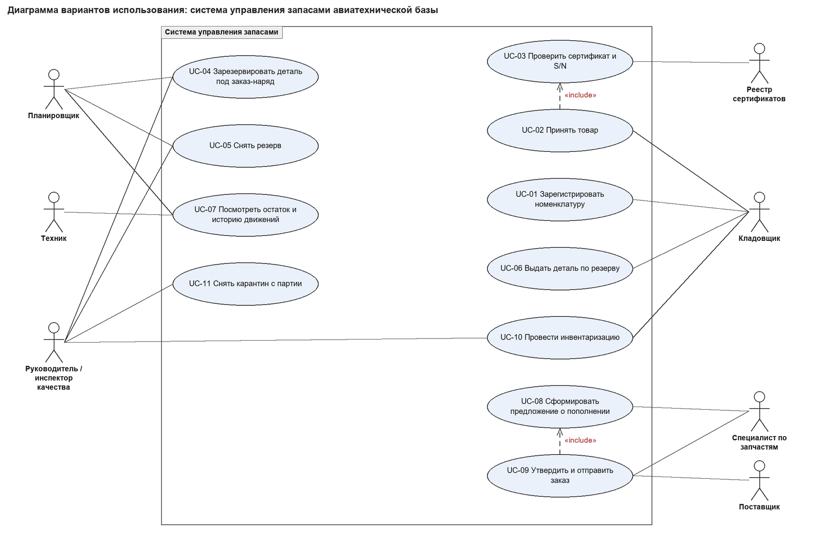

Диаграмма содержит 7 актёров (3 основных слева, 4 справа) и 11 вариантов использования. Связь «include»: UC-02 включает UC-03 (при приёмке проверяются сертификат и серийный номер), UC-09 включает UC-08 (заказ утверждается по предложению системы). Сторно ошибочного прихода реализовано в прототипе, но не вынесено на диаграмму, чтобы не перегружать её; оно описано как альтернативный сценарий UC-02. Техник только просматривает остаток (UC-07), как и требует BR-06.

### 6.1. Описание сценариев

**UC-04 «Зарезервировать деталь под заказ-наряд»**

| Элемент | Содержание |
|---|---|
| Основной актёр | Инженер-планировщик (также руководитель технической службы) |
| Предусловия | Пользователь не заблокирован, роль «планировщик» или «руководитель»; номенклатура зарегистрирована; запросу назначен уникальный ключ; указан номер заказ-наряда WO-NNNN |
| Основной сценарий | 1) Планировщик передаёт ключ запроса, P/N, количество, номер заказ-наряда. 2) Система начинает транзакцию и проверяет права и формат номера заказ-наряда. 3) Проверяет, что ключ ещё не использован. 4) Считает доступное по годным партиям. 5) Выбирает партии по сроку годности и увеличивает резерв условным обновлением. 6) Записывает резерв, строки и движения, фиксирует транзакцию. 7) Возвращает номер резерва |
| Альтернативные сценарии | A1: ключ уже использован с теми же данными – возвращается прежний резерв, новых записей нет. A2: резерв охватывает две партии – создаются две строки |
| Ошибочные ситуации | E1: количество не положительное целое или номер заказ-наряда неверен – ошибка данных. E2: доступно меньше запрошенного – отказ «запрошено X, доступно N», данные не меняются. E3: ключ с другими данными – конфликт. E4: нет прав (например, у техника). E5: сбой на любом шаге – откат |
| Постусловия успеха | Доступное уменьшилось на количество, остаток не изменился; создан один резерв «active»; в журнале запись RESERVE на каждую партию |
| Гарантии при неуспехе | Резерв, строки и движения не созданы; остаток и резерв прежние; повтор запроса безопасен |

**UC-02 «Принять деталь»**

| Элемент | Содержание |
|---|---|
| Основной актёр | Кладовщик (вторичные – поставщик с накладной и документом о годности; для серийных позиций – проверка S/N) |
| Предусловия | Роль «кладовщик»; номенклатура и места хранения существуют; документ имеет уникальный номер |
| Основной сценарий | 1) Кладовщик вводит номер документа и строки (партия, сертификат, срок годности, S/N). 2) Система проверяет права и что номер новый. 3) По каждой строке переводит количество в базовую единицу, проверяет срок годности и S/N. 4) Находит или создаёт партию, добавляет строку, увеличивает остаток и записывает движение RECEIPT. 5) Фиксирует транзакцию. 6) Остаток сразу доступен |
| Альтернативные сценарии | A1: документ с таким номером уже проведён – возвращается он же, остаток не меняется. A2: в строке нет номера сертификата – партия создаётся в карантине, остаток виден как негодный, снять карантин может руководитель (UC-11). A3: сторно: приход исправляется встречным движением, если деталь не зарезервирована и не выдана |
| Ошибочные ситуации | E1: единица измерения не определена; E2: срок годности в прошлом или неверный формат; E3: S/N неверен, повторён или уже принят; E4: место не найдено; E5: любая строка неверна – откат всего документа |
| Постусловия успеха | Остаток вырос на количество в базовых единицах; создан документ «posted»; в журнале по строке запись RECEIPT; партия без сертификата – в карантине |
| Гарантии при неуспехе | Ни документ, ни партии, ни остатки, ни S/N не сохранены |

### 6.2. Диаграмма классов

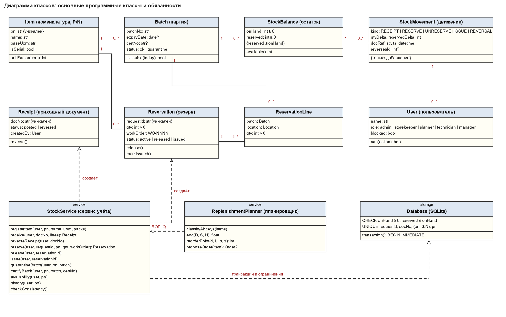

| Класс | Обязанности |
|---|---|
| Item | Хранит P/N, единицы и признак серийности; даёт коэффициент пересчёта |
| Batch | Хранит номер, срок годности, номер сертификата и статус (ok или quarantine); определяет, пригодна ли партия на дату |
| StockBalance | Хранит остаток и резерв по тройке «номенклатура – партия – место»; считает доступное; обеспечивает reserved ≤ onHand |
| StockMovement | Неизменяемая запись об изменении остатка и резерва с автором, временем и документом |
| Receipt | Приходный документ, умеет быть сторнирован |
| Reservation и ReservationLine | Резерв под заказ-наряд и его распределение по партиям; допустимые переходы статуса |
| User | Роль и признак блокировки; проверка права на действие |
| StockService | Единая точка операций; границы транзакций; проверка бизнес-правил |
| ReplenishmentPlanner | Классификация ABC/XYZ, EOQ, точка заказа, предложение заказа (в прототипе – скрипты calc) |
| Database | Транзакции и ограничения, последний рубеж защиты |

### 6.3. Диаграммы последовательности

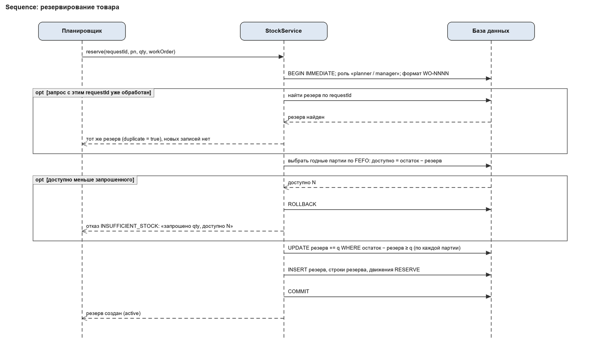

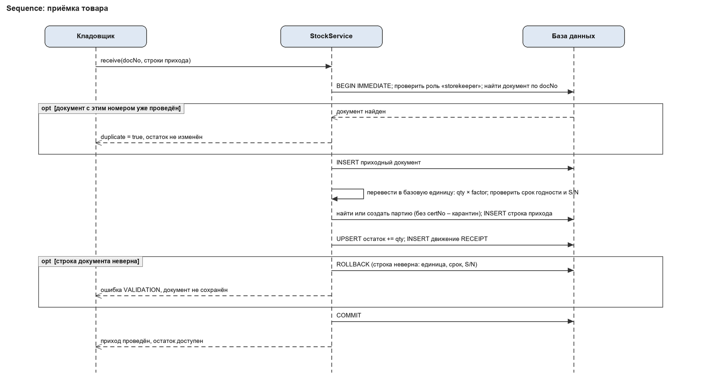

Сообщения соответствуют операциям сервиса: reserve и receive. Фрагменты opt показывают повторный запрос (идемпотентность), нехватку запаса и ошибку данных; в каждой неуспешной ветке выполняется откат транзакции.

### 6.4. Диаграмма состояний резерва

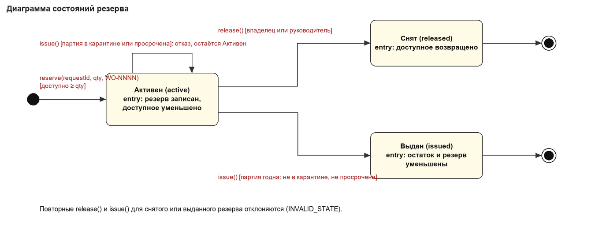

Резерв создаётся только при достаточном доступном количестве и находится в состоянии «Активен». Из него возможны два перехода: снятие (владелец или руководитель) и выдача (только кладовщик, при годной партии). Выдача из партии в карантине или просроченной отклоняется, резерв остаётся активным. Из состояний «Снят» и «Выдан» переходов нет: повтор отклоняется (TC-10, TC-11).

## 7. Параллельные операции (задание 7)

**Ситуация.** На складе 10 единиц фильтрующего элемента. Два планировщика одновременно резервируют по 8: один под заказ-наряд WO-1001, другой под WO-1002.

**1. Какое противоречие возникает при ошибочной реализации.** Каждая операция сначала читает «доступно 10», проверяет «10 ≥ 8» и затем записывает резерв +8. Обе проверки проходят до того, как любая запись выполнена, итоговый резерв 16 при остатке 10: деталь обещана двум заказ-нарядам, нарушены BR-01 и инвариант reserved ≤ on_hand. Контрольный тест (раздел 8) воспроизводит это поведение: при раздельных чтении и записи без транзакции резерв равен 16. Это та же ошибка, что в работе 9 при двойном назначении места в ангаре, только вместо интервала времени здесь количество.

**2. Как объединить проверку остатка и регистрацию резерва.** В одну неделимую операцию: проверка доступного, условное обновление `UPDATE … SET reserved = reserved + q WHERE on_hand − reserved ≥ q` и запись резерва и движения происходят в одной транзакции. Если обновление не затронуло строку, количество изменилось, операция отклоняется.

**3. Какой транзакционный подход выбран.** Короткая транзакция с немедленной блокировкой записи (SQLite: BEGIN IMMEDIATE), то есть пессимистический подход: вторая операция ждёт завершения первой и после этого читает уже обновлённое значение. Условное обновление и CHECK (reserved ≤ on_hand) дают две дополнительные линии защиты. Для промышленной СУБД: уровень READ COMMITTED с SELECT … FOR UPDATE по строкам остатка или уровень SERIALIZABLE с повтором при конфликте. Оптимистичный вариант (версия строки и повтор) не выбран: конкуренция на одной строке остатка редка, но цена ошибки высока, поэтому лучше дождаться, чем повторять. Вызовов внешних систем внутри транзакции нет, блокировка кратковременна.

**4. Какой результат получает отклонённый запрос.** Ошибка INSUFFICIENT_STOCK с сообщением «Запрошено 8, доступно 2»; транзакция откатывается, резерва и движения нет. Планировщик может запросить 2, дождаться поставки или подобрать другую деталь.

**5. Как предотвратить дублирование резерва при повторной отправке.** Каждый запрос несёт уникальный ключ (request_id), проверка ключа выполняется внутри той же транзакции. Если ключ есть и данные совпадают, возвращается прежний резерв (duplicate = true), новых записей нет; тот же ключ с другими данными даёт конфликт. Уникальность request_id закреплена ограничением UNIQUE.

**Алгоритм.**

```
reserve(user, request_id, pn, qty, work_order):
    BEGIN IMMEDIATE                                  -- единственный пишущий
    проверить роль пользователя; qty – целое > 0; work_order = WO-NNNN
    если есть резерв с request_id:
        если (pn, qty, work_order) совпадают: COMMIT; вернуть его (duplicate)
        иначе: ROLLBACK; ошибка конфликта ключа
    строки = годные партии позиции по сроку годности, где остаток − резерв > 0
    если сумма (остаток − резерв) < qty:
        ROLLBACK; ошибка INSUFFICIENT_STOCK(доступно)
    создать резерв; осталось = qty
    для строки в строках:
        взять = min(осталось, строка.доступно)
        UPDATE остаток SET резерв = резерв + взять
               WHERE ключ = строка.ключ AND остаток − резерв >= взять
        если затронуто не 1 строк: ROLLBACK; ошибка INSUFFICIENT_STOCK
        записать строку резерва и движение RESERVE; осталось −= взять
    COMMIT; вернуть резерв
```

**Ожидаемые и фактические результаты.**

| Шаг | Планировщик 1 (WO-1001) | Планировщик 2 (WO-1002) | Состояние |
|---|---|---|---|
| Начало | – | – | остаток 10, резерв 0, доступно 10 |
| 1 | резерв 8: успех | ждёт завершения первого | остаток 10, резерв 8, доступно 2 |
| 2 | – | резерв 8: отказ «доступно 2» | без изменений |
| 3 | повтор запроса с тем же ключом: тот же резерв | – | резерв 8, второй записи нет |
| Итог | В 20 из 20 повторов теста TC-08: ровно один успех, одно движение RESERVE, резерв 8 | | согласованность остатка и движений подтверждена |

## 8. Прототип и проверка (задание 8)

### 8.1. Прототип

Прототип реализован на Python 3.11 и встроенном SQLite (папка prototype). Он поддерживает: регистрацию номенклатуры (FR-01), приход с сертификатом и сроком годности (FR-03), доступный остаток (FR-05), резервирование под заказ-наряд (FR-06), снятие резерва (FR-07), выдачу (FR-08), историю движений (FR-09); дополнительно – карантин партии и его снятие (FR-10), сторно, серийные единицы с S/N, роли и проверку согласованности. Не реализованы поставщики и заказы, инвентаризация, автоматическое снятие резерва по сроку, связь с системой ТО и Р из работы 9 (заказ-наряд – лишь строка формата WO-NNNN), интерфейс пользователя.

**Инструкция по запуску** (из папки prototype; нужен только Python 3.11 или новее):

```
python demo.py
python -m unittest discover -s tests -t . -v
```

Демонстрация (demo_output.txt) показывает приход 10 штук с сертификатом, резерв 8 под WO-1001, отказ второму планировщику «Запрошено 8, доступно 2», повтор запроса без дубля, приход партии без сертификата (в карантин) и снятие карантина руководителем, выдачу и историю из четырёх движений.

### 8.2. Протокол проверки

Все сценарии автоматизированы в tests/test_inventory.py. Запуск на Windows 11, Python 3.11: **24 проверки, все успешны, около 7 с** (test_results.txt). Обязательные категории задания отмечены.

| Код | Категория | Действие | Ожидаемый и фактический результат |
|---|---|---|---|
| TC-01 | Штатное | Зарегистрировать номенклатуру; повторить P/N; неверный P/N; упаковка с коэффициентом 1 | Первая принята; три отказа; записей нет. Пройден |
| TC-02 | Штатное | Принять 10 штук с сертификатом | Остаток 10, доступно 10, одно движение RECEIPT. Пройден |
| TC-03 | Единицы | Принять 2 упаковки по 10; затем неизвестную единицу | Остаток 20; вторая отклонена. Пройден |
| TC-04 | Повторный запрос | Тот же приходный документ дважды | Остаток 10, одно движение, второй вызов duplicate. Пройден |
| TC-05 | Штатное | Резерв 4 из 10 под WO-1001 | Резерв 4, доступно 6, остаток 10. Пройден |
| TC-06 | Недостаточный запас | После резерва 8 запросить ещё 8 | Отказ «Запрошено 8, доступно 2»; одно движение RESERVE. Пройден |
| TC-07 | Повторный запрос | Тот же ключ дважды; тот же ключ с другим количеством | Один резерв, duplicate; конфликт ключа. Пройден |
| TC-08 | Параллельное | Два резерва по 8 из 10 одновременно, 20 повторов | Каждый раз один успех, отказ с «доступно 2», резерв 8, расхождений нет. Пройден |
| TC-09 | Несанкционированное | Планировщик и техник принимают деталь; кладовщик и техник резервируют; планировщик 2 снимает чужой резерв; планировщик выдаёт | Все шесть отклонены, данные не изменены; руководитель снял чужой резерв. Пройден |
| TC-10 | Штатное | Выдача резерва 4; повторная выдача | Остаток 6, резерв 0; повтор отклонён; история RECEIPT, RESERVE, ISSUE. Пройден |
| TC-11 | Штатное | Снять резерв 8; снять повторно; зарезервировать 8 другим | Доступно 10; повторное снятие отклонено; новый резерв принят. Пройден |
| TC-12 | Качество запаса | Перевести в карантин партию с резервом 3 | Доступно 0, негодно 5; новый резерв и выдача отклонены. Пройден |
| TC-13 | Качество запаса | Приход с прошедшим сроком; резерв, затем наступление срока | Приход отклонён; после срока доступно 0, резерв и выдача отклонены. Пройден |
| TC-14 | Правило выбора | Две партии, резерв 7 | 5 из ближайшей по сроку, 2 из другой. Пройден |
| TC-15 | Корректировка | Сторно прихода при резерве части; сторно свободного прихода; повторное сторно | Первое отклонено; второе проведено встречным движением −3; третье отклонено. Пройден |
| TC-16 | Серийный учёт | Приём стартёр-генераторов: S/N короче 4 символов, повтор S/N, строчные буквы, число S/N не равно количеству; затем верные; повторный S/N в другой партии | Все ошибки отклонены, остаток 0; верные приняты; выдача называет S/N. Пройден |
| TC-17 | Откат | Приход со второй строкой с отрицательным количеством; сбой при резерве | Ничего не сохранено; в истории только прежнее движение. Пройден |
| TC-18 | Согласованность | Серия приходов, резервов, выдачи, снятия, сторно | Хранимый остаток равен сумме движений. Пройден |
| TC-19 | Неизменяемость | UPDATE и DELETE журнала движений | Оба отклонены триггером. Пройден |
| TC-20 | Ограничение базы | Прямой UPDATE: резерв 11 при остатке 10 | Нарушение CHECK. Пройден |
| TC-21 | Неверные данные | Резерв неизвестной позиции; просмотр от неизвестного пользователя | Отказы NOT_FOUND. Пройден |
| TC-22 | Допуск детали | Приход без сертификата; резерв; снятие карантина кладовщиком; руководителем без номера; руководителем с номером | Партия в карантине, доступно 0, резерв отклонён; кладовщик отклонён по правам; без номера отклонено; с номером доступно 6, резерв принят. Пройден |
| TC-23 | Неверные данные | Резерв без заказ-наряда и с номерами «ЗН-5», «WO-1», «wo-1001» | Все отклонены, резерв 0. Пройден |
| TC-C | Контрольный | Раздельные чтение и запись без транзакции и без CHECK, 2 потока | Оба «успешны», резерв 16 при остатке 10: подтверждено, что защита нужна. Пройден (как демонстрация дефекта) |

Автоматизировано 24 проверки (задание требует не менее пяти). Ограничения: нагрузка (NFR-01, NFR-02) и доступность не проверялись; NFR-03 проверено 20 повторами вместо 1 000; база создаётся заново для каждой проверки; параллелизм смоделирован потоками одного процесса, а не отдельными серверами; расчёт раздела 5 в прототип не встроен.

## 9. Таблица соответствия «Требование – элемент модели – реализация – проверка»

Таблица охватывает все 16 функциональных, 8 нефункциональных требований и 14 бизнес-правил; она вынесена в приложение Д. Сводка: из 16 функциональных требований реализовано и проверено 13 (FR-01...FR-12 и FR-16), FR-13 выполнено расчётом вне системы (раздел 5), FR-14 и FR-15 не реализованы; из нефункциональных проверены NFR-03...NFR-06 (NFR-03 на 20 повторах вместо 1 000), NFR-01, NFR-02, NFR-07 и NFR-08 не проверялись; из бизнес-правил проверены 12 (BR-01...BR-10, BR-13, BR-14), BR-11 следует из BR-01 без отдельной проверки, BR-12 не реализовано.

## 10. Заключение

Для авиатехнической базы предложена система учёта запасов запасных частей, в которой остаток хранится вместе с журналом движений и проверяется на согласованность; резерв проверяет доступное и фиксируется неделимой транзакцией с ключом запроса под конкретный заказ-наряд; партии без подтверждения годности принимаются только в карантин и не резервируются; серийные агрегаты прослеживаются по номеру; права разграничены по ролям. Прототип проверен 24 автоматизированными проверками, все успешны; контрольный тест показал, что без транзакции возникает резерв 16 при остатке 10.

Расчёт на модельных данных показал, что единая политика непрерывного контроля (s, Q) обеспечивает доступность 99,67 %, но обходится на 6,6 % дороже периодического контроля при R = 30 (который даёт только 95,38 %). Смешанная политика – (s, Q) для позиций с годовым спросом от 60 единиц и (R, S) для шести редких агрегатов – снижает затраты на 15,3 % против (s, Q) и на 9,7 % против (R, S) при доле спроса, выполненного сразу, 99,59 %; вывод подтверждён 30 повторениями, но порог 60 подобран по тем же данным и требует проверки на другом году.

**Ограничения.** Организация условная, данные искусственные, пороги – допущения; нагрузка и доступность не проверялись; поставщики, заказы и инвентаризация описаны моделью, но не реализованы в прототипе; связь с системой ТО и Р из работы 9 ограничена номером заказ-наряда; стоимость дефицита не включена в затраты (дан безубыточный штраф); цикл ремонта агрегатов и ресурс деталей не моделировались; базовые показатели AS-IS не измерялись.

## Список использованных источников

1. Harris F. W. How Many Parts to Make at Once // Factory, The Magazine of Management. – 1913. – Vol. 10, No. 2. – P. 135-136, 152.
2. Silver E. A., Pyke D. F., Peterson R. Inventory Management and Production Planning and Scheduling. 3rd ed. – New York: Wiley, 1998.
3. Chopra S., Meindl P. Supply Chain Management: Strategy, Planning, and Operation. 6th ed. – Pearson, 2016.
4. OMG. Business Process Model and Notation (BPMN), Version 2.0.2. – Object Management Group, 2013. – Документ formal/2013-12-09.
5. OMG. Unified Modeling Language (UML), Version 2.5.1. – Object Management Group, 2017. – Документ formal/2017-12-05.
6. Kleppmann M. Designing Data-Intensive Applications. – O'Reilly, 2017 (главы о транзакциях и идемпотентности).
7. SQLite Documentation: Transaction (BEGIN IMMEDIATE), CHECK constraints, Triggers. – https://www.sqlite.org/docs.html
8. Ларман К. Применение UML 2.0 и шаблонов проектирования. 3-е изд. – М.: Вильямс, 2013.
9. Материалы автора по теме: презентация «Информационная система автоматизации технического обслуживания и ремонта самолётов», лабораторные работы, практика 6; СРМ №9 (friend_1/task_9).

## Приложение А. Состав материалов для сдачи

| Материал | Расположение |
|---|---|
| Аналитический отчёт | task_10.md, документ Word собирается скриптом md_to_docx.py |
| Редактируемые диаграммы | inventory_model.drawio (10 страниц: 4 BPMN, ER, Use Case, Class, 2 Sequence, State) |
| Изображения диаграмм и графики | assets |
| Набор данных | data/items.csv, data/demand_monthly.csv |
| Расчёты и код | calc/gen_data.py, calc/replenishment.py; результаты – results |
| Код прототипа и инструкция | prototype, prototype/README.md |
| Протокол проверки | раздел 8.2; prototype/test_results.txt, prototype/demo_output.txt |
| Таблица соответствия | раздел 9, приложение Д |

Изображения диаграмм построены средствами Python (Pillow) из тех же координат, что и файл .drawio, поэтому могут немного отличаться от экспорта diagrams.net.

## Приложение Б. Набор данных (модельные данные)

| P/N | Наименование | Цена, тг | Затраты на заказ S, тг | Хранение H, тг/ед. в год | Срок поставки L, дн. | Начальный остаток | Спрос за год, ед. |
|---|---|---|---|---|---|---|---|
| TIR-MLG | Пневматик основной стойки шасси | 520 000 | 20 000 | 130 000 | 21 | 29 | 269 |
| TIR-NLG | Пневматик передней стойки шасси | 380 000 | 20 000 | 95 000 | 21 | 14 | 138 |
| BRK-DSK | Комплект тормозных дисков | 1 200 000 | 30 000 | 300 000 | 30 | 5 | 76 |
| FLT-HYD | Фильтрующий элемент гидросистемы | 85 000 | 8 000 | 21 250 | 14 | 30 | 487 |
| FLT-FUEL | Фильтр топливный | 65 000 | 8 000 | 16 250 | 14 | 19 | 373 |
| FLT-OIL | Фильтр масляный двигателя | 48 000 | 8 000 | 12 000 | 14 | 25 | 421 |
| FLT-CAB | Фильтр воздушный кабины | 22 000 | 5 000 | 5 500 | 10 | 51 | 731 |
| OIL-JET | Масло турбинное, банка 1 кг | 14 000 | 6 000 | 3 500 | 10 | 210 | 2924 |
| HYD-FLD | Гидрожидкость, 3,8 л | 95 000 | 7 000 | 23 750 | 14 | 44 | 535 |
| DEICE-IV | Противообледенительная жидкость, 20 л | 28 000 | 5 000 | 7 000 | 7 | 176 | 1561 |
| SEAL-PS | Герметик, туба 0,5 кг | 35 000 | 5 000 | 8 750 | 21 | 50 | 603 |
| ORG-KIT | Комплект уплотнительных колец | 18 000 | 4 000 | 4 500 | 10 | 104 | 1569 |
| BLT-AN | Болты стандартные, упаковка 100 | 12 000 | 3 500 | 3 000 | 7 | 44 | 873 |
| NUT-LCK | Самоконтрящиеся гайки, упаковка 100 | 15 000 | 3 500 | 3 750 | 7 | 57 | 785 |
| WIRE-LK | Контровочная проволока и шплинты, комплект | 6 500 | 3 000 | 1 625 | 7 | 108 | 947 |
| LGT-LDG | Лампа посадочной фары | 45 000 | 6 000 | 11 250 | 21 | 10 | 220 |
| BAT-NICD | Бортовой аккумулятор NiCd | 1 400 000 | 25 000 | 350 000 | 45 | 3 | 44 |
| GEN-STR | Стартёр-генератор | 3 800 000 | 40 000 | 950 000 | 60 | 1 | 20 |
| PMP-HYD | Гидронасос | 6 500 000 | 60 000 | 1 625 000 | 75 | 1 | 8 |
| PMP-FUEL | Топливный насос-регулятор | 4 200 000 | 50 000 | 1 050 000 | 60 | 1 | 10 |
| WHL-ASM | Колесо шасси в сборе | 2 100 000 | 30 000 | 525 000 | 45 | 5 | 51 |
| SNS-PITOT | Приёмник воздушного давления | 900 000 | 25 000 | 225 000 | 45 | 2 | 33 |
| WPR-BLD | Щётка стеклоочистителя пилотской кабины | 24 000 | 4 000 | 6 000 | 21 | 29 | 264 |
| EXT-HAL | Бортовой огнетушитель | 110 000 | 8 000 | 27 500 | 30 | 6 | 140 |

Помесячный спрос, штук:

| P/N | янв | фев | мар | апр | май | июн | июл | авг | сен | окт | ноя | дек |
|---|---|---|---|---|---|---|---|---|---|---|---|---|
| TIR-MLG | 15 | 16 | 18 | 22 | 31 | 17 | 30 | 28 | 21 | 23 | 19 | 29 |
| TIR-NLG | 15 | 10 | 8 | 10 | 12 | 22 | 9 | 18 | 12 | 10 | 11 | 1 |
| BRK-DSK | 4 | 4 | 7 | 6 | 9 | 6 | 2 | 15 | 5 | 9 | 4 | 5 |
| FLT-HYD | 42 | 38 | 41 | 45 | 45 | 41 | 43 | 34 | 31 | 38 | 44 | 45 |
| FLT-FUEL | 28 | 29 | 30 | 28 | 34 | 37 | 35 | 28 | 27 | 32 | 29 | 36 |
| FLT-OIL | 38 | 38 | 38 | 40 | 38 | 28 | 31 | 35 | 35 | 35 | 34 | 31 |
| FLT-CAB | 69 | 65 | 52 | 56 | 69 | 50 | 61 | 71 | 69 | 54 | 57 | 58 |
| OIL-JET | 173 | 184 | 191 | 255 | 234 | 292 | 342 | 354 | 291 | 235 | 193 | 180 |
| HYD-FLD | 48 | 46 | 51 | 50 | 53 | 45 | 38 | 47 | 38 | 45 | 43 | 31 |
| DEICE-IV | 245 | 340 | 230 | 42 | 15 | 10 | 7 | 6 | 20 | 96 | 173 | 377 |
| SEAL-PS | 33 | 85 | 53 | 19 | 72 | 49 | 45 | 10 | 62 | 53 | 61 | 61 |
| ORG-KIT | 134 | 112 | 114 | 128 | 126 | 135 | 200 | 175 | 140 | 103 | 119 | 83 |
| BLT-AN | 59 | 91 | 68 | 76 | 65 | 97 | 72 | 72 | 55 | 59 | 96 | 63 |
| NUT-LCK | 65 | 73 | 80 | 74 | 47 | 76 | 62 | 62 | 64 | 54 | 59 | 69 |
| WIRE-LK | 70 | 120 | 66 | 93 | 65 | 94 | 77 | 57 | 97 | 68 | 106 | 34 |
| LGT-LDG | 17 | 15 | 27 | 5 | 25 | 19 | 12 | 30 | 13 | 14 | 20 | 23 |
| BAT-NICD | 6 | 0 | 4 | 7 | 4 | 2 | 0 | 1 | 8 | 2 | 6 | 4 |
| GEN-STR | 0 | 1 | 2 | 0 | 3 | 1 | 4 | 2 | 3 | 2 | 2 | 0 |
| PMP-HYD | 1 | 1 | 0 | 0 | 1 | 1 | 2 | 0 | 0 | 2 | 0 | 0 |
| PMP-FUEL | 2 | 0 | 0 | 0 | 2 | 1 | 2 | 0 | 0 | 2 | 0 | 1 |
| WHL-ASM | 6 | 6 | 5 | 7 | 0 | 2 | 6 | 2 | 4 | 5 | 5 | 3 |
| SNS-PITOT | 3 | 2 | 1 | 1 | 4 | 6 | 5 | 3 | 0 | 3 | 2 | 3 |
| WPR-BLD | 25 | 14 | 29 | 5 | 35 | 43 | 16 | 20 | 4 | 23 | 22 | 28 |
| EXT-HAL | 14 | 14 | 11 | 7 | 10 | 20 | 16 | 9 | 19 | 7 | 6 | 7 |

## Приложение В. Результаты ABC/XYZ-анализа

| № | P/N | Продажи, тыс. тг | Доля, % | Накопленная, % | ABC | Среднее в мес. | σ в мес. | CV | XYZ |
|---|---|---|---|---|---|---|---|---|---|
| 1 | TIR-MLG | 139 880 | 14,0 | 14,0 | A | 22,4 | 5,8 | 0,26 | Y |
| 2 | WHL-ASM | 107 100 | 10,7 | 24,7 | A | 4,2 | 2,1 | 0,49 | Y |
| 3 | BRK-DSK | 91 200 | 9,1 | 33,9 | A | 6,3 | 3,4 | 0,54 | Z |
| 4 | GEN-STR | 76 000 | 7,6 | 41,5 | A | 1,7 | 1,3 | 0,78 | Z |
| 5 | BAT-NICD | 61 600 | 6,2 | 47,6 | A | 3,7 | 2,7 | 0,74 | Z |
| 6 | TIR-NLG | 52 440 | 5,2 | 52,9 | A | 11,5 | 5,2 | 0,46 | Y |
| 7 | PMP-HYD | 52 000 | 5,2 | 58,1 | A | 0,7 | 0,8 | 1,17 | Z |
| 8 | HYD-FLD | 50 825 | 5,1 | 63,2 | A | 44,6 | 6,3 | 0,14 | X |
| 9 | DEICE-IV | 43 708 | 4,4 | 67,6 | A | 130,1 | 137,9 | 1,06 | Z |
| 10 | PMP-FUEL | 42 000 | 4,2 | 71,8 | A | 0,8 | 0,9 | 1,12 | Z |
| 11 | FLT-HYD | 41 395 | 4,1 | 75,9 | A | 40,6 | 4,5 | 0,11 | X |
| 12 | OIL-JET | 40 936 | 4,1 | 80,0 | A | 243,7 | 63,7 | 0,26 | Y |
| 13 | SNS-PITOT | 29 700 | 3,0 | 83,0 | B | 2,8 | 1,7 | 0,62 | Z |
| 14 | ORG-KIT | 28 242 | 2,8 | 85,8 | B | 130,8 | 31,2 | 0,24 | X |
| 15 | FLT-FUEL | 24 245 | 2,4 | 88,2 | B | 31,1 | 3,5 | 0,11 | X |
| 16 | SEAL-PS | 21 105 | 2,1 | 90,3 | B | 50,2 | 21,3 | 0,42 | Y |
| 17 | FLT-OIL | 20 208 | 2,0 | 92,4 | B | 35,1 | 3,6 | 0,10 | X |
| 18 | FLT-CAB | 16 082 | 1,6 | 94,0 | B | 60,9 | 7,4 | 0,12 | X |
| 19 | EXT-HAL | 15 400 | 1,5 | 95,5 | B | 11,7 | 4,9 | 0,42 | Y |
| 20 | NUT-LCK | 11 775 | 1,2 | 96,7 | C | 65,4 | 9,6 | 0,15 | X |
| 21 | BLT-AN | 10 476 | 1,1 | 97,8 | C | 72,8 | 14,6 | 0,20 | X |
| 22 | LGT-LDG | 9 900 | 1,0 | 98,8 | C | 18,3 | 7,1 | 0,39 | Y |
| 23 | WPR-BLD | 6 336 | 0,6 | 99,4 | C | 22,0 | 11,4 | 0,52 | Z |
| 24 | WIRE-LK | 6 156 | 0,6 | 100,0 | C | 78,9 | 23,8 | 0,30 | Y |

## Приложение Г. EOQ, страховой запас и точка повторного заказа

| P/N | ABC/XYZ | D, ед. | EOQ | Q | Заказов в год | Затраты при Q, тыс. тг | σ в сутки | L, дн. | SS | ROP |
|---|---|---|---|---|---|---|---|---|---|---|
| TIR-MLG | AY | 269 | 9,1 | 10 | 26,9 | 1 188 | 1,04 | 21 | 8 | 24 |
| WHL-ASM | AY | 51 | 2,4 | 3 | 17,0 | 1 298 | 0,38 | 45 | 5 | 12 |
| BRK-DSK | AZ | 76 | 3,9 | 4 | 19,0 | 1 170 | 0,62 | 30 | 6 | 13 |
| GEN-STR | AZ | 20 | 1,3 | 2 | 10,0 | 1 350 | 0,24 | 60 | 4 | 8 |
| BAT-NICD | AZ | 44 | 2,5 | 3 | 14,7 | 892 | 0,49 | 45 | 6 | 12 |
| TIR-NLG | AY | 138 | 7,6 | 8 | 17,2 | 725 | 0,95 | 21 | 8 | 16 |
| PMP-HYD | AZ | 8 | 0,8 | 1 | 8,0 | 1 292 | 0,14 | 75 | 3 | 5 |
| HYD-FLD | AX | 535 | 17,8 | 18 | 29,7 | 422 | 1,14 | 14 | 8 | 29 |
| DEICE-IV | AZ | 1561 | 47,2 | 48 | 32,5 | 331 | 25,01 | 7 | 109 | 139 |
| PMP-FUEL | AZ | 10 | 1,0 | 1 | 10,0 | 1 025 | 0,17 | 60 | 3 | 5 |
| FLT-HYD | AX | 487 | 19,1 | 20 | 24,4 | 407 | 0,82 | 14 | 6 | 25 |
| OIL-JET | AY | 2924 | 100,1 | 101 | 28,9 | 350 | 11,55 | 10 | 61 | 142 |
| SNS-PITOT | BZ | 33 | 2,7 | 3 | 11,0 | 612 | 0,31 | 45 | 4 | 9 |
| ORG-KIT | BX | 1569 | 52,8 | 53 | 29,6 | 238 | 5,66 | 10 | 30 | 73 |
| FLT-FUEL | BX | 373 | 19,2 | 20 | 18,6 | 312 | 0,64 | 14 | 4 | 19 |
| SEAL-PS | BY | 603 | 26,2 | 27 | 22,3 | 230 | 3,86 | 21 | 30 | 65 |
| FLT-OIL | BX | 421 | 23,7 | 24 | 17,5 | 284 | 0,65 | 14 | 5 | 22 |
| FLT-CAB | BX | 731 | 36,5 | 37 | 19,8 | 201 | 1,35 | 10 | 8 | 29 |
| EXT-HAL | BY | 140 | 9,0 | 10 | 14,0 | 250 | 0,88 | 30 | 8 | 20 |
| NUT-LCK | CX | 785 | 38,3 | 39 | 20,1 | 144 | 1,73 | 7 | 8 | 24 |
| BLT-AN | CX | 873 | 45,1 | 46 | 19,0 | 135 | 2,65 | 7 | 12 | 29 |
| LGT-LDG | CY | 220 | 15,3 | 16 | 13,8 | 172 | 1,29 | 21 | 10 | 23 |
| WPR-BLD | CZ | 264 | 18,8 | 19 | 13,9 | 113 | 2,06 | 21 | 16 | 32 |
| WIRE-LK | CY | 947 | 59,1 | 60 | 15,8 | 96 | 4,32 | 7 | 19 | 38 |

## Приложение Д. Таблица соответствия «Требование – элемент модели – реализация – проверка»

| Требование | Элемент модели | Реализация | Проверка |
|---|---|---|---|
| FR-01 | Номенклатура, Единица измерения; Рис. 5, 9 (UC-01) | register_item | TC-01, TC-03 |
| FR-02 | Место хранения, Остаток; Рис. 5 | add_location, stock_balance | TC-02 |
| FR-03 | Приходный документ, Строка прихода; Рис. 3, 12 | receive | TC-02, TC-04 |
| FR-04 | Серийная единица; Рис. 9 (UC-03) | receive (serials) | TC-16 |
| FR-05 | Остаток, Партия; Рис. 9 (UC-07) | availability | TC-02, TC-05, TC-12 |
| FR-06 | Резерв, Строка резерва; Рис. 4, 11, 13 | reserve | TC-05, TC-06, TC-14 |
| FR-07 | Резерв; Рис. 13 | release | TC-11 |
| FR-08 | Резерв, Движение; Рис. 4, 13 | issue | TC-10, TC-16 |
| FR-09 | Движение запасов; Рис. 5 | history, stock_movement | TC-02, TC-10 |
| FR-10 | Партия; Рис. 9 (UC-11), 10 | quarantine_batch, certify_batch | TC-12, TC-22 |
| FR-11 | Приходный документ, Движение; Рис. 9 (альтернатива UC-02) | reverse_receipt | TC-15 |
| FR-12 | Пользователь; Рис. 10 | PERMISSIONS, _user | TC-09 |
| FR-13 | ReplenishmentPlanner; раздел 5 | calc/replenishment.py | Расчёт и имитация раздела 5 (в ИС не встроено) |
| FR-14 | Заказ поставщику, Строка заказа; Рис. 3 | Не реализовано | Не проверялось |
| FR-15 | Инвентаризация; Рис. 4 | Не реализовано | Не проверялось |
| FR-16 | Остаток, Движение; раздел 4.4 | check_consistency | TC-18 |
| NFR-01, NFR-02 | Раздел 2.2 | Не реализовано | Не проверялось |
| NFR-03 | Раздел 7; Рис. 11 | BEGIN IMMEDIATE, условное обновление | TC-08 (20 повторов) |
| NFR-04 | IC-4 | _tx: откат при исключении | TC-17 |
| NFR-05 | IC-3 | Триггеры | TC-19 |
| NFR-06 | Движение запасов | user_id, ts обязательны | TC-02, TC-18 |
| NFR-07, NFR-08 | Раздел 2.2 | Вне прототипа | Не проверялось |
| BR-01 | IC-5; Рис. 11 | reserve | TC-06, TC-08 |
| BR-02 | Партия; Рис. 13 | reserve (фильтр), issue | TC-12, TC-13 |
| BR-03 | Резерв (request_id), Приход (doc_no) | UNIQUE и проверка в транзакции | TC-04, TC-07 |
| BR-04 | Движение (reverses_id) | reverse_receipt | TC-15 |
| BR-05 | Единица измерения | item_uom, receive | TC-03 |
| BR-06 | Пользователь | PERMISSIONS | TC-09, TC-22 |
| BR-07 | Серийная единица | SN_RE, первичный ключ (item_id, serial_no) | TC-16 |
| BR-08 | Движение запасов | Триггеры | TC-19 |
| BR-09 | Резерв, Партия | ORDER BY срок годности | TC-14 |
| BR-10 | Партия | receive | TC-13 |
| BR-11 | Серийная единица | Следствие BR-01 при количестве 1 | Отдельной проверки нет |
| BR-12 | Заказ поставщику | Не реализовано | Не проверялось |
| BR-13 | Партия (cert_no, status); IC-8 | receive, certify_batch, CHECK | TC-22 |
| BR-14 | Резерв (work_order) | WO_RE в reserve | TC-23 |
