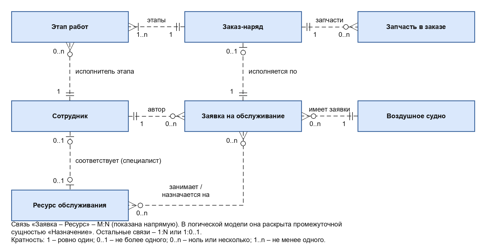
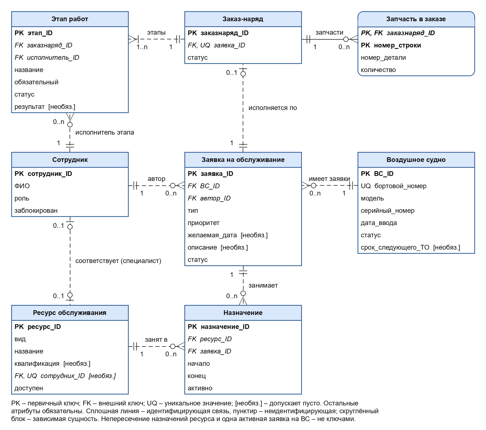

# Практическая работа №8. Моделирование данных. Методология IDEF1

**Выполнил:** Маханов Тимур

## 1. Тема и цель работы

**Тема:** модель данных информационной системы автоматизации технического обслуживания и ремонта (ТО и Р) самолётов (продолжение проекта автора, работа 9); работа учебная. В модель включены восемь понятий ядра планирования и выполнения ТО; дефекты, заключения о годности, акты списания и журнал в работе не рассматриваются.

**Цель:** проанализировать информационные потребности предметной области, определить сущности, атрибуты и связи, построить концептуальную и логическую модели. Диаграммы – в файле aircraft_data_model.drawio (diagrams.net): страница 1 – концептуальная модель, страница 2 – логическая.

## 2. Описание предметной области

Техническая служба аэропорта ведёт учёт ТО и Р воздушных судов (ВС). Система решает задачу безопасного планирования: исключить двойное занятие специалиста, оборудования или места в ангаре и не закрывать заказ-наряд при невыполненных обязательных работах. В системе работают планировщик (создаёт заявки и назначает ресурсы), техник (выполняет этапы работ), руководитель технической службы и администратор. Хранятся ВС, сотрудники, заявки на обслуживание, ресурсы (специалист, оборудование, место в ангаре) и их назначения, заказ-наряды с этапами и запчастями. Регистрируются создание заявки, назначение ресурсов, закрытие этапов и учёт запчастей. Ограничения: бортовой номер ВС уникален; у ВС не более одной активной заявки; активные назначения одного ресурса не пересекаются по времени; заказ-наряд закрывается только после выполнения обязательных этапов.

## 3. Бизнес-правила

В скобках – код правила из работы 9.

- БП-1. ВС определяется уникальным бортовым номером (BR-01).
- БП-2. У ВС со временем много заявок, но активной может быть только одна (BR-04). Заявку вносит сотрудник – планировщик; неполная заявка (нет желаемой даты или описания внеплановой) сохраняется со статусом «Требует уточнения» (BR-05).
- БП-3. По заявке открывается не более одного заказ-наряда; в нём не менее одного этапа, у каждого этапа один исполнитель с ролью «техник», закрыть этап может только он (BR-11).
- БП-4. Запчасти учитываются строками заказ-наряда; количество больше нуля.
- БП-5. На заявку назначаются ресурсы на интервал времени, ресурс участвует во многих заявках в разное время. Активные назначения одного ресурса не пересекаются, начало раньше окончания (BR-03).
- БП-6. Ресурс вида «специалист» соответствует не более чем одному сотруднику; недоступный ресурс не назначается (BR-06).
- БП-7. Заказ-наряд закрывается, только когда выполнены все обязательные этапы (BR-07).

## 4. Сущности и атрибуты

| Сущность (основные атрибуты, 3-5; полный состав – в разделе 6) | Цель хранения | Атрибуты |
|---|---|---|
| Сотрудник | Учёт пользователей и их ролей | сотрудник_ID, ФИО, роль, заблокирован |
| Воздушное судно | Реестр ВС | ВС_ID, бортовой_номер, модель, статус, срок_следующего_ТО |
| Заявка на обслуживание | Потребность в плановом или внеплановом ТО | заявка_ID, ВС_ID, автор_ID, тип, статус |
| Заказ-наряд | Фактическое выполнение работ по заявке | заказнаряд_ID, заявка_ID, статус |
| Этап работ | Часть работ заказ-наряда с исполнителем | этап_ID, заказнаряд_ID, исполнитель_ID, обязательный, статус |
| Запчасть в заказе | Расход детали по заказ-наряду | заказнаряд_ID, номер_строки, номер_детали, количество |
| Ресурс обслуживания | Специалист, оборудование, место в ангаре | ресурс_ID, вид, название, доступен |
| Назначение | Занятие ресурса заявкой на интервал (раскрывает M:N) | назначение_ID, ресурс_ID, заявка_ID, начало, конец |

## 5. Концептуальная модель

| Связь | Кратность | Бизнес-правило |
|---|---|---|
| Сотрудник – Заявка | 1:N | Заявку вносит один сотрудник (автор) |
| ВС – Заявка | 1:N | Заявка относится к одному ВС; активная – одна |
| Заявка – Заказ-наряд | 1:0..1 | По заявке открывается не более одного заказ-наряда |
| Заказ-наряд – Этап | 1:1..n | В заказ-наряде не менее одного этапа |
| Сотрудник – Этап | 1:N | Этап выполняет один сотрудник |
| Заказ-наряд – Запчасть | 1:N | Строка запчасти принадлежит одному заказ-наряду |
| Сотрудник – Ресурс | 0..1:0..1 | Ресурс-специалист соответствует одному сотруднику |
| Заявка – Ресурс | M:N | Заявка занимает много ресурсов, ресурс занят во многих заявках |

**Вопрос для анализа: как раскрывается связь M:N?** Заявка занимает много ресурсов, ресурс обслуживает много заявок, причём у каждой пары есть собственные сведения – интервал времени и признак активности, которые нельзя отнести ни к заявке, ни к ресурсу. Сущность «Назначение» хранит эти сведения и превращает M:N в две связи 1:N.

## 6. Логическая модель

На диаграмме показаны все атрибуты, ключи, уникальность, необязательные атрибуты и кратность связей. Необязательны желаемая_дата и описание (неполная заявка сохраняется для уточнения), результат этапа, срок_следующего_ТО у нового ВС, квалификация и сотрудник_ID у ресурсов-неспециалистов. Типы СУБД и индексы – физический уровень, не рассматриваются.

## 7. Пояснение ключей и связей

| Сущность | Первичный ключ | Внешний ключ | Уникальность |
|---|---|---|---|
| Сотрудник | сотрудник_ID | – | – |
| Воздушное судно | ВС_ID | – | бортовой_номер |
| Заявка | заявка_ID | ВС_ID, автор_ID | одна активная заявка на ВС |
| Заказ-наряд | заказнаряд_ID | заявка_ID | заявка_ID |
| Этап работ | этап_ID | заказнаряд_ID, исполнитель_ID (→ Сотрудник) | – |
| Запчасть в заказе | заказнаряд_ID + номер_строки | заказнаряд_ID | пара (входит в PK) |
| Ресурс | ресурс_ID | сотрудник_ID (необяз.) | сотрудник_ID |
| Назначение | назначение_ID | ресурс_ID, заявка_ID | непересечение активных назначений ресурса (правило) |

**Анализ по IDEF1X.** Ключ «Заказ-наряд» входит в первичный ключ «Запчасть в заказе» (как заказ_ID в «Позиция заказа» из лекции), поэтому эта связь идентифицирующая (сплошная линия). В остальных связях внешний ключ в первичный ключ дочерней сущности не входит (например, ВС_ID в «Заявка»), они неидентифицирующие (пунктир). «Назначение» имеет собственный ключ назначение_ID, поэтому связи с заявкой и ресурсом неидентифицирующие; при ключе из заявка_ID, ресурс_ID и начало они стали бы идентифицирующими. Номер_строки введён, потому что в прототипе запчасти хранятся списком и деталь может повторяться; уникальна строка.

## 8. Словарь данных

| Атрибут | Значение | Домен или тип | Ограничение |
|---|---|---|---|
| сотрудник_ID | Уникальный код сотрудника | Целое число | PK, не пусто |
| роль | Роль в системе | Перечень: планировщик, техник, руководитель, администратор | Не пусто |
| бортовой_номер | Бортовой номер ВС | Текст | Уникально, не пусто |
| срок_следующего_ТО | Дата очередного ТО | Дата | Может быть пусто |
| статус (ВС) | Состояние ВС | Перечень из 5 значений (Готово к эксплуатации … Списано) | Не пусто |
| тип | Вид обслуживания | Перечень: плановое, внеплановое | Не пусто |
| приоритет | Срочность заявки | Целое число 1-3 (обычный, высокий, срочный) | Не пусто; от 1 до 3 |
| желаемая_дата | Желаемая дата обслуживания | Дата | Может быть пусто («Требует уточнения») |
| статус (заявки) | Состояние заявки | Перечень из 7 значений (Новая … Отменена) | Не пусто |
| заявка_ID (в «Заказ-наряд») | Заявка, по которой открыт заказ-наряд | Целое число | FK, уникально, не пусто |
| обязательный | Обязательность этапа | Логическое значение | Не пусто |
| количество | Число использованных деталей | Целое число | Больше нуля |
| вид | Вид ресурса | Перечень: специалист, оборудование, место в ангаре | Не пусто |
| начало, конец | Границы интервала назначения | Дата и время | Не пусто; начало раньше конца |

## 9. Правила целостности и тестовые случаи

| № | Вид | Правило | Как обеспечивается |
|---|---|---|---|
| 1 | Целостность сущности | Первичный ключ уникален и не пуст; в «Запчасть в заказе» уникальна пара заказнаряд_ID + номер_строки | PK, составной PK |
| 2 | Непустое значение | Бортовой номер, тип, приоритет, статус, ВС_ID, автор_ID, начало и конец не пусты; пусто допускают только желаемая_дата, описание, срок_ТО, результат, квалификация, сотрудник_ID ресурса | NOT NULL |
| 3 | Ссылочная целостность | Каждый внешний ключ ссылается на существующую запись; ВС с заявками, заявка с заказ-нарядом или назначениями не удаляется | FOREIGN KEY, запрет удаления |
| 4 | Допустимый диапазон | Приоритет от 1 до 3; количество больше 0; начало раньше конца; статусы только из перечней | CHECK |
| 5 | Бизнес-правило | У ВС не более одной активной заявки (статусы кроме «Завершена» и «Отменена») | Частичный уникальный индекс по ВС_ID, проверка в транзакции |
| 6 | Бизнес-правило | Активные назначения одного ресурса не пересекаются (смежные интервалы допустимы) | Ограничение исключения по ресурсу и интервалу, транзакция |
| 7 | Бизнес-правило | Заказ-наряд закрывается только при выполненных обязательных этапах; этап назначается сотруднику с ролью «техник» | Триггер или проверка в сервисе |

**Тестовые данные (условные).** Сотрудники: 1 – планировщик, 2 – техник. ВС: UP-A1001 (заявка 1 активна), UP-A1002. Ресурс 1 – место в ангаре.

| № | Тестовый случай | Ожидаемый результат |
|---|---|---|
| 1 | Заявка сотрудника 1 на ВС UP-A1001, приоритет 2 | Принимается |
| 2 | Заявка на ВС UP-A1002 без желаемой даты и описания | Принимается со статусом «Требует уточнения» |
| 3 | Вторая активная заявка на ВС UP-A1001 | Не принимается (частичный уникальный индекс) |
| 4 | Добавление ВС с бортовым номером UP-A1001 | Не принимается (UNIQUE) |
| 5 | Заявка с автором, которого нет (автор_ID = 99) | Не принимается (FK) |
| 6 | Приоритет = 5 | Не принимается (CHECK) |
| 7 | Назначение места 12:00-14:00 после назначения 10:00-12:00; затем 11:00-13:00 | Первое принимается (смежное), второе нет (пересечение) |
| 8 | Второй заказ-наряд по той же заявке | Не принимается (UNIQUE) |
| 9 | Закрытие заказ-наряда при невыполненном обязательном этапе | Не принимается (правило 7) |

Результаты подтверждены на временной SQLite-схеме (в сдачу не входит); тесты 3, 7 и 9 показали, что одних PK и FK недостаточно.

**Проверка нормализации**

| Вопрос | Вывод и исправление |
|---|---|
| Нет ли в поле нескольких значений? | Этапы и запчасти хранятся отдельными записями, а не списком в заказ-наряде. Перечень недостающего в заявке (в прототипе список) вычисляется при проверке и в модель не включён |
| Нет ли необоснованного дублирования? | В прототипе заказ-наряд хранит ВС_ID, который определяется через заявку; в логической модели атрибут убран. Название ресурса-специалиста может повторять ФИО – лучше брать ФИО по сотрудник_ID |
| Нет ли зависимости от части составного ключа? | Составной ключ только у «Запчасть в заказе»; номер_детали и количество зависят от всей пары – 2NF соблюдена |
| Придётся ли менять несколько мест? | ФИО и роль хранятся в «Сотрудник», в заявках и этапах только ключи; изменение – в одном месте |

## 10. Заключение

Построена модель из восьми сущностей: семь понятий проекта и «Назначение», раскрывающее связь M:N «Заявка – Ресурс». Составлены словарь из 14 атрибутов, семь правил целостности и девять тестовых случаев.

## Ответы на вопросы для защиты

**1. Почему вы выбрали эти сущности?** У каждой много экземпляров и нужна отдельная информация. Заявка отделена от заказ-наряда (потребность и выполнение), ВС – от заявки (у ВС много заявок за время), этап и запчасть – от заказ-наряда (их несколько). «Назначение» добавлено, чтобы раскрыть M:N.

**2. Чем различаются концептуальная и логическая модели?** Концептуальная показывает сущности и смысловые связи без атрибутов и ключей; M:N допустима напрямую. Логическая добавляет все атрибуты, PK, FK, UNIQUE, обязательность и раскрывает M:N промежуточной сущностью. Типы СУБД и индексы – физический уровень.

**3. Как вы раскрыли связь M:N?** Связь «Заявка – Ресурс» заменена сущностью «Назначение» с внешними ключами заявка_ID и ресурс_ID и атрибутами начало, конец, активно; получились две связи 1:N.

**4. Какое ограничение исключает повторную запись?** UNIQUE по бортовому_номеру исключает повторное ВС, UNIQUE по заявка_ID в «Заказ-наряд» – второй заказ-наряд на заявку, составной ключ заказнаряд_ID + номер_строки – повтор строки запчасти. Повторное назначение ресурса на тот же интервал исключает правило непересечения активных назначений.

**5. Как определить, что связь является идентифицирующей?** Нужно посмотреть, входит ли внешний ключ в первичный ключ дочерней сущности. Входит – идентифицирующая (заказнаряд_ID в «Запчасть в заказе»), нет – неидентифицирующая (ВС_ID в «Заявка»).

**6. Какое бизнес-правило невозможно обеспечить только первичными и внешними ключами?** Непересечение активных назначений одного ресурса: оно сравнивает интервалы нескольких записей. Также «не более одной активной заявки на ВС» (зависит от статуса) и «заказ-наряд закрывается после обязательных этапов» (зависит от других таблиц). Их обеспечивают индекс, ограничение исключения, триггер и транзакции; при одновременных назначениях нужна блокировка.

## Ответы на контрольные вопросы лекции

**1. Какие задачи решает модель данных?** Описывает объекты, их свойства, связи и ограничения; помогает избежать дублирования и противоречий, служит основой для базы данных и общего понимания заказчика и разработчиков.

**2. Чем различаются концептуальная, логическая и физическая модели?** Концептуальная – сущности и смысловые связи; логическая – атрибуты, ключи, связи, ограничения; физическая – реализация в конкретной СУБД (таблицы, типы, индексы).

**3. Чем сущность отличается от экземпляра?** Сущность – тип объекта («Воздушное судно»), экземпляр – конкретный объект этого типа (самолёт с бортовым номером UP-A1001).

**4. Что такое домен атрибута?** Множество допустимых значений атрибута (например, приоритет – целое число от 1 до 3).

**5. Назначение первичного и внешнего ключей?** Первичный ключ однозначно определяет запись; внешний ссылается на ключ другой (или той же) таблицы и реализует связь.

**6. Как определяются кратность и обязательность связи?** Из бизнес-правила: сколько экземпляров одной сущности связано с одним экземпляром другой (1:1, 1:N, M:N) и необходима ли связь (0..1, 1..1, 0..n, 1..n).

**7. Как M:N представляется в реляционной модели?** Через промежуточную сущность с двумя внешними ключами: «Заявка» – «Назначение» – «Ресурс».

**8. Различие между IDEF1 и IDEF1X?** IDEF1 – анализ информационных потребностей организации; IDEF1X – точное описание логической структуры данных, ключей и связей (идентифицирующих и неидентифицирующих).

**9. Что такое идентифицирующая связь?** Связь, при которой ключ родительской сущности входит в первичный ключ дочерней.

**10. Какие проблемы уменьшает нормализация?** Избыточное дублирование и аномалии изменения данных (противоречия при обновлении, потеря сведений).

**11. Для чего нужна ссылочная целостность?** Чтобы внешний ключ всегда указывал на существующую запись (или был пустым, если это разрешено), без «висячих» ссылок.

**12. Какие ограничения требуют совместной проверки нескольких записей?** Правила, зависящие от многих записей: не более одной активной заявки на ВС и непересечение активных назначений ресурса. Их реализуют индексами, ограничениями исключения, триггерами и транзакциями с учётом параллельных операций.
