**Выполнил:** Маханов Тимур

**Дисциплина:** «Анализ, моделирование и проектирование информационных систем»

**Тема:** «Информационная система автоматизации технического обслуживания и ремонта самолётов»

# СРМ №9. Объектно-ориентированное проектирование информационной системы и исследование согласованности моделей

Примечание: работа учебная. Числовые пороги – проектные предположения. Диаграммы – в файле aircraft_maintenance_oo_model.drawio (diagrams.net, одна страница на диаграмму) и в папке assets; прототип – в папках prototype и prototype_v2.

## 1. Постановка проблемы и исследовательский вопрос

В аэропорту сведения о самолётах, заявках, работах, исполнителях, запчастях, проверках и сроках следующего обслуживания ведутся разрозненно. Из-за этого возможны три опасные ситуации: самолёт с просроченным обслуживанием или неисправностью получает допуск к полётам; два планировщика одновременно занимают одного специалиста или одно место в ангаре на одно время; операция остаётся выполненной наполовину (например, закрыт заказ-наряд, а статус самолёта не изменился). Цель системы – автоматизировать учёт технического обслуживания и ремонта (ТО и Р) воздушных судов (ВС) и не допускать к полётам самолёт, у которого не выполнены обязательные работы.

**Исследовательский вопрос:** как спроектировать объектную структуру, которая обеспечивает соблюдение бизнес-правил при изменении требований и возникновении исключительных ситуаций?

**Гипотеза:** правила, зависящие от состояния одного объекта (переходы статуса ВС, готовность заказ-наряда к допуску, непересечение назначений ресурса), размещаются в самом объекте; сервис только проверяет права, открывает транзакцию, пишет журнал и уведомляет; правила, затрагивающие несколько объектов (одна активная заявка на ВС), проверяются в сервисе внутри транзакции и дублируются ограничением хранилища; внешние зависимости (хранилище, канал уведомлений, журнал) спрятаны за тремя интерфейсами. Проверка гипотезы – моделями (разделы 4–6), ограничениями (7), сравнением альтернатив (8), конкурентным сценарием (9), матрицей трассируемости и тестами (10, 12), изменением требований (11).

## 2. Предметная область и границы системы

Предметная область выбрана самостоятельно: учёт ТО и Р самолётов в аэропорту (материалы автора по этой теме: презентация, лабораторные работы и практика 6; термины и статусы взяты оттуда и уточнены, см. раздел 10.3).

| Обязательная сложная ситуация | Как проявляется в системе |
|---|---|
| Конкурентное действие | Два планировщика одновременно назначают одно место в ангаре на пересекающийся интервал |
| Исключительная ситуация | Нужный ресурс занят (Э2 из презентации): назначение не сохраняется, заявка «Ожидает ресурсов», планировщик уведомлён; а также неполная заявка (Э1) |
| Правило, зависящее от состояния | Статус «Готово к эксплуатации» только после завершения обязательных этапов, при отсутствии открытых критичных дефектов и при заключении «годно»; допустимые переходы статуса ВС |

**В границах системы:** реестр ВС и история обслуживания; заявки на плановое и внеплановое обслуживание; планирование работ и назначение специалистов, оборудования и мест в ангаре; заказ-наряд с этапами, дефектами и запчастями; заключение о годности и допуск; контроль сроков и уведомления; списание; журнал действий; разграничение прав. **Вне границ:** управление воздушным движением, продажа билетов и пассажирские перевозки, закупка запчастей, бухгалтерский учёт и зарплата, автоматическое решение о годности без специалиста, управление бортовыми системами самолёта. Система не решает за специалиста, годен ли самолёт: она только запрещает статус «Готово к эксплуатации» без заключения уполномоченного лица и выполненных работ.

| Заинтересованная сторона | Интерес |
|---|---|
| Инженер-планировщик (роль «планировщик») | Быстро записать ВС на обслуживание, не получать конфликтов расписания |
| Техник-исполнитель (роль «техник») | Видеть свои этапы, фиксировать дефекты и запчасти |
| Руководитель технической службы / инспектор качества (роль «руководитель») | Выдавать заключения и допуск только при выполненных условиях, оформлять списание |
| Администратор | Управление пользователями и ролями, разграничение доступа |
| Представитель авиакомпании | Узнать статус заявки, сроки и результат работ (обращается к планировщику, в системе не работает) |
| Специалист по запчастям | Получать данные о расходе запчастей (в границы не входит) |
| Система учёта ВС авиакомпании | Передаёт регистрационные данные и сведения об эксплуатации |

## 3. Требования и бизнес-правила

Коды FR, NFR, BR новые; они уточняют требования F1–F10 и NF1–NF5 из презентации автора, названия и статусы сохранены. Проверочные сценарии TC-xx описаны в приложении В. Требования FR-14, BR-14 и BR-15 появляются только после изменения (раздел 11).

### 3.1. Функциональные требования

| Код | Требование | Обоснование | Способ проверки |
|---|---|---|---|
| FR-01 | Уполномоченный сотрудник регистрирует ВС (бортовой номер, модель, серийный номер, дата ввода); бортовой номер обязателен и уникален | F1: основа реестра | TC-02 |
| FR-02 | Планировщик создаёт заявку на плановое или внеплановое обслуживание (ВС, тип, приоритет, желаемая дата, описание) | F2: основной сценарий | TC-01 |
| FR-03 | Неполная заявка получает статус «Требует уточнения» с перечнем недостающего и не передаётся на планирование до исправления | Э1 презентации | TC-02, TC-05 |
| FR-04 | Повторная идентичная заявка на ВС не создаёт дубля; заявка с другим содержанием при активной заявке отклоняется | Повторный запрос, BR-04 | TC-07 |
| FR-05 | Планировщик назначает на заявку ресурсы (специалист, оборудование, место в ангаре) на интервал; ресурсы назначаются все или ни один | F3, F4: расписание без частичных назначений | TC-01, TC-06, TC-08 |
| FR-06 | Если ресурс занят, назначение не сохраняется, заявка получает статус «Ожидает ресурсов», планировщик получает уведомление | Э2 презентации | TC-10 |
| FR-07 | Заказ-наряд содержит этапы (обязательные и нет) с исполнителями; техник закрывает только свои этапы, фиксирует дефекты (критичность) и запчасти | F4 | TC-09, TC-14 |
| FR-08 | Руководитель выдаёт заключение о годности (годно / негодно, основание); каждая новая проверка – новое заключение | F5 | TC-13 |
| FR-09 | Статус «Готово к эксплуатации» устанавливается только при выполнении BR-07; при отказе показывается перечень причин | F7: запрет допуска | TC-01, TC-04, TC-09 |
| FR-10 | Контроль сроков: просроченное ТО переводит ВС в «Ограничено/не допущено к полётам» и уведомляет планировщиков; за 7 дней до срока отправляется предупреждение | F6 | TC-05 |
| FR-11 | Списание ВС с основанием и реквизитами утверждающего документа; открытые заявка и заказ-наряд закрываются, ресурсы освобождаются | F8 | TC-11 |
| FR-12 | Система ведёт неизменяемый журнал операций: успех, отказ, сбой | F9, NF3 | TC-03, TC-15 |
| FR-13 | Пользователь просматривает историю обслуживания и отчёты по статусам, срокам и просрочкам | F10 | не покрыто прототипом (раздел 10) |
| FR-14 | (после изменения) Заявка, не получившая ресурсы, ждёт в очереди; освободившиеся ресурсы автоматически назначаются первой заявке очереди | Раздел 11 | Q1–Q8 |

### 3.2. Требования к качеству

| Код | Требование (пороги – проектные предположения) | Обоснование | Способ проверки |
|---|---|---|---|
| NFR-01 | Не менее 95 % типовых поисковых запросов и открытий карточки ВС выполняются не более чем за 3 с при 30 одновременных пользователях и 20 000 записях | NF1 презентации | Нагрузочный тест (не выполнялся) |
| NFR-02 | 100 % попыток операций вне роли отклоняются и записываются в журнал | NF2 | TC-03 |
| NFR-03 | Каждое изменение статуса ВС, закрытие заказ-наряда, допуск и списание сохраняют пользователя, время и основание; записи журнала не редактируются | NF3 | TC-01, TC-15 |
| NFR-04 | При сбое сохранения 0 частично записанных операций в 1000 запусках со сбоем | NF4 | TC-08 (в прототипе по одному запуску на операцию) |
| NFR-05 | При двух одновременных назначениях одного ресурса на пересекающиеся интервалы успешно ровно одно в 100 % из 1000 повторов | Инвариант BR-03 | TC-06 (в прототипе 20 повторов) |
| NFR-06 | Каждый отказ содержит причину; при отказе в допуске – полный перечень невыполненных условий | NF5, FR-09 | TC-09 |
| NFR-07 | Замена канала уведомлений или хранилища не требует изменения сервисов | Расширяемость (подход по презентации) | Два канала в тестах, код сервисов не менялся |

### 3.3. Бизнес-правила

| Код | Правило | Обоснование | Способ проверки |
|---|---|---|---|
| BR-01 | Бортовой номер ВС обязателен и уникален | Однозначность реестра | TC-02 |
| BR-02 | Статус ВС меняется только по допустимым переходам (рис. 9) | Правило, зависящее от состояния | TC-04 |
| BR-03 | Активные назначения одного ресурса не пересекаются по времени; начало раньше окончания; интервалы полуоткрытые (смежные не конфликтуют) | Двойное назначение исключено (Э2) | TC-05, TC-06, TC-10 |
| BR-04 | У ВС не более одной активной заявки; идентичный повтор возвращает существующую заявку | Нет дублей и конфликтов | TC-07 |
| BR-05 | Заявка без желаемой даты, с датой в прошлом или внеплановая без описания получает «Требует уточнения» и не планируется | Э1 | TC-02, TC-05 |
| BR-06 | Недоступный ресурс не назначается; по списанному ВС заявки не создаются и не планируются | Корректность расписания | TC-11 |
| BR-07 | Допуск возможен, только если ВС «На обслуживании», заказ-наряд «Работы завершены», обязательные этапы выполнены, открытых критичных дефектов нет, последнее заключение «годно» и выдано после последнего добавленного этапа; некритичный дефект допуск не блокирует | F7 | TC-01, TC-09, TC-13 |
| BR-08 | Списание оформляет только руководитель; основание и реквизиты документа обязательны; в системе списание необратимо | F8 | TC-03, TC-11 |
| BR-09 | Срок ТО меньше сегодняшней даты у ВС «Готово» или «Запланировано» переводит ВС в «Ограничено»; срок равный сегодняшней дате не просрочен | F6 | TC-05 |
| BR-10 | Операция выполняется в одной транзакции; уведомление отправляется после фиксации; сбой канала данные не отменяет | NF4 | TC-08, TC-12 |
| BR-11 | Права по роли (матрица действий); техник закрывает только назначенные ему этапы; заблокированный сотрудник операций не выполняет | NF2 | TC-03, TC-14 |
| BR-12 | Заключение, акт списания и запись журнала неизменяемы | NF3 | TC-15 |
| BR-13 | Отказы в доступе и запрещённые операции журналируются даже при откате операции | NF2, NF3 | TC-03, TC-08 |
| BR-14 | (после изменения) Освободившиеся ресурсы получает первая заявка очереди: выше приоритет, при равенстве – раньше встала в очередь | Раздел 11 | Q1, Q2 |
| BR-15 | (после изменения) Повторная попытка назначения сохраняет место в очереди; назначенная или отменённая заявка выходит из очереди | Раздел 11 | Q3, Q7 |

## 4. Варианты использования

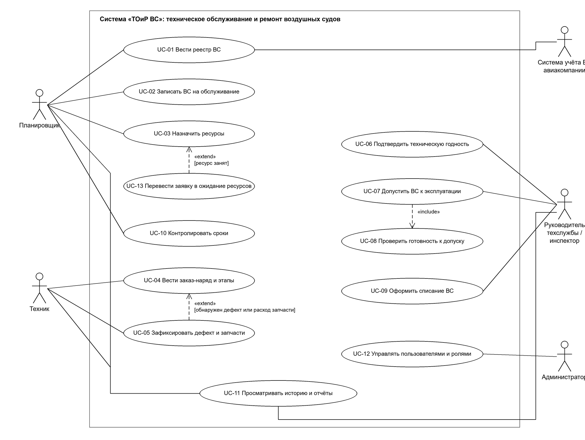

Пять акторов с разграниченными целями: планировщик (UC-01, 02, 03, 10, 11), техник (UC-04, 05, 11), руководитель технической службы / инспектор качества (UC-06, 07, 09, 11), администратор (UC-12), внешняя система учёта ВС авиакомпании (UC-01, актуализация данных). Связи include и extend соответствуют сценариям: UC-07 **включает** UC-08 (проверка готовности выполняется при каждой выдаче допуска); UC-05 **расширяет** UC-04 (дефект или расход запчасти появляется только в части работ); UC-13 **расширяет** UC-03 при условии «ресурс занят». Контроль сроков (UC-10) запускается по времени; на диаграмме показан получатель уведомлений – планировщик.

### 4.1. Сценарий UC-02 «Записать ВС на обслуживание»

| Элемент | Содержание |
|---|---|
| Название и цель | Записать ВС на обслуживание: создать заявку на плановое или внеплановое обслуживание |
| Основной актор | Планировщик (по обращению представителя авиакомпании) |
| Предусловия | Планировщик вошёл в систему, имеет роль «планировщик», не заблокирован; ВС зарегистрировано и не списано |
| Инициирующее событие | Планировщик отправляет заявку |
| Основная последовательность | 1) Планировщик передаёт ВС, тип, приоритет, желаемую дату и описание. 2) Система проверяет право. 3) В транзакции читает ВС и проверяет, что активной заявки нет. 4) Проверяет полноту заявки. 5) Создаёт заявку «Новая». 6) Фиксирует транзакцию, пишет в журнал «успех», показывает заявку |
| Альтернативные сценарии | A1: данные неполны – заявка сохраняется как «Требует уточнения» с перечнем недостающего и не планируется, после исправления становится «Новая». A2: такая же заявка уже активна – возвращается существующая, новая не создаётся |
| Ошибочные ситуации | E1: нет права или пользователь заблокирован. E2: ВС не найдено или списано. E3: активная заявка с другим содержанием. E4: сбой сохранения – откат |
| Постусловия успеха | Создана одна заявка (или возвращена существующая); у ВС не более одной активной заявки; в журнале запись «успех» |
| Гарантии при неуспехе | Новая заявка не создана, существующие не изменены; отказ записан в журнал; повтор операции безопасен |

### 4.2. Сценарий UC-03 «Назначить ресурсы»

| Элемент | Содержание |
|---|---|
| Название и цель | Назначить на заявку специалистов, оборудование и место в ангаре на заданный интервал |
| Основной актор | Планировщик |
| Предусловия | Заявка «Новая» или «Ожидает ресурсов»; ВС не списано; указанные ресурсы существуют и доступны |
| Инициирующее событие | Планировщик выбирает заявку, ресурсы и интервал |
| Основная последовательность | 1) Планировщик отправляет заявку, список ресурсов, начало и конец. 2) Система проверяет право. 3) В транзакции читает заявку и ВС. 4) Для каждого ресурса читает активные назначения и бронирует интервал. 5) Сохраняет назначения, переводит заявку в «Запланирована», ВС «Готово» – в «Запланировано обслуживание». 6) Фиксирует транзакцию, пишет «успех», показывает назначения |
| Альтернативные сценарии | A1: ресурс занят (UC-13, E2) – откат всех назначений, заявка «Ожидает ресурсов», уведомление планировщику, планировщик выбирает другое время. A2: канал уведомлений недоступен – заявка всё равно «Ожидает ресурсов», сбой канала записан в журнал. A3: интервалы смежные (конец одного равен началу другого) – конфликта нет |
| Ошибочные ситуации | E1: нет права. E2: заявка в другом статусе (например, «Требует уточнения»). E3: ВС списано. E4: начало не раньше конца или список ресурсов пуст. E5: сбой хранилища – откат |
| Постусловия успеха | У каждого ресурса не более одного активного назначения в любой момент; заявка «Запланирована» с назначениями на все ресурсы; в журнале «успех» |
| Гарантии при неуспехе | Ни одно назначение не сохранено, даже по свободным ресурсам; статус ВС прежний; заявка прежняя либо «Ожидает ресурсов»; отказ записан в журнал |

### 4.3. Сценарий UC-07 «Допустить ВС к эксплуатации»

| Элемент | Содержание |
|---|---|
| Название и цель | Установить статус «Готово к эксплуатации» после завершения обслуживания |
| Основной актор | Руководитель технической службы / инспектор качества |
| Предусловия | Роль «руководитель», не заблокирован; ВС «На обслуживании»; существует заказ-наряд с выданным заключением |
| Инициирующее событие | Руководитель выбирает заказ-наряд и запрашивает допуск |
| Основная последовательность | 1) Руководитель отправляет запрос. 2) Система проверяет право. 3) В транзакции читает заказ-наряд, ВС и заявку. 4) ВС запрашивает у заказ-наряда причины отказа в допуске (UC-08): перечень пуст. 5) ВС получает статус «Готово к эксплуатации» и новый срок ТО (сегодня + 180 дней); заказ-наряд «Закрыт», заявка «Завершена», ресурсы освобождены. 6) Фиксация, запись «успех», уведомление планировщиков |
| Альтернативные сценарии | A1: канал уведомлений недоступен – допуск сохранён, сбой канала записан в журнал. A2: заключение «негодно» – допуск отклонён, планировщик добавляет этап, выдаётся новое заключение, запрос повторяется |
| Ошибочные ситуации | E1: нет права (например, техник). E2: условия BR-07 не выполнены (незавершённый этап, открытый критичный дефект, нет заключения, заключение устарело) – отказ с перечнем причин. E3: ВС не «На обслуживании». E4: сбой сохранения – откат |
| Постусловия успеха | ВС «Готово к эксплуатации»; заказ-наряд «Закрыт»; заявка «Завершена»; активных назначений заявки нет; новая запись журнала |
| Гарантии при неуспехе | Статусы ВС, заказ-наряда и заявки прежние; назначения не освобождены; отказ или сбой записан в журнал; сбой уведомления допуск не отменяет |

## 5. Концептуальная и проектная модели классов

### 5.1. Концептуальная модель

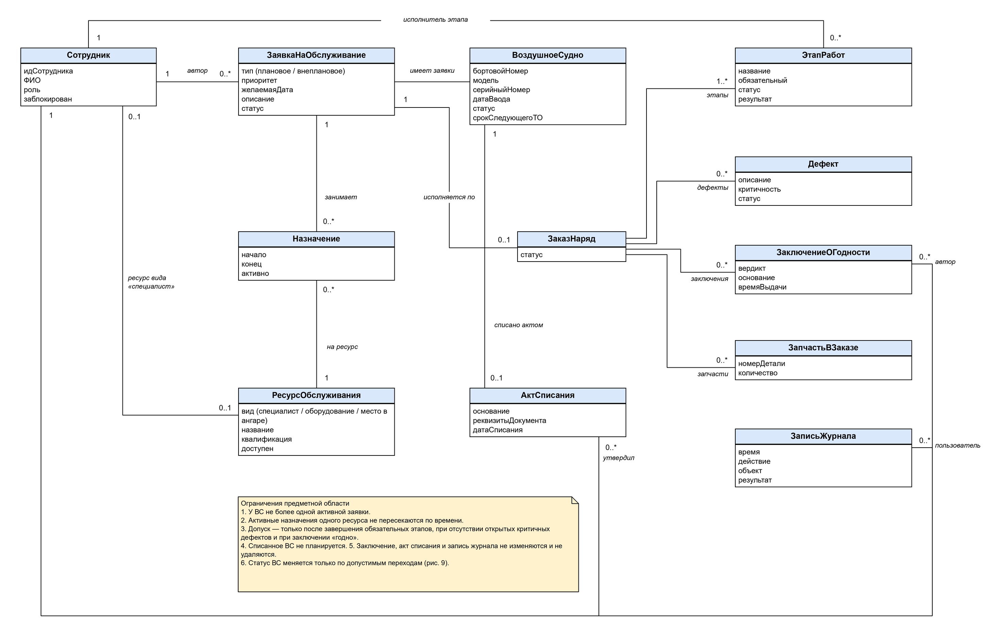

Модель показывает 12 понятий, их атрибуты, смысловые связи, кратности и шесть ограничений области. Кратности следуют правилам: у ВС со временем много заявок, но активна одна (BR-04); у заявки не более одного заказ-наряда; у заказ-наряда не менее одного этапа; у заявки много назначений, а у ресурса много назначений в разное время (BR-03); у ВС не более одного акта списания (BR-08). У каждого этапа, дефекта, заключения и запчасти ровно один заказ-наряд.

### 5.2. Проектная модель классов

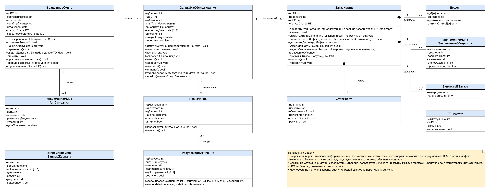

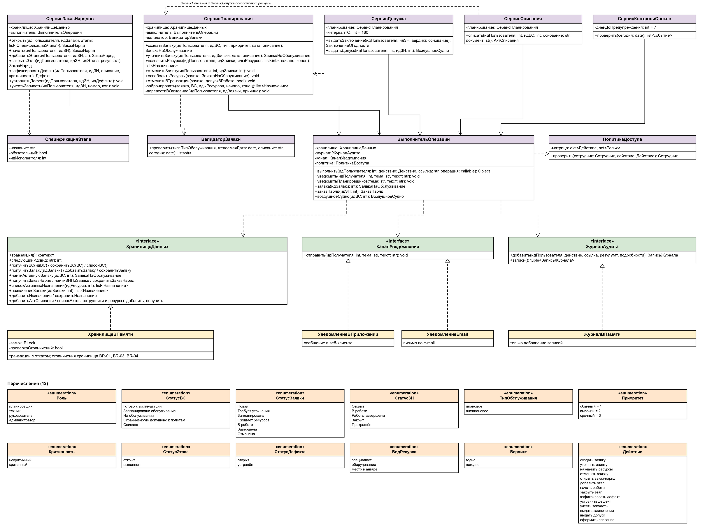

Модель содержит 21 класс (12 предметной области и 9 служебных), 3 интерфейса, 4 реализации интерфейсов и 12 перечислений; показаны типы атрибутов, параметры и результаты операций, видимость (+ и -), зависимости, реализации и кратности. Зависимость сервисов от ХранилищеДанных показана атрибутом «хранилище» (допустимая в UML запись), чтобы не перегружать рисунок линиями.

| Преобразование | Что именно и почему |
|---|---|
| Добавлены классы | ВалидаторЗаявки, ПолитикаДоступа, ВыполнительОпераций, СпецификацияЭтапа и пять сервисов: концептуальная модель не описывает сценарии, проверки прав и транзакции |
| Добавлены интерфейсы | ХранилищеДанных, КаналУведомления, ЖурналАудита: сервисы не зависят от хранилища, способа уведомления и устройства журнала (NFR-07) |
| Добавлены реализации | ХранилищеВПамяти, УведомлениеВПриложении, УведомлениеEmail, ЖурналВПамяти: для прототипа и тестов, второй канал подтверждает заменяемость |
| Разделены | «Заявка» и «Заказ-наряд» (план и факт не смешиваются: заявка фиксирует потребность, заказ-наряд – выполнение); «ВС» и «Акт списания» (акт неизменяем и содержит реквизиты документа) |
| Объединены | «Сотрудник» и роль (различие поведения задаётся перечислением Роль, а не подклассами); «Специалист», «Оборудование» и «Место в ангаре» – один класс РесурсОбслуживания с видом, потому что для всех действует одно правило BR-03 |
| Исключены из ИС | Авиакомпания и Аэропорт из диаграммы классов презентации: это внешние сущности и атрибут «авиакомпания», собственного поведения в системе у них нет; иерархия «внутренняя/иностранная авиакомпания», «ангар/аренда ангара» не нужна ни одному правилу и убрана |

Наследование и агрегация не использованы: правила области их не требуют; общий код сервисов вынесен не в базовый класс, а в объект ВыполнительОпераций (композиция). Композиция (закрашенный ромб) применена только к этапам, дефектам и заключениям: они не существуют вне заказ-наряда и входят в проверку допуска BR-07. Запчасти связаны обычной ассоциацией: они не влияют на допуск. Остальные связи – ассоциации, обоснованные правилами: ВС–Заявка 1:0..* (BR-04), Заявка–ЗаказНаряд 1:0..1, Заявка–Назначение 1:0..* и Назначение–Ресурс 0..*:1 (BR-03), ВС–АктСписания 1:0..1 (BR-08). Ссылки на сотрудника и между агрегатами хранятся идентификаторами, как в коде.

### 5.3. Обязанности пяти основных классов

| Класс | Какие данные хранит | Какие действия выполняет | С какими классами взаимодействует |
|---|---|---|---|
| ВоздушноеСудно | Бортовой номер, модель, серийный номер, дата ввода, статус, срок следующего ТО | Меняет статус только по таблице переходов (зарезервировать, начать обслуживание, ограничить, списать); выдаёт допуск, проверяя BR-07; сообщает о просрочке | ЗаказНаряд, СервисПланирования, СервисДопуска, СервисСписания, СервисКонтроляСроков |
| ЗаказНаряд | Статус, этапы, дефекты, запчасти, заключения | Закрывает этап (только исполнитель), фиксирует дефекты, выдаёт заключения, возвращает причины отказа в допуске, закрывается | ЭтапРабот, Дефект, ЗаключениеОГодности, ВоздушноеСудно, СервисЗаказНарядов |
| РесурсОбслуживания | Вид, название, квалификация, доступность | Бронирует интервал, проверяя доступность и непересечение (BR-03) | Назначение, СервисПланирования |
| СервисПланирования | Ссылки на хранилище, выполнитель операций, валидатор | Создаёт заявки, назначает ресурсы все или ни один, ставит заявку в ожидание, отменяет заявку и освобождает ресурсы | ХранилищеДанных, ВыполнительОпераций, ВалидаторЗаявки, ЗаявкаНаОбслуживание, РесурсОбслуживания, ВоздушноеСудно |
| СервисДопуска | Интервал следующего ТО (180 дней), ссылка на СервисПланирования | Выдаёт заключение; выдаёт допуск в одной транзакции: статус ВС, закрытие заказ-наряда и заявки, освобождение ресурсов | ВоздушноеСудно, ЗаказНаряд, ЗаявкаНаОбслуживание, КаналУведомления, ВыполнительОпераций |

## 6. Моделирование поведения

### 6.1. Диаграммы последовательности

Три диаграммы соответствуют сценариям раздела 4; каждая содержит основной сценарий, альтернативный путь и ошибочную ситуацию (операнды фрагментов alt). Соответствие сообщений операциям классов дано в приложении Б. Оболочка ВыполнительОпераций показана на каждой диаграмме: она проверяет право, открывает транзакцию, откатывает её при ошибке и пишет журнал.

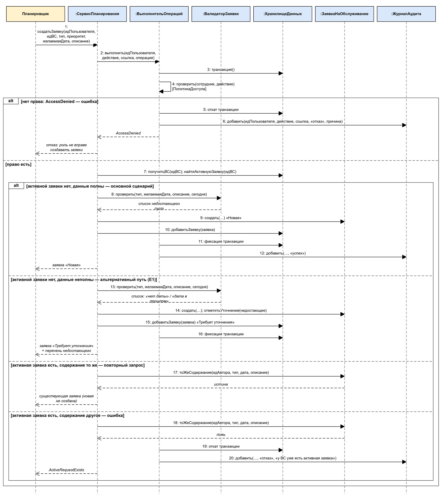

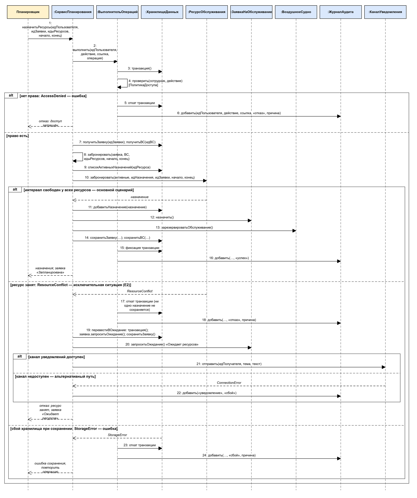

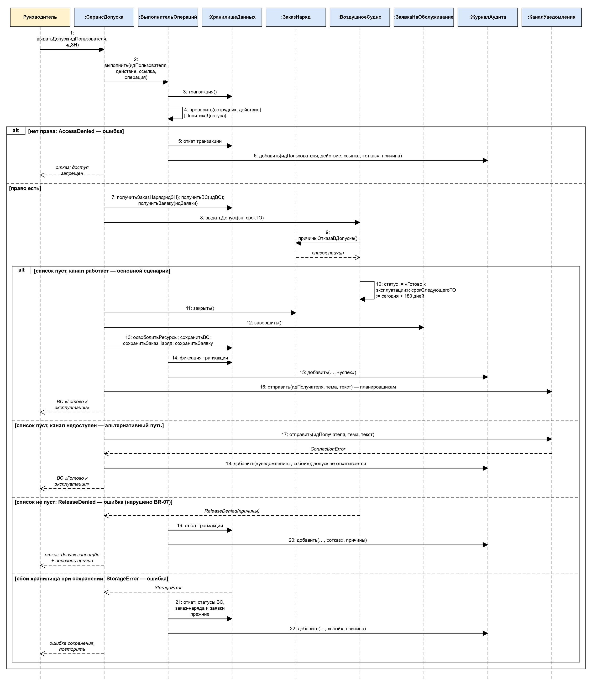

### 6.2. Диаграмма деятельности

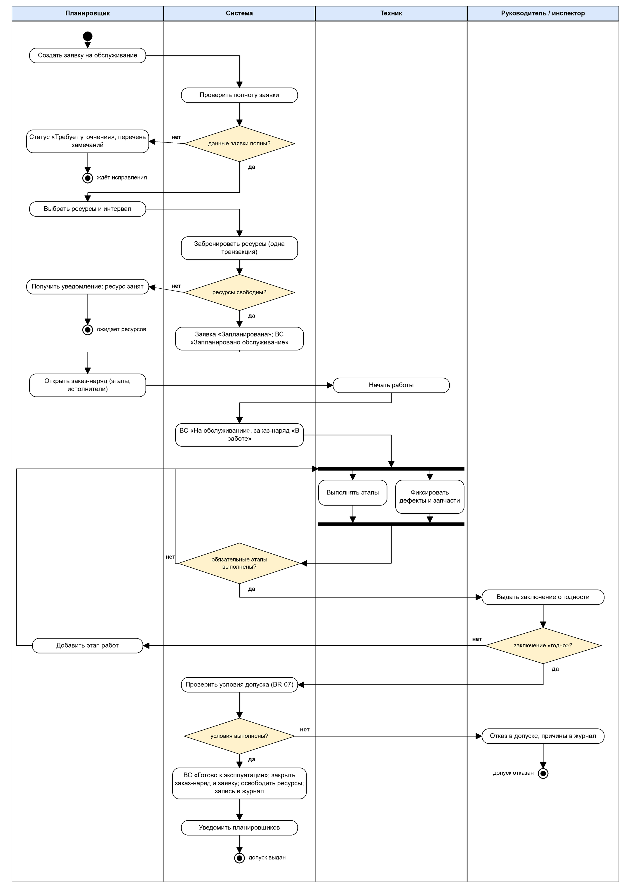

Показаны четыре участника, пять ветвлений, параллельное выполнение этапов с фиксацией дефектов (разветвление и слияние) и четыре пути завершения: заявка ждёт исправления, заявка ждёт ресурсов, допуск отказан, допуск выдан. Ветка списания на диаграмме не показана, она описана на рис. 9 и в разделе 11.

### 6.3. Диаграмма состояний

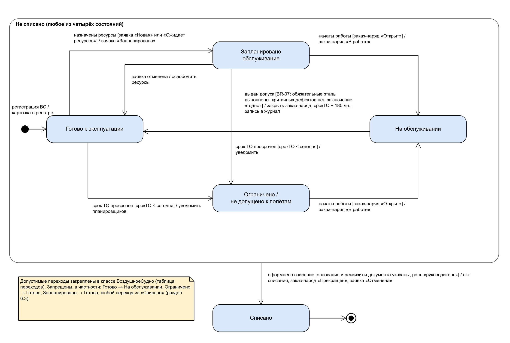

Основной объект – ВС. У каждого перехода указаны событие, сторожевое условие (в квадратных скобках) и действие. Состояний пять; «В эксплуатации» и «Допущен к полётам» из прежних работ автора объединены с «Готово к эксплуатации», потому что различие не влияет на правила, а полёты вне границ системы; состояние «Продажа» из лабораторной работы вне границ. Допустимые переходы – те, что показаны стрелками, они же закреплены в таблице переходов класса ВоздушноеСудно (BR-02).

| Запрещённый переход | Причина |
|---|---|
| Готово → На обслуживании | Работы начинаются только по запланированной заявке, иначе нет заказ-наряда и плана (BR-02) |
| Запланировано → Готово | Допуск без выполненных работ и заключения (BR-07) |
| Ограничено → Готово | Ограничение снимается только после обслуживания: сначала «На обслуживании», затем допуск (BR-07) |
| На обслуживании → Запланировано | Обратного хода нет: работы начаты, отмена плана невозможна |
| Любой переход из «Списано» | Списание необратимо в системе (BR-08); отмена, если регламент её допускает, – отдельная процедура вне данной модели |

### 6.4. Диаграмма объектов

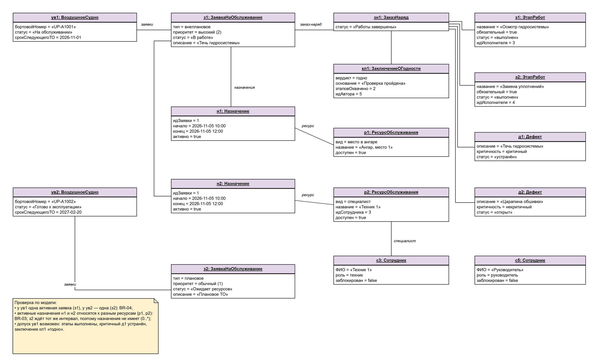

Пример – состояние перед выдачей допуска: ВС UP-A1001 обслуживается по внеплановой заявке (течь гидросистемы), ВС UP-A1002 ждёт ресурсов по плановой заявке. Проверка по модели: у каждого ВС одна активная заявка (кратность 0..*, BR-04); у заявки з2 назначений нет, потому что нужный интервал занят назначениями н1 и н2 (допустимо 0..*, BR-03); н1 и н2 относятся к разным ресурсам; у заказ-наряда два обязательных этапа выполнены, критичный дефект устранён, некритичный открыт, заключение «годно» охватывает оба этапа – допуск возможен (BR-07). Противоречий нет.

## 7. Формальное описание ограничений

Запись на OCL упрощённая, с русскими именами элементов модели.

| № | Вид | Ограничение | Кто обеспечивает |
|---|---|---|---|
| 1 | Инвариант | context ВоздушноеСудно inv: self.заявки->select(активна())->size() <= 1 | СервисПланирования в транзакции; ограничение хранилища (в СУБД – частичный уникальный индекс по ВС среди активных заявок) |
| 2 | Инвариант | context РесурсОбслуживания inv: self.назначения->select(активно)->forAll(a, b \| a <> b implies (a.конец <= b.начало or b.конец <= a.начало)) | РесурсОбслуживания.забронировать; транзакция и замок; ограничение хранилища (в PostgreSQL – EXCLUDE по ресурсу и диапазону времени) |
| 3 | Инвариант | context ЗаказНаряд inv: self.статус = СтатусЗН::Закрыт implies self.этапы->select(обязательный)->forAll(статус = СтатусЭтапа::выполнен) | ЗаказНаряд.закрыть, ВоздушноеСудно.выдатьДопуск |
| 4 | Предусловие | context ВоздушноеСудно::выдатьДопуск(зн, срокТО) pre: self.статус = СтатусВС::НаОбслуживании and зн.причиныОтказаВДопуске()->isEmpty() | ВоздушноеСудно (исключение ReleaseDenied с перечнем причин) |
| 5 | Постусловие | context СервисДопуска::выдатьДопуск(идПользователя, идЗН) post: ВС.статус = СтатусВС::Готово and зн.статус = СтатусЗН::Закрыт and заявка.статус = СтатусЗаявки::Завершена and заявка.назначения->forAll(not активно) and журнал.записи()->size() = журнал.записи()@pre->size() + 1 | СервисДопуска (одна транзакция) |
| 6 | Предусловие | context СервисПланирования::назначитьРесурсы(идПользователя, идЗаявки, идыРесурсов, начало, конец) pre: заявка.статус = Новая or заявка.статус = ОжидаетРесурсов and ВС.статус <> Списано and начало < конец and идыРесурсов->notEmpty() | СервисПланирования, Назначение (ValidationError при начало ≥ конец) |
| 7 | Доступ | context СервисСписания::списать(идПользователя, идВС, основание, документ) pre: сотрудник.роль = Роль::руководитель and not сотрудник.заблокирован and основание <> '' and документ <> '' | ПолитикаДоступа, СервисСписания |
| 8 | Доступ | context ЗаказНаряд::закрытьЭтап(идЭтапа, идИсполнителя, результат) pre: self.этапы->any(идЭтапа = идЭтапа).идИсполнителя = идИсполнителя | ЗаказНаряд (исключение AccessDenied) |
| 9 | Кратность | context ЗаказНаряд inv: self.этапы->size() >= 1 and self.этапы->exists(обязательный) | СервисЗаказНарядов.открыть |

## 8. Сравнение архитектурных альтернатив

**Проблема:** где разместить правила состояния – допустимые переходы статуса ВС и условие допуска BR-07. **Альтернатива А:** правила в сервисах приложения, ВС и ЗаказНаряд – контейнеры данных с открытыми полями. **Альтернатива Б:** переходы проверяет ВоздушноеСудно, готовность к допуску вычисляет ЗаказНаряд, сервис только координирует (права, транзакция, журнал, уведомление).

Шкала от 1 (плохо) до 5 (отлично); веса и оценки экспертные (суждение автора, подтверждённое наблюдениями за прототипом, а не измерения); альтернатива А не реализовывалась, её оценки – прогноз; итог – сумма «вес × оценка».

| Критерий | Вес | А | Б | Доказательство или обоснование |
|---|---|---|---|---|
| Соответствие требованиям | 0,25 | 3 | 5 | Статус ВС меняют 6 вызовов в 5 сервисах (планирование, отмена, начало работ, допуск, списание, контроль сроков). В А запрет переходов пришлось бы повторять в каждом; пропуск даёт запрещённый переход. В Б проверка одна – таблица переходов, TC-04 |
| Удобство внесения изменений | 0,25 | 2 | 4 | В Б новое условие допуска – одна операция причиныОтказаВДопуске; в разделе 11 правило BR-07 не менялось (в СервисДопуска добавлен лишь вызов обслуживания очереди) |
| Тестируемость | 0,20 | 3 | 4 | Переходы статуса ВС в Б проверяются вызовом методов объекта без хранилища и сервисов (первая проверка TC-04); условие допуска – одним вызовом причиныОтказаВДопуске; для остальных проверок нужен сервис |
| Уровень зависимостей | 0,15 | 3 | 4 | В А каждый сервис знает устройство статусов ВС; в Б – только операции объекта |
| Сложность реализации | 0,15 | 5 | 4 | Б требует таблицы переходов и дисциплины: сервис не должен менять статус напрямую |
| **Итого** | 1,00 | **3,05** | **4,25** | |

**Решение: альтернатива Б.** Недостатки: ВоздушноеСудно знает ЗаказНаряд (параметр выдатьДопуск), то есть два объекта связаны; правила распределены между объектами и сервисом (права – ПолитикаДоступа, транзакция – сервис, непересечение – Ресурс и хранилище); поля объектов в Python открыты, защита держится на дисциплине сервисов. **Условия пересмотра:** если статусов ВС станет заметно больше или переходы начнут зависеть от роли и данных – выделить паттерн «Состояние» или политики переходов; если межобъектных правил станет много – сделать ВС корнем агрегата, владеющим заявками.

## 9. Конкурентное выполнение и исключительная ситуация

**Ситуация.** Планировщики 1 и 2 одновременно назначают на разные заявки (ВС UP-A1001 и UP-A1002) одно и то же место в ангаре на 10:00–12:00. Правило BR-03 проверяется чтением «нет активных назначений», затем записью.

| Момент | Планировщик 1 | Планировщик 2 |
|---|---|---|
| t1 | Читает активные назначения места: нет | Читает активные назначения места: нет |
| t2 | Проверка пройдена | Проверка пройдена |
| t3 | Сохраняет назначение 10:00–12:00 | Сохраняет назначение 10:00–12:00 (нарушение BR-03) |

1. **Какое правило нарушается:** BR-03, а при частичном сбое – BR-10.
2. **Что атомарно:** блок «прочитать активные назначения – проверить – сохранить назначение – перевести заявку и ВС»; для нескольких ресурсов – все назначения вместе.
3. **Где транзакция и контроль доступа:** в СервисПланирования внутри ВыполнительОпераций; блокировка на время транзакции (в прототипе общий замок, в СУБД – блокировка строк ресурса); последний рубеж – ограничение хранилища на непересечение интервалов. Контроль доступа выполняется до чтения данных.
4. **Повторный запрос:** повторная заявка на то же ВС с тем же содержанием возвращает существующую (TC-07); повторное назначение уже запланированной заявки отклоняется как недопустимый переход (проверка статуса заявки).
5. **Что сохраняется при сбое шага:** внутри транзакции откатываются все назначения, статус заявки и ВС (TC-08); сохраняются только отказ в журнале и перевод заявки в «Ожидает ресурсов» отдельной короткой транзакцией; сбой уведомления данные не откатывает (TC-12).
6. **Что видит пользователь:** победитель – назначения и статус «Запланирована»; проигравший планировщик – сообщение «Ресурс занят в выбранный интервал», заявка «Ожидает ресурсов», уведомление; он выбирает другое время или другие ресурсы.

**Неуспешная последовательность с защитой:** планировщик 1 получает транзакцию и сохраняет назначение; планировщик 2 ждёт замок, затем находит активное назначение, получает ResourceConflict, его транзакция откатывается; заявка 2 – «Ожидает ресурсов», назначения для неё нет.

**Эффективность и ограничения.** TC-06 запускает гонку двух потоков 20 раз подряд: каждый раз ровно одна заявка «Запланирована», одна «Ожидает ресурсов», на месте одно активное назначение. Контрольный тест без замка и ограничения хранилища намеренно воспроизводит проблему: оба потока проходят проверку и записывают назначение – получаются два активных назначения. Ограничения: общий замок лишь моделирует блокировки СУБД и снижает пропускную способность; 1000 повторов (NFR-05) не выполнялись; сеть и реальная СУБД не использовались.

## 10. Результаты проверки согласованности моделей

### 10.1. Матрица трассируемости

| Требование | Вариант использования | Класс или операция | UML-диаграмма | Сценарий |
|---|---|---|---|---|
| FR-01 | UC-01 | ВоздушноеСудно; ХранилищеДанных (уникальность номера) | Рис. 1, 2, 3 | TC-02 |
| FR-02 | UC-02 | СервисПланирования.создатьЗаявку | Рис. 1, 5, 8 | TC-01 |
| FR-03 | UC-02 | ВалидаторЗаявки.проверить; ЗаявкаНаОбслуживание.отметитьУточнение | Рис. 5, 8 | TC-02, TC-05 |
| FR-04 | UC-02 | СервисПланирования.создатьЗаявку; ЗаявкаНаОбслуживание.тоЖеСодержание | Рис. 5 | TC-07 |
| FR-05 | UC-03 | СервисПланирования.назначитьРесурсы; РесурсОбслуживания.забронировать | Рис. 6, 8 | TC-01, TC-06, TC-08 |
| FR-06 | UC-03, UC-13 | СервисПланирования.перевестиВОжидание; КаналУведомления.отправить | Рис. 6, 8 | TC-10 |
| FR-07 | UC-04, UC-05 | ЗаказНаряд.закрытьЭтап, зафиксироватьДефект, учестьЗапчасть | Рис. 3, 4, 8 | TC-09, TC-14 |
| FR-08 | UC-06 | СервисДопуска.выдатьЗаключение; ЗаказНаряд.выдатьЗаключение | Рис. 4, 8 | TC-13 |
| FR-09 | UC-07, UC-08 | СервисДопуска.выдатьДопуск; ВоздушноеСудно.выдатьДопуск; ЗаказНаряд.причиныОтказаВДопуске | Рис. 7, 8, 9 | TC-01, TC-04, TC-09 |
| FR-10 | UC-10 | СервисКонтроляСроков.проверить; ВоздушноеСудно.просрочено, ограничить | Рис. 9 | TC-05 |
| FR-11 | UC-09 | СервисСписания.списать; ВоздушноеСудно.списать | Рис. 9 | TC-11 |
| FR-12 | Все | ЖурналАудита.добавить; ВыполнительОпераций.выполнить | Рис. 5, 6, 7 | TC-03, TC-15 |
| FR-13 | UC-11 | Не реализовано в прототипе | Рис. 1 | Не покрыто |
| FR-14 | UC-03, UC-13 | СервисПланирования.обслужитьОчередь (раздел 11) | Рис. 11 | Q1–Q8 |

Правила и качество связаны с теми же сценариями (колонка «Способ проверки» разделов 3.2 и 3.3); NFR-01 нагрузочными проверками не покрыто.

### 10.2. Проверочные сценарии

Подготовлено 15 сценариев TC-01…TC-15, каждый с исходным состоянием, действием и ожидаемым результатом (приложение В). Они охватывают штатное выполнение (TC-01), некорректные данные (TC-02), отсутствие прав (TC-03, TC-14), запрещённый переход (TC-04), граничные значения (TC-05), конкурентное выполнение (TC-06, TC-07), повторный запрос (TC-07), частичный сбой (TC-08, TC-12). Все автоматизированы: 28 проверок базового прототипа выполняются успешно (24 относятся к TC-01…TC-15, 4 дополнительные).

### 10.3. Выявленные проблемы и риски

| № | Проблема или риск | Решение |
|---|---|---|
| 1 | При запуске демонстрации выяснилось: после допуска назначения ресурсов оставались активными, и то же место в ангаре нельзя было назначить заново (BR-03 удерживало ресурс без причины) | Исправлено в коде: освобождение ресурсов вынесено в одну операцию, её вызывают отмена, допуск и списание; проверка добавлена в TC-01 |
| 2 | Расхождение модели и кода: в коде сервисы наследовали общий базовый класс (наследование ради повторного использования кода), а в модели наследование не используется | Исправлено: общая часть вынесена в ВыполнительОпераций (композиция), он показан на рис. 4 |
| 3 | Статусы ВС в прежних работах автора различались (лабораторная: «Допущен к полётам», «Плановое ТО», «Ремонт», «Продажа», «Списан»; практика 6: шесть статусов, среди них отдельные «В эксплуатации» и «Готово к эксплуатации»); в тексте лабораторной ERD названа шестисущностной, а перечислено семь | Принят набор из пяти статусов (раздел 6.3); «Продажа» вне границ; расхождения требуют согласования с автором прежних работ |
| 4 | NF5 презентации требует «не сохранять форму до исправления», а Э1 – сохранять заявку со статусом «Требует уточнения» | Принят Э1 (заявка сохраняется, на планирование не передаётся); NFR-06 сформулировано через причину отказа |
| 5 | Запись журнала «успех» делается после фиксации данных, а не в той же транзакции: при сбое между ними данные сохранены без записи (риск для NFR-03) | Не исправлено: в СУБД запись об успехе нужно делать в той же транзакции; отказы пишутся отдельно намеренно (BR-13) |
| 6 | Диаграмма деятельности не показывает ветку списания и повторный запрос заявки; они описаны в UC-09, UC-02 и проверены TC-11, TC-07 | Не исправлено; риск неполной диаграммы |
| 7 | В основном сценарии лабораторной работы заявку создаёт представитель авиакомпании, а на диаграмме вариантов использования презентации заявку записывает планировщик | В модели заявку вносит планировщик по обращению представителя авиакомпании (как на диаграмме презентации) |
| 8 | UC-10 запускается по времени, а UML-актора «время» нет | На диаграмме показан получатель уведомлений (планировщик); запуск описан в тексте |
| 9 | При занятом ресурсе планировщик должен сам повторять попытки: заявка «Ожидает ресурсов» не получает освободившийся ресурс автоматически | Учтено как причина изменения требований (раздел 11) |
| 10 | NFR-01 не проверено, NFR-04 и NFR-05 проверены в прототипе на малых выборках, FR-13 не реализовано, блокировка и СУБД смоделированы | Остаточный риск: нужны СУБД, сеть и нагрузочные испытания |

## 11. Оценка влияния изменения требований

**Изменение.** Новое требование FR-14: вместо «ожидания» с ручными повторами вводится очередь бронирования ресурсов. Заявка, не получившая ресурсы, встаёт в очередь (запоминаются нужные ресурсы, интервал и номер в очереди); когда ресурсы освобождаются (отмена заявки, допуск, списание), система автоматически назначает их первой заявке очереди: выше приоритет (срочный, высокий, обычный), при равенстве – раньше встала в очередь (BR-14); повторная попытка сохраняет место (BR-15). Это пункт «введение очереди бронирования»; изменение реализовано в prototype_v2.

| Изменённый элемент | Исходная версия | Обновлённая версия | Причина изменения |
|---|---|---|---|
| Требование | FR-06: заявка «Ожидает ресурсов», планировщик уведомлён и сам повторяет попытку; Э2 | FR-06 сохраняется; новые FR-14, BR-14, BR-15; Э2 дополнена: заявка ждёт в очереди | Автоматическое назначение освободившихся ресурсов |
| Класс или интерфейс | ЗаявкаНаОбслуживание без данных ожидания; СервисПланирования, СервисДопуска, СервисСписания; интерфейс ХранилищеДанных | В ЗаявкаНаОбслуживание добавлены 4 атрибута (нужные ресурсы, начало, конец, номер в очереди); СервисДопуска и СервисСписания после фиксации вызывают обслуживание очереди; в ХранилищеДанных добавлена выборка заявок в ожидании. ВоздушноеСудно, ЗаказНаряд, РесурсОбслуживания, КаналУведомления, ЖурналАудита и ВыполнительОпераций не менялись | Заявка должна помнить, чего ждёт; освобождение ресурсов происходит в трёх сервисах |
| Операция | перевестиВОжидание(…): статус «Ожидает ресурсов»; запроситьОжидание(): без параметров | поставитьВОчередь(…) вместо перевестиВОжидание; запроситьОжидание(идыРесурсов, начало, конец, номерОчереди); новая обслужитьОчередь(); назначить() очищает данные ожидания | Очередь, порядок, сохранение места |
| Диаграмма | Рис. 4: сервисы без очереди; рис. 6: ветка «ресурс занят» (ожидание); заявка без отдельной диаграммы состояний | Рис. 4 дополняется операцией обслужитьОчередь; рис. 6: ветка «ресурс занят» заканчивается постановкой в очередь; новая рис. 11 – состояния заявки с выделенными изменениями | Новое поведение |
| Проверочный сценарий | TC-01…TC-15 (24 проверки) и 4 дополнительные (всего 28) | Те же без изменений плюс 8 новых (Q1–Q8): порядок по приоритету, порядок по очереди, отмена ожидающей заявки, освобождение допуском и списанием, неполное освобождение, сохранение места, конкурентное обслуживание очереди | Новое поведение |

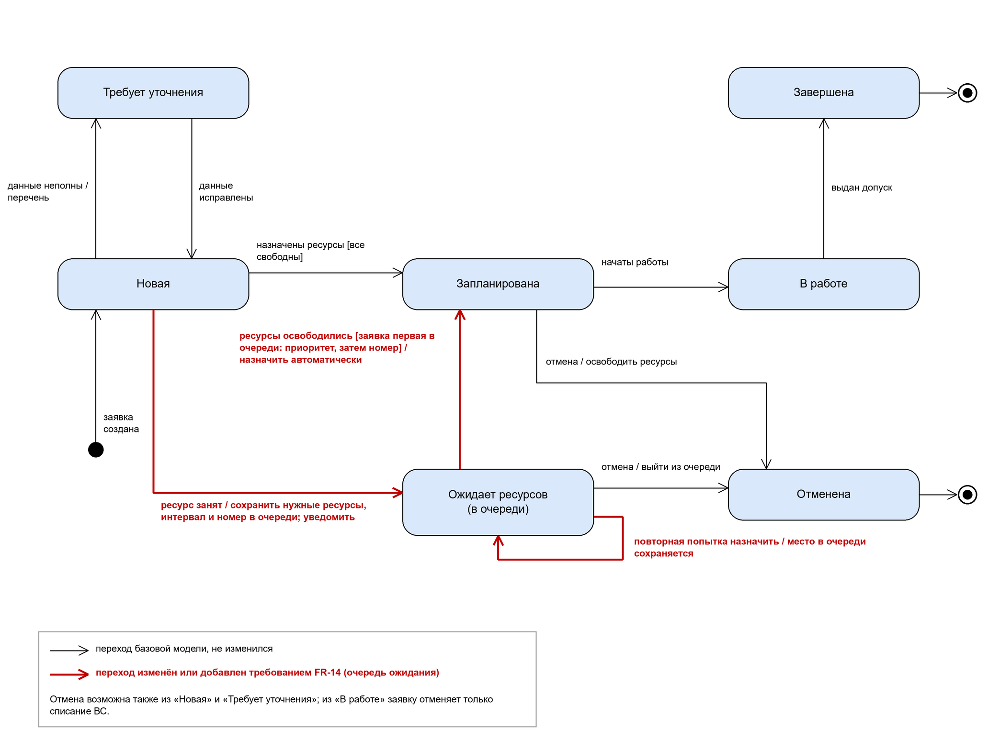

**Подсчёт** (диаграммы рис. 3 и 4, различия кода prototype и prototype_v2: изменено 69 строк – domain 12, ports 3, storage 7, services 47; adapters не менялся).

| Показатель | Значение |
|---|---|
| Элементов проектной модели (классы, интерфейсы, перечисления) | 36 (21 + 3 + 12) |
| Изменено: классы / интерфейсы / перечисления | 4 (ЗаявкаНаОбслуживание, СервисПланирования, СервисДопуска, СервисСписания) / 1 (ХранилищеДанных) / 0, всего 5 из 36 (около 14 %); из реализаций изменена одна (ХранилищеВПамяти) из четырёх |
| Операций до изменения | 87 (59 в классах и 28 в интерфейсах; ХранилищеДанных учтено по числу операций кода – 25) |
| Новых / изменённых операций | 2 (обслужитьОчередь, найтиЗаявкиВОжидании) / 7 (запроситьОжидание, назначить, назначитьРесурсы, перевестиВОжидание, отменитьЗаявку, выдатьДопуск, списать); затронуто 9 из 89 (около 10 %) |
| Изменённых прежних тестов | 0 из 28 |

**Адаптируемость.** Изменение не затронуло правила состояния: ВоздушноеСудно, ЗаказНаряд, условие допуска BR-07, ресурс и правило BR-03, два интерфейса из трёх, ВыполнительОпераций и журнал; 28 прежних проверок остались зелёными без правки. Это следствие решения Б (раздел 8). Минусы: три сервиса (отмена, допуск, списание) обязаны не забыть вызвать обслуживание очереди – это скрытая связь, при четвёртом источнике освобождения ресурсов её легко пропустить; порядок очереди зашит в одну функцию сортировки; обслуживание очереди идёт отдельной транзакцией после освобождения, между ними другой планировщик может занять освободившийся интервал. Улучшение: событие «Ресурс освобождён» и интерфейс политики очереди. Оценка адаптируемости – хорошая с оговорками. Число изменённых элементов не полная оценка качества: оно не учитывает сложность операций и скрытые связи, поэтому вывод подтверждён регрессионными тестами и перечнем минусов.

## 12. Прототип и результаты тестирования

**Назначение:** проверить размещение правил состояния в объектах, транзакции, ограничения хранилища, интерфейсы с подменяемыми реализациями, конкурентное назначение и исключительные ситуации. Язык Python 3.11, только стандартная библиотека; интерфейса пользователя нет, хранилище в памяти. Состав и соответствие классов модели и кода – в приложении Г.

**Реализованные правила** (нужно не менее трёх): BR-03 (ресурс и ограничение хранилища), BR-07 (ЗаказНаряд и ВоздушноеСудно), BR-10 (транзакция с откатом), а также BR-01, BR-02, BR-04, BR-05, BR-06, BR-08, BR-09, BR-11, BR-12, BR-13. **Сценарии:** штатный – плановое ТО до допуска (demo.py, TC-01); неуспешный – два борта претендуют на одно место в ангаре (demo.py, TC-10); конфликт назначений – TC-06. **Запуск** из папки prototype: python demo.py и python -m unittest discover -s tests -t . -v.

| Версия | Проверок | Результат |
|---|---|---|
| prototype (базовая) | 28 | Все успешны |
| prototype_v2 (после изменения) | 36 (28 прежних и 8 новых) | Все успешны |

Ограничения: хранилище в памяти и общий замок не заменяют СУБД; сбой хранилища и ошибка канала имитируются исключениями; нагрузка и сеть не проверялись; пользовательский интерфейс и FR-13 не реализованы. Контрольный тест без замка и ограничения намеренно подтверждает неправильное поведение без защиты.

## 13. Заключение

Объектная структура, соблюдающая бизнес-правила при изменениях и сбоях, строится из трёх опор: правила состояния размещены в самих объектах (ВоздушноеСудно сам запрещает недопустимые переходы и допуск без выполненных условий, Ресурс сам отклоняет пересекающееся бронирование); межобъектные правила защищены сервисом в транзакции и ограничением хранилища (контрольный тест показал, что без замка и ограничения возникает двойное назначение); внешние зависимости изолированы тремя интерфейсами. При изменении требований (очередь ожидания) не изменились правила состояния, два интерфейса из трёх и 28 прежних тестов.

Согласованность проверена матрицей трассируемости, сопоставлением сообщений с операциями и 15 сценариями; исправлены несвободный после допуска ресурс и наследование в коде, расхождения прежних материалов и неполнота двух диаграмм отмечены как риски. Ограничения: прототип проверен в памяти, без СУБД, сети и нагрузки; веса и оценки экспертные; пороги – предположения.

## Список использованных источников

1. OMG. Unified Modeling Language (UML), Version 2.5.1. – Object Management Group, 2017. Документ formal/2017-12-05.
2. OMG. Object Constraint Language (OCL), Version 2.4. – Object Management Group, 2014. Документ formal/2014-02-03.
3. Ларман К. Применение UML 2.0 и шаблонов проектирования. 3-е изд. – М.: Вильямс, 2013.
4. Фаулер М. UML. Основы. 3-е изд. – СПб.: Символ-Плюс, 2004.
5. Мейер Б. Объектно-ориентированное конструирование программных систем. – М.: Русская редакция; Интернет-университет информационных технологий, 2005.
6. Мартин Р. Чистая архитектура. – СПб.: Питер, 2018.
7. Эванс Э. Предметно-ориентированное проектирование (DDD). – М.: Вильямс, 2010.
8. Лекция №9 и задание СРМ №9 по дисциплине «Анализ, моделирование и проектирование информационных систем».
9. Материалы автора по теме: презентация «Информационная система автоматизации технического обслуживания и ремонта самолётов», лабораторные работы, практика 6.

## Приложение А. Состав материалов для сдачи

| Материал | Расположение |
|---|---|
| Отчёт | task_9.md; docx собирается из него скриптом md_to_docx.py, PDF – из docx |
| Исходные UML-модели | aircraft_maintenance_oo_model.drawio (11 страниц diagrams.net) |
| Изображения диаграмм | assets/01_use_case.png … assets/11_state_request_v2.png |
| Исходный код прототипа | prototype, prototype_v2 |
| Инструкция по запуску | prototype/README.md, prototype_v2/README.md |
| Результаты тестирования | раздел 12; файлы prototype/test_results.txt и prototype_v2/test_results.txt (вывод запуска тестов) |
| Построение диаграмм | tools/ (скрипты, из которых получены .drawio и PNG) |

## Приложение Б. Сопоставление сообщений с операциями проектных классов

| Диаграмма | Сообщение | Операция класса модели | В прототипе |
|---|---|---|---|
| Рис. 5 | создатьЗаявку(идПользователя, идВС, тип, приоритет, желаемаяДата, описание) | СервисПланирования.создатьЗаявку | PlanningService.create_request |
| Рис. 5, 6, 7 | выполнить(идПользователя, действие, ссылка, операция) | ВыполнительОпераций.выполнить | OperationRunner.execute |
| Рис. 5, 6, 7 | проверить(сотрудник, действие) | ПолитикаДоступа.проверить | AccessPolicy.check |
| Рис. 5, 6, 7 | транзакция(); откат; фиксация | ХранилищеДанных.транзакция | DataStore.transaction |
| Рис. 5 | получитьВС; найтиАктивнуюЗаявку(идВС) | ХранилищеДанных.получитьВС, найтиАктивнуюЗаявку | get_aircraft, find_active_request |
| Рис. 5 | проверить(тип, желаемаяДата, описание, сегодня) | ВалидаторЗаявки.проверить | RequestValidator.check |
| Рис. 5 | создать(…); отметитьУточнение(недостающее) | ЗаявкаНаОбслуживание (создание); отметитьУточнение | MaintenanceRequest, mark_needs_clarification |
| Рис. 5 | тоЖеСодержание(идАвтора, тип, дата, описание) | ЗаявкаНаОбслуживание.тоЖеСодержание | MaintenanceRequest.same_content |
| Рис. 5 | добавитьЗаявку(заявка) | ХранилищеДанных.добавитьЗаявку | DataStore.add_request |
| Рис. 5, 6, 7 | добавить(идПользователя, действие, ссылка, результат, подробности) | ЖурналАудита.добавить | AuditLog.append |
| Рис. 6 | назначитьРесурсы(идПользователя, идЗаявки, идыРесурсов, начало, конец) | СервисПланирования.назначитьРесурсы | PlanningService.schedule |
| Рис. 6 | забронировать(заявка, ВС, идыРесурсов, начало, конец) | СервисПланирования.забронировать (закрытая) | PlanningService._book |
| Рис. 6 | списокАктивныхНазначений(идРесурса) | ХранилищеДанных.списокАктивныхНазначений | DataStore.list_active_assignments |
| Рис. 6 | забронировать(активные, идНазначения, идЗаявки, начало, конец) | РесурсОбслуживания.забронировать | Resource.book |
| Рис. 6 | добавитьНазначение(назначение) | ХранилищеДанных.добавитьНазначение | DataStore.add_assignment |
| Рис. 6 | назначить(); запроситьОжидание() | ЗаявкаНаОбслуживание.назначить, запроситьОжидание | MaintenanceRequest.schedule, wait_for_resources |
| Рис. 6 | зарезервироватьОбслуживание() | ВоздушноеСудно.зарезервироватьОбслуживание | Aircraft.reserve_maintenance |
| Рис. 6 | сохранитьЗаявку; сохранитьВС | ХранилищеДанных.сохранитьЗаявку, сохранитьВС | save_request, save_aircraft |
| Рис. 6 | перевестиВОжидание(идПользователя, идЗаявки, причина) | СервисПланирования.перевестиВОжидание (закрытая) | PlanningService._park |
| Рис. 6, 7 | отправить(идПолучателя, тема, текст) | КаналУведомления.отправить | Notifier.send |
| Рис. 7 | выдатьДопуск(идПользователя, идЗН) | СервисДопуска.выдатьДопуск | ReleaseService.release |
| Рис. 7 | получитьЗаказНаряд; получитьЗаявку | ХранилищеДанных; ВыполнительОпераций.заказНаряд, заявка | get_work_order, get_request |
| Рис. 7 | выдатьДопуск(зн, срокТО) | ВоздушноеСудно.выдатьДопуск | Aircraft.release |
| Рис. 7 | причиныОтказаВДопуске() | ЗаказНаряд.причиныОтказаВДопуске | WorkOrder.release_blockers |
| Рис. 7 | закрыть(); завершить() | ЗаказНаряд.закрыть; ЗаявкаНаОбслуживание.завершить | WorkOrder.close, MaintenanceRequest.complete |
| Рис. 7 | освободитьРесурсы | СервисПланирования.освободитьРесурсы | PlanningService.free_resources |
| Рис. 7 | сохранитьЗаказНаряд | ХранилищеДанных.сохранитьЗаказНаряд | DataStore.save_work_order |

## Приложение В. Проверочные сценарии

Автоматизированы в prototype/tests/test_aircraft_maintenance.py; код сценария есть в имени теста. Q1–Q8 – в prototype_v2/tests/test_queue.py.

| Код | Категория | Исходное состояние | Действие | Ожидаемый результат |
|---|---|---|---|---|
| TC-01 | Штатное выполнение | ВС «Готово»; заявка, назначения, заказ-наряд с двумя обязательными этапами выполнены | Заключение «годно», допуск | ВС «Готово к эксплуатации», срок ТО + 180 дней, заказ-наряд «Закрыт», заявка «Завершена», ресурсы свободны, запись «успех», уведомление планировщику |
| TC-02 | Некорректные данные | ВС «Готово» | Заявка без даты; внеплановая без описания; неизвестное ВС; дубль или пустой бортовой номер | «Требует уточнения» с перечнем и без планирования; исправление даёт «Новая»; неизвестное ВС и дубль номера отклонены, записей нет |
| TC-03 | Нет прав | Заказ-наряд готов к допуску | Техник выдаёт допуск; планировщик списывает и выдаёт заключение; заблокированный создаёт заявку | Доступ запрещён, статусы не изменены, каждый отказ в журнале |
| TC-04 | Запрещённый переход | ВС «Готово», «Ограничено», «Запланировано», «Списано» | Начать работы без плана; снять ограничение без обслуживания; допуск ВС не «На обслуживании» | Запрещено, статус не изменился, допуск отклонён с причиной |
| TC-05 | Граничное значение | Дата ТО сегодня и вчера; интервалы 10–12 и 12–14; количество запчасти 0 и 1; желаемая дата сегодня и вчера | Контроль сроков; назначения; учёт запчасти; создание заявки | Сегодня не просрочено, вчера – «Ограничено»; смежные интервалы допустимы, нулевой запрещён; 0 отклонён, 1 принят; вчерашняя дата – «Требует уточнения» |
| TC-06 | Конкурентное выполнение | Две заявки на разные ВС, одно место в ангаре | Два планировщика одновременно назначают место на 10–12, 20 повторов; контрольный запуск без замка и ограничения | Каждый раз одна «Запланирована», другая «Ожидает ресурсов», одно активное назначение; в контрольном запуске два активных назначения |
| TC-07 | Повторный запрос | ВС «Готово» | Одна и та же заявка дважды; другая заявка на то же ВС; две одновременные заявки разными планировщиками | Одна заявка; другая отклонена; при гонке активна ровно одна |
| TC-08 | Частичный сбой | Заказ-наряд готов к допуску; два ресурса, один занят | Сбой сохранения ВС при допуске; назначение занятого и свободного ресурсов | Откат: статусы прежние, запись «сбой», повтор успешен; свободный ресурс не остаётся забронированным |
| TC-09 | Нарушение BR-07 | Заказ-наряд «В работе» или с дефектами | Допуск без заключения и этапов; с открытым критичным дефектом; с некритичным дефектом | Отказ с перечнем причин; после устранения критичного допуск выдаётся при открытом некритичном |
| TC-10 | Исключительная ситуация Э2 | Место в ангаре занято заявкой 1 | Планировщик 2 назначает то же место | Ресурс не назначен, заявка «Ожидает ресурсов», уведомление планировщику, затем назначение на другое время проходит |
| TC-11 | Списание | ВС «На обслуживании» с открытым заказ-нарядом | Списание без основания или документа; затем с ними; повторное списание; заявка на списанное ВС | Первые отклонены; затем ВС «Списано», заказ-наряд «Прекращён», заявка «Отменена», ресурсы свободны; повтор и новая заявка отклонены |
| TC-12 | Сбой канала | Канал уведомлений недоступен | Выдать допуск | ВС «Готово к эксплуатации», сбой канала записан в журнал |
| TC-13 | Заключение «негодно» | Работы завершены | «Негодно»; затем «годно» и добавление обязательного этапа; выполнение этапа | Допуск отклонён; после добавления этапа прежнее заключение устарело, нужно новое; затем допуск |
| TC-14 | Чужой этап | Заказ-наряд «В работе» | Техник 2 закрывает этап техника 1 | Доступ запрещён, этап не изменён |
| TC-15 | Неизменяемость | Заключение и запись журнала созданы | Попытка изменить заключение и запись; поиск операций изменения и удаления у журнала | Изменение запрещено; операций изменения и удаления журнала нет |

Дополнительно: ограничение снимается обслуживанием (ВС «Ограничено» → «На обслуживании» → «Готово»); завершённую заявку нельзя запланировать; отмена заявки освобождает ресурс и возвращает ВС «Готово»; смена канала уведомлений не меняет сервисы.

## Приложение Г. Состав прототипа и соответствие модели и кода

| Файл | Содержание |
|---|---|
| prototype/aircraft_maintenance/domain.py | ВоздушноеСудно, ЗаявкаНаОбслуживание, ЗаказНаряд, ЭтапРабот, Дефект, Запчасть, Заключение, Сотрудник, Ресурс, Назначение, АктСписания, ЗаписьЖурнала, перечисления, ошибки |
| prototype/aircraft_maintenance/ports.py | Интерфейсы ХранилищеДанных, КаналУведомления, ЖурналАудита |
| prototype/aircraft_maintenance/storage.py | Хранилище в памяти: транзакции с откатом, ограничения BR-01, BR-03, BR-04, внедрение сбоя для тестов |
| prototype/aircraft_maintenance/adapters.py | Уведомление в приложении, по e-mail, неисправный канал для тестов, журнал в памяти |
| prototype/aircraft_maintenance/services.py | ПолитикаДоступа, ВалидаторЗаявки, ВыполнительОпераций, пять сервисов |
| prototype/tests, prototype/demo.py | 28 проверок; штатный и неуспешный сценарии |
| prototype_v2 | Копия с изменением раздела 11; в tests добавлен test_queue.py (8 проверок) |

| Класс модели | В коде |
|---|---|
| ВоздушноеСудно, ЗаявкаНаОбслуживание, ЗаказНаряд | Aircraft, MaintenanceRequest, WorkOrder |
| ЭтапРабот, Дефект, ЗапчастьВЗаказе, ЗаключениеОГодности | Stage, Defect, PartUsage, Conclusion |
| Сотрудник, РесурсОбслуживания, Назначение | Employee, Resource, Assignment |
| АктСписания, ЗаписьЖурнала | WriteOffAct, AuditRecord |
| ПолитикаДоступа, ВалидаторЗаявки, ВыполнительОпераций, СпецификацияЭтапа | AccessPolicy, RequestValidator, OperationRunner, StageSpec |
| СервисПланирования, СервисЗаказНарядов, СервисДопуска, СервисСписания, СервисКонтроляСроков | PlanningService, WorkOrderService, ReleaseService, WriteOffService, DeadlineService |
| ХранилищеДанных, КаналУведомления, ЖурналАудита | DataStore, Notifier, AuditLog |
| ХранилищеВПамяти, УведомлениеВПриложении, УведомлениеEmail, ЖурналВПамяти | InMemoryDataStore, InAppNotifier, EmailNotifier, InMemoryAuditLog |
| Роль, СтатусВС, СтатусЗаявки, СтатусЗН, ТипОбслуживания, Приоритет, Критичность, СтатусЭтапа, СтатусДефекта, ВидРесурса, Вердикт, Действие | Role, AircraftStatus, RequestStatus, WorkOrderStatus, MaintenanceType, Priority, Severity, StageStatus, DefectStatus, ResourceKind, Verdict, Action |
