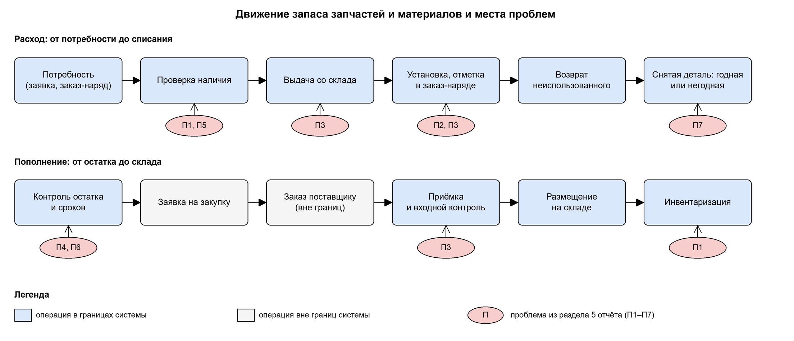
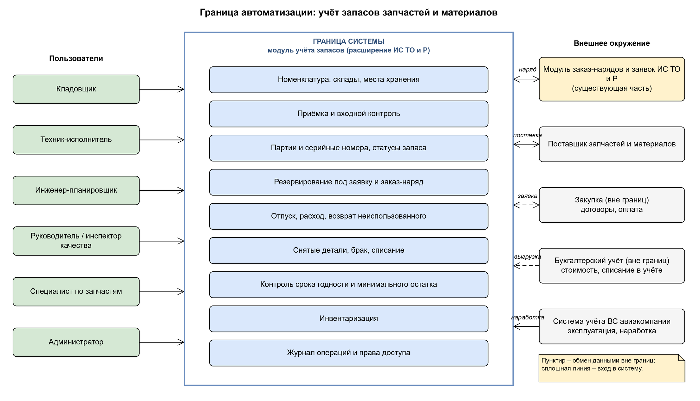

# Тема 1. Анализ предметной области системы управления запасами

**Выполнил:** Маханов Тимур

Примечание: работа учебная. Организация – техническая служба аэропорта из прежних работ автора (информационная система автоматизации технического обслуживания и ремонта самолётов, ТО и Р). Описание порядка работы с запасами составлено по материалам автора и типовой практике ТО и Р, это модельное описание, а не обследование конкретного предприятия; числовые показатели – проектные предположения. Диаграммы – в файле inventory_domain.drawio (diagrams.net, две страницы) и в папке assets.

## 1. Цель и задачи

**Цель:** проанализировать предметную область управления запасами технической службы аэропорта и обосновать границы автоматизации.

**Задачи темы:** определить виды запасов, участников и операции; описать основные проблемы; установить границы автоматизации.

**Исходные материалы:** модель ИС ТО и Р автора (работы 8 и 9). Из неё сохранены названия ролей (планировщик, техник, руководитель, администратор), понятия «заявка», «заказ-наряд», «ресурс», статус заявки «Ожидает ресурсов» и строка «запчасть в заказе» (номер детали, количество). В работе 9 учёт запчастей назван вне границ системы; здесь эта часть раскрыта как отдельный модуль (раздел 7).

## 2. Организация и запасы

**Деятельность.** Техническая служба аэропорта выполняет плановое и внеплановое обслуживание воздушных судов (ВС). Работы идут по заявкам и заказ-нарядам, и многие из них невозможны без запасных частей и материалов.

**Назначение запасов.** Запасы нужны, чтобы работы начинались без ожидания поставки: ВС, стоящее в ангаре из-за отсутствия детали, не допускается к полётам и занимает ресурсы (место в ангаре, специалистов). Одновременно излишний запас замораживает деньги, а у части позиций ограничен срок хранения. Задача управления запасами – держать нужные детали в наличии, знать, где какая деталь и откуда она взята, и не допускать использования негодных.

**Что считается запасом.** Запасные части и расходные материалы. Инструмент и оборудование в запас не входят: в модели автора они – «ресурсы» обслуживания (назначаются на интервал времени, а не расходуются). Авиатопливо и ГСМ в этой работе не рассматриваются (отдельная служба).

### 2.1. Виды запасов

| Вид | Примеры | Особенности учёта и хранения |
|---|---|---|
| Ремонтопригодные агрегаты | насосы, стартёры, блоки управления | Учёт каждой единицы по серийному номеру; после снятия возвращаются на ремонт; высокая стоимость |
| Невосстанавливаемые детали | фильтры, уплотнения, лампы, тормозные колодки | Учёт по номеру детали и партии; расходуются при установке |
| Детали с ограниченным ресурсом | узлы с назначенным сроком службы | Серийный учёт; контроль наработки и срока; запрет установки при исчерпании ресурса |
| Расходные материалы | смазки, герметики, краски, крепёж | Учёт по партиям; у части материалов ограничен срок годности и заданы условия хранения |
| Снятые и негодные детали | снятые с ВС, забракованные при приёмке | Хранятся отдельно (карантин); не должны смешиваться с годными |

Для каждого вида различается набор данных: у агрегатов обязательны серийный номер и документ о годности, у материалов – партия и срок годности. Поэтому номенклатура описывается по номеру детали с признаками «серийный учёт», «партионный учёт», «срок годности».

### 2.2. Склады и места хранения

Условная структура: центральный склад запчастей; склад материалов с особыми условиями хранения (температура, влажность); карантинная зона для негодных и спорных деталей; выдача у ангара под заказ-наряд. Каждая деталь хранится в определённом месте; перемещения между местами фиксируются.

## 3. Участники и ответственность

| Участник | Роль в системе | Ответственность за запасы |
|---|---|---|
| Кладовщик (новая роль) | пользователь | Приёмка, размещение, выдача, возврат, инвентаризация; точность остатков |
| Техник-исполнитель | пользователь | Получает детали по заказ-наряду, фиксирует расход, возвращает неиспользованное, сдаёт снятые детали |
| Инженер-планировщик | пользователь | Создаёт заявки; видит, хватит ли деталей, до назначения ресурсов |
| Руководитель / инспектор качества | пользователь | Входной контроль и решение по спорным деталям; блокировка и списание; допуск ВС только при годных деталях |
| Специалист по запчастям | пользователь | Нормы запаса, формирование заявок на закупку, контроль минимального остатка |
| Администратор | пользователь | Пользователи, роли, права доступа |
| Поставщик | внешний | Поставляет детали и документы годности |
| Закупка и бухгалтерия | внешние, вне границ | Договоры, оплата, стоимостной учёт |
| Система учёта ВС авиакомпании | внешняя | Передаёт наработку и сведения об эксплуатации |

## 4. Порядок движения запасов (действующий)

Действующий порядок описан по материалам автора: сведения о запчастях ведутся разрозненно (таблицы, журналы, записи в заказ-нарядах).

**Расход.**

1. **Потребность.** Появляется при создании заявки или заказ-наряда: нужны детали по номеру и количеству.
2. **Проверка наличия.** Техник или планировщик узнаёт у склада, есть ли деталь; ответ даётся по журналу или по памяти кладовщика.
3. **Выдача.** Кладовщик выдаёт деталь; запись в журнале склада, часто без связи с конкретным заказ-нарядом.
4. **Установка.** Техник устанавливает деталь и записывает номер и количество в заказ-наряд.
5. **Возврат.** Неиспользованное возвращается на склад; снятая деталь сдаётся как годная или негодная.

**Пополнение.** Остаток проверяется вручную; при нехватке формируется заявка на закупку и заказ поставщику (вне границ). Поставка принимается кладовщиком с проверкой документов, затем деталь размещается. Периодически проводится инвентаризация.

**Исключительные ситуации:** детали нет на складе (заявка получает статус «Ожидает ресурсов»), деталь без документа о годности, поставка не совпадает с заказом, срок годности материала истёк.

## 5. Проблемы действующего способа

| № | Проблема | Причина | Последствие | Решение средствами ИС |
|---|---|---|---|---|
| П1 | Нет единого достоверного остатка | Учёт ведётся в разных местах; расхождения выявляются только при инвентаризации | Деталь «есть» в журнале, но её нет на полке; простой ВС | Единая база остатков; остаток вычисляется по журналу движений; инвентаризация со сверкой |
| П2 | Расход по заказ-наряду не связан со складом | Запись о детали в заказ-наряде и выдача со склада оформляются отдельно | Остаток не уменьшается или уменьшается дважды; невозможно сопоставить расход и работу | Расход создаётся из строки заказ-наряда и сразу меняет остаток |
| П3 | Нет прослеживаемости детали | Не хранятся партия, серийный номер, документ о годности | Нельзя установить, на какое ВС поставлена деталь; риск установки детали без документа | Партии и серийные номера; обязательный документ при приёмке; история движений |
| П4 | Не контролируются срок годности и ресурс | Сроки отслеживаются вручную | Просроченный материал или деталь с исчерпанным ресурсом попадает в работу | Контроль сроков, предупреждение заранее, запрет выдачи просроченного |
| П5 | Нет резервирования под заявку | Деталь не закрепляется за заказ-нарядом | Две заявки рассчитывают на одну деталь; конфликт обнаруживается в момент работ | Резервирование под заявку; доступный остаток = остаток – резервы |
| П6 | Пополнение «по факту нехватки» | Нет нормы и минимального остатка | Дефицит критичных деталей, излишки дорогих позиций | Минимальный остаток и точка заказа; автоматическая заявка закупщику |
| П7 | Годные и негодные детали смешиваются | Нет статусов запаса и карантина | Риск повторной установки снятой или забракованной детали | Статусы «годен», «карантин», «заблокирован», «списан»; выдача только годного |

Решения П1-П7 относятся к функциям из раздела 7; по последствиям П3, П4, П7 затрагивают безопасность, П1, П2, П5 – сроки работ, П6 – затраты.

## 6. Источники сложностей, которые нужно учесть в системе

- **Конкурентные действия:** два планировщика одновременно резервируют последнюю деталь (по аналогии с конфликтом назначения ресурса в работе 9).
- **Правила, зависящие от состояния:** выдача только годного и непросроченного; списание только руководителем с основанием.
- **Исключительные ситуации:** нехватка детали, поставка с расхождением, деталь без документа.

## 7. Границы автоматизации

| В границах системы | Вне границ системы |
|---|---|
| Номенклатура, склады, места хранения | Закупка: договоры, оплата, выбор поставщика |
| Приёмка с фиксацией документа о годности и входной контроль | Бухгалтерский учёт и расчёт стоимости (передаётся выгрузка) |
| Партии, серийные номера, статусы запаса | Расчёт ресурса детали и наработки (данные приходят из системы учёта ВС) |
| Резервирование под заявку и заказ-наряд | Ремонт агрегатов в сторонних организациях (учитывается только отправка и возврат) |
| Отпуск, расход по заказ-наряду, возврат | Авиатопливо и ГСМ |
| Снятые детали, брак, списание | Склады поставщиков и транспортировка |
| Контроль срока годности и минимального остатка | |
| Инвентаризация | |
| Журнал операций, права доступа | |

**Граница с существующей системой.** Модуль учёта запасов подключается к модулю заказ-нарядов ИС ТО и Р: строка «запчасть в заказе» (номер детали, количество) ссылается на позицию номенклатуры и создаёт расход. Список ролей расширяется ролями «кладовщик» и «специалист по запчастям»; остальные роли сохраняются.

**Проектные цели автоматизации (предположения):**

| Цель | Показатель |
|---|---|
| Достоверность остатка | расхождение при инвентаризации не более 2 % позиций |
| Связь расхода с работой | 100 % выданных деталей привязаны к заказ-наряду |
| Прослеживаемость | по любой установленной детали находится партия или серийный номер и документ |
| Скорость ответа «есть ли деталь» | не более 2 секунд при 20 одновременных пользователях |
| Безопасность | 0 выдач просроченного или заблокированного запаса |

## 8. Замечания по исходным материалам

- В работе 9 запасы и закупка были вне границ, а «специалист по запчастям» – лишь заинтересованная сторона. Здесь складской учёт входит в границы, а закупка остаётся вне; роль «специалист по запчастям» становится пользователем. Это развитие модели, а не замена: названия ролей и статусов из прежних работ сохранены.
- Статус заявки «Ожидает ресурсов» в работе 9 связан с занятостью ресурса; нехватка детали сюда не отнесена. При проектировании надо решить, будет ли нехватка детали причиной этого же статуса или отдельным.
- Порядок работы склада (раздел 4) и структура складов (раздел 2.2) не описаны в материалах автора подробно; они даны как типовые и подлежат уточнению у специалистов службы.

## 9. Выводы

1. Запасами технической службы являются запасные части и материалы пяти видов; различаются они прежде всего способом учёта (серийный, партионный, с ограничением срока).
2. Основные участники: кладовщик, техник, планировщик, руководитель, специалист по запчастям, администратор; внешние – поставщик, закупка, бухгалтерия, система учёта ВС.
3. Выявлено семь проблем, самые опасные – отсутствие прослеживаемости, контроля сроков и разделения годных и негодных деталей.
4. В границы автоматизации входит складской учёт, резервирование, расход по заказ-наряду, контроль сроков, инвентаризация и журнал; закупка, бухгалтерия и расчёт ресурса остаются вне границ.

## Приложение А. Состав материалов

| Файл | Содержание |
|---|---|
| topic_1.md, Makhanov_T-AMDIS_topic_1.docx | отчёт |
| inventory_domain.drawio | диаграммы (редактируемые) |
| assets/ | диаграммы в PNG |
| tools/build_diagrams.py | генерация диаграмм (Python, Pillow) |
